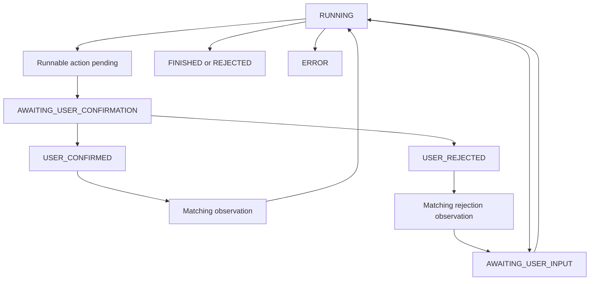

## Overview

`AgentController` turns incoming events into scheduled agent decisions. It owns state transitions, pending-action tracking, task limits, confirmation and delegation. The runtime executes tools and the agent selects them; the controller decides whether another decision may proceed. [[Events and Persistence]] describes the underlying record and dispatch mechanism, while [[Conversations]] describes who creates and closes the controller.

Sources: [openhands/controller/agent_controller.py:467-517](repo://openhands/controller/agent_controller.py#L467-L517), [openhands/controller/agent_controller.py:821-870](repo://openhands/controller/agent_controller.py#L821-L870), [openhands/server/session/agent_session.py:181-202](repo://openhands/server/session/agent_session.py#L181-L202)

## From incoming event to step

The controller ignores hidden events, adds relevant events to state history, and dispatches actions and observations to separate handlers. It then asks `should_step` whether the event warrants a decision. User messages, eligible agent messages, delegation and condensation actions can trigger steps. Most observations do too, but agent-state observations and ordinary null observations do not. A null observation answering a recall action has a special stepping branch.

Sources: [openhands/controller/agent_controller.py:392-431](repo://openhands/controller/agent_controller.py#L392-L431), [openhands/controller/agent_controller.py:467-485](repo://openhands/controller/agent_controller.py#L467-L485)

The state tracker filters null actions, null observations, state-change actions and state-change observations out of model history, and excludes hidden events. History restoration also collapses completed delegate ranges to their opening action and closing observation. This separates the agent's working history from the full event record needed for replay and diagnostics.

Sources: [openhands/controller/state/state_tracker.py:38-48](repo://openhands/controller/state/state_tracker.py#L38-L48), [openhands/controller/state/state_tracker.py:134-192](repo://openhands/controller/state/state_tracker.py#L134-L192)

A user message first creates a pending `RecallAction`. The first user message requests workspace context; later messages request knowledge matching their content. The controller moves to `RUNNING`, but its pending-action gate prevents model execution until recall answers. [[Memory and Microagents]] explains the contextual observation that clears this gate. Agent messages with `wait_for_response` instead enter `AWAITING_USER_INPUT`.

Sources: [openhands/controller/agent_controller.py:549-588](repo://openhands/controller/agent_controller.py#L549-L588), [openhands/controller/agent_controller.py:831-839](repo://openhands/controller/agent_controller.py#L831-L839)

## Step gates and limits

A step immediately returns unless the agent is `RUNNING` and no action is pending. It synchronizes the budget with combined model-service metrics, detects repeated stuck behavior, then advances/checks control flags. Any limit error is routed through exception handling before another model action is requested. Replay supplies a recorded action when active; otherwise the controller calls the agent's `step` method.

Sources: [openhands/controller/agent_controller.py:821-873](repo://openhands/controller/agent_controller.py#L821-L873), [openhands/controller/state/state_tracker.py:254-268](repo://openhands/controller/state/state_tracker.py#L254-L268)

Runnable actions become pending before publication to the stream. An observation clears the pending action only when its `cause` matches that action's ID, and an observation received while waiting for confirmation does not clear it. The pending-action property logs work older than 60 seconds but deliberately does not discard it. A long-running action is therefore not automatically retried just because that diagnostic message appears.

Sources: [openhands/controller/agent_controller.py:536-546](repo://openhands/controller/agent_controller.py#L536-L546), [openhands/controller/agent_controller.py:960-973](repo://openhands/controller/agent_controller.py#L960-L973), [openhands/controller/agent_controller.py:979-1002](repo://openhands/controller/agent_controller.py#L979-L1002)

## State transitions and confirmation

Sources: [openhands/controller/agent_controller.py:512-588](repo://openhands/controller/agent_controller.py#L512-L588), [openhands/controller/agent_controller.py:658-679](repo://openhands/controller/agent_controller.py#L658-L679), [openhands/controller/agent_controller.py:919-973](repo://openhands/controller/agent_controller.py#L919-L973), [openhands/controller/agent_controller.py:353-356](repo://openhands/controller/agent_controller.py#L353-L356)

When confirmation mode is active, the controller examines exact command, IPython, browser-interaction, file-edit and file-read action classes. It runs security analysis, then uses the action's risk classification. Non-CLI execution requests confirmation for high risk, or unknown risk without an analyzer. CLI mode marks these checked actions as awaiting confirmation so the CLI can handle the interaction. This branch is scoped to the listed action classes.

Sources: [openhands/controller/agent_controller.py:919-959](repo://openhands/controller/agent_controller.py#L919-L959)

Confirmation or rejection updates the pending action, clears its old identity, and republishes it with the chosen confirmation status. A matching result returns confirmed work to `RUNNING`; rejected work returns to user input. Every changed state emits an `AgentStateChangedObservation` and saves state. Re-entering `RUNNING` from `ERROR` asks the state tracker to consider expanding control limits under the current headless-mode rules.

Sources: [openhands/controller/agent_controller.py:536-546](repo://openhands/controller/agent_controller.py#L536-L546), [openhands/controller/agent_controller.py:642-683](repo://openhands/controller/agent_controller.py#L642-L683)

Finish and reject actions copy their outputs into state and enter the corresponding terminal state. Stopping or entering error invokes controller reset. These transitions differ from simply pausing model execution while a tool is outstanding: the pending-action gate alone does not mark a task completed, rejected or failed.

Sources: [openhands/controller/agent_controller.py:512-517](repo://openhands/controller/agent_controller.py#L512-L517), [openhands/controller/agent_controller.py:648-652](repo://openhands/controller/agent_controller.py#L648-L652), [openhands/controller/agent_controller.py:831-839](repo://openhands/controller/agent_controller.py#L831-L839)

## Recoverable model output and terminal errors

Malformed actions, missing actions, response errors and function-call validation failures become `ErrorObservation` events. The controller can then let the agent react to that feedback. Context-window failures have a separate branch: when history truncation is enabled, the controller emits `CondensationRequestAction`; otherwise it raises a context-window exception. [[CodeAct Agent]] handles response conversion, and [[Memory and Microagents]] describes condensation.

Sources: [openhands/controller/agent_controller.py:874-917](repo://openhands/controller/agent_controller.py#L874-L917)

The outer exception wrapper preserves recognized provider and context errors, while wrapping unexpected exceptions with a user-facing runtime error. The error handler stores the reason, maps supported provider failures to status codes, and normally enters `ERROR`. Rate-limit handling with a status callback can enter `RATE_LIMITED` while retry attempts remain, or `ERROR` when retry metadata indicates exhaustion.

Sources: [openhands/controller/agent_controller.py:302-390](repo://openhands/controller/agent_controller.py#L302-L390)

## Delegated subtasks

A delegation action selects a registered agent class and constructs a child controller sharing the parent's event stream, LLM registry, metrics, iteration flag and budget flag. The child starts at the next event ID and increments the delegate level. It does not subscribe directly to the stream: the parent forwards events while the delegate is active, keeping parent and child processing from independently consuming the same task stage.

Sources: [openhands/controller/agent_controller.py:433-465](repo://openhands/controller/agent_controller.py#L433-L465), [openhands/controller/agent_controller.py:709-752](repo://openhands/controller/agent_controller.py#L709-L752)

When delegation ends, the parent closes the child, builds an `AgentDelegateObservation` from outputs or an error description, preserves initiating tool-call metadata, and clears the delegate reference. Global limits remain shared across the subtask. [[LLM Requests and Metrics]] explains how model-service accounting contributes to those shared limits.

Sources: [openhands/controller/agent_controller.py:754-819](repo://openhands/controller/agent_controller.py#L754-L819)

