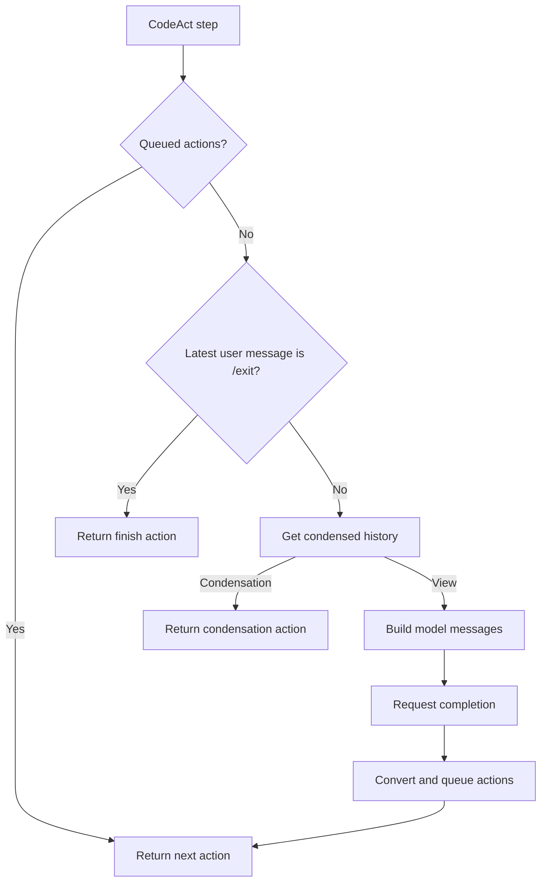

## Overview

CodeAct converts conversation history into the next OpenHands action. It assembles available tool definitions, obtains a condensed history view, formats model messages, requests a completion and converts the result into actions. [[Agent Control Loop]] controls when this method runs and waits for action results. CodeAct itself does not start a container or execute a shell command while selecting the next action.

Sources: [openhands/agenthub/codeact_agent/codeact_agent.py:78-96](repo://openhands/agenthub/codeact_agent/codeact_agent.py#L78-L96), [openhands/agenthub/codeact_agent/codeact_agent.py:182-224](repo://openhands/agenthub/codeact_agent/codeact_agent.py#L182-L224), [openhands/controller/agent_controller.py:821-873](repo://openhands/controller/agent_controller.py#L821-L873)

## Construction and tool selection

Construction obtains the agent LLM through the shared registry, creates a pending-action deque, loads tool definitions, and constructs `ConversationMemory` and the configured condenser. It then obtains the configured model router. The prompt manager is lazy and uses CodeAct's prompt directory plus the resolved system-prompt filename. [[LLM Requests and Metrics]] covers model-service reuse and routing.

Sources: [openhands/controller/agent.py:40-51](repo://openhands/controller/agent.py#L40-L51), [openhands/agenthub/codeact_agent/codeact_agent.py:78-106](repo://openhands/agenthub/codeact_agent/codeact_agent.py#L78-L106)

Tool availability follows agent configuration flags. The editor branch selects the legacy LLM editor when enabled, otherwise the string-replacement editor when ordinary editing is enabled. Browsing is omitted on Windows. Older OpenAI-model name patterns select shorter tool descriptions through an explicit compatibility branch. Tool declarations therefore depend on both agent settings and the model selected during construction.

Sources: [openhands/agenthub/codeact_agent/codeact_agent.py:108-152](repo://openhands/agenthub/codeact_agent/codeact_agent.py#L108-L152)

| Capability | Configuration switch | Action conversion |
| --- | --- | --- |
| Shell commands | `enable_cmd` | `CmdRunAction` |
| Reasoning notes | `enable_think` | `AgentThinkAction` |
| Task completion | `enable_finish` | `AgentFinishAction` |
| Context reduction request | `enable_condensation_request` | `CondensationRequestAction` |
| Browser interaction | `enable_browsing` | `BrowseInteractiveAction` |
| Python cells | `enable_jupyter` | `IPythonRunCellAction` |
| Task tracking | `enable_plan_mode` | `TaskTrackingAction` |
| File inspection and editing | `enable_editor` or `enable_llm_editor` | `FileReadAction` or `FileEditAction` |

Sources: [openhands/agenthub/codeact_agent/codeact_agent.py:125-152](repo://openhands/agenthub/codeact_agent/codeact_agent.py#L125-L152), [openhands/agenthub/codeact_agent/function_calling.py:105-172](repo://openhands/agenthub/codeact_agent/function_calling.py#L105-L172), [openhands/agenthub/codeact_agent/function_calling.py:191-251](repo://openhands/agenthub/codeact_agent/function_calling.py#L191-L251), [openhands/agenthub/codeact_agent/function_calling.py:256-296](repo://openhands/agenthub/codeact_agent/function_calling.py#L256-L296)

CodeAct declares agent-skills and Jupyter plugin requirements in that order. The source explains that agent-skills supplies Python functions that Jupyter needs during initialization. These environment requirements complement the model-facing tool list; [[Sandbox Runtimes]] follows how plugins are installed and initialized.

Sources: [openhands/agenthub/codeact_agent/codeact_agent.py:70-76](repo://openhands/agenthub/codeact_agent/codeact_agent.py#L70-L76)

## One decision at a time

The first branch in `step` returns an already queued action. Only when the queue is empty does the agent examine the latest user message for `/exit`, ask the condenser for history, and consider a new model request. A condenser can return either a `View` or a `Condensation` action; the latter is returned immediately so the controller can apply it before another decision.

Sources: [openhands/agenthub/codeact_agent/codeact_agent.py:182-201](repo://openhands/agenthub/codeact_agent/codeact_agent.py#L182-L201)

Sources: [openhands/agenthub/codeact_agent/codeact_agent.py:182-224](repo://openhands/agenthub/codeact_agent/codeact_agent.py#L182-L224)

The initial user message is located in full history, even when the model receives a condensed view. If none exists, CodeAct raises an error rather than silently manufacturing a task. Message construction delegates to `ConversationMemory.process_events`, passing maximum message characters and active vision support. Prompt caching markers are then applied when the model wrapper enables caching. [[Memory and Microagents]] owns event-to-message enrichment and condensation rules.

Sources: [openhands/agenthub/codeact_agent/codeact_agent.py:226-244](repo://openhands/agenthub/codeact_agent/codeact_agent.py#L226-L244), [openhands/agenthub/codeact_agent/codeact_agent.py:279-293](repo://openhands/agenthub/codeact_agent/codeact_agent.py#L279-L293)

The completion receives messages, checked tool definitions and state-derived metadata containing the model and agent names. Returned actions are appended to the deque in response order, and the first is returned. Reset clears this queue and the base completion flag while retaining LLM metrics, so conversation spending is not erased by an agent reset.

Sources: [openhands/agenthub/codeact_agent/codeact_agent.py:207-224](repo://openhands/agenthub/codeact_agent/codeact_agent.py#L207-L224), [openhands/agenthub/codeact_agent/codeact_agent.py:154-158](repo://openhands/agenthub/codeact_agent/codeact_agent.py#L154-L158), [openhands/controller/agent.py:111-114](repo://openhands/controller/agent.py#L111-L114)

## Convert model output into actions

The function-call converter requires exactly one completion choice. It parses each tool's JSON arguments and raises `FunctionCallValidationError` for invalid JSON or missing required arguments. Command conversion requires `command`, accepts a numeric timeout, and translates the tool's string-valued input flag. IPython requires `code`; the finish tool copies its optional message into the final thought.

Sources: [openhands/agenthub/codeact_agent/function_calling.py:73-150](repo://openhands/agenthub/codeact_agent/function_calling.py#L73-L150)

For the string-replacement editor, `view` becomes a read action with an optional view range. Other commands become edit actions. Edit arguments are checked against the tool schema; unexpected arguments raise a validation error, and security risk is carried separately from editor-specific arguments. Task-tracker conversion requires a command, requires a task list for planning, and normalizes dictionary entries with default IDs, titles, statuses and notes.

Sources: [openhands/agenthub/codeact_agent/function_calling.py:173-229](repo://openhands/agenthub/codeact_agent/function_calling.py#L173-L229), [openhands/agenthub/codeact_agent/function_calling.py:256-296](repo://openhands/agenthub/codeact_agent/function_calling.py#L256-L296)

Recognized external tool names become `MCPAction`; unknown names raise `FunctionCallNotExistsError`. The first action receives the assistant's accompanying thought where supported. Every tool action stores call ID, function name, original response and total call count, and every returned action stores the response ID for usage attribution. Without tool calls, the converter emits a message that waits for user input.

Sources: [openhands/agenthub/codeact_agent/function_calling.py:301-338](repo://openhands/agenthub/codeact_agent/function_calling.py#L301-L338)

## Extension points

The base `Agent` interface requires `step(State)` and provides registry lookup, duplicate-name rejection and optional system-message generation. A system message includes prompt text, tools and agent class. `set_mcp_tools` appends external definitions by function name and skips duplicates already registered as MCP tools. [[MCP Tools]] explains discovery; [[Configuration]] explains loading a custom agent class through its configured classpath.

Sources: [openhands/controller/agent.py:59-93](repo://openhands/controller/agent.py#L59-L93), [openhands/controller/agent.py:104-150](repo://openhands/controller/agent.py#L104-L150), [openhands/controller/agent.py:163-180](repo://openhands/controller/agent.py#L163-L180), [openhands/core/config/utils.py:796-815](repo://openhands/core/config/utils.py#L796-L815)

