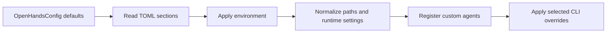

## Overview

Application configuration starts with `OpenHandsConfig`, then applies TOML, environment values, final normalization, and custom-agent registration. The object holds model groups, agent groups, runtime and storage settings, execution limits, and nested sandbox, security, and MCP configuration. [[Quickstart]] uses these settings to launch a checkout; this page explains how the effective values are assembled.

Sources: [openhands/core/config/utils.py:819-836](repo://openhands/core/config/utils.py#L819-L836), [openhands/core/config/openhands_config.py:65-118](repo://openhands/core/config/openhands_config.py#L65-L118)

## Load order and failure behavior

`load_openhands_config` defaults to `config.toml` in the current directory. A missing file leaves the defaults in place. A TOML decoding error logs a warning and returns without applying its contents. Within a valid document, missing `[core]` produces a warning; recognized core fields are assigned and unknown fields are warned about. Missing a file therefore differs from loading a file that contains an invalid value in a particular section.

Sources: [openhands/core/config/utils.py:138-190](repo://openhands/core/config/utils.py#L138-L190), [openhands/core/config/utils.py:819-836](repo://openhands/core/config/utils.py#L819-L836)

Sources: [openhands/core/config/utils.py:819-850](repo://openhands/core/config/utils.py#L819-L850), [openhands/core/config/utils.py:852-904](repo://openhands/core/config/utils.py#L852-L904)

Agent, LLM, security, sandbox, MCP, Kubernetes, and condenser sections have dedicated parsers. Several section validation failures warn and preserve the remaining configuration; sandbox and MCP parsing also contain branches that raise `ValueError`. Unknown top-level sections produce warnings. A successful process launch does not by itself establish that every section was accepted: the warning identifies the section that was skipped.

Sources: [openhands/core/config/utils.py:192-226](repo://openhands/core/config/utils.py#L192-L226), [openhands/core/config/utils.py:258-319](repo://openhands/core/config/utils.py#L258-L319), [openhands/core/config/utils.py:349-364](repo://openhands/core/config/utils.py#L349-L364)

## Environment names and conversion

Environment names come from uppercased field names. Nested models use their field name as a prefix; default model and agent groups receive explicit `LLM_` and `AGENT_` passes. Empty values are skipped. Boolean conversion recognizes case-insensitive `true` and `1`; dictionary and list values are parsed as Python literals, including construction of nested Pydantic objects for supported model lists. Invalid type conversions are logged.

Sources: [openhands/core/config/utils.py:65-135](repo://openhands/core/config/utils.py#L65-L135)

| Setting | Environment name | Meaning |
| --- | --- | --- |
| `runtime` | `RUNTIME` | Runtime identifier; application default is Docker |
| `file_store_path` | `FILE_STORE_PATH` | Storage root; default is `~/.openhands` |
| `max_iterations` | `MAX_ITERATIONS` | Task iteration limit |
| `llm.model` | `LLM_MODEL` | Model in the default LLM group |
| `sandbox.volumes` | `SANDBOX_VOLUMES` | Explicit host-to-container mounts |

Sources: [openhands/core/config/utils.py:65-135](repo://openhands/core/config/utils.py#L65-L135), [openhands/core/config/openhands_config.py:65-99](repo://openhands/core/config/openhands_config.py#L65-L99), [openhands/core/config/utils.py:377-424](repo://openhands/core/config/utils.py#L377-L424), [openhands/core/config/llm_config.py:100-115](repo://openhands/core/config/llm_config.py#L100-L115)

The environment pass modifies the default LLM and agent configurations explicitly. Named model groups were already constructed from TOML by this point. Do not assume that changing a default model field through an environment variable rebuilds every named group: the loader iterates the default configuration objects for those prefixed overrides.

Sources: [openhands/core/config/utils.py:127-135](repo://openhands/core/config/utils.py#L127-L135), [openhands/core/config/utils.py:203-208](repo://openhands/core/config/utils.py#L203-L208), [openhands/core/config/utils.py:828-831](repo://openhands/core/config/utils.py#L828-L831)

## Named models and agents

`LLMConfig.from_toml_section` separates scalar base settings from nested named groups. Each named group merges its overrides onto the validated base configuration. An invalid base falls back to a default model configuration; an invalid custom group is skipped independently. This allows shared retry or logging settings with model-specific overrides. [[LLM Requests and Metrics]] follows the resulting configuration into actual model calls.

Sources: [openhands/core/config/llm_config.py:100-160](repo://openhands/core/config/llm_config.py#L100-L160)

The application stores the default LLM under `llm` and default agent configuration under `agent`. An agent's `llm_config` field selects a model group; absent selection uses the default. Looking up a missing named LLM warns and falls back to the default group. Custom agent classes are loaded from each configured `classpath` and registered under the group name; registration failures are logged.

Sources: [openhands/core/config/openhands_config.py:131-169](repo://openhands/core/config/openhands_config.py#L131-L169), [openhands/core/config/utils.py:796-815](repo://openhands/core/config/utils.py#L796-L815)

Command-line setup can replace the default model group using the selected LLM configuration name. It first checks loaded groups, then the specified configuration file, then the user's `~/.openhands/config.toml` when applicable. If that explicit name cannot be found, it raises an error. Agent class, iteration limit, budget, and selected repository arguments are applied afterward when provided.

Sources: [openhands/core/config/utils.py:852-904](repo://openhands/core/config/utils.py#L852-L904)

## Final normalization

Volume configuration is a comma-separated list of `host_path:container_path[:mode]` mounts. A mount targeting exactly `/workspace` establishes the application workspace host path. When explicit volumes exist but none targets `/workspace`, the finalizer clears the legacy host workspace fields to avoid unintended mounting. Invalid segment counts raise an error. [[Sandbox Runtimes]] explains how the runtime turns these values into container mounts.

Sources: [openhands/core/config/utils.py:377-424](repo://openhands/core/config/utils.py#L377-L424)

Finalization makes completion-log paths absolute, creates the cache directory, and obtains a persistent JWT secret from the selected file store when none was supplied. Selecting the CLI runtime disables Jupyter and browsing on configured agents because that runtime does not support the corresponding execution path. Condenser settings are assigned during TOML loading; the default summarizing condenser is created there when enabled and no explicit condenser section exists.

Sources: [openhands/core/config/utils.py:301-338](repo://openhands/core/config/utils.py#L301-L338), [openhands/core/config/utils.py:438-470](repo://openhands/core/config/utils.py#L438-L470), [openhands/core/config/utils.py:367-374](repo://openhands/core/config/utils.py#L367-L374)

## Server and conversation settings

Server implementation selection is a separate layer. `OPENHANDS_CONFIG_CLS` selects a server configuration implementation through `get_impl`. The default server configuration names settings, secret and conversation stores, the authentication implementation, and a conversation manager; `CONVERSATION_MANAGER_CLASS` can replace the default standalone manager. Its public configuration response exposes app mode and selected feature flags rather than the full application configuration.

Sources: [openhands/server/config/server_config.py:8-60](repo://openhands/server/config/server_config.py#L8-L60)

Web conversations additionally load stored user settings and turn them into `ConversationInitData`, adding repository, branch, secrets, instructions, and optional MCP configuration. Consequently, model choice in the web interface has a distinct settings path from a headless configuration file. [[Conversations]] follows that merge into the agent session and explains the missing-settings and missing-key responses.

Sources: [openhands/server/services/conversation_service.py:98-159](repo://openhands/server/services/conversation_service.py#L98-L159)

