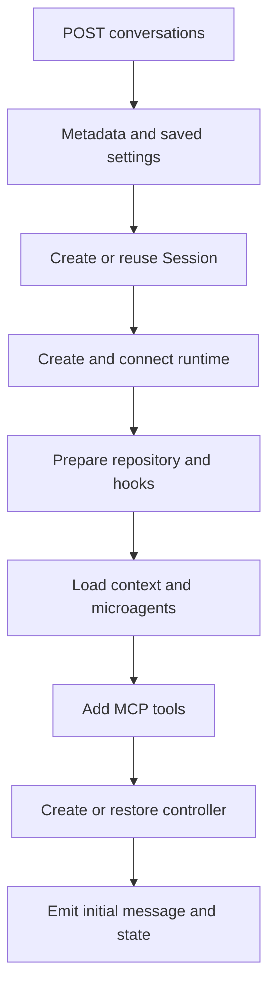

## Overview

A web conversation has durable metadata, an agent loop, and client connections with different lifetimes. Creating it stores the conversation identity and starts initialization; attaching a browser joins its event stream. The standalone manager keeps active loops by session ID and connections by socket ID. [[Configuration]] describes the settings sources that feed this lifecycle.

Sources: [openhands/server/services/conversation_service.py:164-202](repo://openhands/server/services/conversation_service.py#L164-L202), [openhands/server/conversation_manager/standalone_conversation_manager.py:151-165](repo://openhands/server/conversation_manager/standalone_conversation_manager.py#L151-L165), [openhands/server/conversation_manager/standalone_conversation_manager.py:280-294](repo://openhands/server/conversation_manager/standalone_conversation_manager.py#L280-L294)

## Create a conversation

`POST /api/conversations` accepts repository and provider selection, a branch, initial text and images, optional replay data, conversation instructions, and MCP configuration. The request model forbids extra fields. Caller-supplied conversation IDs are available only when `ALLOW_SET_CONVERSATION_ID=1`; otherwise the route generates a UUID. After initialization, clients use the returned conversation ID to establish their socket connection.

Sources: [openhands/server/routes/manage_conversations.py:78-78](repo://openhands/server/routes/manage_conversations.py#L78-L78), [openhands/server/routes/manage_conversations.py:160-201](repo://openhands/server/routes/manage_conversations.py#L160-L201), [openhands/server/routes/manage_conversations.py:242-269](repo://openhands/server/routes/manage_conversations.py#L242-L269)

The route verifies the selected repository's provider before calling `create_new_conversation`. That service initializes metadata, then calls `start_conversation`. Stored settings are required; non-Bedrock models must have a nonempty, non-whitespace API key. Settings are merged with repository, branch, provider tokens, custom secrets and instructions, then validated as `ConversationInitData`. Optional experiment processing occurs before the manager starts the loop.

Sources: [openhands/server/routes/manage_conversations.py:242-263](repo://openhands/server/routes/manage_conversations.py#L242-L263), [openhands/server/services/conversation_service.py:98-159](repo://openhands/server/services/conversation_service.py#L98-L159), [openhands/server/services/conversation_service.py:179-202](repo://openhands/server/services/conversation_service.py#L179-L202)

| Condition | Response from the creation route |
| --- | --- |
| Remote API-key trigger without an initial message | HTTP 400 with a missing-message identifier |
| Missing saved settings | HTTP 400 with `CONFIGURATION$SETTINGS_NOT_FOUND` |
| LLM authentication failure | HTTP 400 with an LLM authentication status identifier |
| Successful initialization request | Conversation ID and current conversation status |

Sources: [openhands/server/routes/manage_conversations.py:229-287](repo://openhands/server/routes/manage_conversations.py#L229-L287)

## Initialize the agent loop

`maybe_start_agent_loop` returns information for an existing local session or creates a new one. When the user's running-loop count reaches `max_concurrent_conversations`, startup loads metadata, sorts conversations by update time, and closes the oldest until capacity is available. It sends affected clients a status message explaining the concurrency limit before closing those sessions.

Sources: [openhands/server/conversation_manager/standalone_conversation_manager.py:280-338](repo://openhands/server/conversation_manager/standalone_conversation_manager.py#L280-L338)

The manager creates the LLM registry and conversation statistics, constructs a `Session`, stores it, and schedules `initialize_agent` as an asynchronous task. Returning a conversation response therefore does not mean every sandbox startup operation has finished. The session's runtime status and later events describe readiness while initialization proceeds.

Sources: [openhands/server/conversation_manager/standalone_conversation_manager.py:340-367](repo://openhands/server/conversation_manager/standalone_conversation_manager.py#L340-L367), [openhands/server/session/agent_session.py:365-373](repo://openhands/server/session/agent_session.py#L365-L373)

Sources: [openhands/server/routes/manage_conversations.py:242-269](repo://openhands/server/routes/manage_conversations.py#L242-L269), [openhands/server/services/conversation_service.py:135-202](repo://openhands/server/services/conversation_service.py#L135-L202), [openhands/server/conversation_manager/standalone_conversation_manager.py:340-355](repo://openhands/server/conversation_manager/standalone_conversation_manager.py#L340-L355), [openhands/server/session/agent_session.py:134-202](repo://openhands/server/session/agent_session.py#L134-L202), [openhands/server/session/agent_session.py:365-379](repo://openhands/server/session/agent_session.py#L365-L379)

`AgentSession.start` rejects reuse when a controller or runtime already exists and returns early if already closed. Its runtime setup connects, clones or initializes the selected repository, runs the setup script, and installs repository hooks. [[Sandbox Runtimes]] owns execution details; [[Repository Automation]] explains the repository-specific preparation.

Sources: [openhands/server/session/agent_session.py:117-125](repo://openhands/server/session/agent_session.py#L117-L125), [openhands/server/session/agent_session.py:365-384](repo://openhands/server/session/agent_session.py#L365-L384)

Startup registers provider and custom secrets with the event stream, loads memory, and adds MCP tools before creating the controller. The code explicitly requires that ordering so the initial system message includes the tools. An initial message is followed by a request to enter `RUNNING`; without one, the session requests `AWAITING_USER_INPUT`. [[Memory and Microagents]] and [[MCP Tools]] describe how those inputs are assembled.

Sources: [openhands/server/session/agent_session.py:149-202](repo://openhands/server/session/agent_session.py#L149-L202)

## Attach and replay browser history

Socket connection reads `conversation_id`, `latest_event_id`, and provider selection from query parameters. It validates conversation access, opens an event store, and replays events starting after the supplied ID. Null events and recall actions are omitted; the latest encountered agent-state observation is sent after the other replayed events. This gives the client a history cursor and a final state update before joining the live room.

Sources: [openhands/server/listen_socket.py:35-114](repo://openhands/server/listen_socket.py#L35-L114)

After replay, the server rebuilds initialization settings and joins the conversation through the manager. Joining enters the socket room, records the connection-to-session mapping, and starts the loop only if necessary. Incoming `oh_user_action` messages go to that session's event stream. [[Web Client]] explains how the browser maintains its cursor and renders these events.

Sources: [openhands/server/listen_socket.py:120-145](repo://openhands/server/listen_socket.py#L120-L145), [openhands/server/conversation_manager/standalone_conversation_manager.py:151-165](repo://openhands/server/conversation_manager/standalone_conversation_manager.py#L151-L165)

The manager also supports reference-counted `ServerConversation` attachments. Existing active or detached attachments are reused; a new attachment shares the live session's event stream and runtime where available. Detaching the last reference moves the attachment into a detached collection rather than immediately removing the agent loop. These attachment counts are distinct from the socket connection mapping.

Sources: [openhands/server/conversation_manager/standalone_conversation_manager.py:91-177](repo://openhands/server/conversation_manager/standalone_conversation_manager.py#L91-L177)

## Restore and close

State restoration reads a saved controller state by session and user. Failure to restore logs a warning when the event stream already has history, and otherwise logs that no state exists. [[Events and Persistence]] distinguishes those state snapshots from the individual events used for browser replay; a persisted history alone does not guarantee a restorable controller snapshot.

Sources: [openhands/server/session/agent_session.py:492-510](repo://openhands/server/session/agent_session.py#L492-L510)

A socket disconnect removes its mapping without immediately closing the loop. Stale cleanup considers the sandbox close delay, last activity, agent state and remaining connections; running or still-initializing sessions are excluded. With no close delay configured, this cleanup path leaves disconnected sandboxes open. Explicit session closure disconnects associated sockets, removes the session from the manager, and awaits its close operation.

Sources: [openhands/server/conversation_manager/standalone_conversation_manager.py:179-215](repo://openhands/server/conversation_manager/standalone_conversation_manager.py#L179-L215), [openhands/server/conversation_manager/standalone_conversation_manager.py:397-413](repo://openhands/server/conversation_manager/standalone_conversation_manager.py#L397-L413), [openhands/server/conversation_manager/standalone_conversation_manager.py:429-454](repo://openhands/server/conversation_manager/standalone_conversation_manager.py#L429-L454)

Agent-session closure is guarded against repeated calls. It marks the session closed, handles in-progress initialization, closes the event stream, saves and closes the controller, then submits runtime closure to an executor. The controller's stop and wait behavior belongs to [[Agent Control Loop]]; session closure is the owner of environment cleanup.

Sources: [openhands/server/session/agent_session.py:224-245](repo://openhands/server/session/agent_session.py#L224-L245)

