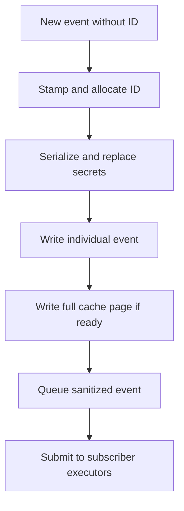

## Overview

Actions and observations are the shared record of a conversation. `EventStream` extends `EventStore` with writing, secret replacement and subscriber dispatch, while the store provides history lookup over a configurable file store. [[Conversations]] uses this record for client replay and session recovery; [[Agent Control Loop]] interprets the events to decide when another step is allowed.

Sources: [openhands/events/stream.py:43-69](repo://openhands/events/stream.py#L43-L69), [openhands/events/event_store.py:43-58](repo://openhands/events/event_store.py#L43-L58), [openhands/server/listen_socket.py:78-114](repo://openhands/server/listen_socket.py#L78-L114), [openhands/controller/agent_controller.py:467-485](repo://openhands/controller/agent_controller.py#L467-L485)

## Event identity and wire representation

An event's source identifies the agent, user, or environment. New events have the invalid ID sentinel `-1`; persisted events carry an ID, timestamp, source and optional cause. The cause links an observation to the action it answers. Those fields are metadata around the action or observation payload, not a replacement for its concrete event type.

Sources: [openhands/events/event.py:9-12](repo://openhands/events/event.py#L9-L12), [openhands/events/event.py:35-77](repo://openhands/events/event.py#L35-L77), [openhands/controller/agent_controller.py:536-546](repo://openhands/controller/agent_controller.py#L536-L546)

`event_to_dict` separates common metadata from payload fields. Actions store their arguments under `args`, including supported security-risk metadata, and may carry a timeout. Observations keep `content` at the top level and additional values under `extras`. Tool-call metadata and LLM metrics have explicit conversions. `event_from_dict` chooses the action or observation decoder from the discriminator and rejects dictionaries with neither.

Sources: [openhands/events/serialization/event.py:52-91](repo://openhands/events/serialization/event.py#L52-L91), [openhands/events/serialization/event.py:100-152](repo://openhands/events/serialization/event.py#L100-L152)

## Append before dispatch

`add_event` refuses events that already have IDs, explicitly identifying accidental re-addition from handlers as a possible loop. It stamps the event, assigns the next ID under a lock, serializes it, replaces registered secrets, and reconstructs the event from the sanitized dictionary. The sanitized dictionary is also appended to the current write-cache page.

Sources: [openhands/events/stream.py:163-184](repo://openhands/events/stream.py#L163-L184)

The individual JSON event is written before the cache page and before queue insertion. A full cache page is an optimization: it is stored after individual records so reads can bypass a missing cache. File-store failures propagate from this append path; queue insertion occurs only after the preceding writes return. The ID assignment lock does not encompass the subsequent storage operations, so it should not be read as a transaction across storage and callback execution.

Sources: [openhands/events/stream.py:170-213](repo://openhands/events/stream.py#L170-L213)

Sources: [openhands/events/stream.py:163-213](repo://openhands/events/stream.py#L163-L213), [openhands/events/stream.py:254-275](repo://openhands/events/stream.py#L254-L275)

Secret replacement walks dictionary values and replaces matching substrings in strings with the hidden-secret marker. Top-level metadata fields such as ID, source, cause and event discriminators are protected from replacement. The implementation recurses into dictionaries but does not contain a list-recursion branch. This is a specific serialization filter, not a promise that arbitrary nested structures or unrelated output channels are sanitized.

Sources: [openhands/events/stream.py:215-244](repo://openhands/events/stream.py#L215-L244)

## Subscriber execution and shutdown

Each subscription is identified by a subscriber category and callback ID. Duplicate callback IDs within that category are rejected. Every callback gets a single-worker executor initialized with an asyncio event loop. The queue processor traverses sorted subscriber keys and submits each event to the registered callback executors. This serializes work within one callback executor while permitting different subscribers to progress independently.

Sources: [openhands/events/stream.py:71-76](repo://openhands/events/stream.py#L71-L76), [openhands/events/stream.py:130-148](repo://openhands/events/stream.py#L130-L148), [openhands/events/stream.py:254-275](repo://openhands/events/stream.py#L254-L275)

Callback futures receive an error handler that reads the result, logs exceptions with the callback and subscriber IDs, and re-raises. Dispatch does not wait for each callback to finish before submitting to another subscriber. Closing the stream sets a stop flag, joins its queue thread, cleans up subscribers and drains remaining queued events. Subscriber cleanup cancels pending loop tasks, closes the loop and shuts down its executor.

Sources: [openhands/events/stream.py:78-128](repo://openhands/events/stream.py#L78-L128), [openhands/events/stream.py:262-291](repo://openhands/events/stream.py#L262-L291)

## Stored layout and history reads

Storage paths are scoped by conversation and optionally user. Without a user ID, the root is `sessions/<sid>/`; with one, it is `users/<user_id>/conversations/<sid>/`. Individual event records use numeric JSON filenames. The same conversation root also holds metadata, initialization data, controller state, registry information and conversation statistics.

Sources: [openhands/storage/locations.py:1-38](repo://openhands/storage/locations.py#L1-L38)

| Artifact | Relative location inside a conversation |
| --- | --- |
| Individual event | `events/<id>.json` |
| Grouped event cache | `event_cache/<start>-<end>.json` |
| Conversation metadata | `metadata.json` |
| Initialization data | `init.json` |
| Controller snapshot | `agent_state.pkl` |
| LLM registry | `llm_registry.json` |

Sources: [openhands/storage/locations.py:11-34](repo://openhands/storage/locations.py#L11-L34), [openhands/events/event_store.py:155-159](repo://openhands/events/event_store.py#L155-L159)

The next event ID is calculated lazily by listing event files and taking the highest numeric ID plus one. History search supports a starting ID, inclusive explicit end ID, reverse traversal, a filter and a result limit. It checks shutdown between reads. The default cache size is 25; a missing cache falls back to individual events, and missing individual files are skipped during search. Direct `get_event` still lets a missing-file error propagate.

Sources: [openhands/events/event_store.py:43-83](repo://openhands/events/event_store.py#L43-L83), [openhands/events/event_store.py:85-142](repo://openhands/events/event_store.py#L85-L142), [openhands/events/event_store.py:161-175](repo://openhands/events/event_store.py#L161-L175)

## File-store choices

The factory recognizes local, S3 and Google Cloud storage, with other type strings falling back to in-memory storage. Local storage requires an explicit path. An optional webhook wrapper can decorate any selected store, using explicit headers or a session API-key header fallback; the factory chooses immediate or batched webhook behavior from its batching argument. [[Configuration]] describes where the application storage selection originates.

Sources: [openhands/storage/__init__.py:14-57](repo://openhands/storage/__init__.py#L14-L57)

## Controller snapshots

A controller snapshot is a base64-encoded pickle written through the file store. Conversation statistics are excluded because they manage their own persistence. History and cached history views are also excluded: history is expected to be reconstructed from the event stream. This is why event JSON and `agent_state.pkl` serve different recovery purposes even though they share the same conversation root.

Sources: [openhands/controller/state/state.py:122-147](repo://openhands/controller/state/state.py#L122-L147), [openhands/controller/state/state.py:191-209](repo://openhands/controller/state/state.py#L191-L209)

Restoration first tries the user-scoped path and, for a missing user-scoped file, falls back to the older session path. It preserves a resumable agent state in `resume_state` and initially sets the restored agent to `LOADING`. Compatibility code converts older iteration fields into a control flag when unpickling. [[Conversations]] owns the decision to attempt restoration and the response when a snapshot is unavailable.

Sources: [openhands/controller/state/state.py:150-189](repo://openhands/controller/state/state.py#L150-L189), [openhands/controller/state/state.py:211-229](repo://openhands/controller/state/state.py#L211-L229)

