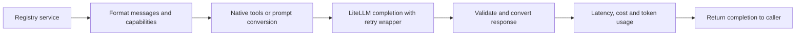

## Overview

The LLM layer gives agents and supporting services a common completion interface backed by LiteLLM. It handles model configuration, message serialization, native or emulated tool calls, retry behavior, latency, token usage and cost. [[CodeAct Agent]] owns the meaning of tool responses; [[Configuration]] owns how the input settings are loaded before an LLM instance is constructed.

Sources: [openhands/llm/llm.py:194-218](repo://openhands/llm/llm.py#L194-L218), [openhands/llm/llm.py:243-284](repo://openhands/llm/llm.py#L243-L284), [openhands/llm/llm.py:328-370](repo://openhands/llm/llm.py#L328-L370)

## Model services and reuse

`LLMRegistry` deep-copies application configuration and creates the active agent LLM under the `agent` service ID. Additional services are stored in `service_to_llm`. Creating a service notifies the registry subscriber with its LLM and service ID, allowing conversation statistics to track model usage from multiple consumers. An extraneous completion can create a service without the normal retry listener and returns stripped text from its first choice.

Sources: [openhands/llm/llm_registry.py:23-69](repo://openhands/llm/llm_registry.py#L23-L69)

`get_llm` returns an existing service only when its requested configuration agrees; attempting to reuse the ID with another configuration raises an error, and a new service requires a configuration. The agent-config convenience method has a different existing-service branch: it currently returns the cached instance even when configurations differ. Code extending the registry should account for that distinction rather than assuming all lookup methods replace model settings.

Sources: [openhands/llm/llm_registry.py:71-106](repo://openhands/llm/llm_registry.py#L71-L106)

A `noop_router` returns the main agent LLM directly. Other router names construct `RouterLLM` from agent configuration and the same registry. Subscribing after initial construction immediately reports the active agent service, so metrics consumers do not miss the model created before they attached.

Sources: [openhands/llm/llm_registry.py:111-139](repo://openhands/llm/llm_registry.py#L111-L139)

## Construct and format a request

Each `LLM` copies its model configuration, creates or accepts a metrics object, initializes capability information, and optionally creates a completion-log directory. It can load a custom tokenizer. A partially configured LiteLLM completion binds the model, credentials, base URL, API version, timeout, parameter-dropping behavior, seed and sampling/output settings before the wrapper processes individual requests.

Sources: [openhands/llm/llm.py:76-123](repo://openhands/llm/llm.py#L76-L123), [openhands/llm/llm.py:194-207](repo://openhands/llm/llm.py#L194-L207)

The wrapper accepts message objects or dictionaries and normalizes them to a list. Message objects receive cache, vision and function-calling flags before serialization, including explicit string-serialization branches for selected model names. An empty message list raises an error. The wrapper also sets LiteLLM's global `modify_params` setting and removes `extra_body` unless the configured model is a LiteLLM proxy model.

Sources: [openhands/llm/llm.py:223-256](repo://openhands/llm/llm.py#L223-L256), [openhands/llm/llm.py:294-310](repo://openhands/llm/llm.py#L294-L310), [openhands/llm/llm.py:803-820](repo://openhands/llm/llm.py#L803-L820)

Sources: [openhands/llm/llm_registry.py:45-56](repo://openhands/llm/llm_registry.py#L45-L56), [openhands/llm/llm.py:211-284](repo://openhands/llm/llm.py#L211-L284), [openhands/llm/llm.py:328-405](repo://openhands/llm/llm.py#L328-L405)

## Capabilities and tool-call compatibility

Model information is looked up through provider-aware paths and fallback names. A LiteLLM proxy can supply metadata through its model-info endpoint. Input and output token limits are filled from metadata only when not explicitly configured, with a special output-limit branch for Claude 3.7. Native tool calling comes from centralized model features unless `native_tool_calling` overrides it.

Sources: [openhands/llm/llm.py:417-480](repo://openhands/llm/llm.py#L417-L480), [openhands/llm/llm.py:494-528](repo://openhands/llm/llm.py#L494-L528)

Vision requires that it is not disabled and that the model capability check succeeds; the latter also supports `OPENHANDS_FORCE_VISION`. Explicit prompt-cache markers require both the caching configuration flag and model feature support. These decisions change message serialization, not just the list of options displayed to the user.

Sources: [openhands/llm/llm.py:530-581](repo://openhands/llm/llm.py#L530-L581), [openhands/llm/llm.py:807-820](repo://openhands/llm/llm.py#L807-L820)

When native tool calling is inactive and tools are supplied, the wrapper converts tool-call messages into a prompting format and removes the native tools argument. Supported models may receive stop words. After the provider returns, the wrapper converts the response back into tool-call form for the agent. It validates that at least one choice exists and raises `LLMNoResponseError` otherwise, keeping agent-side action conversion independent of this compatibility path.

Sources: [openhands/llm/llm.py:258-292](repo://openhands/llm/llm.py#L258-L292), [openhands/llm/llm.py:335-364](repo://openhands/llm/llm.py#L335-L364)

## Retries and failures

Retries cover connection failures, rate limits, service unavailability, timeout, internal-server errors and missing-response errors. The retry decorator uses exponential waits bounded by configured minimum and maximum values, stops at the configured attempt count or shutdown, and re-raises the final exception. The `num_retries` value is passed to Tenacity's `stop_after_attempt`, so it controls total attempts in this implementation.

Sources: [openhands/llm/llm.py:43-51](repo://openhands/llm/llm.py#L43-L51), [openhands/llm/llm.py:211-218](repo://openhands/llm/llm.py#L211-L218), [openhands/llm/retry_mixin.py:28-69](repo://openhands/llm/retry_mixin.py#L28-L69)

Before sleeping, the retry hook logs the attempt, notifies its listener and can change zero or unspecified request temperature to 1.0 after an empty response. Retry logging attaches attempt metadata to the exception when it can inspect the stop condition. [[Agent Control Loop]] uses provider errors and available retry metadata to publish application state changes.

Sources: [openhands/llm/retry_mixin.py:35-54](repo://openhands/llm/retry_mixin.py#L35-L54), [openhands/llm/retry_mixin.py:71-100](repo://openhands/llm/retry_mixin.py#L71-L100), [openhands/controller/agent_controller.py:337-356](repo://openhands/controller/agent_controller.py#L337-L356)

## Usage, cost and persistence

The non-streaming provider call is timed and its response ID is recorded with latency. Post-processing extracts prompt and completion tokens, cache-read and provider-specific cache-write tokens, and available context-window metadata. These fields enter the LLM's metrics object, while response IDs let actions be associated with token usage later.

Sources: [openhands/llm/llm.py:312-333](repo://openhands/llm/llm.py#L312-L333), [openhands/llm/llm.py:606-660](repo://openhands/llm/llm.py#L606-L660), [openhands/agenthub/codeact_agent/function_calling.py:330-335](repo://openhands/agenthub/codeact_agent/function_calling.py#L330-L335)

Cost calculation first checks provider response headers, then LiteLLM calculation and a fallback model name. Supplying both input and output per-token prices enables custom pricing. Successful calculation adds to accumulated cost; unsupported calculation disables subsequent cost calculation for that instance and returns zero. A zero cost in these metrics can therefore reflect unavailable accounting, rather than proof of a free request.

Sources: [openhands/llm/llm.py:733-791](repo://openhands/llm/llm.py#L733-L791)

Conversation statistics restore per-service metrics, transfer them to an LLM when that service registers, and combine currently registered services for budget accounting. Saving preserves both active and not-yet-registered restored metrics. Optional completion logs include messages, response, arguments, timestamp and cost; emulated tool calling additionally records both transformed and original forms. [[Events and Persistence]] covers the separate conversation storage layout.

Sources: [openhands/server/services/conversation_stats.py:34-103](repo://openhands/server/services/conversation_stats.py#L34-L103), [openhands/controller/state/state_tracker.py:260-268](repo://openhands/controller/state/state_tracker.py#L260-L268), [openhands/llm/llm.py:372-403](repo://openhands/llm/llm.py#L372-L403)

