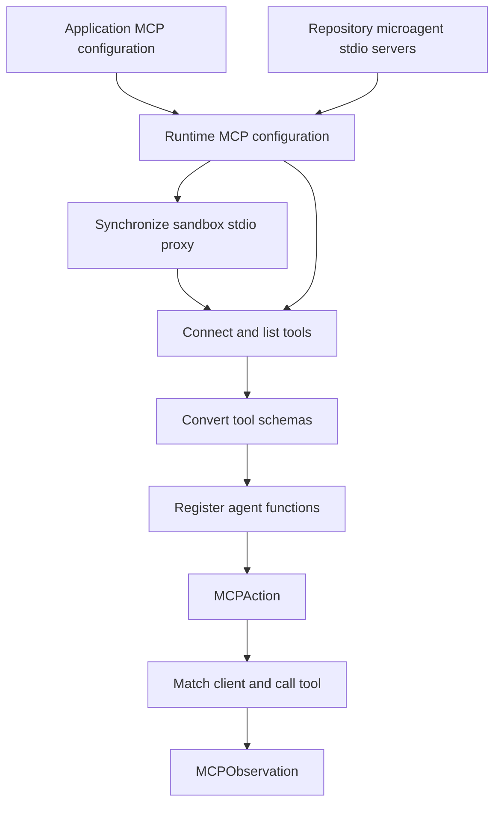

## Overview

MCP tools extend the agent's available functions with operations discovered from external servers. Startup combines application and repository microagent configuration, exposes tools to the agent, and later routes `MCPAction` events to a matching client. [[Sandbox Runtimes]] covers ordinary environment actions; MCP has a distinct discovery and execution path that returns serialized protocol results as observations.

Sources: [openhands/mcp/utils.py:267-317](repo://openhands/mcp/utils.py#L267-L317), [openhands/runtime/base.py:361-371](repo://openhands/runtime/base.py#L361-L371), [openhands/mcp/utils.py:230-264](repo://openhands/mcp/utils.py#L230-L264)

## Configure transports

| Transport | Configuration | Connection behavior |
| --- | --- | --- |
| SSE | `MCPSSEServerConfig`: URL and optional key | Uses an SSE transport |
| Streamable HTTP | `MCPSHTTPServerConfig`: URL and optional key | Uses a streamable HTTP transport |
| Standard input/output | `MCPStdioServerConfig`: name, executable, arguments and environment | Starts a stdio transport with those process settings |

Sources: [openhands/core/config/mcp_config.py:46-77](repo://openhands/core/config/mcp_config.py#L46-L77), [openhands/core/config/mcp_config.py:191-199](repo://openhands/core/config/mcp_config.py#L191-L199), [openhands/mcp/client.py:84-98](repo://openhands/mcp/client.py#L84-L98), [openhands/mcp/client.py:125-132](repo://openhands/mcp/client.py#L125-L132)

URL validation requires a nonempty URL with a scheme and host, accepting HTTP, HTTPS, WS and WSS schemes. Stdio server names allow letters, digits, hyphens and underscores. The command must be a single executable without spaces; parameters belong in `args`. String arguments are parsed with `shlex.split`, while environment strings are comma-separated key/value assignments with validated variable names.

Sources: [openhands/core/config/mcp_config.py:25-43](repo://openhands/core/config/mcp_config.py#L25-L43), [openhands/core/config/mcp_config.py:79-172](repo://openhands/core/config/mcp_config.py#L79-L172)

HTTP connections with an API key set bearer authorization plus the `s` and `X-Session-API-Key` headers used by runtime integrations. When supplied, a conversation ID becomes `X-OpenHands-ServerConversation-ID`. The client selects transport by the concrete configuration type and uses a 30-second default connection timeout.

Sources: [openhands/mcp/client.py:57-98](repo://openhands/mcp/client.py#L57-L98)

## Discover tools during startup

`add_mcp_tools_to_agent` requires an initialized runtime. It collects stdio configurations from repository microagents, deduplicates equivalent server configurations, and asks the runtime for the resulting MCP configuration. It discovers tools using direct stdio only for the CLI runtime, then calls `agent.set_mcp_tools`. [[Memory and Microagents]] explains which repository files contribute these configurations.

Sources: [openhands/mcp/utils.py:279-317](repo://openhands/mcp/utils.py#L279-L317), [openhands/core/config/mcp_config.py:174-188](repo://openhands/core/config/mcp_config.py#L174-L188)

For an action-execution runtime, stdio servers are synchronized through `/update_mcp_server`. The client retains a union with previously updated servers so later calls do not accidentally remove a server absent from the current list. When tracked stdio servers exist, the runtime's `/mcp/sse` endpoint is added with its session API key. This lets tools running inside the environment appear through the HTTP discovery path.

Sources: [openhands/runtime/impl/action_execution/action_execution_client.py:395-450](repo://openhands/runtime/impl/action_execution/action_execution_client.py#L395-L450)

Sources: [openhands/mcp/utils.py:283-317](repo://openhands/mcp/utils.py#L283-L317), [openhands/runtime/impl/action_execution/action_execution_client.py:395-450](repo://openhands/runtime/impl/action_execution/action_execution_client.py#L395-L450), [openhands/mcp/client.py:33-53](repo://openhands/mcp/client.py#L33-L53), [openhands/mcp/tool.py:14-23](repo://openhands/mcp/tool.py#L14-L23), [openhands/agenthub/codeact_agent/function_calling.py:301-305](repo://openhands/agenthub/codeact_agent/function_calling.py#L301-L305), [openhands/mcp/utils.py:230-255](repo://openhands/mcp/utils.py#L230-L255)

A client opens a context, lists tools, then stores their name, description and input schema. `MCPClientTool.to_param` converts those fields directly into a function-tool definition. Discovery does not retain an always-open operation session. Registration by the base agent skips duplicate MCP function names already present in its map. [[CodeAct Agent]] describes conversion of a selected function call into an action.

Sources: [openhands/mcp/client.py:33-55](repo://openhands/mcp/client.py#L33-L55), [openhands/mcp/tool.py:5-23](repo://openhands/mcp/tool.py#L5-L23), [openhands/controller/agent.py:163-180](repo://openhands/controller/agent.py#L163-L180)

Web startup adds MCP tools before controller creation because the initial system message includes tool definitions. A tool missing from discovery at that point will not appear merely because a server configuration object exists. The important boundary is the successfully fetched tool list passed to the agent.

Sources: [openhands/server/session/agent_session.py:165-189](repo://openhands/server/session/agent_session.py#L165-L189), [openhands/mcp/utils.py:305-315](repo://openhands/mcp/utils.py#L305-L315)

## Execute a selected tool

The action-execution client obtains the updated configuration and creates MCP clients for each operation, passing its session ID for HTTP connections. The shared dispatcher chooses the first client advertising the exact action name, then calls it with the action arguments. No clients or no matching tool raises a `ValueError`. The individual client additionally validates that the tool is in its map and that a transport client exists.

Sources: [openhands/runtime/impl/action_execution/action_execution_client.py:452-481](repo://openhands/runtime/impl/action_execution/action_execution_client.py#L452-L481), [openhands/mcp/utils.py:225-248](repo://openhands/mcp/utils.py#L225-L248), [openhands/mcp/client.py:147-156](repo://openhands/mcp/client.py#L147-L156)

Successful calls become `MCPObservation` with JSON-serialized protocol output, tool name and arguments. A protocol `McpError` is converted into an observation containing an error flag, message and empty content list. Other failures are not caught by that narrow branch and can reach the runtime's general failure handling. Runtime publication adds cause and tool-call metadata as described in [[Sandbox Runtimes]].

Sources: [openhands/mcp/utils.py:246-264](repo://openhands/mcp/utils.py#L246-L264), [openhands/runtime/base.py:383-399](repo://openhands/runtime/base.py#L383-L399)

## Diagnose missing tools

Discovery skips stdio commands that cannot be found by `shutil.which` and logs installation/removal guidance. Connection failures are collected with server identity and transport type. The tool-fetch helper returns an empty list when no clients connect or an exception prevents fetching. These branches allow a session to continue with fewer discovered functions.

Sources: [openhands/mcp/utils.py:92-121](repo://openhands/mcp/utils.py#L92-L121), [openhands/mcp/utils.py:173-200](repo://openhands/mcp/utils.py#L173-L200), [openhands/mcp/client.py:99-123](repo://openhands/mcp/client.py#L99-L123)

The sandbox update endpoint can return HTTP 200 while including a nonempty `router_error_log` after a proxy update fails. The caller explicitly warns on that field, so status alone does not establish that every configured server was mounted. On Windows, this checkout skips MCP discovery and returns an unsupported-functionality observation for calls; the update endpoint also returns a skipped-operation response.

Sources: [openhands/runtime/action_execution_server.py:834-884](repo://openhands/runtime/action_execution_server.py#L834-L884), [openhands/runtime/impl/action_execution/action_execution_client.py:419-429](repo://openhands/runtime/impl/action_execution/action_execution_client.py#L419-L429), [openhands/mcp/utils.py:220-223](repo://openhands/mcp/utils.py#L220-L223), [openhands/mcp/utils.py:273-277](repo://openhands/mcp/utils.py#L273-L277)

