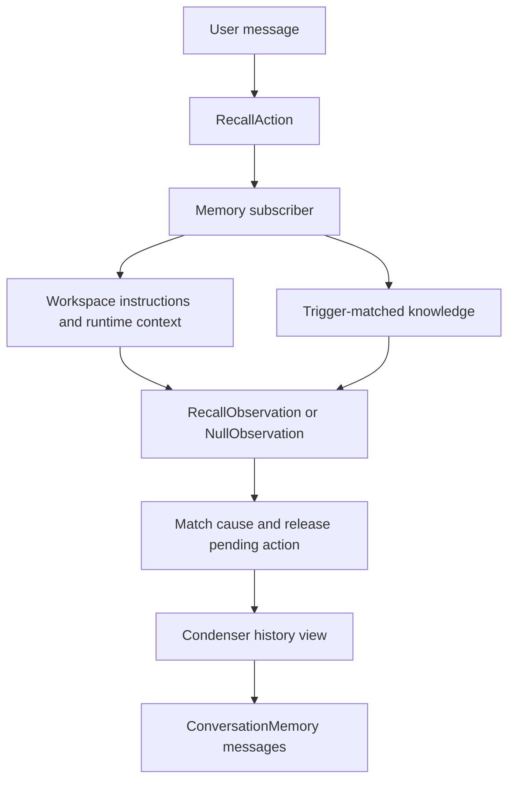

## Overview

OpenHands prepares model context through three cooperating parts. `Memory` subscribes to recall actions and returns workspace or keyword knowledge. `ConversationMemory` converts events into valid model messages. A condenser supplies the history view used for that conversion. [[CodeAct Agent]] connects these parts when choosing its next action, while [[Agent Control Loop]] waits for recall results before proceeding.

Sources: [openhands/memory/memory.py:64-84](repo://openhands/memory/memory.py#L64-L84), [openhands/memory/memory.py:90-132](repo://openhands/memory/memory.py#L90-L132), [openhands/memory/conversation_memory.py:74-96](repo://openhands/memory/conversation_memory.py#L74-L96), [openhands/agenthub/codeact_agent/codeact_agent.py:191-208](repo://openhands/agenthub/codeact_agent/codeact_agent.py#L191-L208)

## Recall workspace and knowledge

Workspace recall is accepted for a user-sourced `RecallAction` with the workspace-context type. Memory collects repository information, runtime hosts and instructions, repository microagent content, matched knowledge, custom-secret descriptions, working directory and conversation instructions. Repository microagent contents are concatenated. If no context exists, the handler produces a null observation rather than omitting the response.

Sources: [openhands/memory/memory.py:93-112](repo://openhands/memory/memory.py#L93-L112), [openhands/memory/memory.py:139-205](repo://openhands/memory/memory.py#L139-L205)

Knowledge recall accepts user or agent sources. It finds matching knowledge microagents and returns their names, trigger strings and content. Empty queries produce no matches. Both recall paths put the initiating event ID in the observation's cause, including the null-result case. That link releases the pending recall in the controller; ordinary retrieval failure instead reports `ERROR_MEMORY` through runtime status.

Sources: [openhands/memory/memory.py:114-137](repo://openhands/memory/memory.py#L114-L137), [openhands/memory/memory.py:207-252](repo://openhands/memory/memory.py#L207-L252), [openhands/controller/agent_controller.py:536-546](repo://openhands/controller/agent_controller.py#L536-L546)

Sources: [openhands/controller/agent_controller.py:566-583](repo://openhands/controller/agent_controller.py#L566-L583), [openhands/memory/memory.py:90-132](repo://openhands/memory/memory.py#L90-L132), [openhands/controller/agent_controller.py:536-546](repo://openhands/controller/agent_controller.py#L536-L546), [openhands/agenthub/codeact_agent/codeact_agent.py:191-208](repo://openhands/agenthub/codeact_agent/codeact_agent.py#L191-L208), [openhands/agenthub/codeact_agent/codeact_agent.py:282-288](repo://openhands/agenthub/codeact_agent/codeact_agent.py#L282-L288)

## Load and classify microagents

Memory loads global microagents first, then user microagents from `~/.openhands/microagents/`; session setup later adds the selected workspace's microagents. Each category is a dictionary keyed by microagent name, so later assignments replace earlier entries with the same name in that category. Failure to load the user directory is warned about. Workspace loading occurs after the runtime has prepared the repository.

Sources: [openhands/memory/memory.py:70-84](repo://openhands/memory/memory.py#L70-L84), [openhands/memory/memory.py:254-300](repo://openhands/memory/memory.py#L254-L300), [openhands/server/session/agent_session.py:448-480](repo://openhands/server/session/agent_session.py#L448-L480)

The directory loader collects Markdown recursively, excluding files named `README.md`, and checks the inferred repository root for `.cursorrules` and supported case variants of `AGENTS.md` or `AGENT.md`. It keeps only the first matching agents filename from that ordered list. These special files become repository knowledge. Ordinary Markdown is parsed as frontmatter plus body; relative paths can supply derived microagent names.

Sources: [openhands/microagent/microagent.py:26-49](repo://openhands/microagent/microagent.py#L26-L49), [openhands/microagent/microagent.py:62-105](repo://openhands/microagent/microagent.py#L62-L105), [openhands/microagent/microagent.py:299-327](repo://openhands/microagent/microagent.py#L299-L327)

| Metadata shape | Inferred type | Context behavior |
| --- | --- | --- |
| Inputs are declared | Task microagent | Adds a slash-name trigger and task input prompting |
| Triggers exist without inputs | Knowledge microagent | Content is selected by trigger matching |
| Neither inputs nor triggers | Repository microagent | Content participates in workspace context |

Sources: [openhands/microagent/microagent.py:129-170](repo://openhands/microagent/microagent.py#L129-L170), [openhands/microagent/microagent.py:189-203](repo://openhands/microagent/microagent.py#L189-L203), [openhands/microagent/microagent.py:226-241](repo://openhands/microagent/microagent.py#L226-L241), [openhands/memory/memory.py:153-160](repo://openhands/memory/memory.py#L153-L160)

Trigger matching lowercases the message and each trigger, then performs substring matching, returning the first match. It does not require a word boundary or an exact whole-message match. Metadata validation errors include the source filename. Microagent MCP configuration requires stdio servers in this loader; repository microagent MCP definitions are later collected for [[MCP Tools]].

Sources: [openhands/microagent/microagent.py:104-127](repo://openhands/microagent/microagent.py#L104-L127), [openhands/microagent/microagent.py:189-199](repo://openhands/microagent/microagent.py#L189-L199), [openhands/memory/memory.py:302-318](repo://openhands/memory/memory.py#L302-L318)

## Assemble valid model history

`ConversationMemory.process_events` ensures the history has a system message and initial user message, then processes action and observation events separately. It tracks pending tool-call messages and tool results. A model message that initiated several calls is emitted together with its results only after all listed call IDs are available, preserving response grouping and result order.

Sources: [openhands/memory/conversation_memory.py:92-155](repo://openhands/memory/conversation_memory.py#L92-L155)

The final pass removes unmatched tool calls and tool responses, then applies user-message formatting. This matters after condensation: removing events can otherwise leave a model request with an orphaned tool result. Compatibility code adds a missing system message from the prompt manager and inserts the original user action when the beginning of the condensed view no longer contains a user message.

Sources: [openhands/memory/conversation_memory.py:157-164](repo://openhands/memory/conversation_memory.py#L157-L164), [openhands/memory/conversation_memory.py:801-860](repo://openhands/memory/conversation_memory.py#L801-L860)

Knowledge observations are filtered by microagent name against earlier recall observations in the current event list. A repeated knowledge microagent is excluded when an earlier workspace or knowledge observation already introduced it. This deduplication is relative to the view being processed, so it is separate from whether Memory retrieved the same microagent more than once.

Sources: [openhands/memory/conversation_memory.py:698-744](repo://openhands/memory/conversation_memory.py#L698-L744)

## Condensation contract

A condenser receives `state.view` and returns either a new `View` or a `Condensation` containing a history-change action. It records per-condensation metadata through the surrounding state batch. A rolling condenser checks its own threshold before producing a condensation; otherwise it returns the existing view. [[CodeAct Agent]] returns a condensation action to the controller before making another completion request.

Sources: [openhands/memory/condenser/condenser.py:92-115](repo://openhands/memory/condenser/condenser.py#L92-L115), [openhands/memory/condenser/condenser.py:169-193](repo://openhands/memory/condenser/condenser.py#L169-L193), [openhands/agenthub/codeact_agent/codeact_agent.py:191-201](repo://openhands/agenthub/codeact_agent/codeact_agent.py#L191-L201)

The LLM summarizer triggers when the view exceeds `max_size`. It retains the configured prefix and a recent tail, combines the previous summary with truncated representations of forgotten events, and requests an updated summary. Its condensation action identifies the forgotten event range and insertion offset. Constructor validation rejects negative prefix counts, nonpositive sizes, and a prefix at least half the configured maximum.

Sources: [openhands/memory/condenser/impl/llm_summarizing_condenser.py:25-69](repo://openhands/memory/condenser/impl/llm_summarizing_condenser.py#L25-L69), [openhands/memory/condenser/impl/llm_summarizing_condenser.py:125-161](repo://openhands/memory/condenser/impl/llm_summarizing_condenser.py#L125-L161)

This summarizer registers a separate `condenser` LLM service and disables prompt caching on its copied model configuration. The source gives the reason: these summaries would pay for cache writes without benefiting from later cache reads. [[LLM Requests and Metrics]] explains how that service contributes to conversation costs.

Sources: [openhands/memory/condenser/impl/llm_summarizing_condenser.py:164-179](repo://openhands/memory/condenser/impl/llm_summarizing_condenser.py#L164-L179)

## Compose context strategies

Recent-events condensation returns a prefix plus a recent tail; observation masking substitutes older observations with placeholder condensation observations outside an attention window. A pipeline passes each returned view to the next condenser and stops immediately when a stage produces a condensation action. These strategies share the same return contract, allowing view transformations to compose without treating every transformation as a new summary request.

Sources: [openhands/memory/condenser/impl/recent_events_condenser.py:8-22](repo://openhands/memory/condenser/impl/recent_events_condenser.py#L8-L22), [openhands/memory/condenser/impl/observation_masking_condenser.py:11-28](repo://openhands/memory/condenser/impl/observation_masking_condenser.py#L11-L28), [openhands/memory/condenser/impl/pipeline.py:12-47](repo://openhands/memory/condenser/impl/pipeline.py#L12-L47)

