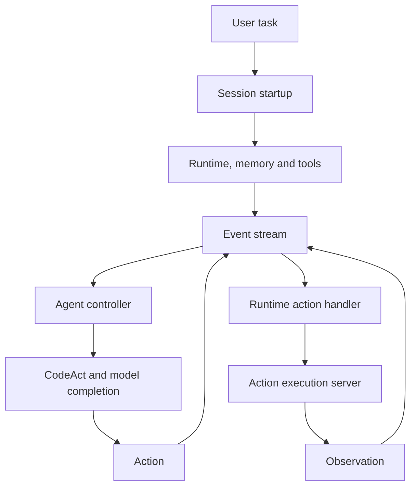

## Overview

OpenHands runs software development agents that interact with a working environment through actions and observations. A user supplies a task; the agent chooses tools, the runtime executes them, and their results become input to the next decision. The same controller machinery serves interactive sessions and programmatic runs. The application also supplies repository context and external tools before starting that loop.

Sources: [openhands/core/main.py:97-167](repo://openhands/core/main.py#L97-L167), [openhands/agenthub/codeact_agent/codeact_agent.py:182-224](repo://openhands/agenthub/codeact_agent/codeact_agent.py#L182-L224), [openhands/runtime/base.py:361-375](repo://openhands/runtime/base.py#L361-L375)

The central unit is a conversation with an event stream, runtime, memory, and controller. Web startup constructs these through an `AgentSession`; headless startup assembles them in `run_controller`. Both arrange the environment and contextual tools before accepting the initial user action. This makes startup ordering relevant when adding integrations: a tool needed in the initial system message must exist before controller creation.

Sources: [openhands/server/session/agent_session.py:134-202](repo://openhands/server/session/agent_session.py#L134-L202), [openhands/core/main.py:105-167](repo://openhands/core/main.py#L105-L167)

## Documentation map

| Area | What it does | Page |
| --- | --- | --- |
| Local development | Builds and starts the backend and frontend | [[Quickstart]] |
| Settings | Loads application defaults, TOML and environment overrides | [[Configuration]] |
| Sessions | Creates and manages a conversation and its agent loop | [[Conversations]] |
| Event history | Persists and dispatches actions and observations | [[Events and Persistence]] |
| Execution policy | Schedules steps, handles pending actions and applies limits | [[Agent Control Loop]] |
| Agent decisions | Converts history and model tool calls into actions | [[CodeAct Agent]] |
| Model calls | Supplies the model completion interface used by the agent | [[LLM Requests and Metrics]] |
| Context | Loads repository knowledge and condenses history | [[Memory and Microagents]] |
| Environment | Executes commands and other runnable actions | [[Sandbox Runtimes]] |
| External tools | Discovers MCP servers and exposes their tools | [[MCP Tools]] |
| Browser interface | Provides a conversation socket and parsed events | [[Web Client]] |
| Terminal and scripts | Dispatches CLI commands and runs a controller directly | [[CLI and Headless Runs]] |
| Issue resolution | Configures an agent run against a repository issue | [[Repository Automation]] |
| Benchmarks | Runs instance callbacks and appends their evaluation results | [[Evaluation Runs]] |

Sources: [Development.md:51-104](repo://Development.md#L51-L104), [openhands/core/config/utils.py:819-836](repo://openhands/core/config/utils.py#L819-L836), [openhands/server/session/agent_session.py:134-202](repo://openhands/server/session/agent_session.py#L134-L202), [openhands/events/stream.py:163-203](repo://openhands/events/stream.py#L163-L203), [openhands/controller/agent_controller.py:821-887](repo://openhands/controller/agent_controller.py#L821-L887), [openhands/agenthub/codeact_agent/codeact_agent.py:182-224](repo://openhands/agenthub/codeact_agent/codeact_agent.py#L182-L224), [openhands/core/setup.py:178-199](repo://openhands/core/setup.py#L178-L199), [openhands/runtime/base.py:361-375](repo://openhands/runtime/base.py#L361-L375), [openhands/mcp/utils.py:63-117](repo://openhands/mcp/utils.py#L63-L117), [frontend/src/context/ws-client-provider.tsx:72-92](repo://frontend/src/context/ws-client-provider.tsx#L72-L92), [openhands/cli/entry.py:12-45](repo://openhands/cli/entry.py#L12-L45), [openhands/resolver/issue_resolver.py:52-95](repo://openhands/resolver/issue_resolver.py#L52-L95), [evaluation/utils/shared.py:486-549](repo://evaluation/utils/shared.py#L486-L549)

## A task through the system

Sources: [openhands/server/session/agent_session.py:134-202](repo://openhands/server/session/agent_session.py#L134-L202), [openhands/controller/agent_controller.py:862-887](repo://openhands/controller/agent_controller.py#L862-L887), [openhands/controller/agent_controller.py:960-973](repo://openhands/controller/agent_controller.py#L960-L973), [openhands/agenthub/codeact_agent/codeact_agent.py:207-224](repo://openhands/agenthub/codeact_agent/codeact_agent.py#L207-L224), [openhands/runtime/impl/action_execution/action_execution_client.py:315-338](repo://openhands/runtime/impl/action_execution/action_execution_client.py#L315-L338), [openhands/runtime/action_execution_server.py:814-831](repo://openhands/runtime/action_execution_server.py#L814-L831)

1. [[Conversations]] accepts the initial message and starts the session with the selected repository and user settings.
2. [[Memory and Microagents]] supplies workspace context; [[MCP Tools]] installs external tools before the controller constructs its initial prompt.
3. [[Events and Persistence]] records the initial message and makes it available to subscribers.
4. [[Agent Control Loop]] checks whether another decision is permitted, then invokes [[CodeAct Agent]].
5. [[LLM Requests and Metrics]] supplies the completion that CodeAct converts into one or more actions.
6. [[Sandbox Runtimes]] sends executable actions to the action server and returns observations for subsequent decisions.

Sources: [openhands/server/services/conversation_service.py:126-159](repo://openhands/server/services/conversation_service.py#L126-L159), [openhands/server/session/agent_session.py:156-202](repo://openhands/server/session/agent_session.py#L156-L202), [openhands/events/stream.py:163-203](repo://openhands/events/stream.py#L163-L203), [openhands/controller/agent_controller.py:821-887](repo://openhands/controller/agent_controller.py#L821-L887), [openhands/agenthub/codeact_agent/codeact_agent.py:207-224](repo://openhands/agenthub/codeact_agent/codeact_agent.py#L207-L224), [openhands/runtime/impl/action_execution/action_execution_client.py:315-338](repo://openhands/runtime/impl/action_execution/action_execution_client.py#L315-L338)

## Design decisions across the parts

Events are persisted before they enter the dispatch queue. `add_event` assigns an ID, serializes and redacts the event, writes its JSON, and only then queues the reconstructed event. Re-adding an event that already has an ID is rejected explicitly to prevent handler feedback loops. Full cache pages are written after individual events because a missing page can be bypassed; the code identifies grouped reads as an optimization for large histories.

Sources: [openhands/events/stream.py:163-213](repo://openhands/events/stream.py#L163-L213)

The controller distinguishes choosing an action from waiting for its result. It refuses to step outside `RUNNING` or while an action remains pending. It synchronizes spending and checks control flags before asking the agent for another action. This places scheduling and execution limits in a common layer instead of requiring each model response to enforce them.

Sources: [openhands/controller/agent_controller.py:821-870](repo://openhands/controller/agent_controller.py#L821-L870)

Runtime construction selects a class from configuration and passes the agent's required plugins into it. The factory returns an unconnected runtime; its caller connects and prepares the repository before loading memory. That boundary allows the same task setup to select an execution environment without embedding container startup in the agent's decision method.

Sources: [openhands/core/setup.py:35-89](repo://openhands/core/setup.py#L35-L89), [openhands/core/main.py:107-143](repo://openhands/core/main.py#L107-L143)

Model output can contain several actions, but CodeAct keeps them in a queue and returns one per step. It also lets a condenser return a history-change action before requesting another completion. These two branches explain why a controller step does not necessarily mean a new model request: the agent may be draining existing work or preparing a usable view of history.

Sources: [openhands/agenthub/codeact_agent/codeact_agent.py:182-224](repo://openhands/agenthub/codeact_agent/codeact_agent.py#L182-L224)

## Execution entry points

The terminal launcher defaults to CLI mode and dispatches `serve` separately to the GUI launcher. Headless execution exposes `run_controller` for callers that supply an initial action and optionally a runtime, memory, and user-response callback. [[CLI and Headless Runs]] explains how these choices affect interaction and completion. The distinction matters for integrations that already own their environment and should pass it into the run.

Sources: [openhands/cli/entry.py:12-45](repo://openhands/cli/entry.py#L12-L45), [openhands/core/main.py:51-78](repo://openhands/core/main.py#L51-L78), [openhands/core/main.py:107-143](repo://openhands/core/main.py#L107-L143)

Repository issue resolution and benchmarks build on these execution primitives but have their own inputs and outputs. The resolver requires a repository identity and credentials, while evaluation takes a dataset and an asynchronous per-instance callback. [[Repository Automation]] follows the issue workflow; [[Evaluation Runs]] follows result persistence and worker execution, which are separate from a conversation's event history.

Sources: [openhands/resolver/issue_resolver.py:52-95](repo://openhands/resolver/issue_resolver.py#L52-L95), [evaluation/utils/shared.py:486-549](repo://evaluation/utils/shared.py#L486-L549)
