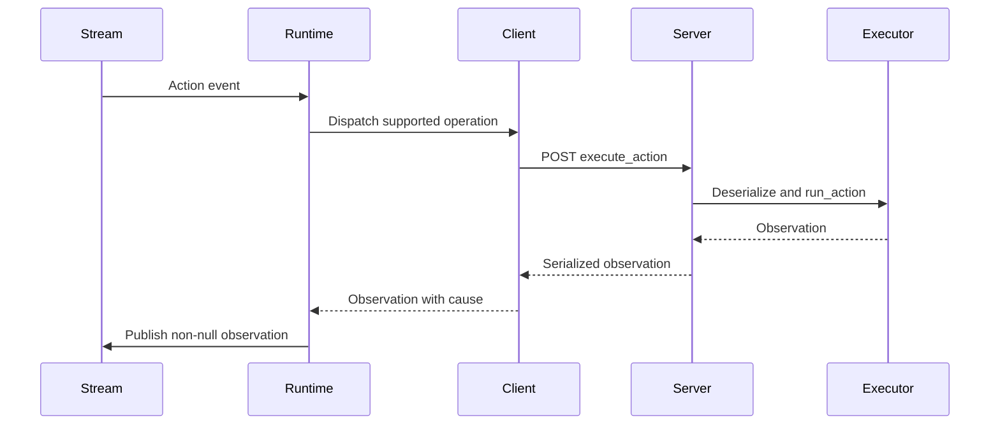

## Overview

A runtime connects an agent's action stream to its execution environment. It receives actions, applies execution checks, runs the supported operation and publishes an observation linked to the initiating event. Docker uses an HTTP action-execution client and a server inside the runtime container. [[Agent Control Loop]] schedules work; [[CodeAct Agent]] selects tools without owning container lifecycle.

Sources: [openhands/runtime/base.py:320-322](repo://openhands/runtime/base.py#L320-L322), [openhands/runtime/base.py:361-399](repo://openhands/runtime/base.py#L361-L399), [openhands/runtime/impl/action_execution/action_execution_client.py:315-338](repo://openhands/runtime/impl/action_execution/action_execution_client.py#L315-L338), [openhands/runtime/impl/docker/docker_runtime.py:493-534](repo://openhands/runtime/impl/docker/docker_runtime.py#L493-L534)

## Select an implementation

Runtime selection recognizes the following built-in names. Names outside the registered map are resolved as implementation paths through `get_impl(Runtime, name)`; invalid selections raise a `ValueError` naming known keys. Optional third-party runtime packages are discovered dynamically and added to the registry when their dependencies are available.

Sources: [openhands/runtime/__init__.py:14-21](repo://openhands/runtime/__init__.py#L14-L21), [openhands/runtime/__init__.py:28-103](repo://openhands/runtime/__init__.py#L28-L103)

| Runtime name | Selected class |
| --- | --- |
| `docker`, `eventstream` | `DockerRuntime` |
| `remote` | `RemoteRuntime` |
| `local` | `LocalRuntime` |
| `kubernetes` | `KubernetesRuntime` |
| `cli` | `CLIRuntime` |

Sources: [openhands/runtime/__init__.py:14-21](repo://openhands/runtime/__init__.py#L14-L21)

The shared factory creates the file store and event stream, resolves the agent class and runtime class, and passes the agent's plugin requirements to the runtime. It returns the runtime before connecting it. This lets the caller control when environment startup and repository preparation occur. [[Conversations]] covers web-session ownership of this sequence; [[CLI and Headless Runs]] covers direct controller setup.

Sources: [openhands/core/setup.py:35-89](repo://openhands/core/setup.py#L35-L89), [openhands/core/main.py:107-143](repo://openhands/core/main.py#L107-L143)

## Connect a Docker environment

Docker connection first tries to attach to the named container. If it does not exist and the caller requested attachment only, startup raises a disconnected-runtime error. Otherwise it selects or builds the runtime image and creates a container. An explicitly supplied runtime image bypasses image building; without either a runtime image or base image, image preparation fails.

Sources: [openhands/runtime/impl/docker/docker_runtime.py:170-189](repo://openhands/runtime/impl/docker/docker_runtime.py#L170-L189), [openhands/runtime/impl/docker/docker_runtime.py:233-248](repo://openhands/runtime/impl/docker/docker_runtime.py#L233-L248)

The runtime waits for the action server to become alive, prepares the initial environment for a newly owned runtime, marks it initialized and reports readiness. Additional Docker networks are connected afterward, with individual connection failures logged. The alive check first distinguishes an exited or missing container from an HTTP readiness failure.

Sources: [openhands/runtime/impl/docker/docker_runtime.py:196-231](repo://openhands/runtime/impl/docker/docker_runtime.py#L196-L231), [openhands/runtime/impl/docker/docker_runtime.py:579-591](repo://openhands/runtime/impl/docker/docker_runtime.py#L579-L591)

Container creation allocates locked execution, VS Code and application ports, except when an explicit VS Code port is configured. Host networking bypasses ordinary port mappings; otherwise mapped ports use the configured runtime binding address. The container starts with the action-server command, environment, volumes, optional overlay mounts and GPU requests, plus configured Docker runtime keyword arguments.

Sources: [openhands/runtime/impl/docker/docker_runtime.py:391-436](repo://openhands/runtime/impl/docker/docker_runtime.py#L391-L436), [openhands/runtime/impl/docker/docker_runtime.py:475-534](repo://openhands/runtime/impl/docker/docker_runtime.py#L475-L534)

## Mounts and plugins

Volume configuration becomes Docker bind mappings with a default `rw` mode. Absolute host paths are normalized; non-absolute host components are treated as named volumes by this parser. Overlay entries are handled separately. Without configured volumes, startup passes an empty mapping and does not automatically mount a host workspace. [[Configuration]] describes normalization of explicit workspace mounts and legacy workspace fields.

Sources: [openhands/runtime/impl/docker/docker_runtime.py:261-322](repo://openhands/runtime/impl/docker/docker_runtime.py#L261-L322), [openhands/runtime/impl/docker/docker_runtime.py:479-487](repo://openhands/runtime/impl/docker/docker_runtime.py#L479-L487)

The action executor initializes its shell first, starts browser initialization in the background, and initializes requested plugins with a configurable timeout. Once both agent-skills and Jupyter are available, it imports the skills into the Python session. Jupyter setup aligns its working directory with the shell, and later IPython calls update that directory again when it changes.

Sources: [openhands/runtime/action_execution_server.py:291-345](repo://openhands/runtime/action_execution_server.py#L291-L345), [openhands/runtime/action_execution_server.py:399-430](repo://openhands/runtime/action_execution_server.py#L399-L430)

## Execute an action

Sources: [openhands/runtime/base.py:320-322](repo://openhands/runtime/base.py#L320-L322), [openhands/runtime/base.py:361-399](repo://openhands/runtime/base.py#L361-L399), [openhands/runtime/impl/action_execution/action_execution_client.py:315-344](repo://openhands/runtime/impl/action_execution/action_execution_client.py#L315-L344), [openhands/runtime/action_execution_server.py:379-383](repo://openhands/runtime/action_execution_server.py#L379-L383), [openhands/runtime/action_execution_server.py:814-831](repo://openhands/runtime/action_execution_server.py#L814-L831)

The event handler assigns the sandbox default timeout when no action timeout exists, refreshes referenced provider tokens, and separates MCP actions from ordinary runtime methods. The base dispatcher returns null for work awaiting confirmation, errors for unsupported action types, and a rejection observation for rejected actions. The execution client repeats these checks under its action semaphore before sending a remote request. [[MCP Tools]] owns the alternate tool-call branch.

Sources: [openhands/runtime/base.py:361-375](repo://openhands/runtime/base.py#L361-L375), [openhands/runtime/base.py:950-972](repo://openhands/runtime/base.py#L950-L972), [openhands/runtime/impl/action_execution/action_execution_client.py:281-311](repo://openhands/runtime/impl/action_execution/action_execution_client.py#L281-L311)

The client posts a serialized action and waits for the requested timeout plus five seconds, allowing the server's timeout result to arrive. A client HTTP timeout becomes `AgentRuntimeTimeoutError`. The server deserializes the event, requires an action, executes it and serializes the observation; its exception handler converts failures to HTTP 500. Executor dispatch holds an async lock around method execution.

Sources: [openhands/runtime/impl/action_execution/action_execution_client.py:313-338](repo://openhands/runtime/impl/action_execution/action_execution_client.py#L313-L338), [openhands/runtime/action_execution_server.py:379-383](repo://openhands/runtime/action_execution_server.py#L379-L383), [openhands/runtime/action_execution_server.py:814-831](repo://openhands/runtime/action_execution_server.py#L814-L831)

## Operation results and failure reporting

Commands normally run in the persistent shell session; static commands create a separate session at the requested directory. Command exceptions become error observations. IPython requires the Jupyter plugin. File editor operations return old/new content information and a generated diff. Browser operations return an error observation when browsing is unavailable and otherwise wait for browser readiness.

Sources: [openhands/runtime/action_execution_server.py:385-397](repo://openhands/runtime/action_execution_server.py#L385-L397), [openhands/runtime/action_execution_server.py:399-434](repo://openhands/runtime/action_execution_server.py#L399-L434), [openhands/runtime/action_execution_server.py:565-605](repo://openhands/runtime/action_execution_server.py#L565-L605)

Runtime permission errors become feedback observations. Network/disconnection failures and other unexpected handler exceptions instead publish runtime status and return without an ordinary result. Successful non-null observations receive the action cause and tool-call metadata before entering the stream. [[Events and Persistence]] describes how that result is stored and delivered to the controller.

Sources: [openhands/runtime/base.py:361-399](repo://openhands/runtime/base.py#L361-L399)

The action server checks `X-Session-API-Key` when `SESSION_API_KEY` is configured, exempting alive and server-info routes. A configured-key mismatch returns 403. The conditional matters: this verifier does not require a key when the environment variable is absent.

Sources: [openhands/runtime/action_execution_server.py:90-97](repo://openhands/runtime/action_execution_server.py#L90-L97), [openhands/runtime/action_execution_server.py:788-797](repo://openhands/runtime/action_execution_server.py#L788-L797)

## Close or retain the runtime

Docker closure first closes client resources and logging. If `keep_runtime_alive` is enabled or the instance only attached to an existing container, it returns without stopping containers. Otherwise it stops the selected container prefix and releases allocated port locks; `rm_all_containers` broadens that prefix to all OpenHands sandbox containers. Container-creation failure invokes closure before re-raising the startup exception.

Sources: [openhands/runtime/impl/docker/docker_runtime.py:535-541](repo://openhands/runtime/impl/docker/docker_runtime.py#L535-L541), [openhands/runtime/impl/docker/docker_runtime.py:593-612](repo://openhands/runtime/impl/docker/docker_runtime.py#L593-L612)

