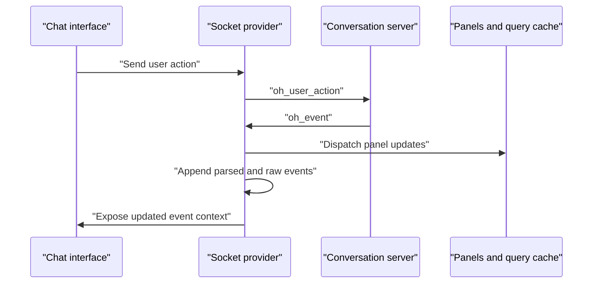

## Overview

The browser combines REST conversation management with a Socket.IO event connection. REST creates, starts and stops conversations; the socket carries user actions and incoming agent events. React context retains the received events, Redux receives updates for specialized panels, and query invalidation refreshes repository changes. [[Conversations]] explains the corresponding server lifecycle, while [[Events and Persistence]] explains the event record behind reconnect replay.

Sources: [frontend/src/api/open-hands.ts:257-314](repo://frontend/src/api/open-hands.ts#L257-L314), [frontend/src/context/ws-client-provider.tsx:130-165](repo://frontend/src/context/ws-client-provider.tsx#L130-L165), [frontend/src/context/ws-client-provider.tsx:190-255](repo://frontend/src/context/ws-client-provider.tsx#L190-L255), [frontend/src/services/actions.ts:17-42](repo://frontend/src/services/actions.ts#L17-L42)

## Routes and conversation creation

The route table places the home screen, settings and conversation view under the root layout. Settings have separate routes for LLM, MCP, user, integrations, application, billing, secrets and API keys. Individual conversations use `conversations/:conversationId`; microagent management is another top-level child. These route identities are the browser entry points, not separate implementations of agent execution.

Sources: [frontend/src/routes.ts:8-25](repo://frontend/src/routes.ts#L8-L25)

The creation mutation accepts an optional query, repository name and provider, branch, suggested task, conversation instructions and microagent request. It forwards these to `OpenHands.createConversation`, which translates them into the server's snake-case request fields and posts to `/api/conversations`. After success, the mutation records submission analytics and invalidates the user's conversation list so navigation can show the new item.

Sources: [frontend/src/hooks/mutation/use-create-conversation.ts:8-55](repo://frontend/src/hooks/mutation/use-create-conversation.ts#L8-L55), [frontend/src/api/open-hands.ts:257-281](repo://frontend/src/api/open-hands.ts#L257-L281)

Fetching conversation metadata, starting a stopped conversation and stopping its environment are explicit REST methods. Start optionally supplies `providers_set`. These operations should be distinguished from the chat stop button: that button sends an agent-state action over the socket. The browser therefore has both conversation lifecycle controls and controls over the current agent loop.

Sources: [frontend/src/api/open-hands.ts:284-314](repo://frontend/src/api/open-hands.ts#L284-L314), [frontend/src/components/features/chat/chat-interface.tsx:144-147](repo://frontend/src/components/features/chat/chat-interface.tsx#L144-L147)

## Connect to the conversation

Changing the conversation ID clears raw and parsed events, resets the last-event reference and sets connection status to `CONNECTING`. Connection setup waits until conversation metadata reports `RUNNING` or a truthy runtime status. The initial query contains the conversation ID, selected providers, session API key and `latest_event_id`, using `-1` when there is no previous event.

Sources: [frontend/src/context/ws-client-provider.tsx:286-318](repo://frontend/src/context/ws-client-provider.tsx#L286-L318)

An absolute conversation URL controls both the target host and the path prefix before `/api/conversations`. The socket path becomes that prefix plus `/socket.io`. Otherwise the client uses `VITE_BACKEND_BASE_URL` or the current browser host with the default socket path. The connection explicitly selects the WebSocket transport; checking only the REST base URL is insufficient when diagnosing a deployment that serves conversations under a prefix.

Sources: [frontend/src/context/ws-client-provider.tsx:320-339](repo://frontend/src/context/ws-client-provider.tsx#L320-L339)

Sources: [frontend/src/components/features/chat/chat-interface.tsx:128-141](repo://frontend/src/components/features/chat/chat-interface.tsx#L128-L141), [frontend/src/context/ws-client-provider.tsx:151-165](repo://frontend/src/context/ws-client-provider.tsx#L151-L165), [frontend/src/context/ws-client-provider.tsx:190-255](repo://frontend/src/context/ws-client-provider.tsx#L190-L255), [frontend/src/context/ws-client-provider.tsx:341-345](repo://frontend/src/context/ws-client-provider.tsx#L341-L345), [frontend/src/context/ws-client-provider.tsx:375-391](repo://frontend/src/context/ws-client-provider.tsx#L375-L391)

## Receive and reconcile events

Every incoming message first passes through `handleAssistantMessage`, which dispatches on action, observation or status-update fields. The socket provider then handles recognized event objects. Agent-state errors and error status updates set the visible error and return early. Ordinary actions and observations are appended to `parsedEvents`; other messages can still enter the raw event collection.

Sources: [frontend/src/services/actions.ts:69-77](repo://frontend/src/services/actions.ts#L69-L77), [frontend/src/context/ws-client-provider.tsx:164-202](repo://frontend/src/context/ws-client-provider.tsx#L164-L202), [frontend/src/context/ws-client-provider.tsx:252-255](repo://frontend/src/context/ws-client-provider.tsx#L252-L255)

A user-message echo removes the optimistic message displayed after submission. Message actions also feed the loading-rate tracker. Events that reach the end of the handler are appended to the raw array, and an ID that parses as a number becomes the reconnect cursor. This handler appends rather than deduplicates by ID; replay correctness depends on the server honoring the cursor. Early-return error messages do not advance it through this path.

Sources: [frontend/src/context/ws-client-provider.tsx:175-209](repo://frontend/src/context/ws-client-provider.tsx#L175-L209), [frontend/src/context/ws-client-provider.tsx:252-265](repo://frontend/src/context/ws-client-provider.tsx#L252-L265)

File edits, writes and shell commands invalidate the conversation's `file_changes` query. Explicit file edits and writes additionally invalidate one `file_diff` entry after stripping the workspace and selected repository prefixes from its path. This refreshes repository views after actions that may alter files, rather than treating the text of an event as the authoritative diff.

Sources: [frontend/src/context/ws-client-provider.tsx:212-247](repo://frontend/src/context/ws-client-provider.tsx#L212-L247)

## Update specialized panels

The action dispatcher skips hidden actions. For visible actions it updates available accumulated cost, budget and token usage, appends shell or notebook input, and forwards security-risk information to the security analyzer state. Status messages with a conversation title invalidate that conversation's metadata query; other informational status messages update the status display.

Sources: [frontend/src/services/actions.ts:17-65](repo://frontend/src/services/actions.ts#L17-L65)

| Incoming observation | Specialized state update |
| --- | --- |
| Shell output | Append visible output, retaining the first and last 2,500 characters when longer than 5,000 |
| Notebook output | Append content and an image URL array when present |
| Browser output | Update the screenshot and URL when present |
| Agent state change | Update the current agent state |

Sources: [frontend/src/services/observations.ts:9-46](repo://frontend/src/services/observations.ts#L9-L46)

These panel updates are separate from chat rendering. The chat interface filters `parsedEvents` through `shouldRenderEvent`, while the observation dispatcher intentionally performs no default-message update for several observation types, including file reads, edits, recall and MCP results. A missing panel update therefore does not alone establish that the event was lost or excluded from chat.

Sources: [frontend/src/components/features/chat/chat-interface.tsx:73-87](repo://frontend/src/components/features/chat/chat-interface.tsx#L73-L87), [frontend/src/services/observations.ts:47-58](repo://frontend/src/services/observations.ts#L47-L58)

## Send messages and handle disconnects

Message submission validates attachments before processing them. Images become base64 URLs; other files are uploaded, and skipped-file reasons appear as error toasts. Successfully uploaded paths are added to the prompt before the chat message is sent. The interface then stores an optimistic user message and clears the pending message state. The socket send helper emits `oh_user_action`, or logs an error and returns if no socket object exists.

Sources: [frontend/src/components/features/chat/chat-interface.tsx:114-141](repo://frontend/src/components/features/chat/chat-interface.tsx#L114-L141), [frontend/src/context/ws-client-provider.tsx:151-157](repo://frontend/src/context/ws-client-provider.tsx#L151-L157)

Disconnect sets the connection state to `DISCONNECTED` and updates the Socket.IO query with the last event ID for reconnection. Connection errors also refetch conversation metadata and set a visible message. A successful connect clears the error. Effect cleanup removes listeners, and provider unmount disconnects the socket. These transitions explain why browser connection state and the agent's persisted execution state can differ during a temporary network interruption.

Sources: [frontend/src/context/ws-client-provider.tsx:159-162](repo://frontend/src/context/ws-client-provider.tsx#L159-L162), [frontend/src/context/ws-client-provider.tsx:258-284](repo://frontend/src/context/ws-client-provider.tsx#L258-L284), [frontend/src/context/ws-client-provider.tsx:341-373](repo://frontend/src/context/ws-client-provider.tsx#L341-L373)

