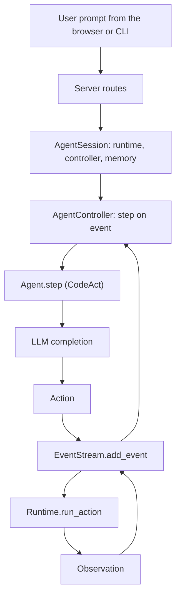

## Overview

OpenHands runs a language model as an agent that acts on a workspace one step at a time. The project's own architecture notes name the classes involved: LLM wraps model calls, Agent picks the next action, AgentController drives the loop, EventStream carries every event, Runtime executes actions, and Server brokers sessions over HTTP. Each task gets one session that holds one event stream, one controller and one runtime. To run the project locally, follow [[Quickstart]].

Sources: [openhands/README.md:10-24](repo://openhands/README.md#L10-L24)

Components do not call each other directly for most work. Actions and observations travel through one event stream, and the controller and runtime subscribe to it. The architecture notes call the stream the backbone of all communication.

Sources: [openhands/README.md:38-40](repo://openhands/README.md#L38-L40)

## The parts

| Area | What it does | Page |
| --- | --- | --- |
| Server | FastAPI app and Socket.IO listener for the frontend and API clients | [[HTTP and WebSocket API]] |
| Sessions | One session per conversation, holding a runtime, a controller and a memory | [[Sessions and Conversation Manager]] |
| Controller | Decides when the agent takes a step and reacts to each event | [[Agent Controller and Step Loop]] |
| Agents | Turn the state into one action per step (CodeAct is one of several) | [[Agents]] |
| Events | Actions, observations and the stream and store that hold them | [[Events and the Event Stream]] |
| LLM | Model completions, retries, function-call conversion and cost metrics | [[LLM Access]] |
| Memory | Event history to messages, history condensation and microagents | [[Conversation Memory and Prompts]], [[Condenser Strategies]], [[Microagents]] |
| Runtime | Runs each action in a sandbox and returns the observation | [[Runtime and Action Execution]], [[Runtime Implementations]] |
| Security | Scores actions for risk before they run | [[Security Analysis and Confirmation]] |
| MCP | Connects agents to external tool servers | [[Model Context Protocol]] |
| Frontend | React single-page app that shows the conversation | [[Web Frontend]] |
| CLI | Terminal entry point for interactive and headless runs | [[Command-Line Interface]] |
| Integrations | Git providers, the issue resolver and file storage | [[Git Provider Integrations]], [[Issue Resolver]], [[Storage Backends]] |
| Enterprise | The SaaS server that extends the open-source server | [[Enterprise SaaS Server]] |
| Evaluation | Benchmark runners that drive agents over datasets | [[Evaluation Harness]] |

Sources: [openhands/server/app.py:58-80](repo://openhands/server/app.py#L58-L80) [openhands/server/conversation_manager/standalone_conversation_manager.py:53-78](repo://openhands/server/conversation_manager/standalone_conversation_manager.py#L53-L78) [openhands/server/session/agent_session.py:42-64](repo://openhands/server/session/agent_session.py#L42-L64) [openhands/controller/agent_controller.py:100-115](repo://openhands/controller/agent_controller.py#L100-L115) [openhands/controller/agent.py:25-40](repo://openhands/controller/agent.py#L25-L40) [openhands/agenthub/codeact_agent/codeact_agent.py:49-78](repo://openhands/agenthub/codeact_agent/codeact_agent.py#L49-L78) [openhands/events/stream.py:43-56](repo://openhands/events/stream.py#L43-L56) [openhands/llm/llm.py:54](repo://openhands/llm/llm.py#L54) [openhands/memory/condenser/condenser.py:44-54](repo://openhands/memory/condenser/condenser.py#L44-L54) [openhands/microagent/microagent.py:17](repo://openhands/microagent/microagent.py#L17) [openhands/runtime/base.py:90-128](repo://openhands/runtime/base.py#L90-L128) [openhands/runtime/impl/action_execution/action_execution_client.py:61](repo://openhands/runtime/impl/action_execution/action_execution_client.py#L61) [openhands/security/analyzer.py:8](repo://openhands/security/analyzer.py#L8) [openhands/mcp/client.py:23](repo://openhands/mcp/client.py#L23) [frontend/src/routes/root-layout.tsx:65](repo://frontend/src/routes/root-layout.tsx#L65) [openhands/cli/main.py:125-130](repo://openhands/cli/main.py#L125-L130) [openhands/integrations/github/github_service.py:21](repo://openhands/integrations/github/github_service.py#L21) [openhands/resolver/issue_resolver.py:52](repo://openhands/resolver/issue_resolver.py#L52) [openhands/storage/files.py:4](repo://openhands/storage/files.py#L4) [enterprise/server/saas_nested_conversation_manager.py:86](repo://enterprise/server/saas_nested_conversation_manager.py#L86) [evaluation/utils/shared.py:486-500](repo://evaluation/utils/shared.py#L486-L500)

## One task through the system

Sources: [openhands/server/app.py:58-80](repo://openhands/server/app.py#L58-L80) [openhands/server/session/agent_session.py:42-64](repo://openhands/server/session/agent_session.py#L42-L64) [openhands/controller/agent_controller.py:467-492](repo://openhands/controller/agent_controller.py#L467-L492) [openhands/agenthub/codeact_agent/codeact_agent.py:160-166](repo://openhands/agenthub/codeact_agent/codeact_agent.py#L160-L166) [openhands/llm/llm.py:54](repo://openhands/llm/llm.py#L54) [openhands/events/stream.py:163-203](repo://openhands/events/stream.py#L163-L203) [openhands/runtime/base.py:890-972](repo://openhands/runtime/base.py#L890-L972)

1. A request enters the server, which attaches it to the session for its conversation. See [[HTTP and WebSocket API]] and [[Sessions and Conversation Manager]].
2. The session's controller receives the user's message as an event and asks the agent for one action. See [[Agent Controller and Step Loop]].
3. The agent builds its messages from the event history, condenses them when needed, and calls the model. See [[Agents]], [[Conversation Memory and Prompts]], [[Condenser Strategies]] and [[LLM Access]].
4. The returned action is checked for risk, then published on the event stream. See [[Security Analysis and Confirmation]] and [[Events and the Event Stream]].
5. The runtime runs the action in its sandbox and publishes an observation, which returns to the controller for the next step. See [[Runtime and Action Execution]].

Sources: [openhands/core/main.py:105-121](repo://openhands/core/main.py#L105-L121) [openhands/core/main.py:165-166](repo://openhands/core/main.py#L165-L166) [openhands/controller/agent_controller.py:821-830](repo://openhands/controller/agent_controller.py#L821-L830) [openhands/runtime/base.py:890-972](repo://openhands/runtime/base.py#L890-L972)

## Design decisions

Events are the only shared channel. `EventStream.add_event` refuses an event that already has an id, because the check exists to stop an event being re-added from inside a handler and starting a loop. Each event gets an id and a timestamp when it is added.

Sources: [openhands/events/stream.py:163-175](repo://openhands/events/stream.py#L163-L175)

The runtime is swappable. `Runtime.run_action` dispatches on the action's type name. An action the runtime does not implement returns an error observation rather than failing the step, and an action the user rejected returns a rejection observation without running.

Sources: [openhands/runtime/base.py:890-972](repo://openhands/runtime/base.py#L890-L972)

Agents are registered by import. `openhands.agenthub` is imported at startup so that every agent class is registered before a run starts.

Sources: [openhands/core/main.py:7](repo://openhands/core/main.py#L7)

Configuration comes from three layers: environment variables, a TOML file, and command-line arguments. `load_from_env` and `load_from_toml` fill one `OpenHandsConfig`, and `setup_config_from_args` applies the arguments. See [[Configuration]] for the order they are applied in.

Sources: [openhands/core/config/utils.py:40-44](repo://openhands/core/config/utils.py#L40-L44) [openhands/core/config/utils.py:138-142](repo://openhands/core/config/utils.py#L138-L142) [openhands/core/config/utils.py:839-842](repo://openhands/core/config/utils.py#L839-L842)
