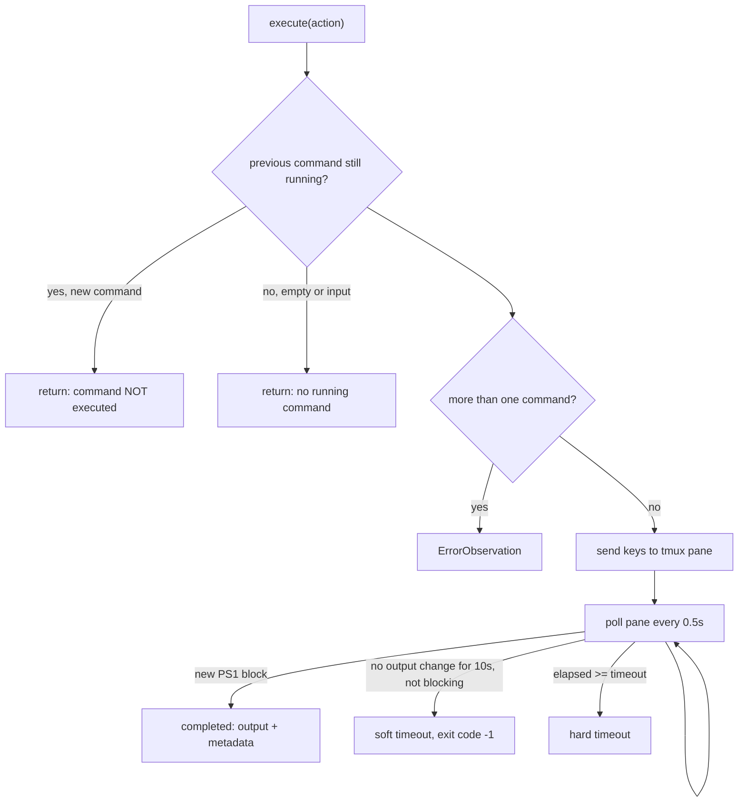

## Overview

Inside every sandbox runs one small FastAPI application, `openhands/runtime/action_execution_server.py`. It owns the agent's persistent bash shell (a tmux session), the Jupyter kernel, the file editor, the headless browser and the MCP proxy, and exposes them over HTTP. The OpenHands process never runs commands in the sandbox itself: `ActionExecutionClient` posts each action as JSON to `/execute_action` and gets the observation back as JSON ([[Runtime Architecture]]).

Sources: [openhands/runtime/action_execution_server.py:166-224](repo://openhands/runtime/action_execution_server.py#L166-L224), [openhands/runtime/action_execution_server.py:814-831](repo://openhands/runtime/action_execution_server.py#L814-L831)

The same server runs in every backend that uses the client (Docker, remote, Kubernetes and local); [[Runtime Implementations]] covers how each one starts it and [[Runtime Images]] how it gets into the image.

Sources: [openhands/runtime/impl/action_execution/action_execution_client.py:61-66](repo://openhands/runtime/impl/action_execution/action_execution_client.py#L61-L66)

## Starting the server

### Command line and lifespan

The server is started as `python -m openhands.runtime.action_execution_server PORT` with `--working-dir`, `--plugins`, `--username` (default `openhands`), `--user-id` (default 1000), `--enable-browser`/`--no-enable-browser` and `--browsergym-eval-env`. It first starts a file viewer server on a free port above its own, then instantiates the requested plugins from `ALL_PLUGINS`, rejecting unknown names.

Sources: [openhands/runtime/action_execution_server.py:653-696](repo://openhands/runtime/action_execution_server.py#L653-L696), [openhands/runtime/plugins/__init__.py:21-25](repo://openhands/runtime/plugins/__init__.py#L21-L25)

The FastAPI lifespan creates the `ActionExecutor` and awaits `ainit`, then (except on Windows) creates the `MCPProxyManager` and mounts it at `/mcp`. On shutdown it removes the proxy and closes the executor, which stops the memory monitor, the bash session and the browser ([[MCP Tools]]).

Sources: [openhands/runtime/action_execution_server.py:697-758](repo://openhands/runtime/action_execution_server.py#L697-L758), [openhands/runtime/action_execution_server.py:645-650](repo://openhands/runtime/action_execution_server.py#L645-L650)

### Executor initialisation

`ActionExecutor.__init__` creates or adjusts the sandbox user and working directory, creates an `OHEditor` rooted at the working directory, and starts the memory monitor when `RUNTIME_MEMORY_MONITOR` is set. `RUNTIME_MAX_MEMORY_GB` sets a memory limit passed to the shell. Asking for a BrowserGym evaluation environment with the browser disabled raises an error.

Sources: [openhands/runtime/action_execution_server.py:171-224](repo://openhands/runtime/action_execution_server.py#L171-L224)

`ainit` starts the bash session first, starts browser initialisation in the background, initialises all plugins concurrently (within `INIT_PLUGIN_TIMEOUT`, default 120 seconds), imports `agentskills` into the Jupyter kernel when both plugins are present, and runs startup shell commands: `alias git="git --no-pager"` and, for non-root users, a `cd` back to the working directory. Only then does `/alive` report `ok`.

Sources: [openhands/runtime/action_execution_server.py:291-377](repo://openhands/runtime/action_execution_server.py#L291-L377), [openhands/runtime/action_execution_server.py:972-980](repo://openhands/runtime/action_execution_server.py#L972-L980)

## Endpoints

| Endpoint | Purpose |
| --- | --- |
| `POST /execute_action` | Deserialises an action, runs it, returns the observation |
| `GET /alive` | `ok` once initialised, otherwise `not initialized`; no auth |
| `GET /server_info` | Uptime, idle time and system resource stats; no auth |
| `POST /upload_file` | Writes an uploaded file, or extracts an uploaded zip, to a destination |
| `GET /download_files` | Zips a path and streams it back |
| `POST /list_files` | Lists a directory |
| `GET /vscode/connection_token` | Token for the in-sandbox VS Code server |
| `POST /update_mcp_server` | Replaces the stdio MCP servers behind the `/mcp` proxy |

Sources: [openhands/runtime/action_execution_server.py:799-831](repo://openhands/runtime/action_execution_server.py#L799-L831), [openhands/runtime/action_execution_server.py:886-1000](repo://openhands/runtime/action_execution_server.py#L886-L1000)

When `SESSION_API_KEY` is set in the sandbox, middleware requires every request except `/alive` and `/server_info` to carry it in `X-Session-API-Key`, answering 403 otherwise. This keeps the sandbox port from being usable by anyone who can reach it.

Sources: [openhands/runtime/action_execution_server.py:86-97](repo://openhands/runtime/action_execution_server.py#L86-L97), [openhands/runtime/action_execution_server.py:787-797](repo://openhands/runtime/action_execution_server.py#L787-L797)

`/execute_action` records the time of the last execution, which `/server_info` reports as idle time and backends use to decide when a sandbox has been idle. Any error is returned as HTTP 500 with the traceback in `detail`.

Sources: [openhands/runtime/action_execution_server.py:814-831](repo://openhands/runtime/action_execution_server.py#L814-L831)

## Running actions

`run_action` takes an async lock, so actions run one at a time, and calls the method named by the action type.

Sources: [openhands/runtime/action_execution_server.py:379-383](repo://openhands/runtime/action_execution_server.py#L379-L383)

| Action | Handled by |
| --- | --- |
| `run` | The shared `BashSession`, or a fresh one in `cwd` for `is_static` commands |
| `run_ipython` | The Jupyter plugin, after syncing its working directory with bash |
| `read` | The editor's `view` command for ACI reads; otherwise the file, or a base64 data URL for images, PDFs and videos |
| `write` | Writes or splices lines, keeping an existing file's mode and owner |
| `edit` | `OHEditor` for ACI edits, returning the editor's message and a diff |
| `browse`, `browse_interactive` | `BrowserEnv`, started on first use |

Sources: [openhands/runtime/action_execution_server.py:385-442](repo://openhands/runtime/action_execution_server.py#L385-L442), [openhands/runtime/action_execution_server.py:511-600](repo://openhands/runtime/action_execution_server.py#L511-L600)

Errors become `ErrorObservation`s with messages written for the model: a binary file (`ERROR_BINARY_FILE`), a missing file together with the current working directory, a directory, or a file that is not UTF-8. The editor's errors are prefixed `ERROR:`.

Sources: [openhands/runtime/action_execution_server.py:442-509](repo://openhands/runtime/action_execution_server.py#L442-L509), [openhands/runtime/action_execution_server.py:100-163](repo://openhands/runtime/action_execution_server.py#L100-L163)

## The bash session

### Session setup

`BashSession` drives bash through tmux. `initialize` starts a tmux server and a session named `openhands-<user>-<uuid>`, raises the scroll-back limit to 10,000 lines, opens a window running `su <user> -` for the `root` and `openhands` users (plain `/bin/bash` otherwise), and sets `PROMPT_COMMAND` so every prompt prints the JSON metadata block described in [[Actions and Observations]] (exit code, working directory, interpreter). `PS2` is emptied so continuation prompts do not confuse the parser.

Sources: [openhands/runtime/utils/bash.py:175-252](repo://openhands/runtime/utils/bash.py#L175-L252), [openhands/events/observation/commands.py:38-57](repo://openhands/events/observation/commands.py#L38-L57)

Because the shell is one long-lived process, environment variables, virtual environments and the current directory persist between commands, which is what the bash tool description promises the model ([[Agents and Tools]]).

Sources: [openhands/agenthub/codeact_agent/tools/bash.py:13-17](repo://openhands/agenthub/codeact_agent/tools/bash.py#L13-L17)

### Executing a command

Sources: [openhands/runtime/utils/bash.py:483-580](repo://openhands/runtime/utils/bash.py#L483-L580), [openhands/runtime/utils/bash.py:581-670](repo://openhands/runtime/utils/bash.py#L581-L670)

`execute` refuses an empty command or `is_input` text when nothing is running, and refuses input that bash would parse as several commands, telling the model to chain them with `&&` or `;`. If the previous command hit a timeout and is still running, a new non-input command is not sent; the reply shows the output so far and says the command was not executed.

Sources: [openhands/runtime/utils/bash.py:483-520](repo://openhands/runtime/utils/bash.py#L483-L520), [openhands/runtime/utils/bash.py:534-578](repo://openhands/runtime/utils/bash.py#L534-L578)

Otherwise the command is escaped and typed into the pane (input goes to the running process as is; special keys like `C-c` are sent without Enter). The session then polls the pane every half second. A new prompt block means the command finished, and its metadata fills the observation. No output change for `NO_CHANGE_TIMEOUT_SECONDS` (10 by default) on a non-blocking command returns the output so far with exit code -1 and instructions for continuing: send an empty command to wait, send input, send `C-c`, or use a longer timeout. Reaching the action's hard timeout does the same with a timed-out message.

Sources: [openhands/runtime/utils/bash.py:580-670](repo://openhands/runtime/utils/bash.py#L580-L670), [openhands/runtime/utils/bash.py:374-438](repo://openhands/runtime/utils/bash.py#L374-L438), [openhands/runtime/utils/bash_constants.py:2-7](repo://openhands/runtime/utils/bash_constants.py#L2-L7)

This is the mechanism behind the soft timeout the model is told about: a long command keeps running in tmux, and the agent decides whether to wait, interact or interrupt.

Sources: [openhands/agenthub/codeact_agent/tools/bash.py:19-26](repo://openhands/agenthub/codeact_agent/tools/bash.py#L19-L26)

On Windows the executor uses a PowerShell session with the same interface.

Sources: [openhands/runtime/action_execution_server.py:269-289](repo://openhands/runtime/action_execution_server.py#L269-L289)

## Plugins

A plugin is an object with `initialize(username)` and `run(action)`; agents request them by `PluginRequirement` name, and the runtime passes the names to the server. CodeAct requires `agent_skills` and `jupyter`, and the VS Code plugin is added outside headless mode.

Sources: [openhands/runtime/plugins/requirement.py:8-31](repo://openhands/runtime/plugins/requirement.py#L8-L31), [openhands/agenthub/codeact_agent/codeact_agent.py:70-76](repo://openhands/agenthub/codeact_agent/codeact_agent.py#L70-L76), [openhands/runtime/base.py:152-157](repo://openhands/runtime/base.py#L152-L157)

| Plugin | What it provides |
| --- | --- |
| `jupyter` | A Jupyter kernel gateway on a free port between 40000 and 49999, used by `run_ipython` |
| `agent_skills` | Python helper functions (file editing, file reading, repository operations) importable in the kernel |
| `vscode` | An OpenVSCode server on `VSCODE_PORT` with a random connection token, for the root or `openhands` user |

Sources: [openhands/runtime/plugins/jupyter/__init__.py:22-66](repo://openhands/runtime/plugins/jupyter/__init__.py#L22-L66), [openhands/runtime/plugins/agent_skills/README.md:1-20](repo://openhands/runtime/plugins/agent_skills/README.md#L1-L20), [openhands/runtime/plugins/vscode/__init__.py:26-62](repo://openhands/runtime/plugins/vscode/__init__.py#L26-L62)

Before each IPython cell the executor changes the kernel's directory to the shell's if it differs, so Python and bash agree on where they are. With `include_extra` the output ends with the working directory and interpreter path.

Sources: [openhands/runtime/action_execution_server.py:399-434](repo://openhands/runtime/action_execution_server.py#L399-L434)

## The browser

`BrowserEnv` runs BrowserGym in a separate process connected by a pipe, using the open-ended task for normal browsing or a named evaluation environment (WebArena, VisualWebArena, MiniWoB). `step` sends an action string with a request id and waits up to 120 seconds for the matching reply.

Sources: [openhands/runtime/browser/browser_env.py:23-91](repo://openhands/runtime/browser/browser_env.py#L23-L91), [openhands/runtime/browser/browser_env.py:189-200](repo://openhands/runtime/browser/browser_env.py#L189-L200)

The `browse` helper turns a `BrowseURLAction` into `goto("url")` and passes a `BrowseInteractiveAction`'s BrowserGym code through, then builds a `BrowserOutputObservation` from the result and saves screenshots under `.browser_screenshots` in the workspace.

Sources: [openhands/runtime/browser/utils.py:100-130](repo://openhands/runtime/browser/utils.py#L100-L130)

The executor starts the browser lazily and restarts initialisation if it failed. When an interactive browser action errors because it triggered a download, the new file is copied from `/workspace/.downloads` into `/workspace` with an extension guessed from its content, and a `FileDownloadObservation` tells the agent where it is.

Sources: [openhands/runtime/action_execution_server.py:229-267](repo://openhands/runtime/action_execution_server.py#L229-L267), [openhands/runtime/action_execution_server.py:591-643](repo://openhands/runtime/action_execution_server.py#L591-L643)
