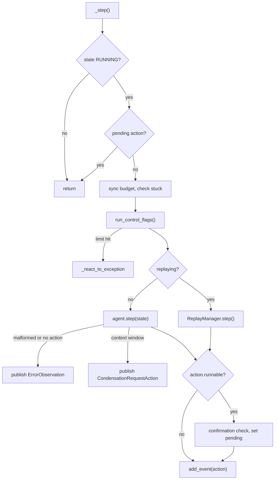
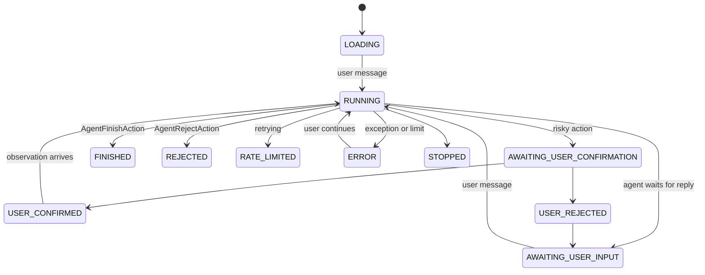

## Overview

`AgentController` drives a conversation forward. It listens to the [[Events and Event Stream]], decides after each event whether the agent should take another step, calls `agent.step(state)`, and publishes the action the agent returns. Around that loop it keeps the agent's `State`, enforces the iteration and budget limits, detects loops, holds actions for user confirmation, runs sub-agents as delegates, and replays recorded trajectories.

Sources: [openhands/controller/agent_controller.py:100-202](repo://openhands/controller/agent_controller.py#L100-L202)

The controller never calls the runtime or memory. It learns that an action ran only because an observation whose `cause` is that action's id arrives on the stream. How the agent chooses its action is covered in [[Agents and Tools]].

Sources: [openhands/controller/agent_controller.py:519-547](repo://openhands/controller/agent_controller.py#L519-L547)

## Construction

The constructor stores the agent, stream and limits, and subscribes `on_event` under `EventStreamSubscriber.AGENT_CONTROLLER`, unless the controller is a delegate. It creates a `StateTracker`, sets the initial state (restored, inherited from a parent, or new), and builds a `StuckDetector`, a `ReplayManager` and the optional security analyzer. Its last act is `_add_system_message`, which publishes the agent's `SystemMessageAction` unless the stream already holds one or begins with a user message from an older conversation.

Sources: [openhands/controller/agent_controller.py:115-202](repo://openhands/controller/agent_controller.py#L115-L202), [openhands/controller/agent_controller.py:244-268](repo://openhands/controller/agent_controller.py#L244-L268)

Entry points do not call the constructor directly; `create_controller` in [[Headless Mode]] restores any saved state and passes the configured limits.

Sources: [openhands/core/main.py:165-167](repo://openhands/core/main.py#L165-L167)

## Handling events

`on_event` is the stream callback. If a delegate is active and has not finished, rejected or errored (or stopped on a limit), the event goes to the delegate's `_on_event` and the parent does nothing else. When the delegate is done, the parent calls `end_delegate` instead.

Sources: [openhands/controller/agent_controller.py:433-465](repo://openhands/controller/agent_controller.py#L433-L465)

`_on_event` ignores hidden events, appends the event to the history through the state tracker, dispatches actions to `_handle_action` and observations to `_handle_observation`, and then asks `should_step` whether to run the agent.

Sources: [openhands/controller/agent_controller.py:467-492](repo://openhands/controller/agent_controller.py#L467-L492)

`should_step` returns true for a user `MessageAction`, an agent message while the agent is not waiting for input, a delegate action, and either kind of condensation action. For observations it returns true for every observation except `AgentStateChangedObservation` and `NullObservation`; the exception is a `NullObservation` with a positive `cause`, which is the empty answer to a `RecallAction` and does step the agent.

Sources: [openhands/controller/agent_controller.py:392-431](repo://openhands/controller/agent_controller.py#L392-L431)

`_handle_action` reacts to the control actions. `ChangeAgentStateAction` sets the state; `AgentFinishAction` and `AgentRejectAction` copy their outputs into the state and move it to `FINISHED` or `REJECTED`; `AgentDelegateAction` starts a delegate.

Sources: [openhands/controller/agent_controller.py:494-517](repo://openhands/controller/agent_controller.py#L494-L517)

A user message does more. `_handle_message_action` publishes a `RecallAction` carrying the message text and makes it the pending action. The recall type is `WORKSPACE_CONTEXT` for the first user message and `KNOWLEDGE` for later ones, so the [[Conversation Memory]] component can add repository and runtime information once and microagent knowledge every time. The controller then moves to `RUNNING`. An agent message with `wait_for_response` moves the state to `AWAITING_USER_INPUT`.

Sources: [openhands/controller/agent_controller.py:549-588](repo://openhands/controller/agent_controller.py#L549-L588)

## The step

`step` schedules `_step_with_exception_handling`, which runs `_step` and turns any exception into an error state. Known LiteLLM errors (timeouts, rate limits, authentication, content policy, context window) are reported as they are; anything else is wrapped in a generic `RuntimeError` asking the user to retry.

Sources: [openhands/controller/agent_controller.py:358-390](repo://openhands/controller/agent_controller.py#L358-L390)

Sources: [openhands/controller/agent_controller.py:821-916](repo://openhands/controller/agent_controller.py#L821-L916), [openhands/controller/agent_controller.py:918-972](repo://openhands/controller/agent_controller.py#L918-L972)

`_step` runs only in `RUNNING` and only when no action is pending, which is what keeps the agent from acting twice before an observation returns. It copies the combined LLM spend into the budget flag, checks for loops, and steps the control flags; a stuck agent or a hit limit goes to `_react_to_exception`. Otherwise it takes the next action from the replay manager or from `agent.step`, and stamps it with source `AGENT`.

Sources: [openhands/controller/agent_controller.py:821-871](repo://openhands/controller/agent_controller.py#L821-L871)

Errors from the model's output (`LLMMalformedActionError`, `LLMNoActionError`, `LLMResponseError`, function-call validation errors) become an `ErrorObservation` so the agent can correct itself. A context-window error, recognised by type or by matching several provider-specific messages, becomes a `CondensationRequestAction` when `enable_history_truncation` is on, or `LLMContextWindowExceedError` otherwise.

Sources: [openhands/controller/agent_controller.py:872-916](repo://openhands/controller/agent_controller.py#L872-L916)

A runnable action becomes the pending action. In confirmation mode, command, IPython, browser, edit and read actions first pass through the security check described in [[Security Analyzers and Confirmation]], which may mark them `AWAITING_CONFIRMATION` and move the controller to `AWAITING_USER_CONFIRMATION`. Finally the action is published.

Sources: [openhands/controller/agent_controller.py:918-972](repo://openhands/controller/agent_controller.py#L918-L972)

## Pending actions

The pending action is stored with the time it was set; reading it logs a message once it has waited more than a minute, but never clears it. `_handle_observation` clears it when an observation's `cause` matches its id, unless the controller is waiting for confirmation. An observation arriving after `USER_CONFIRMED` moves the state back to `RUNNING`, and after `USER_REJECTED` to `AWAITING_USER_INPUT`.

Sources: [openhands/controller/agent_controller.py:979-1031](repo://openhands/controller/agent_controller.py#L979-L1031), [openhands/controller/agent_controller.py:535-547](repo://openhands/controller/agent_controller.py#L535-L547)

## Agent states

Sources: [openhands/core/schema/agent.py:4-51](repo://openhands/core/schema/agent.py#L4-L51), [openhands/controller/agent_controller.py:631-683](repo://openhands/controller/agent_controller.py#L631-L683)

`set_agent_state_to` makes every transition. Moving to `STOPPED` or `ERROR` calls `_reset`, which publishes an `ErrorObservation` carrying the pending action's tool-call metadata if no observation answered it, so the model never sees a tool call without a result. Moving from `ERROR` back to `RUNNING` lets the control flags raise their limits. Confirming or rejecting re-publishes the pending action with its new `confirmation_state`. Every transition publishes an `AgentStateChangedObservation` (with `last_error` as the reason for errors) and saves the state.

Sources: [openhands/controller/agent_controller.py:590-683](repo://openhands/controller/agent_controller.py#L590-L683)

`_react_to_exception` records `last_error` and, when a status callback is set, maps LLM errors to specific runtime statuses (authentication, service unavailable, out of credits, content policy). A rate-limit error moves to `RATE_LIMITED` while retries remain and to `ERROR` once they are exhausted.

Sources: [openhands/controller/agent_controller.py:302-356](repo://openhands/controller/agent_controller.py#L302-L356)

## State and limits

`State` is a dataclass holding the agent state, history, inputs and outputs, the iteration and budget flags, the delegate level, the `start_id`/`end_id` range of its events, metrics, `extra_data` for evaluations, and `last_error`. `save_to_session` pickles it, base64-encodes it and writes it to the file store; the history is dropped from the pickle because it is rebuilt from the event stream. `restore_from_session` loads it in `LOADING` and remembers a resumable previous state in `resume_state`.

Sources: [openhands/controller/state/state.py:48-120](repo://openhands/controller/state/state.py#L48-L120), [openhands/controller/state/state.py:122-209](repo://openhands/controller/state/state.py#L122-L209)

`StateTracker` owns that state. It filters history (no null events, no state-change events, nothing hidden), rebuilds it from the stream with each delegate's inner events collapsed to the delegate action and its observation, saves state and conversation metrics, and syncs the budget flag with accumulated cost.

Sources: [openhands/controller/state/state_tracker.py:20-48](repo://openhands/controller/state/state_tracker.py#L20-L48), [openhands/controller/state/state_tracker.py:104-195](repo://openhands/controller/state/state_tracker.py#L104-L195), [openhands/controller/state/state_tracker.py:246-268](repo://openhands/controller/state/state_tracker.py#L246-L268)

The limits are control flags. `IterationControlFlag.step` raises `RuntimeError('Agent reached maximum iteration...')` at the limit and otherwise counts one step; `BudgetControlFlag.step` raises when spend reaches the maximum. When the user continues after the error, the iteration limit grows by its original amount only outside headless mode, and the budget limit becomes current spend plus the original amount.

Sources: [openhands/controller/state/control_flags.py:42-95](repo://openhands/controller/state/control_flags.py#L42-L95), [openhands/controller/state/state_tracker.py:231-236](repo://openhands/controller/state/state_tracker.py#L231-L236)

## Stuck detection

`StuckDetector.is_stuck` looks at the whole history in headless mode and at the events after the last user message otherwise, ignoring user messages and null events. It reports a loop for four identical action-observation pairs, three identical actions that each end in an error, three identical agent messages with no observation between them, an alternating pattern over the last six steps, or ten condensation observations in a row.

Sources: [openhands/controller/stuck.py:28-110](repo://openhands/controller/stuck.py#L28-L110), [openhands/controller/stuck.py:258-290](repo://openhands/controller/stuck.py#L258-L290), [openhands/controller/stuck.py:336-360](repo://openhands/controller/stuck.py#L336-L360)

## Delegation

`start_delegate` creates the agent named in the `AgentDelegateAction` and a child controller with `is_delegate=True`, so the child does not subscribe to the stream itself. Its `State` shares the parent's iteration flag, budget flag and metrics, sits one delegate level deeper, and starts at the next event id. The parent then posts `TASK: ...` as a user message and sets the child to `RUNNING`.

Sources: [openhands/controller/agent_controller.py:693-752](repo://openhands/controller/agent_controller.py#L693-L752), [openhands/controller/agent_controller.py:503-512](repo://openhands/controller/agent_controller.py#L503-L512)

`end_delegate` copies the shared iteration count back, closes the child, and publishes an `AgentDelegateObservation` with the child's outputs (or an error message), linked to the original delegate tool call so the parent agent sees it as that call's result.

Sources: [openhands/controller/agent_controller.py:754-819](repo://openhands/controller/agent_controller.py#L754-L819)

## Replay

`ReplayManager` takes a recorded trajectory and drops environment events and null observations. While it has actions left, `_step` takes the next recorded action instead of calling the agent; messages and observations in the recording are skipped because the live runtime produces fresh ones. The class comment warns that results can differ if an action is non-deterministic or the starting state differs from the recording.

Sources: [openhands/controller/replay.py:11-98](repo://openhands/controller/replay.py#L11-L98)

## Closing

`close` sets `STOPPED` (unless asked not to), rewrites the full history including delegate events for callers such as evaluations, and unsubscribes. `get_trajectory` is only valid after closing.

Sources: [openhands/controller/agent_controller.py:270-286](repo://openhands/controller/agent_controller.py#L270-L286), [openhands/controller/state/state_tracker.py:197-229](repo://openhands/controller/state/state_tracker.py#L197-L229), [openhands/controller/agent_controller.py:1062-1065](repo://openhands/controller/agent_controller.py#L1062-L1065)
