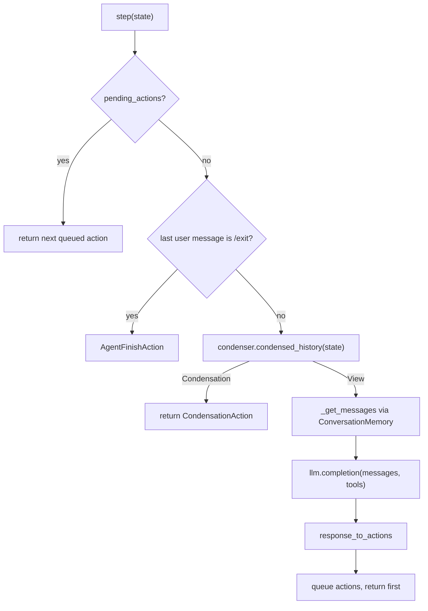

## Overview

An agent is the part that decides. Each time the [[Agent Controller]] calls `agent.step(state)`, the agent looks at the conversation so far and returns one `Action`. OpenHands ships several agents in `openhands/agenthub`; the default, `CodeActAgent`, gives a model a set of function-calling tools (shell, Python, file editor, browser, think, finish, task tracker, plus any MCP tools) and turns each tool call it receives into an action.

Sources: [openhands/controller/agent.py:25-51](repo://openhands/controller/agent.py#L25-L51), [openhands/core/config/config_utils.py:7](repo://openhands/core/config/config_utils.py#L7)

The agent does not build prompt messages itself or talk to a provider directly: it hands history to [[Conversation Memory]] and calls `self.llm.completion`, described in [[LLM Integration]].

Sources: [openhands/agenthub/codeact_agent/codeact_agent.py:282-293](repo://openhands/agenthub/codeact_agent/codeact_agent.py#L282-L293), [openhands/agenthub/codeact_agent/codeact_agent.py:218](repo://openhands/agenthub/codeact_agent/codeact_agent.py#L218)

## The Agent interface

`Agent` is an abstract class. Its constructor takes an `AgentConfig` and the `LLMRegistry`, gets the agent's LLM from the registry, and starts with empty `tools` and `mcp_tools`. Subclasses implement `step`, and may override `reset` (called when the controller stops or errors), `sandbox_plugins` (plugins the sandbox must start) and `config_model` (a subclass of `AgentConfig` with extra settings).

Sources: [openhands/controller/agent.py:25-51](repo://openhands/controller/agent.py#L25-L51), [openhands/controller/agent.py:104-118](repo://openhands/controller/agent.py#L104-L118)

`get_system_message` asks the agent's `PromptManager` for the system prompt and returns it as a `SystemMessageAction` together with the tool list and the agent class name. The controller publishes it as the first event, so the stored conversation records exactly which prompt and tools the model saw.

Sources: [openhands/controller/agent.py:59-93](repo://openhands/controller/agent.py#L59-L93), [openhands/controller/agent_controller.py:244-268](repo://openhands/controller/agent_controller.py#L244-L268)

`set_mcp_tools` adds MCP tool schemas to both `mcp_tools` and `tools`, skipping names already present ([[MCP Tools]]).

Sources: [openhands/controller/agent.py:163-183](repo://openhands/controller/agent.py#L163-L183)

## The agent registry

Agents are found by name. `Agent.register(name, cls)` adds a class to a class-level registry and refuses duplicates; `get_cls(name)` looks one up and raises `AgentNotRegisteredError` for unknown names. Each agent package registers itself in its `__init__.py`, and importing `openhands.agenthub` imports them all, which is why entry points import that package before creating an agent.

Sources: [openhands/controller/agent.py:120-161](repo://openhands/controller/agent.py#L120-L161), [openhands/agenthub/__init__.py:1-24](repo://openhands/agenthub/__init__.py#L1-L24), [openhands/agenthub/codeact_agent/__init__.py:1-4](repo://openhands/agenthub/codeact_agent/__init__.py#L1-L4), [openhands/core/main.py:7](repo://openhands/core/main.py#L7)

`create_agent` instantiates `config.default_agent` with that agent's config section. Agents outside the package are registered from a `classpath` in `[agent.NAME]` ([[Configuration]]).

Sources: [openhands/core/setup.py:202-207](repo://openhands/core/setup.py#L202-L207), [openhands/core/config/utils.py:796-816](repo://openhands/core/config/utils.py#L796-L816)

## CodeActAgent

### Design and construction

`CodeActAgent` implements the CodeAct idea: rather than a fixed menu of high-level actions, the model acts by running code (bash commands and Python) and talks to the user in natural language. It requires the `agent_skills` and `jupyter` sandbox plugins, in that order, because the Jupyter kernel imports the helper functions `agent_skills` provides.

Sources: [openhands/agenthub/codeact_agent/codeact_agent.py:49-76](repo://openhands/agenthub/codeact_agent/codeact_agent.py#L49-L76)

On construction it builds its tool list, creates a `ConversationMemory`, builds a condenser from `config.condenser`, and replaces its LLM with the router from the registry, which is the plain LLM unless model routing is configured. Its `PromptManager` reads templates from its own `prompts` folder using the resolved system prompt file ([[Configuration]]).

Sources: [openhands/agenthub/codeact_agent/codeact_agent.py:78-106](repo://openhands/agenthub/codeact_agent/codeact_agent.py#L78-L106)

### The step

Sources: [openhands/agenthub/codeact_agent/codeact_agent.py:160-224](repo://openhands/agenthub/codeact_agent/codeact_agent.py#L160-L224)

One model response can contain several tool calls. `step` turns them all into actions, queues them in `pending_actions`, and returns the first; the following steps drain the queue without calling the model, one action per step, each waiting for its observation. `reset` clears the queue.

Sources: [openhands/agenthub/codeact_agent/codeact_agent.py:154-158](repo://openhands/agenthub/codeact_agent/codeact_agent.py#L154-L158), [openhands/agenthub/codeact_agent/codeact_agent.py:182-184](repo://openhands/agenthub/codeact_agent/codeact_agent.py#L182-L184), [openhands/agenthub/codeact_agent/codeact_agent.py:220-224](repo://openhands/agenthub/codeact_agent/codeact_agent.py#L220-L224)

Before calling the model, the condenser either returns a `View` of the events to show or a `Condensation` to apply. In the second case the agent returns the `CondensationAction` itself; the controller publishes it and immediately steps again, now with a smaller view ([[Condensers]]).

Sources: [openhands/agenthub/codeact_agent/codeact_agent.py:191-201](repo://openhands/agenthub/codeact_agent/codeact_agent.py#L191-L201), [openhands/controller/agent_controller.py:410-413](repo://openhands/controller/agent_controller.py#L410-L413)

The completion call passes the messages, the tool list after `check_tools` (which strips `default` and unsupported `format` fields for Gemini models), and LLM metadata from the state such as session id and agent name. The initial user message is always found in the full history, so it can be kept even when the condenser drops it from the view.

Sources: [openhands/agenthub/codeact_agent/codeact_agent.py:207-218](repo://openhands/agenthub/codeact_agent/codeact_agent.py#L207-L218), [openhands/agenthub/codeact_agent/codeact_agent.py:226-244](repo://openhands/agenthub/codeact_agent/codeact_agent.py#L226-L244), [openhands/llm/llm_utils.py:11-41](repo://openhands/llm/llm_utils.py#L11-L41)

### Tool selection

`_get_tools` adds a tool for each enabled `AgentConfig` switch. For models whose name contains `gpt-4`, `o1`, `o3` or `o4` it uses short tool descriptions, a precaution from when OpenAI limited function descriptions to about 1,000 characters.

Sources: [openhands/agenthub/codeact_agent/codeact_agent.py:108-152](repo://openhands/agenthub/codeact_agent/codeact_agent.py#L108-L152)

| Tool name | Config switch | Produces |
| --- | --- | --- |
| `execute_bash` | `enable_cmd` | `CmdRunAction` |
| `think` | `enable_think` | `AgentThinkAction` |
| `finish` | `enable_finish` | `AgentFinishAction` |
| `request_condensation` | `enable_condensation_request` | `CondensationRequestAction` |
| `browser` | `enable_browsing` (not on Windows) | `BrowseInteractiveAction` |
| `execute_ipython_cell` | `enable_jupyter` | `IPythonRunCellAction` |
| `task_tracker` | `enable_plan_mode` | `TaskTrackingAction` |
| `edit_file` | `enable_llm_editor` | `FileEditAction` (LLM-based) |
| `str_replace_editor` | `enable_editor`, when the LLM editor is off | `FileEditAction` (ACI) or `FileReadAction` |

Sources: [openhands/llm/tool_names.py:1-8](repo://openhands/llm/tool_names.py#L1-L8), [openhands/agenthub/codeact_agent/codeact_agent.py:125-152](repo://openhands/agenthub/codeact_agent/codeact_agent.py#L125-L152), [openhands/agenthub/codeact_agent/tools/think.py:17-24](repo://openhands/agenthub/codeact_agent/tools/think.py#L17-L24), [openhands/agenthub/codeact_agent/tools/ipython.py:16-31](repo://openhands/agenthub/codeact_agent/tools/ipython.py#L16-L31), [openhands/agenthub/codeact_agent/tools/condensation_request.py:8-13](repo://openhands/agenthub/codeact_agent/tools/condensation_request.py#L8-L13)

### Tool schemas

Each tool is a LiteLLM `ChatCompletionToolParam`. The bash tool, for example, takes `command`, `is_input` (`"true"` or `"false"`), an optional `timeout` in seconds, and `security_risk`. Its long description tells the model the shell is persistent, that commands hit a soft timeout after 10 seconds and return exit code -1, and that it can then send an empty command to read more output, text to stdin, or `C-c` to interrupt.

Sources: [openhands/agenthub/codeact_agent/tools/bash.py:10-82](repo://openhands/agenthub/codeact_agent/tools/bash.py#L10-L82)

Every tool that touches the system (bash, IPython, editor, browser, LLM editor) requires a `security_risk` argument of `LOW`, `MEDIUM` or `HIGH`; the description points the model to the risk assessment section of the system prompt. This is how the model's own risk estimate reaches the confirmation logic in [[Security Analyzers and Confirmation]].

Sources: [openhands/agenthub/codeact_agent/tools/security_utils.py:6-10](repo://openhands/agenthub/codeact_agent/tools/security_utils.py#L6-L10), [openhands/agenthub/codeact_agent/tools/str_replace_editor.py:108-113](repo://openhands/agenthub/codeact_agent/tools/str_replace_editor.py#L108-L113), [openhands/agenthub/codeact_agent/tools/browser.py:160-168](repo://openhands/agenthub/codeact_agent/tools/browser.py#L160-L168)

## From tool calls to actions

`response_to_actions` handles one choice. If the assistant message has tool calls, its text content becomes the `thought` of the first action. Each call's JSON arguments are parsed (bad JSON raises `FunctionCallValidationError`) and dispatched by function name to build the matching action, checking required arguments as it goes.

Sources: [openhands/agenthub/codeact_agent/function_calling.py:73-122](repo://openhands/agenthub/codeact_agent/function_calling.py#L73-L122)

A few conversions are worth knowing. A bash `timeout` becomes a hard timeout on the action. `str_replace_editor` with `view` becomes a `FileReadAction`; other editor commands become an ACI `FileEditAction`, and any argument not in the tool schema raises `FunctionCallValidationError`. `task_tracker` normalises each task to `id`, `title`, `status` and `notes`. A name in `mcp_tool_names` becomes an `MCPAction`, and an unknown name raises `FunctionCallNotExistsError`.

Sources: [openhands/agenthub/codeact_agent/function_calling.py:105-122](repo://openhands/agenthub/codeact_agent/function_calling.py#L105-L122), [openhands/agenthub/codeact_agent/function_calling.py:173-229](repo://openhands/agenthub/codeact_agent/function_calling.py#L173-L229), [openhands/agenthub/codeact_agent/function_calling.py:256-309](repo://openhands/agenthub/codeact_agent/function_calling.py#L256-L309)

`set_security_risk` copies a valid `security_risk` argument onto the action and logs anything else. Each action gets `ToolCallMetadata` with the call id, function name, full response and number of calls. A response with no tool calls becomes a `MessageAction` with `wait_for_response=True`, so the controller waits for the user. Every action is stamped with the response id so token usage can be matched to it.

Sources: [openhands/agenthub/codeact_agent/function_calling.py:59-70](repo://openhands/agenthub/codeact_agent/function_calling.py#L59-L70), [openhands/agenthub/codeact_agent/function_calling.py:311-338](repo://openhands/agenthub/codeact_agent/function_calling.py#L311-L338)

The validation errors raised here are among those the controller turns into an `ErrorObservation`, so a model that calls a tool wrongly sees the message and can retry ([[Agent Controller]]).

Sources: [openhands/controller/agent_controller.py:872-884](repo://openhands/controller/agent_controller.py#L872-L884)

## Other agents

| Agent | Built on | What it is for |
| --- | --- | --- |
| `CodeActAgent` | `Agent` | General software work with shell, Python, editor and browser |
| `ReadOnlyAgent` | `CodeActAgent` | Exploring a codebase without changing it: only grep, glob, view, think, finish and web read tools, and MCP tools are ignored |
| `LocAgent` | `CodeActAgent` | Code localisation with graph-based tools (`search_code_snippets`, `get_entity_contents`, `explore_tree_structure`) |
| `BrowsingAgent` | `Agent` | Web tasks with BrowserGym high-level actions (`chat`, `bid`, optionally `nav`), the target of `delegate_to_browsing_agent` |
| `VisualBrowsingAgent` | `Agent` | Web tasks that also use page screenshots with set-of-marks |
| `DummyAgent` | `Agent` | End-to-end tests: replays a fixed list of actions without calling a model |

Sources: [openhands/agenthub/readonly_agent/readonly_agent.py:23-83](repo://openhands/agenthub/readonly_agent/readonly_agent.py#L23-L83), [openhands/agenthub/loc_agent/loc_agent.py:14-40](repo://openhands/agenthub/loc_agent/loc_agent.py#L14-L40), [openhands/agenthub/loc_agent/README.md:1-14](repo://openhands/agenthub/loc_agent/README.md#L1-L14), [openhands/agenthub/browsing_agent/browsing_agent.py:94-133](repo://openhands/agenthub/browsing_agent/browsing_agent.py#L94-L133), [openhands/agenthub/visualbrowsing_agent/visualbrowsing_agent.py:121-147](repo://openhands/agenthub/visualbrowsing_agent/visualbrowsing_agent.py#L121-L147), [openhands/agenthub/dummy_agent/agent.py:38-43](repo://openhands/agenthub/dummy_agent/agent.py#L38-L43)

`ReadOnlyAgent` and `LocAgent` reuse CodeAct's step, memory and condenser and only replace the tool list and the parser. `CodeActAgent` reaches `BrowsingAgent` through an `AgentDelegateAction` when the model calls `delegate_to_browsing_agent`; the controller then runs the browsing agent as a delegate.

Sources: [openhands/agenthub/readonly_agent/readonly_agent.py:65-83](repo://openhands/agenthub/readonly_agent/readonly_agent.py#L65-L83), [openhands/agenthub/codeact_agent/function_calling.py:138-142](repo://openhands/agenthub/codeact_agent/function_calling.py#L138-L142)
