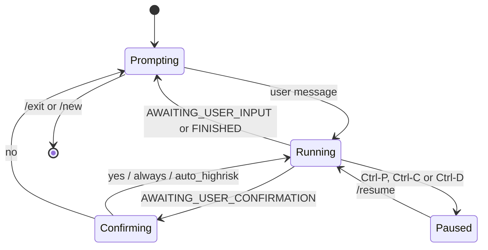

## Overview

Running `openhands` with no subcommand opens an interactive terminal session: the agent works in the current directory, its commands and edits are printed as they happen, each risky action can be confirmed, and the user types follow-up messages or slash commands between turns. It runs the same agent loop as the server, wired directly in one process, with the `cli` runtime by default so commands execute on the user's machine rather than in a container.

Sources: [openhands/cli/entry.py:23-45](repo://openhands/cli/entry.py#L23-L45), [openhands/cli/main.py:125-180](repo://openhands/cli/main.py#L125-L180), [openhands/cli/main.py:652-669](repo://openhands/cli/main.py#L652-L669)

`openhands serve` instead launches the web app in Docker; it is covered in [[Quickstart]]. Running a single task non-interactively is [[Headless Mode]].

Sources: [openhands/cli/entry.py:36-40](repo://openhands/cli/entry.py#L36-L40), [openhands/cli/gui_launcher.py:76-90](repo://openhands/cli/gui_launcher.py#L76-L90)

## Starting up

`entry.main` answers `--help` and `--version` from a lightweight parser without importing the rest of OpenHands, because the full import made `openhands --help` take around 20 seconds. Other invocations go to `run_cli_command`, which runs `main_with_loop` on a new event loop and cancels leftover tasks on exit.

Sources: [openhands/cli/fast_help.py:1-35](repo://openhands/cli/fast_help.py#L1-L35), [openhands/cli/entry.py:12-48](repo://openhands/cli/entry.py#L12-L48), [openhands/cli/main.py:758-781](repo://openhands/cli/main.py#L758-L781)

`main_with_loop` prepares the session in this order:

Sources: [openhands/cli/main.py:565-590](repo://openhands/cli/main.py#L565-L590)

1. Sets the log level (warnings only by default) and falls back to `~/.openhands/config.toml` when there is no `config.toml` in the current directory, then builds the config from file, environment and arguments ([[Configuration]]).
2. Tries once to install the OpenHands VS Code extension.
3. Loads `~/.openhands/settings.json`; with no settings it runs the setup flow, which asks for the LLM provider, model and key and optionally a search API key.
4. Applies the saved settings: agent, LLM model and key (only when neither `-l` nor `config.toml` provided them), confirmation mode, search key, and the condenser (an LLM summarising condenser when `enable_default_condenser` is on, none otherwise).
5. Unless `--override-cli-mode` is given, switches to CLI defaults: the `cli` runtime, the current directory as workspace, confirmation mode on with the `llm` security analyzer, and `cli_mode` for the agent; it re-runs `finalize_config` so Jupyter and browsing are disabled.
6. Offers to add `openhands` and `oh` shell aliases, once, in an interactive terminal.
7. Asks whether the user trusts the current folder, unless it is already listed in `sandbox.trusted_dirs`; accepting adds it to `~/.openhands/config.toml`, refusing exits.
8. Reads the task from `-t`, from stdin, or from `-f`, in which case the file content is wrapped in a prompt asking the agent to read it and ask what to do with it.

Sources: [openhands/cli/main.py:567-590](repo://openhands/cli/main.py#L567-L590), [openhands/cli/main.py:591-651](repo://openhands/cli/main.py#L591-L651), [openhands/cli/main.py:652-725](repo://openhands/cli/main.py#L652-L725), [openhands/cli/main.py:446-475](repo://openhands/cli/main.py#L446-L475), [openhands/cli/commands.py:384-428](repo://openhands/cli/commands.py#L384-L428), [openhands/cli/utils.py:16-50](repo://openhands/cli/utils.py#L16-L50)

It then calls the runtime class's `setup`, runs `run_session`, and keeps starting new sessions for as long as the previous one asked for one with `/new`.

Sources: [openhands/cli/main.py:727-756](repo://openhands/cli/main.py#L727-L756)

## A session

`run_session` builds the pieces the same way the headless runner does: the LLM registry, the agent, a runtime (headless, so no VS Code), the controller (restoring a saved state when `--conversation` names an existing id), then connects the runtime, clones `selected_repo` if set, creates memory with the current directory as working directory, and adds MCP tools including the default servers ([[Headless Mode]], [[MCP Tools]]).

Sources: [openhands/cli/main.py:125-180](repo://openhands/cli/main.py#L125-L180), [openhands/cli/main.py:310-355](repo://openhands/cli/main.py#L310-L355)

The CLI runtime streams shell output to the terminal as it arrives through `subscribe_to_shell_stream`. After clearing the screen it shows the banner, the session id, the number of MCP servers (flagging startup errors, which `/mcp` can show) and `What do you want to build?`.

Sources: [openhands/cli/main.py:158-162](repo://openhands/cli/main.py#L158-L162), [openhands/cli/main.py:357-380](repo://openhands/cli/main.py#L357-L380)

If there is a task it is sent as the first message; otherwise the CLI prompts for one. A resumed conversation that ended with an error tells the agent not to continue the old task blindly, and an LLM authentication error shows a hint about the API key instead. The session runs until the controller is `STOPPED` or `ERROR`, then saves the agent state and closes the runtime and controller.

Sources: [openhands/cli/main.py:381-444](repo://openhands/cli/main.py#L381-L444), [openhands/cli/main.py:91-123](repo://openhands/cli/main.py#L91-L123)

## Reacting to events

The CLI subscribes to the event stream as `EventStreamSubscriber.MAIN`. Each event is printed by `display_event`: the agent's thoughts and messages, commands and their output, file edits and reads, MCP calls and results, task list updates, state changes and errors. Token usage from events is accumulated for `/status`.

Sources: [openhands/cli/main.py:212-312](repo://openhands/cli/main.py#L212-L312), [openhands/cli/tui.py:260-305](repo://openhands/cli/tui.py#L260-L305), [openhands/cli/utils.py:51-78](repo://openhands/cli/utils.py#L51-L78)

Sources: [openhands/cli/main.py:212-309](repo://openhands/cli/main.py#L212-L309)

When the agent waits for input or finishes, the CLI prompts for the next message, after reloading microagents if `/init` has just created `repo.md`. While the agent is running, a key listener turns Ctrl-P, Ctrl-C or Ctrl-D into `ChangeAgentStateAction(PAUSED)`; a paused agent prompts for input too.

Sources: [openhands/cli/main.py:226-244](repo://openhands/cli/main.py#L226-L244), [openhands/cli/main.py:300-309](repo://openhands/cli/main.py#L300-L309), [openhands/cli/tui.py:872-916](repo://openhands/cli/tui.py#L872-L916)

## Confirming actions

In CLI mode the controller holds every command, edit, read and browse action for confirmation and lets the CLI decide ([[Security Analyzers and Confirmation]]). The CLI shows the action's risk and asks the user. For a `HIGH` risk action the choices are proceed, reject or always proceed; otherwise they also include auto-confirming everything except high-risk actions.

Sources: [openhands/controller/agent_controller.py:942-951](repo://openhands/controller/agent_controller.py#L942-L951), [openhands/cli/tui.py:840-869](repo://openhands/cli/tui.py#L840-L869)

`always` confirms every later action without asking, and `auto_highrisk` confirms later `LOW` and `MEDIUM` actions automatically and still asks for `HIGH` ones. A rejection sends `USER_REJECTED` and asks the user what to do instead.

Sources: [openhands/cli/main.py:245-299](repo://openhands/cli/main.py#L245-L299)

## Slash commands

| Command | Does |
| --- | --- |
| `/exit` | Confirms, stops the agent and prints usage before exiting |
| `/help` | Lists the commands |
| `/init` | Asks the agent to explore the repository and write `.openhands/microagents/repo.md` |
| `/status` | Shows the conversation id and token and cost usage |
| `/new` | Confirms, ends this session and starts a fresh one |
| `/settings` | Shows settings and edits them: basic LLM, advanced LLM, or search API |
| `/resume` | Sends `continue` to a paused agent |
| `/mcp` | Lists, adds or removes MCP servers in `config.toml`, or shows MCP errors |

Sources: [openhands/cli/tui.py:79-88](repo://openhands/cli/tui.py#L79-L88), [openhands/cli/commands.py:122-175](repo://openhands/cli/commands.py#L122-L175)

`/init` first shows an existing `repo.md` and asks before replacing it, then sends the prompt as a user message; the new file is loaded as a repository microagent on the next turn ([[Microagents]]).

Sources: [openhands/cli/commands.py:204-234](repo://openhands/cli/commands.py#L204-L234), [openhands/cli/commands.py:325-382](repo://openhands/cli/commands.py#L325-L382)

`/exit` and `/new` publish `ChangeAgentStateAction(STOPPED)` after confirmation, which ends `run_session`. `/resume` only works while the agent is paused.

Sources: [openhands/cli/commands.py:176-198](repo://openhands/cli/commands.py#L176-L198), [openhands/cli/commands.py:239-324](repo://openhands/cli/commands.py#L239-L324)

`/settings` saves to `~/.openhands/settings.json`. The basic editor offers verified providers first, with fuzzy completion over LiteLLM's model list.

Sources: [openhands/cli/commands.py:269-294](repo://openhands/cli/commands.py#L269-L294), [openhands/cli/settings.py:233-250](repo://openhands/cli/settings.py#L233-L250)

`/mcp` edits the `[mcp]` section of the config file for SSE, SHTTP and stdio servers, then offers to restart the CLI, which replaces the process with the same command line so the new servers load.

Sources: [openhands/cli/commands.py:431-505](repo://openhands/cli/commands.py#L431-L505), [openhands/cli/commands.py:586-614](repo://openhands/cli/commands.py#L586-L614), [openhands/cli/commands.py:76-120](repo://openhands/cli/commands.py#L76-L120)
