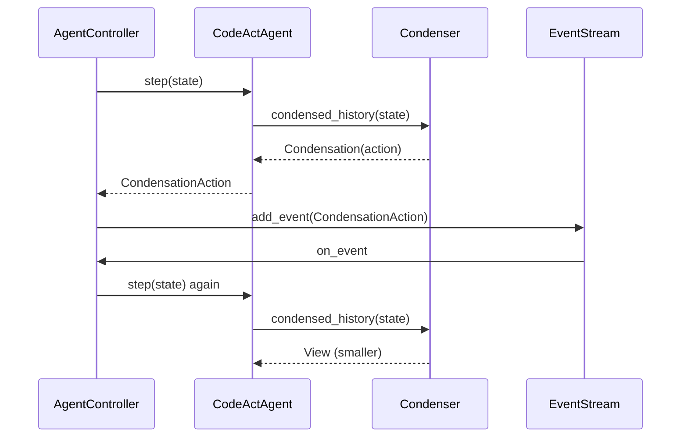

## Overview

A long task produces more events than a model's context window holds. A condenser decides which events the model sees on each step. It either returns a `View` (the events to send now) or a `Condensation` wrapping a `CondensationAction` that tells the system which events to forget from then on, optionally with a summary of them. Condensations are ordinary events, so forgetting is recorded in the stream, survives restarts, and never deletes the stored history.

Sources: [openhands/memory/condenser/condenser.py:38-52](repo://openhands/memory/condenser/condenser.py#L38-L52), [openhands/memory/view.py:13-20](repo://openhands/memory/view.py#L13-L20)

Each `CodeActAgent` builds its condenser from `AgentConfig.condenser` and calls it at the start of every step, before [[Conversation Memory]] turns the view into messages ([[Agents and Tools]]).

Sources: [openhands/agenthub/codeact_agent/codeact_agent.py:92-93](repo://openhands/agenthub/codeact_agent/codeact_agent.py#L92-L93), [openhands/agenthub/codeact_agent/codeact_agent.py:191-201](repo://openhands/agenthub/codeact_agent/codeact_agent.py#L191-L201)

## Views

`State.view` is `View.from_events(state.history)`, cached until the history length changes. `from_events` collects the ids every `CondensationAction` forgets, plus the ids of the condensation actions and condensation requests themselves, and keeps the remaining events in order.

Sources: [openhands/controller/state/state.py:299-311](repo://openhands/controller/state/state.py#L299-L311), [openhands/memory/view.py:47-59](repo://openhands/memory/view.py#L47-L59)

If the most recent condensation with a summary has one, the view inserts an `AgentCondensationObservation` holding that summary at `summary_offset`. The view also sets `unhandled_condensation_request` when a `CondensationRequestAction` appears after the last condensation action.

Sources: [openhands/memory/view.py:61-93](repo://openhands/memory/view.py#L61-L93)

## The condensation cycle



Sources: [openhands/agenthub/codeact_agent/codeact_agent.py:191-201](repo://openhands/agenthub/codeact_agent/codeact_agent.py#L191-L201), [openhands/controller/agent_controller.py:410-413](repo://openhands/controller/agent_controller.py#L410-L413)

`condensed_history` computes LLM metadata for the condenser's own model calls and runs `condense(state.view)` inside `metadata_batch`, which appends anything recorded with `add_metadata` (such as the summariser's response and metrics) to `state.extra_data['condenser_meta']` when the call ends.

Sources: [openhands/memory/condenser/condenser.py:16-31](repo://openhands/memory/condenser/condenser.py#L16-L31), [openhands/memory/condenser/condenser.py:58-127](repo://openhands/memory/condenser/condenser.py#L58-L127)

## Condensation requests

Condensing can also be requested. When the model call fails with a context-window error and `enable_history_truncation` is on, the controller publishes a `CondensationRequestAction` and steps again ([[Agent Controller]]). With `enable_condensation_request`, the agent also gets a `request_condensation` tool to ask for it itself.

Sources: [openhands/controller/agent_controller.py:886-912](repo://openhands/controller/agent_controller.py#L886-L912), [openhands/agenthub/codeact_agent/codeact_agent.py:132-133](repo://openhands/agenthub/codeact_agent/codeact_agent.py#L132-L133)

A request only helps if the configured condenser acts on it. That is why `AgentConfig` defaults to the conversation window condenser: a no-op condenser would leave the request unhandled forever. The stuck detector also stops a run after ten condensations in a row with nothing in between.

Sources: [openhands/core/config/agent_config.py:54-60](repo://openhands/core/config/agent_config.py#L54-L60), [openhands/controller/stuck.py:336-360](repo://openhands/controller/stuck.py#L336-L360)

## Rolling condensers

Most strategies subclass `RollingCondenser`, which splits the decision in two: `should_condense(view)` says whether to act, and `get_condensation(view)` builds the condensation. When `should_condense` is false the view passes through unchanged.

Sources: [openhands/memory/condenser/condenser.py:169-193](repo://openhands/memory/condenser/condenser.py#L169-L193)

The size-based rolling condensers share a shape. They condense when the view exceeds `max_size` events, and they cut it to about `max_size // 2`: the first `keep_first` events (normally the system prompt and task), then the most recent events, forgetting the contiguous middle. They reject `keep_first` values of half `max_size` or more. Because a condensation halves the view, the next condensation happens only after another `max_size / 2` events, which spreads the cost of summarising.

Sources: [openhands/memory/condenser/impl/amortized_forgetting_condenser.py:16-58](repo://openhands/memory/condenser/impl/amortized_forgetting_condenser.py#L16-L58), [openhands/memory/condenser/impl/llm_summarizing_condenser.py:25-70](repo://openhands/memory/condenser/impl/llm_summarizing_condenser.py#L25-L70)

## LLM summarising condenser

`LLMSummarizingCondenser` is the default when the config file has no `[condenser]` section. When the view passes `max_size`, it keeps the head, finds the previous summary right after the head (or starts from `No events summarized`), and asks its LLM to merge the previous summary with the forgotten events, each truncated to `max_event_length` characters and wrapped in `<EVENT id=…>` tags.

Sources: [openhands/memory/condenser/impl/llm_summarizing_condenser.py:52-71](repo://openhands/memory/condenser/impl/llm_summarizing_condenser.py#L52-L71), [openhands/memory/condenser/impl/llm_summarizing_condenser.py:122-149](repo://openhands/memory/condenser/impl/llm_summarizing_condenser.py#L122-L149), [openhands/core/config/utils.py:316-337](repo://openhands/core/config/utils.py#L316-L337)

The prompt asks for a state summary with fixed sections: `USER_CONTEXT`, `TASK_TRACKING` (keeping task ids and statuses), `COMPLETED`, `PENDING`, `CURRENT_STATE`, and for code tasks `CODE_STATE`, `TESTS`, `CHANGES`, `DEPS` and `VERSION_CONTROL_STATUS`. The result is a `CondensationAction` forgetting the range from the first to the last forgotten id, with the summary placed at offset `keep_first`.

Sources: [openhands/memory/condenser/impl/llm_summarizing_condenser.py:72-120](repo://openhands/memory/condenser/impl/llm_summarizing_condenser.py#L72-L120), [openhands/memory/condenser/impl/llm_summarizing_condenser.py:151-161](repo://openhands/memory/condenser/impl/llm_summarizing_condenser.py#L151-L161)

`from_config` registers its LLM as the `condenser` service with prompt caching turned off; the comment explains that summarisation would pay for cache writes without ever reading them. Its spend is counted in the conversation's metrics ([[LLM Integration]]).

Sources: [openhands/memory/condenser/impl/llm_summarizing_condenser.py:163-182](repo://openhands/memory/condenser/impl/llm_summarizing_condenser.py#L163-L182)

## Conversation window condenser

`ConversationWindowCondenser` acts only on an unhandled condensation request, so it costs nothing until the context overflows. It always keeps the system message, the first user message, and the recall action and observation that answered it. Of the rest it keeps the newest half, skipping observations at the start of that slice so no result is kept without its action. The forgotten ids become a range when contiguous and a list otherwise.

Sources: [openhands/memory/condenser/impl/conversation_window_condenser.py:20-110](repo://openhands/memory/condenser/impl/conversation_window_condenser.py#L20-L110), [openhands/memory/condenser/impl/conversation_window_condenser.py:111-177](repo://openhands/memory/condenser/impl/conversation_window_condenser.py#L111-L177)

Its config class notes that it cannot be selected from TOML or environment variables; it is the code default in `AgentConfig`.

Sources: [openhands/core/config/condenser_config.py:170-178](repo://openhands/core/config/condenser_config.py#L170-L178)

## Catalogue

| `type` | Class | What it does | Choose it when |
| --- | --- | --- | --- |
| `noop` | `NoOpCondenser` | Returns the view unchanged | The history always fits, or for experiments |
| `recent` | `RecentEventsCondenser` | Shows the first `keep_first` and the last `max_events` events, without recording a condensation | A simple fixed window is enough |
| `observation_masking` | `ObservationMaskingCondenser` | Replaces observations older than `attention_window` events with `<MASKED>` | Old outputs are bulky but the actions still matter |
| `browser_output_masking` | `BrowserOutputCondenser` | Replaces all but the last `attention_window` browser observations with `Visited URL … Content omitted` | Browsing tasks with large page dumps |
| `amortized` | `AmortizedForgettingCondenser` | Forgets the middle once past `max_size`, without a summary | Cheap forgetting with no extra model calls |
| `llm` | `LLMSummarizingCondenser` | Forgets the middle and keeps an LLM-written running summary | The default; long tasks that must remember earlier work |
| `structured` | `StructuredSummaryCondenser` | Like `llm`, but the model fills a `create_state_summary` function call with fixed fields | Models that are reliable with forced function calls |
| `llm_attention` | `LLMAttentionCondenser` | Asks an LLM which event ids matter most, as a JSON list, and keeps those | Models that support response schemas |
| `pipeline` | `CondenserPipeline` | Runs condensers in order until one returns a condensation | Combining masking with summarising |
| `conversation_window` | `ConversationWindowCondenser` | Halves the history on a condensation request | The `AgentConfig` default fallback |

Sources: [openhands/core/config/condenser_config.py:285-296](repo://openhands/core/config/condenser_config.py#L285-L296), [openhands/memory/condenser/impl/no_op_condenser.py:8-19](repo://openhands/memory/condenser/impl/no_op_condenser.py#L8-L19), [openhands/memory/condenser/impl/recent_events_condenser.py:8-28](repo://openhands/memory/condenser/impl/recent_events_condenser.py#L8-L28), [openhands/memory/condenser/impl/observation_masking_condenser.py:11-28](repo://openhands/memory/condenser/impl/observation_masking_condenser.py#L11-L28), [openhands/memory/condenser/impl/browser_output_condenser.py:11-40](repo://openhands/memory/condenser/impl/browser_output_condenser.py#L11-L40), [openhands/memory/condenser/impl/structured_summary_condenser.py:162-166](repo://openhands/memory/condenser/impl/structured_summary_condenser.py#L162-L166), [openhands/memory/condenser/impl/llm_attention_condenser.py:17-24](repo://openhands/memory/condenser/impl/llm_attention_condenser.py#L17-L24), [openhands/memory/condenser/impl/pipeline.py:12-40](repo://openhands/memory/condenser/impl/pipeline.py#L12-L40)

The masking condensers and `recent` change only what the model sees on that step; they return a `View` and never emit a condensation, so they run again on every step. The rolling ones emit a `CondensationAction`, so their decision is stored and later views start from it.

Sources: [openhands/memory/condenser/impl/observation_masking_condenser.py:19-28](repo://openhands/memory/condenser/impl/observation_masking_condenser.py#L19-L28), [openhands/memory/condenser/impl/recent_events_condenser.py:17-22](repo://openhands/memory/condenser/impl/recent_events_condenser.py#L17-L22), [openhands/memory/condenser/impl/amortized_forgetting_condenser.py:40-55](repo://openhands/memory/condenser/impl/amortized_forgetting_condenser.py#L40-L55)

`StructuredSummaryCondenser` forces the model to call `create_state_summary` and validates the arguments into a `StateSummary` (user context, completed and pending tasks, current state, and code-related fields), falling back to an empty summary if no such call comes back. `LLMAttentionCondenser` sends a `response_format` JSON schema and validates the reply as `ImportantEventSelection`.

Sources: [openhands/memory/condenser/impl/structured_summary_condenser.py:25-40](repo://openhands/memory/condenser/impl/structured_summary_condenser.py#L25-L40), [openhands/memory/condenser/impl/structured_summary_condenser.py:250-295](repo://openhands/memory/condenser/impl/structured_summary_condenser.py#L250-L295), [openhands/memory/condenser/impl/llm_attention_condenser.py:70-92](repo://openhands/memory/condenser/impl/llm_attention_condenser.py#L70-L92)

`CondenserPipeline` overrides `metadata_batch` to write each stage's metadata, because the stages never see the `State` themselves.

Sources: [openhands/memory/condenser/impl/pipeline.py:22-47](repo://openhands/memory/condenser/impl/pipeline.py#L22-L47)

## Configuration

The `[condenser]` section picks the type with `type` (default `noop` when the section exists) and validates the rest against that type's config class. LLM-based types accept `llm_config = "NAME"` naming an `[llm.NAME]` group, falling back to the default LLM if the name is unknown. An invalid section logs a warning and becomes `noop`.

Sources: [openhands/core/config/condenser_config.py:196-262](repo://openhands/core/config/condenser_config.py#L196-L262)

```toml
[llm.condenser]
model = "gpt-4o-mini"

[condenser]
type = "llm"
llm_config = "condenser"
keep_first = 1
max_size = 100
```

Sources: [openhands/core/config/condenser_config.py:61-85](repo://openhands/core/config/condenser_config.py#L61-L85), [openhands/core/config/condenser_config.py:205-212](repo://openhands/core/config/condenser_config.py#L205-L212)

`Condenser.from_config` looks the config's class up in `CONDENSER_REGISTRY`, filled by each implementation calling `register_config` at import, and raises `ValueError` for an unregistered config. A new strategy is a `Condenser` subclass, a config model, and that one registration line.

Sources: [openhands/memory/condenser/condenser.py:34-35](repo://openhands/memory/condenser/condenser.py#L34-L35), [openhands/memory/condenser/condenser.py:129-166](repo://openhands/memory/condenser/condenser.py#L129-L166), [openhands/memory/condenser/impl/pipeline.py:50](repo://openhands/memory/condenser/impl/pipeline.py#L50)
