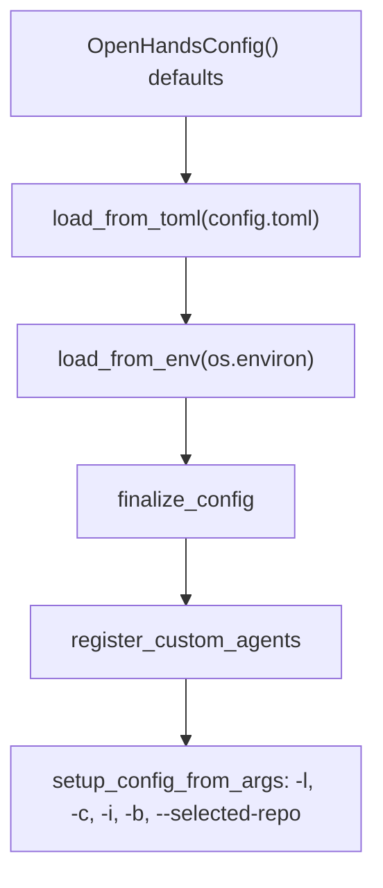

## Overview

All of OpenHands' settings live in one Pydantic model, `OpenHandsConfig`. It holds the core settings directly and one nested model per subsystem: named LLM configs, named agent configs, the sandbox, security, MCP, Kubernetes and CLI settings, plus a free-form `extended` group. Every entry point builds this object the same way, from `config.toml`, then environment variables, then command-line arguments, and hands it to the setup code in [[Headless Mode]].

Sources: [openhands/core/config/openhands_config.py:23-129](repo://openhands/core/config/openhands_config.py#L23-L129)

The model forbids unknown fields (`extra='forbid'`), so a misspelt key passed in code fails validation instead of being ignored. Keys in `config.toml` are handled more gently, as the loading section below shows.

Sources: [openhands/core/config/openhands_config.py:127-129](repo://openhands/core/config/openhands_config.py#L127-L129)

## Loading order

`load_openhands_config` creates a default `OpenHandsConfig`, applies the TOML file, applies environment variables, runs `finalize_config`, and registers custom agents. Because environment variables are applied after the file, an environment variable wins over the same key in `config.toml`.

Sources: [openhands/core/config/utils.py:819-836](repo://openhands/core/config/utils.py#L819-L836)

Sources: [openhands/core/config/utils.py:819-904](repo://openhands/core/config/utils.py#L819-L904)

`setup_config_from_args`, used by the CLI and the headless runner, then applies the command-line overrides. `-l/--llm-config NAME` replaces the default LLM config with the named group: it looks in the loaded configs, then in the given config file, then in `~/.openhands/config.toml`, and raises if none has it. `-c` sets `default_agent`, `-i` sets `max_iterations`, `-b` sets `max_budget_per_task`, and `--selected-repo` sets `sandbox.selected_repo`.

Sources: [openhands/core/config/utils.py:839-904](repo://openhands/core/config/utils.py#L839-L904)

## The TOML file

`load_from_toml` reads the file given by `--config-file` (default `config.toml`). A missing file is silently skipped and a file that does not parse is skipped with a warning. Keys under `[core]` are set directly on `OpenHandsConfig`, with strings wrapped in `SecretStr` where the field is a secret; unknown keys and unknown sections only log a warning.

Sources: [openhands/core/config/utils.py:138-190](repo://openhands/core/config/utils.py#L138-L190), [openhands/core/config/utils.py:349-364](repo://openhands/core/config/utils.py#L349-L364)

| Section | Model | Notes |
| --- | --- | --- |
| `[core]` | `OpenHandsConfig` fields | Runtime name, file store, iterations, budget, workspace |
| `[llm]`, `[llm.NAME]` | `LLMConfig` | Named groups inherit the base `[llm]` keys |
| `[agent]`, `[agent.NAME]` | `AgentConfig` or the agent's own `config_model` | Named groups inherit the base `[agent]` keys |
| `[sandbox]` | `SandboxConfig` | An invalid section raises `ValueError` |
| `[security]` | `SecurityConfig` | An invalid section raises `ValueError` |
| `[mcp]` | `MCPConfig` | See [[MCP Tools]] |
| `[kubernetes]` | `KubernetesConfig` | Used by the Kubernetes runtime |
| `[condenser]` | a condenser config | Assigned to the default agent; see [[Condensers]] |
| `[model_routing]` | `ModelRoutingConfig` | Assigned to the default agent with every LLM marked `for_routing` |
| `[extended]` | `ExtendedConfig` | Arbitrary keys for extensions |

Sources: [openhands/core/config/utils.py:192-275](repo://openhands/core/config/utils.py#L192-L275), [openhands/core/config/utils.py:276-347](repo://openhands/core/config/utils.py#L276-L347)

Named groups are how one file holds several models or agent variants. `LLMConfig.from_toml_section` builds the base config from the non-table keys of `[llm]`, then builds each sub-table by merging its keys over the base, so `num_retries` set in `[llm]` also applies to `[llm.claude]`. `AgentConfig.from_toml_section` does the same and validates each named group with the agent class's own `config_model` when the name matches a registered agent or the group sets a `classpath`.

Sources: [openhands/core/config/llm_config.py:100-160](repo://openhands/core/config/llm_config.py#L100-L160), [openhands/core/config/agent_config.py:79-156](repo://openhands/core/config/agent_config.py#L79-L156)

When the file has no `[condenser]` section and `enable_default_condenser` is true (the default), the default agent gets an `LLMSummarizingCondenserConfig` that uses the default LLM.

Sources: [openhands/core/config/utils.py:314-337](repo://openhands/core/config/utils.py#L314-L337)

## Environment variables

`load_from_env` walks the model's fields and derives each variable name from the field path in upper case: nested models add their field name as a prefix, so `sandbox.timeout` is `SANDBOX_TIMEOUT`. The default LLM config is read with the prefix `LLM_` (`LLM_MODEL`, `LLM_API_KEY`) and the default agent config with `AGENT_`. Named LLM and agent groups can only be set in the TOML file.

Sources: [openhands/core/config/utils.py:66-74](repo://openhands/core/config/utils.py#L66-L74), [openhands/core/config/utils.py:126-135](repo://openhands/core/config/utils.py#L126-L135)

Values are cast to the field's type: booleans are true for `true` or `1`, dicts and lists are parsed with `literal_eval` (and list items become Pydantic models when the list holds models), and empty values are skipped so the default stays. A value that cannot be cast is logged as an error and ignored.

Sources: [openhands/core/config/utils.py:76-124](repo://openhands/core/config/utils.py#L76-L124)

## Finalisation

`finalize_config` resolves the workspace. `SANDBOX_VOLUMES` takes comma-separated `host:container[:mode]` mounts; the one whose container path is `/workspace` sets `workspace_mount_path` and `workspace_base` to the absolute host path. If no mount targets `/workspace`, both are cleared so no workspace is mounted, and any mount without two or three parts raises `ValueError`. The older `WORKSPACE_BASE` and `WORKSPACE_MOUNT_PATH` still work when `volumes` is unset but log a deprecation warning.

Sources: [openhands/core/config/utils.py:377-438](repo://openhands/core/config/utils.py#L377-L438)

It also makes completion log folders absolute, creates `cache_dir`, and creates a JWT secret in the file store if none is configured. When `runtime` is `cli`, it turns off Jupyter and browsing for every agent, because the CLI runtime cannot run IPython or a browser ([[Runtime Implementations]]).

Sources: [openhands/core/config/utils.py:440-470](repo://openhands/core/config/utils.py#L440-L470), [openhands/core/config/utils.py:367-374](repo://openhands/core/config/utils.py#L367-L374)

Finally, `register_custom_agents` imports the `classpath` of every agent group that has one and registers it under the group's name, so `-c NAME` can select an agent defined outside `openhands.agenthub` ([[Agents and Tools]]).

Sources: [openhands/core/config/utils.py:796-816](repo://openhands/core/config/utils.py#L796-L816)

## Core settings

| Field | Default | Meaning |
| --- | --- | --- |
| `runtime` | `docker` | Runtime backend name ([[Runtime Implementations]]) |
| `default_agent` | `CodeActAgent` | Agent class used when none is named |
| `max_iterations` | `500` | Step limit per task |
| `max_budget_per_task` | none | Spend limit in USD |
| `file_store`, `file_store_path` | `local`, `~/.openhands` | Where events and settings are written ([[Storage]]) |
| `save_trajectory_path`, `replay_trajectory_path` | none | Write or replay a trajectory |
| `enable_browser` | `true` | Start the browser in the sandbox |
| `max_concurrent_conversations` | `3` | Agent loops allowed per user on the server |
| `conversation_max_age_seconds` | `864000` | Ten days |
| `enable_default_condenser` | `true` | Add an LLM summarising condenser when none is configured |
| `git_user_name`, `git_user_email` | `openhands`, `openhands@all-hands.dev` | Identity for the agent's commits |

Sources: [openhands/core/config/openhands_config.py:65-125](repo://openhands/core/config/openhands_config.py#L65-L125), [openhands/core/config/config_utils.py:7-9](repo://openhands/core/config/config_utils.py#L7-L9)

## LLM settings

`LLMConfig` defaults to `claude-sonnet-4-20250514`, temperature 0, five retries with exponential backoff between 8 and 64 seconds, observations truncated at 30,000 characters, prompt caching on, and LiteLLM's `drop_params` and `modify_params` on. Its post-init step writes OpenRouter and AWS credentials to environment variables for LiteLLM, sets `reasoning_effort` to `high` for every model except Gemini 2.5 Pro, and gives Azure models a default API version. [[LLM Integration]] explains how these are used.

Sources: [openhands/core/config/llm_config.py:52-98](repo://openhands/core/config/llm_config.py#L52-L98), [openhands/core/config/llm_config.py:162-194](repo://openhands/core/config/llm_config.py#L162-L194)

## Agent settings

`AgentConfig` mostly switches tools on or off: `enable_cmd`, `enable_jupyter`, `enable_browsing`, `enable_editor`, `enable_llm_editor`, `enable_think`, `enable_finish`, `enable_condensation_request`, `enable_mcp`. `llm_config` names the LLM group the agent uses, `disabled_microagents` lists microagents to skip, and `enable_history_truncation` lets the agent condense instead of failing when the context window overflows. With `enable_plan_mode` on (the default) and the default prompt file, the agent uses `system_prompt_long_horizon.j2` and gains the task tracker tool.

Sources: [openhands/core/config/agent_config.py:15-77](repo://openhands/core/config/agent_config.py#L15-L77)

The default condenser in `AgentConfig` is the conversation window condenser rather than no-op; the comment explains that with no-op, a context overflow would produce a condensation request nothing handles.

Sources: [openhands/core/config/agent_config.py:54-60](repo://openhands/core/config/agent_config.py#L54-L60)

## Sandbox and security settings

`SandboxConfig` controls the runtime: the base image (`nikolaik/python-nodejs:python3.12-nodejs22`) or a prebuilt `runtime_container_image`, the 120-second default action timeout, `volumes`, `use_host_network`, `keep_runtime_alive`, `pause_closed_runtimes`, `runtime_extra_deps` appended to the image build, `runtime_startup_env_vars`, the remote runtime URL and timeouts, `enable_gpu` and `selected_repo`. [[Runtime Images]] and [[Runtime Implementations]] cover how each is applied.

Sources: [openhands/core/config/sandbox_config.py:8-123](repo://openhands/core/config/sandbox_config.py#L8-L123)

`SecurityConfig` has two fields: `confirmation_mode` and the name of a `security_analyzer`, described in [[Security Analyzers and Confirmation]]. `ModelRoutingConfig` names a router (default `noop_router`) and the LLM groups it may route to.

Sources: [openhands/core/config/security_config.py:4-15](repo://openhands/core/config/security_config.py#L4-L15), [openhands/core/config/model_routing_config.py:6-17](repo://openhands/core/config/model_routing_config.py#L6-L17)

The full list with comments is in `config.template.toml`, organised by the same sections.

Sources: [config.template.toml:12-20](repo://config.template.toml#L12-L20)
