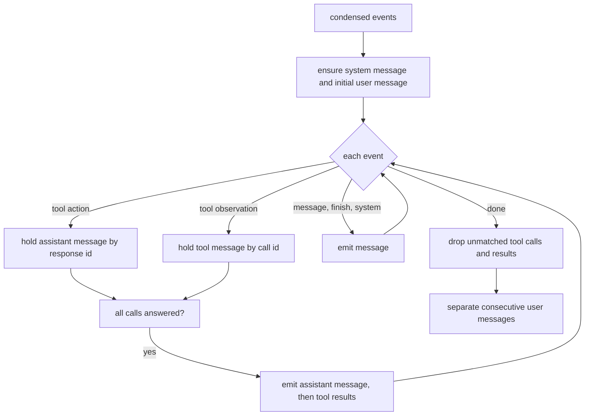

## Overview

Before each model call the agent has a list of events and needs a list of chat messages. Two classes cover that gap. `ConversationMemory` converts events into `Message` objects: the system prompt, user and assistant turns, tool calls and their results, in the order and pairing a function-calling API requires. `Memory` adds context that is not in the history yet: when the controller publishes a `RecallAction`, `Memory` answers with a `RecallObservation` carrying repository details, runtime hosts, instructions and the knowledge of any triggered microagents. `PromptManager` renders the Jinja templates both use.

Sources: [openhands/memory/conversation_memory.py:58-61](repo://openhands/memory/conversation_memory.py#L58-L61), [openhands/memory/memory.py:41-73](repo://openhands/memory/memory.py#L41-L73), [openhands/utils/prompt.py:43-69](repo://openhands/utils/prompt.py#L43-L69)

Choosing which events to show is the condenser's job ([[Condensers]]); `ConversationMemory` receives the already condensed list. How microagents are loaded and matched is in [[Microagents]].

Sources: [openhands/agenthub/codeact_agent/codeact_agent.py:191-208](repo://openhands/agenthub/codeact_agent/codeact_agent.py#L191-L208)

## Building messages

`CodeActAgent._get_messages` calls `process_events` with the condensed events, the initial user message, the LLM's `max_message_chars`, and whether vision is active, then applies prompt caching markers if the LLM supports them ([[Agents and Tools]]).

Sources: [openhands/agenthub/codeact_agent/codeact_agent.py:282-293](repo://openhands/agenthub/codeact_agent/codeact_agent.py#L282-L293)

`process_events` first repairs the head of the list. `_ensure_system_message` inserts a `SystemMessageAction` rendered from the system template when none exists, which only happens for conversations recorded before system messages were events. `_ensure_initial_user_message` makes the second event the original user message, inserting it if the condenser dropped it, because the model always needs the task.

Sources: [openhands/memory/conversation_memory.py:74-100](repo://openhands/memory/conversation_memory.py#L74-L100), [openhands/memory/conversation_memory.py:801-860](repo://openhands/memory/conversation_memory.py#L801-L860)

It then walks the events, converting each action with `_process_action` and each observation with `_process_observation`. Tool calls do not go into the output immediately. The assistant message that made the calls is kept in `pending_tool_call_action_messages` under its response id, and each tool result is kept in `tool_call_id_to_message` under its call id. After each event, any pending assistant message whose calls all have results is emitted, followed by those results in call order.

Sources: [openhands/memory/conversation_memory.py:101-159](repo://openhands/memory/conversation_memory.py#L101-L159)

This ordering matters because a model response with three tool calls produces three actions and three observations spread over several steps. The API expects one assistant message carrying all three calls, followed by three tool messages, so the assistant message is held back until every result has arrived.

Sources: [openhands/memory/conversation_memory.py:133-153](repo://openhands/memory/conversation_memory.py#L133-L153), [openhands/agenthub/codeact_agent/function_calling.py:311-321](repo://openhands/agenthub/codeact_agent/function_calling.py#L311-L321)

Two passes finish the list. `_filter_unmatched_tool_calls` removes tool messages whose call is missing and trims assistant messages to the calls that have results, dropping the message when none remain; a condensed view can cut a pair in half, and providers reject unmatched calls. `_apply_user_message_formatting` puts a blank line before a user message that follows another user message.

Sources: [openhands/memory/conversation_memory.py:155-181](repo://openhands/memory/conversation_memory.py#L155-L181), [openhands/memory/conversation_memory.py:747-799](repo://openhands/memory/conversation_memory.py#L747-L799)



Sources: [openhands/memory/conversation_memory.py:74-164](repo://openhands/memory/conversation_memory.py#L74-L164)

## Actions as messages

Agent tool actions (commands, IPython, file read and edit, browsing, delegation, think, MCP, task tracking) become the assistant message stored in their `ToolCallMetadata.model_response`, with the response text as content and the original `tool_calls`. Every agent action of these types must have that metadata; a user-sourced action without it becomes a plain user message instead.

Sources: [openhands/memory/conversation_memory.py:221-270](repo://openhands/memory/conversation_memory.py#L221-L270)

| Action | Message |
| --- | --- |
| `MessageAction` | `user` or `assistant` text by source; user images become numbered `ImageContent` parts |
| `AgentFinishAction` | `assistant` message with the thought and the response text merged; its tool metadata is dropped |
| `CmdRunAction` from the user | `user` message `User executed the command:` with the command |
| `SystemMessageAction` | `system` message |

Sources: [openhands/memory/conversation_memory.py:271-342](repo://openhands/memory/conversation_memory.py#L271-L342)

## Observations as messages

Each observation becomes a `user` message, then, if it has tool-call metadata, is re-wrapped as a `tool` message with the call id and function name and held until its assistant message is emitted. Content is truncated to `max_message_chars`, keeping the head and tail.

Sources: [openhands/memory/conversation_memory.py:387-403](repo://openhands/memory/conversation_memory.py#L387-L403), [openhands/memory/conversation_memory.py:669-681](repo://openhands/memory/conversation_memory.py#L669-L681)

Some types are shaped further.

Sources: [openhands/memory/conversation_memory.py:387-403](repo://openhands/memory/conversation_memory.py#L387-L403)

| Observation | Treatment |
| --- | --- |
| `CmdOutputObservation` | `to_agent_observation()` text (output, working directory, interpreter, exit code); user-run commands are prefixed `Observed result of command executed by user:` |
| `IPythonRunCellObservation` | Inline base64 images replaced with a placeholder; valid `image_urls` attached as images |
| `BrowserOutputObservation` | Text; for interactive browsing with set-of-marks enabled, the set-of-marks image or screenshot is attached |
| `FileReadObservation` | Content as is, since the editor already truncated it |
| `ErrorObservation` | Suffixed `[Error occurred in processing last action]` |
| `UserRejectObservation` | Prefixed `OBSERVATION:` and suffixed `[Last action has been rejected by the user]` |
| `AgentDelegateObservation` | The delegate's `outputs['content']` if present |

Sources: [openhands/memory/conversation_memory.py:387-453](repo://openhands/memory/conversation_memory.py#L387-L453), [openhands/memory/conversation_memory.py:454-527](repo://openhands/memory/conversation_memory.py#L454-L527)

When vision is active and an expected image is missing or invalid, a note is added telling the model to use other means; when vision is off, images are simply not sent. An unknown observation type raises `ValueError`, because a tool call without a result would break the next request.

Sources: [openhands/memory/conversation_memory.py:420-445](repo://openhands/memory/conversation_memory.py#L420-L445), [openhands/memory/conversation_memory.py:665-667](repo://openhands/memory/conversation_memory.py#L665-L667)

## Recall observations

A `RecallObservation` is turned into prompt text only when `enable_prompt_extensions` is on. For workspace context it builds `RepositoryInfo`, `RuntimeInfo` and `ConversationInstructions` from the observation and renders them with `build_workspace_context`, then appends `build_microagent_info` for any triggered microagents that are not in `disabled_microagents`.

Sources: [openhands/memory/conversation_memory.py:528-625](repo://openhands/memory/conversation_memory.py#L528-L625), [openhands/memory/conversation_memory.py:657-664](repo://openhands/memory/conversation_memory.py#L657-L664)

For a knowledge recall, `_filter_agents_in_microagent_obs` drops microagents already included by an earlier recall observation in the view, so a keyword repeated in every message does not paste the same text again.

Sources: [openhands/memory/conversation_memory.py:626-656](repo://openhands/memory/conversation_memory.py#L626-L656), [openhands/memory/conversation_memory.py:698-745](repo://openhands/memory/conversation_memory.py#L698-L745)

Each triggered microagent is wrapped in an `EXTRA_INFO` block that names the matching keyword and warns that it may not be relevant.

Sources: [openhands/memory/conversation_memory.py:626-656](repo://openhands/memory/conversation_memory.py#L626-L656)

```jinja

<EXTRA_INFO>
The following information has been included based on a keyword match for "{{ agent_info.trigger }}".
It may or may not be relevant to the user's request.

{{ agent_info.content }}
</EXTRA_INFO>

```

Sources: [openhands/agenthub/codeact_agent/prompts/microagent_info.j2:1-8](repo://openhands/agenthub/codeact_agent/prompts/microagent_info.j2#L1-L8)

## Prompt caching

`apply_prompt_caching` marks the last content part of the system message and of the last user or tool message as cacheable. With Anthropic's API, those two breakpoints let the stable prefix of the conversation be read from cache on the next call; the markers are serialised as `cache_control` by `Message` ([[LLM Integration]]).

Sources: [openhands/memory/conversation_memory.py:683-696](repo://openhands/memory/conversation_memory.py#L683-L696), [openhands/core/message.py:24-36](repo://openhands/core/message.py#L24-L36)

## The Memory component

### Loading and wiring

`Memory` subscribes to the stream as `EventStreamSubscriber.MEMORY`. On creation it loads the global microagents from the repository's `microagents/` folder and the user's from `~/.openhands/microagents/`, creating that folder if needed. Repository microagents found in the workspace are added later with `load_user_workspace_microagents`.

Sources: [openhands/memory/memory.py:33-38](repo://openhands/memory/memory.py#L33-L38), [openhands/memory/memory.py:55-83](repo://openhands/memory/memory.py#L55-L83), [openhands/memory/memory.py:254-300](repo://openhands/memory/memory.py#L254-L300)

`create_memory` wires it for a conversation: it sets conversation instructions, stores runtime info (web hosts, extra instructions, today's date in UTC, working directory), loads the selected repository's microagents through the runtime, and records the repository name and directory.

Sources: [openhands/core/setup.py:157-199](repo://openhands/core/setup.py#L157-L199), [openhands/memory/memory.py:320-365](repo://openhands/memory/memory.py#L320-L365)

### Answering recalls

`_on_event` handles only `RecallAction`. A user-sourced workspace-context recall, sent with the first user message, gets a `RecallObservation` from `_on_workspace_context_recall`: all repository microagents' contents joined as `repo_instructions`, the knowledge microagents the message triggers, and the stored repository, runtime and conversation details. A knowledge recall from the user or agent gets an observation with just the triggered microagents.

Sources: [openhands/memory/memory.py:86-137](repo://openhands/memory/memory.py#L86-L137), [openhands/memory/memory.py:139-205](repo://openhands/memory/memory.py#L139-L205), [openhands/memory/memory.py:207-223](repo://openhands/memory/memory.py#L207-L223)

When there is nothing to add, `Memory` publishes an empty `NullObservation` instead. Either way the observation's `cause` is the recall's id, which is what clears the controller's pending action and lets the agent step ([[Agent Controller]]). An exception is reported through the status callback as `ERROR_MEMORY`.

Sources: [openhands/memory/memory.py:104-137](repo://openhands/memory/memory.py#L104-L137), [openhands/controller/agent_controller.py:420-427](repo://openhands/controller/agent_controller.py#L420-L427)

### Triggering microagents

`_find_microagent_knowledge` asks each knowledge microagent whether the query matches one of its triggers and returns a `MicroagentKnowledge` entry (name, trigger, content) for each match. Empty queries match nothing.

Sources: [openhands/memory/memory.py:225-252](repo://openhands/memory/memory.py#L225-L252)

`get_microagent_mcp_tools` also collects MCP server configs declared in repository microagents' metadata, which are added to the agent's tools ([[MCP Tools]]).

Sources: [openhands/memory/memory.py:302-318](repo://openhands/memory/memory.py#L302-L318)

## Prompt templates

`PromptManager` loads four Jinja templates from the agent's prompt folder: the system prompt (file chosen by config), `user_prompt.j2`, `additional_info.j2` for workspace context, and `microagent_info.j2`. A missing template raises `FileNotFoundError` naming the path. `get_system_message` renders the system template with context such as `cli_mode` and passes it through `refine_prompt`.

Sources: [openhands/utils/prompt.py:52-133](repo://openhands/utils/prompt.py#L52-L133)

CodeAct's default `system_prompt.j2` sets the agent's role and rules for efficiency, file handling and code quality. With plan mode on, `system_prompt_long_horizon.j2` includes it and adds task-management rules for the `task_tracker` tool.

Sources: [openhands/agenthub/codeact_agent/prompts/system_prompt.j2:1-30](repo://openhands/agenthub/codeact_agent/prompts/system_prompt.j2#L1-L30), [openhands/agenthub/codeact_agent/prompts/system_prompt_long_horizon.j2:1-8](repo://openhands/agenthub/codeact_agent/prompts/system_prompt_long_horizon.j2#L1-L8), [openhands/core/config/agent_config.py:68-77](repo://openhands/core/config/agent_config.py#L68-L77)
