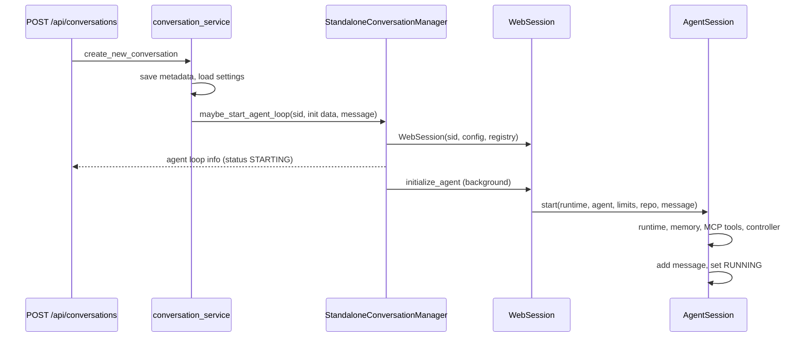

## Overview

On the server, a conversation is stored data (metadata and events) and, while it runs, an agent loop: one runtime, one memory, one controller and one event stream. The `ConversationManager` decides when an agent loop exists. It starts one when a conversation is created or a browser tab joins, routes user events to it, and closes it when it has been idle long enough. `WebSession` connects an agent loop to Socket.IO, and `AgentSession` builds the runtime, memory and controller in the right order.

Sources: [openhands/server/conversation_manager/conversation_manager.py:20-50](repo://openhands/server/conversation_manager/conversation_manager.py#L20-L50), [openhands/server/session/session.py:40-117](repo://openhands/server/session/session.py#L40-L117), [openhands/server/session/agent_session.py:90-200](repo://openhands/server/session/agent_session.py#L90-L200)

The HTTP and socket entry points that call into the manager are described in [[Server Application]].

Sources: [openhands/server/listen_socket.py:120-158](repo://openhands/server/listen_socket.py#L120-L158)

## Creating a conversation

`POST /api/conversations` calls `create_new_conversation`, which first writes the conversation's metadata (repository, branch, trigger, provider) through `initialize_conversation`, then `start_conversation`.

Sources: [openhands/server/services/conversation_service.py:164-203](repo://openhands/server/services/conversation_service.py#L164-L203)

`start_conversation` loads the user's saved settings and refuses to start without them (`MissingSettingsError`) or without an LLM API key, except for Bedrock models, which authenticate with AWS credentials. It merges the settings with the provider tokens, repository, branch, custom secrets, conversation instructions and any request-level MCP config into a `ConversationInitData`, wraps the initial text and images in a `MessageAction`, and calls `conversation_manager.maybe_start_agent_loop`.

Sources: [openhands/server/services/conversation_service.py:78-162](repo://openhands/server/services/conversation_service.py#L78-L162)

## The standalone manager

### State it keeps

`StandaloneConversationManager`, the default, runs every agent loop in the server process. It keeps `_local_agent_loops_by_sid` (conversation id to `WebSession`) and `_local_connection_id_to_session_id` (socket to conversation). Entering its context starts the cleanup task and calls the runtime class's `setup`; leaving cancels the task and calls `teardown`.

Sources: [openhands/server/conversation_manager/standalone_conversation_manager.py:53-89](repo://openhands/server/conversation_manager/standalone_conversation_manager.py#L53-L89)

### Starting an agent loop

`maybe_start_agent_loop` returns the running session's info if one exists, so starting twice is harmless. Otherwise `_start_agent_loop` checks how many loops the user already has. At `max_concurrent_conversations` (3 by default), it closes the least recently updated ones, first telling their browsers `AGENT_ERROR$TOO_MANY_CONVERSATIONS`.

Sources: [openhands/server/conversation_manager/standalone_conversation_manager.py:280-336](repo://openhands/server/conversation_manager/standalone_conversation_manager.py#L280-L336), [openhands/core/config/openhands_config.py:112-114](repo://openhands/core/config/openhands_config.py#L112-L114)

It then creates the conversation's LLM registry and stats ([[LLM Integration]]) and a `WebSession`, registers it, and schedules `session.initialize_agent` as a background task, so the HTTP request returns before the sandbox is up. Finally it subscribes a callback that updates the conversation's metadata after every event.

Sources: [openhands/server/conversation_manager/standalone_conversation_manager.py:337-367](repo://openhands/server/conversation_manager/standalone_conversation_manager.py#L337-L367)

Sources: [openhands/server/services/conversation_service.py:147-160](repo://openhands/server/services/conversation_service.py#L147-L160), [openhands/server/conversation_manager/standalone_conversation_manager.py:296-367](repo://openhands/server/conversation_manager/standalone_conversation_manager.py#L296-L367), [openhands/server/session/session.py:132-150](repo://openhands/server/session/session.py#L132-L150), [openhands/server/session/session.py:246-280](repo://openhands/server/session/session.py#L246-L280)

### Routing and metadata

`join_conversation` puts the socket in the room `room:<sid>` and starts the loop if needed. `send_to_event_stream` looks up the socket's conversation and calls `WebSession.dispatch`; `send_event_to_conversation` does the same by conversation id for `POST /events`. Disconnecting a socket only forgets the mapping; the agent keeps working.

Sources: [openhands/server/conversation_manager/standalone_conversation_manager.py:151-165](repo://openhands/server/conversation_manager/standalone_conversation_manager.py#L151-L165), [openhands/server/conversation_manager/standalone_conversation_manager.py:369-408](repo://openhands/server/conversation_manager/standalone_conversation_manager.py#L369-L408), [openhands/server/constants.py:3](repo://openhands/server/constants.py#L3)

The metadata callback sets `last_updated_at`, copies accumulated cost and token counts from events that carry metrics, refreshes the branch after git-related commands, and, while the title is still the default, asks the LLM for a title and pushes it to the browser as a status update.

Sources: [openhands/server/conversation_manager/standalone_conversation_manager.py:473-563](repo://openhands/server/conversation_manager/standalone_conversation_manager.py#L473-L563)

### Attaching from REST routes

REST routes that need the sandbox use `attach_to_conversation`, which returns a `ServerConversation`: the running loop's event stream and runtime when there is one, or a new runtime attached to the existing sandbox otherwise. Attachments are reference-counted; when the count reaches zero the conversation moves to a detached list, and the cleanup task disconnects detached conversations on its next pass.

Sources: [openhands/server/conversation_manager/standalone_conversation_manager.py:91-177](repo://openhands/server/conversation_manager/standalone_conversation_manager.py#L91-L177), [openhands/server/session/conversation.py:14-66](repo://openhands/server/session/conversation.py#L14-L66)

### Closing idle loops

Every 15 seconds `_cleanup_stale` closes agent loops that have been inactive for longer than `sandbox.close_delay` (an hour by default), are not running, and have no connected socket. A `close_delay` of 0 disables this, leaving sandboxes open. On shutdown the task closes every loop.

Sources: [openhands/server/conversation_manager/standalone_conversation_manager.py:179-228](repo://openhands/server/conversation_manager/standalone_conversation_manager.py#L179-L228), [openhands/server/conversation_manager/standalone_conversation_manager.py:48](repo://openhands/server/conversation_manager/standalone_conversation_manager.py#L48), [openhands/core/config/sandbox_config.py:81-84](repo://openhands/core/config/sandbox_config.py#L81-L84)

`_close_session` disconnects the conversation's sockets, removes the session and awaits `WebSession.close`, which tells the room the agent is `STOPPED` and closes the agent session.

Sources: [openhands/server/conversation_manager/standalone_conversation_manager.py:429-455](repo://openhands/server/conversation_manager/standalone_conversation_manager.py#L429-L455), [openhands/server/session/session.py:119-130](repo://openhands/server/session/session.py#L119-L130)

## WebSession

### Construction

The constructor creates the `AgentSession`, with `queue_status_message` as its status callback, and subscribes `on_event` to the event stream as `EventStreamSubscriber.SERVER`. It also lets the experiment manager adjust the config for this user and conversation.

Sources: [openhands/server/session/session.py:74-117](repo://openhands/server/session/session.py#L74-L117)

### Initialising the agent

`initialize_agent` publishes `LOADING`, then applies the user's settings to the conversation's config: agent class, confirmation mode and security analyzer, sandbox base or runtime image, git identity, iteration and budget limits, search API key and remote sandbox key. It adds the default MCP servers to the config ([[MCP Tools]]).

Sources: [openhands/server/session/session.py:132-210](repo://openhands/server/session/session.py#L132-L210)

With `enable_default_condenser` in the user's settings, the agent gets a pipeline of three condensers: the conversation window condenser for explicit requests, browser output masking that keeps the last two pages, and an LLM summarising condenser keeping four head events with `condenser_max_size` (default 120) as its size. The comment explains the order: masking browser output first means the summariser only sees the latest page, which keeps summarisation cheap ([[Condensers]]).

Sources: [openhands/server/session/session.py:211-245](repo://openhands/server/session/session.py#L211-L245)

It then creates the agent, sets the registry's retry listener to send `LLM_RETRY` status messages, and starts the agent session with the repository, branch, provider tokens, custom secrets and instructions from `ConversationInitData`. A failure sends an error to the browser, with the full message only for microagent problems and the exception class otherwise, to avoid leaking sensitive details.

Sources: [openhands/server/session/session.py:246-309](repo://openhands/server/session/session.py#L246-L309)

### Forwarding events

`on_event` forwards agent and user events to the browser, and environment events only for command output, agent state changes, recall observations and errors, relabelled as agent events because the UI treats environment feedback that way. Null events are dropped.

Sources: [openhands/server/session/session.py:311-351](repo://openhands/server/session/session.py#L311-L351)

Messages go through a queue and a single task that emits them to the conversation's room. On the first message it waits up to two seconds for a client to join the room, so early events are not lost while the browser is connecting. A successful send updates `last_active_ts`, which the idle cleanup uses.

Sources: [openhands/server/session/session.py:371-416](repo://openhands/server/session/session.py#L371-L416)

`dispatch` turns the client's data into an event and adds it with source `USER`, refusing image messages when vision is disabled or unsupported by the model. Status messages from the runtime, controller or memory are sent as `status_update` messages; an `error` status also moves the controller to `ERROR`.

Sources: [openhands/server/session/session.py:353-369](repo://openhands/server/session/session.py#L353-L369), [openhands/server/session/session.py:418-452](repo://openhands/server/session/session.py#L418-L452)

## AgentSession

`AgentSession.start` builds the agent loop in a fixed order, because each step needs the one before.

Sources: [openhands/server/session/agent_session.py:90-130](repo://openhands/server/session/agent_session.py#L90-L130)

1. `_create_runtime` creates the runtime with the agent's plugins and the custom secrets and provider tokens as environment variables (for the remote runtime, provider tokens that a custom secret overrides are dropped), connects it, clones the repository and runs the setup script and git hooks ([[Runtime Architecture]]).
2. Provider tokens and custom secrets are registered with the event stream for masking.
3. `_create_memory` creates `Memory` with runtime info, conversation instructions, secret descriptions and the repository's microagents ([[Conversation Memory]]).
4. MCP tools are added to the agent, before the controller, so they appear in the system message.
5. `_create_controller` restores saved state if there is any and creates the `AgentController` ([[Agent Controller]]); with `replay_json` it creates a replaying controller instead.
6. The initial message is published followed by `ChangeAgentStateAction(RUNNING)`, or, with no message, `AWAITING_USER_INPUT`.

Sources: [openhands/server/session/agent_session.py:90-200](repo://openhands/server/session/agent_session.py#L90-L200), [openhands/server/session/agent_session.py:277-384](repo://openhands/server/session/agent_session.py#L277-L384), [openhands/server/session/agent_session.py:386-481](repo://openhands/server/session/agent_session.py#L386-L481)

`close` waits up to 90 seconds for a start in progress to finish, closes the event stream, saves and closes the controller, and closes the runtime on a worker thread.

Sources: [openhands/server/session/agent_session.py:224-245](repo://openhands/server/session/agent_session.py#L224-L245), [openhands/server/session/agent_session.py:38](repo://openhands/server/session/agent_session.py#L38)

## The Docker nested manager

`DockerNestedConversationManager` runs each conversation's agent loop inside its own sandbox container rather than in the server process. For each conversation it creates a `DockerRuntime` whose main module is `openhands.server`, so the container runs a full OpenHands server with the standalone manager, the `local` runtime, no frontend, a session API key derived from the JWT secret and the conversation id, and the host's file store mounted when it is local.

Sources: [openhands/server/conversation_manager/docker_nested_conversation_manager.py:60-68](repo://openhands/server/conversation_manager/docker_nested_conversation_manager.py#L60-L68), [openhands/server/conversation_manager/docker_nested_conversation_manager.py:534-619](repo://openhands/server/conversation_manager/docker_nested_conversation_manager.py#L534-L619), [openhands/server/conversation_manager/docker_nested_conversation_manager.py:480-488](repo://openhands/server/conversation_manager/docker_nested_conversation_manager.py#L480-L488)

Starting a conversation builds the image if needed, reuses an existing container or starts a new one, and in the background waits for the nested server, then posts the user's settings, provider tokens and secrets to its API and creates the conversation there with the same id. User events are posted to the nested `/events` endpoint, and closing asks the nested server to stop the conversation before stopping the container.

Sources: [openhands/server/conversation_manager/docker_nested_conversation_manager.py:148-188](repo://openhands/server/conversation_manager/docker_nested_conversation_manager.py#L148-L188), [openhands/server/conversation_manager/docker_nested_conversation_manager.py:189-281](repo://openhands/server/conversation_manager/docker_nested_conversation_manager.py#L189-L281), [openhands/server/conversation_manager/docker_nested_conversation_manager.py:296-343](repo://openhands/server/conversation_manager/docker_nested_conversation_manager.py#L296-L343)

The outer server does not attach to these conversations or relay their sockets; `attach_to_conversation` raises, because clients connect directly to the nested server. It reads their events with `NestedEventStore` ([[Events and Event Stream]]).

Sources: [openhands/server/conversation_manager/docker_nested_conversation_manager.py:70-79](repo://openhands/server/conversation_manager/docker_nested_conversation_manager.py#L70-L79), [openhands/server/conversation_manager/docker_nested_conversation_manager.py:130-140](repo://openhands/server/conversation_manager/docker_nested_conversation_manager.py#L130-L140)
