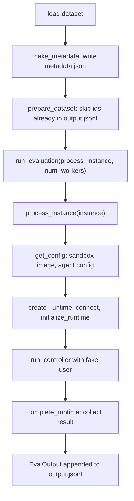

## Overview

`evaluation/` measures how well an agent and model solve benchmark tasks. Each benchmark has its own folder with a `run_infer.py` that runs OpenHands on every instance of a dataset and records the result; scoring usually happens afterwards with the benchmark's own tools. The scripts share helpers in `evaluation/utils/shared.py` for metadata, dataset slicing, parallel execution with retries, and evaluation-friendly configuration, and they all run the agent through `run_controller` from [[Headless Mode]].

Sources: [evaluation/README.md:1-18](repo://evaluation/README.md#L1-L18), [evaluation/utils/shared.py:44-79](repo://evaluation/utils/shared.py#L44-L79)

## Benchmarks

| Area | Benchmarks (folder under `evaluation/benchmarks`) |
| --- | --- |
| Software engineering | `swe_bench`, `humanevalfix`, `bird`, `biocoder`, `ml_bench`, `gorilla`, `toolqa`, `aider_bench`, `commit0_bench`, `discoverybench`, `terminal_bench` |
| Web browsing | `webarena`, `miniwob`, `browsing_delegation` |
| Misc. assistance | `gaia`, `gpqa`, `agent_bench`, `mint`, `EDA`, `logic_reasoning`, `scienceagentbench` |
| Real world | `the_agent_company` |

Sources: [evaluation/README.md:95-131](repo://evaluation/README.md#L95-L131)

## Choosing models and condensers

Evaluation reads only the LLM sections of `config.toml`; other settings come from each benchmark's `get_config`. The model is chosen by naming an `[llm.NAME]` group on the command line, and a condenser by setting `EVAL_CONDENSER` to a `[condenser.NAME]` group; without one the run uses no condenser and keeps the full history ([[Condensers]]).

Sources: [evaluation/README.md:20-75](repo://evaluation/README.md#L20-L75), [evaluation/benchmarks/swe_bench/run_infer.py:801-820](repo://evaluation/benchmarks/swe_bench/run_infer.py#L801-L820)

```toml
[llm.eval_gpt4_1106_preview_llm]
model = "gpt-4-1106-preview"
api_key = "XXX"
temperature = 0.0

[condenser.summarizer_for_eval]
type = "llm"
llm_config = "haiku"
keep_first = 2
max_size = 100
```

Sources: [evaluation/README.md:27-62](repo://evaluation/README.md#L27-L62)

```bash
EVAL_CONDENSER=summarizer_for_eval \
./evaluation/benchmarks/swe_bench/scripts/run_infer.sh llm.eval_gpt4_1106_preview HEAD CodeActAgent 500 100 1 princeton-nlp/SWE-bench_Verified test
```

Sources: [evaluation/README.md:66-69](repo://evaluation/README.md#L66-L69)

The evaluation parser adds `--eval-output-dir`, `--eval-n-limit`, `--eval-num-workers` (default 4), `--eval-note` and `--eval-ids` to the headless arguments.

Sources: [openhands/core/config/arg_utils.py:67-99](repo://openhands/core/config/arg_utils.py#L67-L99), [openhands/core/config/arg_utils.py:218-224](repo://openhands/core/config/arg_utils.py#L218-L224)

## The shape of a run_infer.py

### The four steps

Every benchmark script follows the same pattern: load the dataset, describe the run with `make_metadata`, drop finished instances with `prepare_dataset`, and hand a `process_instance` function to `run_evaluation`.

Sources: [evaluation/benchmarks/swe_bench/run_infer.py:747-820](repo://evaluation/benchmarks/swe_bench/run_infer.py#L747-L820), [evaluation/benchmarks/swe_bench/run_infer.py:821-880](repo://evaluation/benchmarks/swe_bench/run_infer.py#L821-L880)



Sources: [evaluation/utils/shared.py:164-217](repo://evaluation/utils/shared.py#L164-L217), [evaluation/utils/shared.py:219-290](repo://evaluation/utils/shared.py#L219-L290), [evaluation/benchmarks/swe_bench/run_infer.py:606-711](repo://evaluation/benchmarks/swe_bench/run_infer.py#L606-L711)

### Metadata and datasets

`make_metadata` builds `EvalMetadata` (agent class, LLM config, agent config, iteration limit, output directory, start time, git commit, dataset and split, condenser config and extra details), creates the output folder, and writes `metadata.json` there. The output folder is `<output dir>/<dataset>/<agent>/<model>_maxiter_<N>` plus `_N_<note>` when a note is given, so runs with different settings do not overwrite each other.

Sources: [evaluation/utils/shared.py:44-56](repo://evaluation/utils/shared.py#L44-L56), [evaluation/utils/shared.py:164-217](repo://evaluation/utils/shared.py#L164-L217)

`prepare_dataset` requires an `instance_id` column, reads any existing `output.jsonl` and removes instances already finished, so an interrupted run resumes where it stopped. `--eval-ids` restricts the run to named instances and `--eval-n-limit` to the first N.

Sources: [evaluation/utils/shared.py:219-290](repo://evaluation/utils/shared.py#L219-L290)

### Running instances

`run_evaluation` appends results to `output.jsonl` as they finish. With more than one worker it uses a multiprocessing pool and `imap_unordered`, otherwise it runs instances in order; a progress bar tracks completion.

Sources: [evaluation/utils/shared.py:486-550](repo://evaluation/utils/shared.py#L486-L550), [evaluation/utils/shared.py:292-306](repo://evaluation/utils/shared.py#L292-L306)

Each instance runs inside `_process_instance_wrapper`, which applies an optional per-instance timeout with `SIGALRM` and retries failures up to `max_retries` times, pausing five seconds between attempts. When the error looks like a lost runtime it counts the failure and passes `runtime_failure_count` to the next attempt, which SWE-bench uses to double the remote sandbox's resource factor each time, up to 8. After the last retry the instance is logged to `maximum_retries_exceeded.jsonl` and skipped rather than stopping the run.

Sources: [evaluation/utils/shared.py:387-480](repo://evaluation/utils/shared.py#L387-L480), [evaluation/utils/shared.py:89-103](repo://evaluation/utils/shared.py#L89-L103), [evaluation/utils/shared.py:317-385](repo://evaluation/utils/shared.py#L317-L385), [evaluation/benchmarks/swe_bench/run_infer.py:620-628](repo://evaluation/benchmarks/swe_bench/run_infer.py#L620-L628)

Errors that should trigger a retry are recognised by `is_fatal_evaluation_error` and `is_fatal_runtime_error`; a script raises `EvalException` when the final state carries such an error.

Sources: [evaluation/utils/shared.py:626-668](repo://evaluation/utils/shared.py#L626-L668), [evaluation/benchmarks/swe_bench/run_infer.py:652-654](repo://evaluation/benchmarks/swe_bench/run_infer.py#L652-L654)

### Configuration for evaluation

`get_default_sandbox_config_for_eval` gives a 300-second action timeout, a 30-second soft timeout for commands (`NO_CHANGE_TIMEOUT_SECONDS`), no host network, no kept-alive runtimes, and remote runtime settings from `ALLHANDS_API_KEY` and `SANDBOX_REMOTE_RUNTIME_API_URL` with the Sysbox runtime class and long start-up timeouts. `get_openhands_config_for_eval` builds the `OpenHandsConfig` around it from the metadata ([[Runtime Implementations]]).

Sources: [evaluation/utils/shared.py:692-760](repo://evaluation/utils/shared.py#L692-L760)

Benchmarks answer the agent with `codeact_user_response`, which tells it to keep working, to send its answer as a message before finishing, optionally to wrap the answer in `<solution>` tags, and never to ask for human help.

Sources: [evaluation/utils/shared.py:106-155](repo://evaluation/utils/shared.py#L106-L155)

`get_metrics` extracts the run's cost and token usage from the final state, and `update_llm_config_for_completions_logging` turns on per-instance completion logs.

Sources: [evaluation/utils/shared.py:594-613](repo://evaluation/utils/shared.py#L594-L613), [evaluation/utils/shared.py:670-690](repo://evaluation/utils/shared.py#L670-L690)

## SWE-bench as an example

For SWE-bench, `get_config` uses the instance's own Docker image as the sandbox base image (the official SWE-bench images, or SWE-Gym's), built for `linux/amd64`, with auto-lint on. The agent gets no Jupyter, no MCP and no prompt extensions, the browser only when requested, and the condenser from the metadata; the LLM logs completions per instance and a `draft_editor` LLM is configured when present ([[Runtime Images]]).

Sources: [evaluation/benchmarks/swe_bench/run_infer.py:206-266](repo://evaluation/benchmarks/swe_bench/run_infer.py#L206-L266)

`process_instance` creates and connects the runtime, prepares the repository in the sandbox with `initialize_runtime`, builds the instruction from the issue with `get_instruction`, and runs `run_controller` with the agent's fake user. `complete_runtime` then collects the `git diff` of the agent's changes.

Sources: [evaluation/benchmarks/swe_bench/run_infer.py:606-668](repo://evaluation/benchmarks/swe_bench/run_infer.py#L606-L668), [evaluation/benchmarks/swe_bench/run_infer.py:268-275](repo://evaluation/benchmarks/swe_bench/run_infer.py#L268-L275), [evaluation/benchmarks/swe_bench/run_infer.py:437-445](repo://evaluation/benchmarks/swe_bench/run_infer.py#L437-L445)

The patch is not scored here: the comment explains that the agent may have altered the environment or the tests, so scoring runs separately with `eval_infer.sh`. The `EvalOutput` saved for the instance holds the instance id, instruction, the instance itself, `test_result` with the patch, metadata, the full history, metrics and any error.

Sources: [evaluation/benchmarks/swe_bench/run_infer.py:670-711](repo://evaluation/benchmarks/swe_bench/run_infer.py#L670-L711), [evaluation/utils/shared.py:59-79](repo://evaluation/utils/shared.py#L59-L79)

## Adding a benchmark

The README asks for one folder per benchmark holding its preprocessing, evaluation and analysis scripts, with raw data and outputs kept out of the repository; results are shared through the OpenHands evaluation Hugging Face space.

Sources: [evaluation/README.md:133-146](repo://evaluation/README.md#L133-L146)
