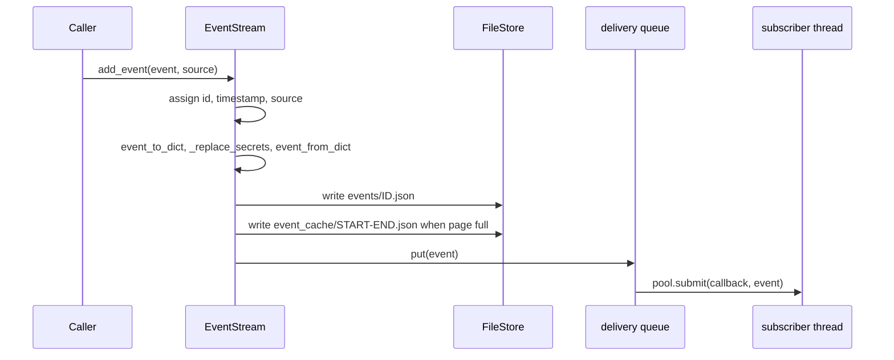

## Overview

An event is either an action (something the user or agent wants done) or an observation (what came back). Every component in a conversation talks through one `EventStream`: the controller, runtime, memory, server session and CLI each add events to it and subscribe to it. The stream gives each event an id, writes it to the conversation's file store, masks secrets, and delivers it to every subscriber. Reading the history back goes through `EventStore.search_events`.

Sources: [openhands/events/stream.py:23-69](repo://openhands/events/stream.py#L23-L69), [openhands/events/event_store.py:43-51](repo://openhands/events/event_store.py#L43-L51)

`EventStream` extends `EventStore`, so the object that delivers live events is also the one that reads stored ones. The concrete event classes are catalogued in [[Actions and Observations]].

Sources: [openhands/events/stream.py:43-57](repo://openhands/events/stream.py#L43-L57)

## The Event base class

`Event` is a dataclass whose metadata lives in underscore attributes exposed as properties: `id` (`-1`, `INVALID_ID`, until the stream assigns one), `timestamp`, `source`, `cause` (the id of the event this one answers), `timeout`, `llm_metrics`, `tool_call_metadata` and `response_id`. `EventSource` is `agent`, `user` or `environment`.

Sources: [openhands/events/event.py:9-12](repo://openhands/events/event.py#L9-L12), [openhands/events/event.py:35-131](repo://openhands/events/event.py#L35-L131)

`set_hard_timeout` sets `_timeout` and, on events that have a `blocking` field, sets it too, so a command with an explicit timeout blocks until that timeout.

Sources: [openhands/events/event.py:86-96](repo://openhands/events/event.py#L86-L96)

## Adding an event

`add_event(event, source)` refuses an event that already has an id, because that means a handler re-added an event it received, which would loop. Under a lock it stamps the timestamp and source, takes the next id from `cur_id`, serialises the event to a dict, masks secrets in the dict, rebuilds the event from the masked dict, and appends the dict to the current write page.

Sources: [openhands/events/stream.py:163-184](repo://openhands/events/stream.py#L163-L184)

Outside the lock it writes the event JSON to its own file, logging a warning when it exceeds about 1 MB, then writes the cache page if the page is full, and finally puts the event on the delivery queue. The cache page is written last on purpose: a reader that finds no page simply falls back to individual files.

Sources: [openhands/events/stream.py:186-213](repo://openhands/events/stream.py#L186-L213)



Sources: [openhands/events/stream.py:163-213](repo://openhands/events/stream.py#L163-L213), [openhands/events/stream.py:254-275](repo://openhands/events/stream.py#L254-L275)

On a new stream `cur_id` is computed lazily by listing the conversation's `events/` directory and taking the highest file id plus one, which is how a resumed conversation continues numbering where it stopped.

Sources: [openhands/events/event_store.py:53-83](repo://openhands/events/event_store.py#L53-L83)

## Secret masking

`set_secrets` and `update_secrets` give the stream the values to hide, typically provider tokens and user secrets. `_replace_secrets` walks the serialised event and replaces every occurrence of each secret value in string fields with `<secret_hidden>`. Top-level metadata (`timestamp`, `id`, `source`, `cause`, `action`, `observation`, `message`) is skipped, but nested fields at any depth are masked. Because the event is rebuilt from the masked dict, subscribers also receive the masked version, not only the stored copy.

Sources: [openhands/events/stream.py:215-244](repo://openhands/events/stream.py#L215-L244), [openhands/events/stream.py:177-179](repo://openhands/events/stream.py#L177-L179)

## Subscribing and delivery

`subscribe(subscriber_id, callback, callback_id)` registers a callback under one of the fixed `EventStreamSubscriber` ids (`agent_controller`, `openhands_resolver`, `server`, `runtime`, `memory`, `main`, `test`) and a caller-chosen callback id, raising if that pair already exists. Each callback gets its own `ThreadPoolExecutor` with one worker, whose initializer creates a fresh asyncio loop for that thread.

Sources: [openhands/events/stream.py:23-30](repo://openhands/events/stream.py#L23-L30), [openhands/events/stream.py:71-76](repo://openhands/events/stream.py#L71-L76), [openhands/events/stream.py:130-148](repo://openhands/events/stream.py#L130-L148)

A daemon thread runs `_process_queue`. For each queued event it goes through subscriber ids in sorted order and submits the event to each callback's pool. Two guarantees follow: a given callback sees events one at a time and in id order, because its pool has one worker; and callbacks do not wait for each other, so the runtime running a long command does not delay the server forwarding events to the browser.

Sources: [openhands/events/stream.py:246-275](repo://openhands/events/stream.py#L246-L275)

Because each callback has its own event loop, async subscribers call `asyncio.get_event_loop().run_until_complete(...)` from their sync callback, as the controller and runtime do.

Sources: [openhands/controller/agent_controller.py:464-465](repo://openhands/controller/agent_controller.py#L464-L465), [openhands/runtime/base.py:320-322](repo://openhands/runtime/base.py#L320-L322)

An exception in a callback is logged with the subscriber and callback ids by a done-callback on the future. `unsubscribe` and `close` cancel the callback loop's pending tasks, stop and close the loop, and shut down the pool; `close` also stops the queue thread and drains the queue.

Sources: [openhands/events/stream.py:277-291](repo://openhands/events/stream.py#L277-L291), [openhands/events/stream.py:78-128](repo://openhands/events/stream.py#L78-L128), [openhands/events/stream.py:150-161](repo://openhands/events/stream.py#L150-L161)

## Storage layout

Events live under the conversation directory: `sessions/<sid>/` for single-user installs, or `users/<user_id>/conversations/<sid>/` when a user id is set. Each event is `events/<id>.json`, and pages of 25 events are also written as `event_cache/<start>-<end>.json`. The same directory holds the pickled agent state, metadata and conversation stats ([[Storage]]).

Sources: [openhands/storage/locations.py:1-38](repo://openhands/storage/locations.py#L1-L38), [openhands/events/event_store.py:155-159](repo://openhands/events/event_store.py#L155-L159), [openhands/events/event_store.py:50](repo://openhands/events/event_store.py#L50)

## Reading events

`search_events(start_id, end_id, reverse, filter, limit)` is a generator over ids. `end_id` is inclusive and defaults to the last event; with `reverse=True` the range is walked backwards. For each id it loads the 25-event cache page covering it when the current page does not, takes the event from the page, and falls back to reading `events/<id>.json`. Missing files are skipped, the filter is applied, and the generator stops early once `limit` matches are yielded or the process is shutting down.

Sources: [openhands/events/event_store.py:85-136](repo://openhands/events/event_store.py#L85-L136), [openhands/events/event_store.py:161-175](repo://openhands/events/event_store.py#L161-L175)

`get_event`, `get_latest_event` and `get_latest_event_id` read single events. `AsyncEventStoreWrapper` lets async code iterate a search with `async for`.

Sources: [openhands/events/event_store.py:138-148](repo://openhands/events/event_store.py#L138-L148), [openhands/events/async_event_store_wrapper.py:8-23](repo://openhands/events/async_event_store_wrapper.py#L8-L23)

## Filters

`EventFilter` combines optional criteria, all of which must pass: `include_types`, `exclude_types`, `source`, `start_date` and `end_date` compared against the ISO timestamp, `exclude_hidden`, and `query`, a case-insensitive substring search over the event's JSON. The controller's history filter, for example, excludes null events, state changes and hidden events ([[Agent Controller]]).

Sources: [openhands/events/event_filter.py:8-98](repo://openhands/events/event_filter.py#L8-L98), [openhands/controller/state/state_tracker.py:38-48](repo://openhands/controller/state/state_tracker.py#L38-L48)

## Serialisation

`event_to_dict` writes the metadata keys (`id`, `timestamp`, `source`, `message`, `cause`, `tool_call_metadata`, `llm_metrics`) at the top level, and the event type under `action` or `observation`. An action's remaining fields go under `args` (with `security_risk` as its enum value and `timeout` alongside); an observation's go under `content` and `extras`, with enums and Pydantic models converted to plain values.

Sources: [openhands/events/serialization/event.py:16-34](repo://openhands/events/serialization/event.py#L16-L34), [openhands/events/serialization/event.py:100-152](repo://openhands/events/serialization/event.py#L100-L152)

A serialised `CmdRunAction` therefore looks like this (values illustrative):

Sources: [openhands/events/action/commands.py:12-32](repo://openhands/events/action/commands.py#L12-L32)

```json
{
  "id": 12,
  "timestamp": "2025-01-01T12:00:00",
  "source": "agent",
  "message": "Running command: ls",
  "action": "run",
  "args": {
    "command": "ls",
    "is_input": false,
    "thought": "",
    "blocking": false,
    "is_static": false,
    "cwd": null,
    "hidden": false,
    "confirmation_state": "confirmed",
    "security_risk": -1
  },
  "timeout": 120
}
```

Sources: [openhands/events/serialization/event.py:100-135](repo://openhands/events/serialization/event.py#L100-L135), [openhands/events/action/commands.py:12-32](repo://openhands/events/action/commands.py#L12-L32), [openhands/events/action/action.py:8-18](repo://openhands/events/action/action.py#L8-L18)

`event_from_dict` picks `action_from_dict` or `observation_from_dict` by key, then restores the underscore metadata, rebuilding `ToolCallMetadata` and `Metrics` objects. `action_from_dict` looks the class up in `ACTION_TYPE_TO_CLASS`, renames fields from older event formats (`is_confirmed`, `images_urls`, `translated_ipython_code`, `keep_prompt`), and raises `LLMMalformedActionError` for an unknown action or wrong arguments. The same function parses actions an agent produces, which is why a bad action becomes an error the agent can see.

Sources: [openhands/events/serialization/event.py:52-91](repo://openhands/events/serialization/event.py#L52-L91), [openhands/events/serialization/action.py:53-154](repo://openhands/events/serialization/action.py#L53-L154)

`event_to_trajectory` serialises for saved trajectories and drops bulky browser fields (DOM, accessibility tree and, unless asked, screenshots). `truncate_content` keeps the head and tail of an over-long observation with a marker in between.

Sources: [openhands/events/serialization/event.py:36-49](repo://openhands/events/serialization/event.py#L36-L49), [openhands/events/serialization/event.py:155-178](repo://openhands/events/serialization/event.py#L155-L178)

## Remote event stores

`EventStoreABC` is the read interface. Besides `EventStore`, it is implemented by `NestedEventStore`, which reads a conversation running in another server process by paging through its `/events` endpoint, sending the `X-Session-API-Key` header and following `has_more`. The Docker nested conversation manager uses it to read conversations that run inside their own containers ([[Conversations and Sessions]]).

Sources: [openhands/events/event_store_abc.py:11-66](repo://openhands/events/event_store_abc.py#L11-L66), [openhands/events/nested_event_store.py:14-101](repo://openhands/events/nested_event_store.py#L14-L101), [openhands/server/conversation_manager/docker_nested_conversation_manager.py:130-140](repo://openhands/server/conversation_manager/docker_nested_conversation_manager.py#L130-L140)
