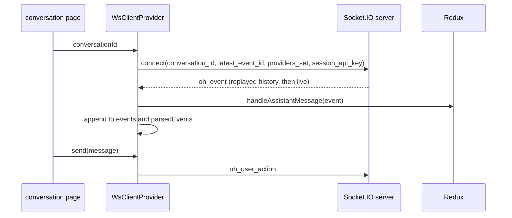

## Overview

The browser UI in `frontend/` is a single-page React application built with React Router in SPA mode, Vite, TanStack Query for server data, Redux for live conversation state, Tailwind CSS and i18next. It talks to the backend in two ways: REST calls to `/api` for everything that is request and response (conversations, settings, files, git), and one Socket.IO connection per open conversation that streams events and carries the user's messages ([[Server Application]]).

Sources: [frontend/README.md:1-18](repo://frontend/README.md#L1-L18), [frontend/package.json:9-60](repo://frontend/package.json#L9-L60)

The built app is served by the backend from `frontend/build` unless `SERVE_FRONTEND=false`; in development it runs on port 3001 against the backend on 3000 ([[Quickstart]]).

Sources: [openhands/server/listen.py:15-18](repo://openhands/server/listen.py#L15-L18), [frontend/README.md:40-70](repo://frontend/README.md#L40-L70)

## Routes

All pages render inside `root-layout.tsx`. The home page starts conversations, `conversations/:conversationId` shows one conversation, `settings` has a sub-route per settings screen, and `microagent-management` lists and edits repository microagents.

Sources: [frontend/src/routes.ts:1-25](repo://frontend/src/routes.ts#L1-L25)

| Path | Screen |
| --- | --- |
| `/` | Home: repository picker, new conversation, recent conversations, suggested tasks |
| `/conversations/:conversationId` | Chat with the agent and workspace panels |
| `/settings` | LLM settings (index) |
| `/settings/mcp`, `/user`, `/integrations`, `/app`, `/billing`, `/secrets`, `/api-keys` | MCP servers, user, git providers, application, credits, secrets, API keys |
| `/microagent-management` | Repository microagents |
| `/accept-tos` | Terms of service |

Sources: [frontend/src/routes.ts:8-24](repo://frontend/src/routes.ts#L8-L24), [frontend/src/routes/home.tsx:12-45](repo://frontend/src/routes/home.tsx#L12-L45)

The settings screens differ by app mode: in `saas` mode there are no LLM settings and `/settings` redirects to the user screen, while `oss` mode hides the SaaS-only screens such as billing and API keys.

Sources: [frontend/src/routes/settings.tsx:20-80](repo://frontend/src/routes/settings.tsx#L20-L80)

## The root layout

`MainApp` loads the server config (`GET /api/options/config`), the user's settings and their authentication state. It applies the saved language, shows the analytics consent form in OSS mode when consent has not been given, and, in SaaS mode, shows the login or re-login modal and the payment setup for new users. It renders the sidebar and the current route.

Sources: [frontend/src/routes/root-layout.tsx:65-140](repo://frontend/src/routes/root-layout.tsx#L65-L140), [frontend/src/routes/root-layout.tsx:184-244](repo://frontend/src/routes/root-layout.tsx#L184-L244)

## Server data with TanStack Query

Request-response data lives in TanStack Query. The `OpenHands` class in `api/open-hands.ts` wraps the REST endpoints with an axios instance whose base URL is `VITE_BACKEND_BASE_URL` or the page's own host; other services under `api/` cover git, settings, secrets, options and auth.

Sources: [frontend/src/api/open-hands.ts:24-70](repo://frontend/src/api/open-hands.ts#L24-L70), [frontend/src/api/open-hands.ts:257-315](repo://frontend/src/api/open-hands.ts#L257-L315), [frontend/src/api/open-hands-axios.ts:1-5](repo://frontend/src/api/open-hands-axios.ts#L1-L5)

Hooks in `hooks/query` and `hooks/mutation` wrap those calls, one per resource: `useSettings` maps the API's settings to the UI's field names and caches them for five minutes, `useCreateConversation` posts a new conversation and invalidates the conversation list, and so on.

Sources: [frontend/src/hooks/query/use-settings.ts:1-60](repo://frontend/src/hooks/query/use-settings.ts#L1-L60), [frontend/src/hooks/mutation/use-create-conversation.ts:20-55](repo://frontend/src/hooks/mutation/use-create-conversation.ts#L20-L55)

The shared `QueryClient` handles errors in one place: a 401 invalidates the authentication query so the app re-checks login, and other errors show a toast (the same message at most once every three seconds) unless the query opts out with `meta.disableToast`.

Sources: [frontend/src/query-client-config.ts:1-48](repo://frontend/src/query-client-config.ts#L1-L48)

## The conversation page

`conversation.tsx` resets the Redux terminal, Jupyter and conversation state, sets the agent to `LOADING`, and loads the conversation. A conversation that does not exist sends the user home with an error; one that is `STOPPED` is started with `POST /start`. The page then wraps its content in `WsClientProvider` and an `EventHandler`.

Sources: [frontend/src/routes/conversation.tsx:32-103](repo://frontend/src/routes/conversation.tsx#L32-L103)

`useActiveConversation` polls the conversation every three seconds while it is `STARTING` and every 30 seconds afterwards, which is how the page notices the sandbox is ready and picks up title changes.

Sources: [frontend/src/hooks/query/use-active-conversation.ts:6-26](repo://frontend/src/hooks/query/use-active-conversation.ts#L6-L26)

The layout puts the chat on the left and, when the right panel is open, workspace tabs on the right in resizable panels; below 1024 pixels they stack. The tabs are the changes (diff) view, browser screenshots, Jupyter, the terminal, served app ports and VS Code, each loaded lazily.

Sources: [frontend/src/components/features/conversation/conversation-main.tsx:29-66](repo://frontend/src/components/features/conversation/conversation-main.tsx#L29-L66), [frontend/src/components/features/conversation/conversation-tabs/conversation-tab-content.tsx:1-34](repo://frontend/src/components/features/conversation/conversation-tabs/conversation-tab-content.tsx#L1-L34)

## The WebSocket client

`WsClientProvider` owns the Socket.IO connection. It connects once the conversation is `RUNNING` or reports a runtime status, passing `conversation_id`, `latest_event_id`, the user's git providers and the conversation's `session_api_key` in the query string, since Socket.IO cannot send custom headers. When the conversation has its own URL (a nested runtime), it connects to that host and derives the socket path from the URL.

Sources: [frontend/src/context/ws-client-provider.tsx:286-360](repo://frontend/src/context/ws-client-provider.tsx#L286-L360)

Sources: [frontend/src/context/ws-client-provider.tsx:151-256](repo://frontend/src/context/ws-client-provider.tsx#L151-L256), [openhands/server/listen_socket.py:35-145](repo://openhands/server/listen_socket.py#L35-L145)

Each `oh_event` goes through `handleMessage`. It passes the event to the Redux handlers, turns error status updates and error agent states into the chat's error banner, appends actions and observations to `parsedEvents` (what the chat renders) and every message to `events`, clears the optimistic copy of the user's message when the real one arrives, and invalidates cached diffs when a file is edited or a command runs.

Sources: [frontend/src/context/ws-client-provider.tsx:164-256](repo://frontend/src/context/ws-client-provider.tsx#L164-L256)

On disconnect it records the id of the last event in the reconnection query, so the server replays only what was missed ([[Server Application]]). `send` emits `oh_user_action`.

Sources: [frontend/src/context/ws-client-provider.tsx:258-269](repo://frontend/src/context/ws-client-provider.tsx#L258-L269), [frontend/src/context/ws-client-provider.tsx:151-157](repo://frontend/src/context/ws-client-provider.tsx#L151-L157)

## Live state in Redux

Data that changes with every event is in a Redux store with one slice per concern: agent state, terminal commands, Jupyter cells, browser URL and screenshot, code and file state, security analyzer input, status message, metrics, conversation UI, microagent management and event messages.

Sources: [frontend/src/store.ts:1-40](repo://frontend/src/store.ts#L1-L40)

`handleAssistantMessage` routes each event to these slices. Actions update metrics from `llm_metrics`, add commands to the terminal and code to the Jupyter view, and feed actions with a `security_risk` to the security panel; hidden actions are ignored. Observations append command output, Jupyter output, browser screenshots and URLs, and set the agent state. Status updates set the status line, or, when they carry a new conversation title, refresh the conversation query.

Sources: [frontend/src/services/actions.ts:17-77](repo://frontend/src/services/actions.ts#L17-L77), [frontend/src/services/observations.ts:11-78](repo://frontend/src/services/observations.ts#L11-L78)

`EventHandler` adds two hooks. `useHandleWSEvents` shows server errors as toasts and, when an error says the agent reached its maximum, sends `PAUSED` so the user can resume with a raised limit ([[Agent Controller]]). `useHandleRuntimeActive` reacts to the runtime becoming active.

Sources: [frontend/src/wrapper/event-handler.tsx:1-10](repo://frontend/src/wrapper/event-handler.tsx#L1-L10), [frontend/src/hooks/use-handle-ws-events.ts:15-46](repo://frontend/src/hooks/use-handle-ws-events.ts#L15-L46)

## The chat

`ChatInterface` renders the filtered `parsedEvents` as messages, shows suggestions in an empty conversation, and sends the user's input as a `message` action with text, image URLs, file URLs and a timestamp. The stop button sends a `change_agent_state` action to `STOPPED`.

Sources: [frontend/src/components/features/chat/chat-interface.tsx:43-146](repo://frontend/src/components/features/chat/chat-interface.tsx#L43-L146), [frontend/src/services/chat-service.ts:1-14](repo://frontend/src/services/chat-service.ts#L1-L14)

## Development

`npm run dev` serves the app on port 3001 with the backend partly mocked by Mock Service Worker; `npm run dev:mock` and `dev:mock:saas` start it with mocks explicitly, the latter simulating SaaS mode. Environment variables such as `VITE_BACKEND_HOST`, `VITE_BACKEND_BASE_URL`, `VITE_USE_TLS` and `VITE_MOCK_API` point it at a real or mocked backend, and the Vite dev server proxies API and socket requests to `VITE_BACKEND_HOST`.

Sources: [frontend/README.md:40-82](repo://frontend/README.md#L40-L82), [frontend/vite.config.ts:10-30](repo://frontend/vite.config.ts#L10-L30), [frontend/vite.config.ts:80-90](repo://frontend/vite.config.ts#L80-L90)
