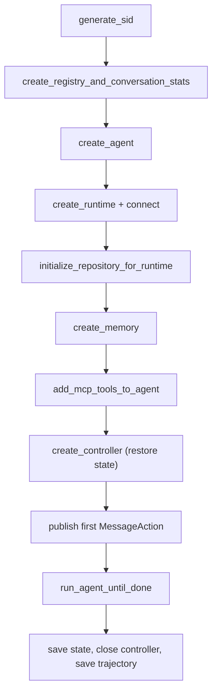

## Overview

Headless mode runs one task from start to finish with no interface: `python -m openhands.core.main -t "..."` builds the agent, sandbox, memory and controller, sends the task, answers the agent's questions automatically, and exits when the agent finishes, gives up, errors or hits a limit. The same function, `run_controller`, is what scripts and the [[Evaluation Harness]] call to run OpenHands programmatically. The helpers it uses in `openhands/core/setup.py` are the shared wiring for every entry point.

Sources: [openhands/core/main.py:51-96](repo://openhands/core/main.py#L51-L96), [evaluation/benchmarks/swe_bench/run_infer.py:647](repo://evaluation/benchmarks/swe_bench/run_infer.py#L647)

The [[Command-Line Interface]] builds its sessions from the same helpers, and the server's agent session follows the same order with its own code ([[Conversations and Sessions]]).

Sources: [openhands/cli/main.py:150-180](repo://openhands/cli/main.py#L150-L180), [openhands/server/session/agent_session.py:130-200](repo://openhands/server/session/agent_session.py#L130-L200)

## Running from the command line

When run as a module, `main.py` parses the headless arguments, builds the config ([[Configuration]]), and reads the task from `-f`, `-t` or piped stdin. It refuses to run without a task, except in trajectory replay mode, which refuses a task instead. `-n NAME` makes the session id derive from a name, so a later run with the same name continues the same conversation.

Sources: [openhands/core/main.py:286-320](repo://openhands/core/main.py#L286-L320), [openhands/io/io.py:26-37](repo://openhands/io/io.py#L26-L37)

```bash
poetry run python -m openhands.core.main \
  --selected-repo "owner/repo-name" \
  -t "analyze the codebase and suggest improvements"
```

Sources: [docs/usage/how-to/headless-mode.mdx:27-31](repo://docs/usage/how-to/headless-mode.mdx#L27-L31)

`generate_sid` hashes the session name (or a random UUID) with the JWT secret and keeps ids at 32 characters, so Kubernetes resource names built from them stay under the 63-character limit.

Sources: [openhands/core/setup.py:246-270](repo://openhands/core/setup.py#L246-L270)

## run_controller step by step



Sources: [openhands/core/main.py:97-175](repo://openhands/core/main.py#L97-L175), [openhands/core/main.py:177-243](repo://openhands/core/main.py#L177-L243)

1. `create_registry_and_conversation_stats` creates the conversation's LLM registry and metrics store ([[LLM Integration]]).
2. `create_agent` instantiates `config.default_agent` with its config section ([[Agents and Tools]]).
3. Unless a runtime is passed in, `create_runtime` builds the event stream on the configured file store and the runtime class with the agent's sandbox plugins, using `GITHUB_TOKEN`, `GITLAB_TOKEN` and `BITBUCKET_TOKEN` from the environment as provider tokens. `run_controller` then connects it.
4. With `sandbox.selected_repo`, `initialize_repository_for_runtime` clones it, runs `.openhands/setup.sh` and installs the pre-commit hook ([[Runtime Architecture]]).
5. `create_memory` creates `Memory` with runtime info, conversation instructions, the repository's microagents and the repository info ([[Conversation Memory]]).
6. With `enable_mcp`, the default stdio MCP servers are added and MCP tools are loaded into the agent ([[MCP Tools]]).
7. `create_controller` tries to restore a saved `State` for the session and creates the `AgentController` with the configured iteration and budget limits and confirmation mode ([[Agent Controller]]).

Sources: [openhands/core/main.py:97-175](repo://openhands/core/main.py#L97-L175), [openhands/core/setup.py:35-117](repo://openhands/core/setup.py#L35-L117), [openhands/core/setup.py:119-200](repo://openhands/core/setup.py#L119-L200), [openhands/core/setup.py:202-244](repo://openhands/core/setup.py#L202-L244)

Every step except the runtime and memory can be replaced by passing objects in: `run_controller` accepts an existing `runtime` and `memory`, which is how evaluations prepare a sandbox before handing it over.

Sources: [openhands/core/main.py:51-61](repo://openhands/core/main.py#L51-L61), [openhands/core/main.py:107-142](repo://openhands/core/main.py#L107-L142)

## Starting and resuming

The initial action goes onto the stream as a user event. If the restored state ended with an error, the task is replaced by a message telling the agent not to resume its task and to ask the user about it, so a conversation that crashed does not repeat the failing step.

Sources: [openhands/core/main.py:177-192](repo://openhands/core/main.py#L177-L192)

## Answering the agent

`run_controller` subscribes a callback as `EventStreamSubscriber.MAIN`. Whenever the agent enters `AWAITING_USER_INPUT`, the callback publishes a reply: `/exit` when `exit_on_message` is set, the result of `fake_user_response_fn` when one is given, and otherwise a line read from the terminal.

Sources: [openhands/core/main.py:194-205](repo://openhands/core/main.py#L194-L205), [openhands/io/io.py:5-17](repo://openhands/io/io.py#L5-L17)

From the command line, the reply function is `auto_continue_response` unless `--no-auto-continue` is given. It tells the agent to continue with whatever approach it thinks best, to finish when done, and never to ask for a human response.

Sources: [openhands/core/main.py:247-260](repo://openhands/core/main.py#L247-L260), [openhands/core/main.py:311-320](repo://openhands/core/main.py#L311-L320)

```python
def auto_continue_response(
    state: State,
    encapsulate_solution: bool = False,
    try_parse: Callable[[Action | None], str] | None = None,
) -> str:
    """Default function to generate user responses.
    Tell the agent to proceed without asking for more input, or finish the interaction.
    """
    message = (
        'Please continue on whatever approach you think is suitable.\n'
        'If you think you have solved the task, please finish the interaction.\n'
        'IMPORTANT: YOU SHOULD NEVER ASK FOR HUMAN RESPONSE.\n'
    )
    return message
```

Sources: [openhands/core/main.py:247-260](repo://openhands/core/main.py#L247-L260)

The `FakeUserResponseFunc` protocol receives the current `State`, so a benchmark can inspect the history and answer differently, for example by checking whether a solution has been submitted.

Sources: [openhands/core/main.py:42-48](repo://openhands/core/main.py#L42-L48)

## Waiting for the end

`run_agent_until_done` installs one status callback on the runtime, controller and memory, refusing to run if one is already set. An `error` status records `last_error` and moves the controller to `ERROR`. It then polls once a second until the agent reaches an end state; for `run_controller` those are `FINISHED`, `REJECTED`, `ERROR`, `PAUSED` and `STOPPED`.

Sources: [openhands/core/loop.py:11-45](repo://openhands/core/loop.py#L11-L45), [openhands/core/main.py:207-218](repo://openhands/core/main.py#L207-L218)

Because the controller runs in headless mode, hitting the iteration limit is final: limits are only extended for interactive users ([[Agent Controller]]). The stuck detector also looks at the whole history in headless mode rather than only the part after the last user message.

Sources: [openhands/controller/state/control_flags.py:51-55](repo://openhands/controller/state/control_flags.py#L51-L55), [openhands/controller/stuck.py:28-49](repo://openhands/controller/stuck.py#L28-L49)

## Afterwards

When the loop ends, `run_controller` saves the final `State` to the file store (unless the store is `memory`), closes the controller without changing its state, and returns the state. Callers read `state.history`, `state.outputs`, `state.metrics` and `state.last_error` from it.

Sources: [openhands/core/main.py:220-231](repo://openhands/core/main.py#L220-L231), [openhands/controller/state/state.py:81-120](repo://openhands/controller/state/state.py#L81-L120)

With `save_trajectory_path`, the trajectory is written as JSON to that file, or to `<sid>.json` inside it when it is a folder; `save_screenshots_in_trajectory` keeps browser screenshots in it. With `replay_trajectory_path`, a saved trajectory's first message becomes the task and its actions are replayed instead of calling the model.

Sources: [openhands/core/main.py:233-243](repo://openhands/core/main.py#L233-L243), [openhands/core/main.py:158-170](repo://openhands/core/main.py#L158-L170), [openhands/core/main.py:263-283](repo://openhands/core/main.py#L263-L283)

## Calling it from Python

```python
import asyncio

from openhands.core.config import load_openhands_config
from openhands.core.main import auto_continue_response, run_controller
from openhands.events.action import MessageAction

config = load_openhands_config()
state = asyncio.run(
    run_controller(
        config=config,
        initial_user_action=MessageAction(content='Write a hello world program'),
        fake_user_response_fn=auto_continue_response,
    )
)
```

Sources: [openhands/core/main.py:93-95](repo://openhands/core/main.py#L93-L95), [openhands/core/main.py:51-61](repo://openhands/core/main.py#L51-L61)
