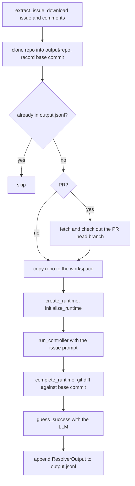

## Overview

The issue resolver points OpenHands at one issue or pull request on GitHub, GitLab or Bitbucket and lets it work unattended. `resolve_issue` fetches the issue and its comments, clones the repository, runs `CodeActAgent` in a sandbox on a prompt built from the issue, collects the resulting diff, and asks the LLM whether the change actually resolves the issue. The result goes to `output/output.jsonl`. A second command, `send_pull_request`, turns a successful result into a branch, a draft PR or a ready PR, or pushes follow-up commits to an existing PR.

Sources: [openhands/resolver/README.md:1-10](repo://openhands/resolver/README.md#L1-L10), [openhands/resolver/issue_resolver.py:535-600](repo://openhands/resolver/issue_resolver.py#L535-L600), [openhands/resolver/issue_resolver.py:601-665](repo://openhands/resolver/issue_resolver.py#L601-L665)

The resolver is a client of [[Headless Mode]]: it calls `run_controller` with its own runtime and an automatic user response. It is also packaged as a GitHub Actions workflow, `examples/openhands-resolver.yml`, triggered by a `fix-me` label or an `@openhands-agent` mention.

Sources: [openhands/resolver/issue_resolver.py:438-448](repo://openhands/resolver/issue_resolver.py#L438-L448), [openhands/resolver/README.md:11-66](repo://openhands/resolver/README.md#L11-L66)

## Running it

```bash
export GITHUB_TOKEN="your-github-token"    # or GITLAB_TOKEN / BITBUCKET_TOKEN
export GIT_USERNAME="your-github-username"
export LLM_MODEL="anthropic/claude-sonnet-4-20250514"
export LLM_API_KEY="your-llm-api-key"

python -m openhands.resolver.resolve_issue --selected-repo OWNER/REPO --issue-number 100
python -m openhands.resolver.send_pull_request --issue-number 100 --username YOUR_GIT_USERNAME --pr-type draft
```

Sources: [openhands/resolver/README.md:100-150](repo://openhands/resolver/README.md#L100-L150), [openhands/resolver/README.md:180-190](repo://openhands/resolver/README.md#L180-L190)

`resolve_issue` takes the repository, issue number, `--issue-type` (`issue` or `pr`), an optional `--comment-id` to focus on one comment, `--max-iterations` (default 50), output directory, LLM settings, a custom `--prompt-file`, a `--repo-instruction-file`, container images, `--runtime` and `--base-domain` for self-hosted servers.

Sources: [openhands/resolver/resolve_issue.py:8-79](repo://openhands/resolver/resolve_issue.py#L8-L79), [openhands/resolver/resolve_issue.py:80-135](repo://openhands/resolver/resolve_issue.py#L80-L135)

## Setting up a run

`IssueResolver.__init__` splits `owner/repo`, takes the token from `--token` or the provider token variables and requires a username. It works out which provider the token belongs to with `identify_token`, which tries to fetch the token's user from each provider in turn, and defaults the base domain accordingly.

Sources: [openhands/resolver/issue_resolver.py:55-113](repo://openhands/resolver/issue_resolver.py#L55-L113), [openhands/integrations/utils.py:13-40](repo://openhands/integrations/utils.py#L13-L40)

The prompt template is `prompts/resolve/basic-with-tests.jinja` for issues and `basic-followup.jinja` for PRs, each paired with a `-conversation-instructions.jinja` file that becomes the conversation instructions ([[Conversation Memory]]).

Sources: [openhands/resolver/issue_resolver.py:91-106](repo://openhands/resolver/issue_resolver.py#L91-L106)

`update_openhands_config` fixes the run's configuration: `CodeActAgent`, the given runtime (default `docker`), a budget of 4 USD per task, the iteration limit, a workspace under `output/workspace/<type>_<number>`, and the `github` microagent disabled. The sandbox uses the published runtime image for the installed version unless images are given, a 300-second action timeout, no auto-lint and no host networking, with adjustments for GitLab CI.

Sources: [openhands/resolver/issue_resolver.py:178-265](repo://openhands/resolver/issue_resolver.py#L178-L265), [openhands/resolver/issue_resolver.py:389-395](repo://openhands/resolver/issue_resolver.py#L389-L395)

Finally `IssueHandlerFactory` builds the issue handler for the provider and issue type.

Sources: [openhands/resolver/issue_resolver.py:160-175](repo://openhands/resolver/issue_resolver.py#L160-L175), [openhands/resolver/issue_handler_factory.py:15-60](repo://openhands/resolver/issue_handler_factory.py#L15-L60)

## Issue handlers

The resolver separates provider API calls from issue logic. `IssueHandlerInterface` is the provider side: download issues and comments, build URLs (clone, branch, compare, pull request, GraphQL), find or name branches, create PRs, request reviewers, reply to comments. `GithubIssueHandler`, `GitlabIssueHandler` and `BitbucketIssueHandler` implement it, with PR-specific subclasses.

Sources: [openhands/resolver/interfaces/issue.py:27-97](repo://openhands/resolver/interfaces/issue.py#L27-L97), [openhands/resolver/issue_handler_factory.py:36-60](repo://openhands/resolver/issue_handler_factory.py#L36-L60)

`ServiceContextIssue` and `ServiceContextPR` wrap a provider handler and an LLM and hold the logic that does not depend on the provider: building the instruction and judging success. An `Issue` carries owner, repository, number, title and body, plus thread comments, and for PRs the issues it closes, review comments, review threads with their files, thread ids, and head and base branches.

Sources: [openhands/resolver/interfaces/issue_definitions.py:19-45](repo://openhands/resolver/interfaces/issue_definitions.py#L19-L45), [openhands/resolver/interfaces/issue_definitions.py:270-275](repo://openhands/resolver/interfaces/issue_definitions.py#L270-L275), [openhands/resolver/interfaces/issue.py:7-25](repo://openhands/resolver/interfaces/issue.py#L7-L25)

## The resolution flow



Sources: [openhands/resolver/issue_resolver.py:519-600](repo://openhands/resolver/issue_resolver.py#L519-L600), [openhands/resolver/issue_resolver.py:601-665](repo://openhands/resolver/issue_resolver.py#L601-L665), [openhands/resolver/issue_resolver.py:397-456](repo://openhands/resolver/issue_resolver.py#L397-L456), [openhands/resolver/issue_resolver.py:457-517](repo://openhands/resolver/issue_resolver.py#L457-L517)

`resolve_issue` downloads the issue (failing with a checklist if it cannot be found) and checks that a given comment id matched something. It clones the repository once into `output/repo`, records `HEAD` as the base commit, reads `.openhands_instructions` as repository instructions if none were given, and skips issues already recorded in the output file. For a PR it fetches and checks out the head branch and uses its tip as the base.

Sources: [openhands/resolver/issue_resolver.py:519-533](repo://openhands/resolver/issue_resolver.py#L519-L533), [openhands/resolver/issue_resolver.py:545-600](repo://openhands/resolver/issue_resolver.py#L545-L600), [openhands/resolver/issue_resolver.py:601-665](repo://openhands/resolver/issue_resolver.py#L601-L665)

`process_issue` copies the repository into a fresh workspace, creates and connects a runtime ([[Runtime Implementations]]), moves to `/workspace`, disables the git pager and runs the repository's setup script and git hooks. `get_instruction` renders the prompt from the issue (including closing issues, review comments and threads for PRs) and repository instructions, and collects image URLs from the text so the model can see screenshots.

Sources: [openhands/resolver/issue_resolver.py:397-437](repo://openhands/resolver/issue_resolver.py#L397-L437), [openhands/resolver/issue_resolver.py:267-307](repo://openhands/resolver/issue_resolver.py#L267-L307), [openhands/resolver/interfaces/issue_definitions.py:115-172](repo://openhands/resolver/interfaces/issue_definitions.py#L115-L172)

The agent runs through `run_controller` with `codeact_user_response` as the fake user, which tells the agent to keep going, to message its answer and finish when done, and never to ask for human help ([[Headless Mode]]).

Sources: [openhands/resolver/issue_resolver.py:438-454](repo://openhands/resolver/issue_resolver.py#L438-L454), [openhands/resolver/utils.py:31-60](repo://openhands/resolver/utils.py#L31-L60)

Afterwards `complete_runtime` stages everything with `git add -A` and takes `git diff --no-color --cached <base_commit>`, retrying up to five times with growing timeouts. That patch, not the sandbox, is what leaves the run.

Sources: [openhands/resolver/issue_resolver.py:309-387](repo://openhands/resolver/issue_resolver.py#L309-L387)

## Judging success

`guess_success` asks the LLM whether the change resolves the issue. For an issue, it renders `guess_success/issue-success-check.jinja` with the issue body and thread comments, the agent's last message and the patch, and parses `--- success` / `--- explanation` from the answer; an unparseable answer counts as failure.

Sources: [openhands/resolver/interfaces/issue_definitions.py:370-410](repo://openhands/resolver/interfaces/issue_definitions.py#L370-L410)

For a PR, each review thread, the thread comments and the review comments are checked separately with their own templates. The PR counts as resolved only if every check passes, and the per-item results and explanations are kept so the follow-up comment can tick off which requests were addressed.

Sources: [openhands/resolver/interfaces/issue_definitions.py:45-108](repo://openhands/resolver/interfaces/issue_definitions.py#L45-L108), [openhands/resolver/interfaces/issue_definitions.py:173-268](repo://openhands/resolver/interfaces/issue_definitions.py#L173-L268), [openhands/resolver/issue_resolver.py:474-499](repo://openhands/resolver/issue_resolver.py#L474-L499)

## Output

Each run appends one `ResolverOutput` line to `output/output.jsonl`: the issue, its type, the instruction, base commit, git patch, full event history, metrics, `success`, per-comment success for PRs, the explanation, and any error. A crash in the agent is recorded as a failed result rather than aborting.

Sources: [openhands/resolver/resolver_output.py:8-20](repo://openhands/resolver/resolver_output.py#L8-L20), [openhands/resolver/issue_resolver.py:455-517](repo://openhands/resolver/issue_resolver.py#L455-L517)

`python -m openhands.resolver.visualize_resolver_output --issue-number N` shows a result for review.

Sources: [openhands/resolver/README.md:165-178](repo://openhands/resolver/README.md#L165-L178)

## Sending the result

`send_pull_request` reads the recorded output and skips failed results unless `--send-on-failure` is set. It copies the repository, checks out the base commit (or the PR's head branch), applies the patch, and commits with the configured git identity.

Sources: [openhands/resolver/send_pull_request.py:502-586](repo://openhands/resolver/send_pull_request.py#L502-L586), [openhands/resolver/send_pull_request.py:28-60](repo://openhands/resolver/send_pull_request.py#L28-L60), [openhands/resolver/send_pull_request.py:124-232](repo://openhands/resolver/send_pull_request.py#L124-L232)

For an issue it creates a branch named from `openhands-fix-issue-<number>` (made unique by the handler), pushes it to the repository or to `--fork-owner`'s fork, and depending on `--pr-type` stops there and returns a compare URL (`branch`) or opens a draft or ready PR against `--target-branch` or the default branch. The title defaults to `Fix issue #N: <title>`, the body says which issue it fixes, and `--reviewer` requests a review. Field names are mapped for each provider, such as `head`/`base` on GitHub and `source_branch`/`target_branch` on GitLab.

Sources: [openhands/resolver/send_pull_request.py:233-345](repo://openhands/resolver/send_pull_request.py#L233-L345), [openhands/resolver/send_pull_request.py:346-390](repo://openhands/resolver/send_pull_request.py#L346-L390)

For a PR, `update_existing_pull_request` pushes the new commit to the PR's branch and comments on the PR, using the LLM to summarise the changes and replying to the review threads that were addressed.

Sources: [openhands/resolver/send_pull_request.py:393-500](repo://openhands/resolver/send_pull_request.py#L393-L500)
