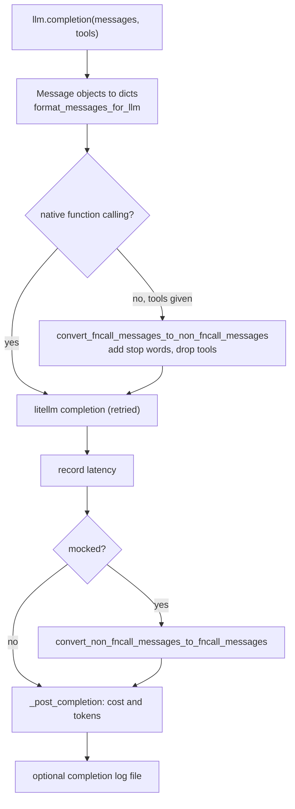

## Overview

Every model call in OpenHands goes through the `LLM` class, a wrapper around `litellm.completion`. It turns the configured `LLMConfig` into provider arguments, decides whether the model gets native function calling or a prompt-based imitation of it, retries transient failures, and records cost, token usage and latency in a `Metrics` object. `LLMRegistry` creates and shares these objects per conversation, and `ConversationStats` saves their metrics.

Sources: [openhands/llm/llm.py:43-58](repo://openhands/llm/llm.py#L43-L58), [openhands/llm/llm_registry.py:23-43](repo://openhands/llm/llm_registry.py#L23-L43)

Which messages are sent is decided by [[Conversation Memory]]; this page starts where those messages reach `llm.completion`.

Sources: [openhands/agenthub/codeact_agent/codeact_agent.py:207-218](repo://openhands/agenthub/codeact_agent/codeact_agent.py#L207-L218)

## Building the completion function

The constructor deep-copies the config, creates `Metrics` for the model, and calls `init_model_info`. It then assembles keyword arguments: temperature, `max_completion_tokens`, `top_k` and `top_p` if set.

Sources: [openhands/llm/llm.py:61-123](repo://openhands/llm/llm.py#L61-L123)

Several providers get special handling before the call is fixed.

Sources: [openhands/llm/llm.py:125-130](repo://openhands/llm/llm.py#L125-L130)

- A model named `openhands/NAME` is rewritten to `litellm_proxy/NAME` with the All Hands proxy as base URL.
- Models that support `reasoning_effort` get it passed through, and lose `temperature` and `top_p`; Gemini 2.5 Pro instead gets a 128-token thinking budget for `low`, `none` or unset effort.
- Azure models get `max_tokens` instead of `max_completion_tokens`.
- Mistral and Gemini models get `safety_settings`; AWS credentials are passed for Bedrock.
- Claude Opus 4.1 has extended thinking disabled and drops `top_p` when both sampling parameters are set.

Sources: [openhands/llm/llm.py:125-192](repo://openhands/llm/llm.py#L125-L192)

The result is a `functools.partial` of `litellm.completion` with the model, API key, base URL, API version, custom provider, timeout, `drop_params` and seed bound, wrapped by the retry decorator around an inner `wrapper` function. Callers use the `completion` property, which returns that wrapper.

Sources: [openhands/llm/llm.py:194-218](repo://openhands/llm/llm.py#L194-L218), [openhands/llm/llm.py:408-415](repo://openhands/llm/llm.py#L408-L415)

## Model information and features

`init_model_info` asks LiteLLM for the model's limits: from OpenRouter, from a LiteLLM proxy's `/v1/model/info` endpoint, or by model name with and without its provider prefix. It fills `max_input_tokens` and `max_output_tokens` from that info when they are not configured (Claude 3.7 Sonnet is pinned to 64,000 output tokens because the higher limit needs an extra header). Hugging Face models get `top_p` 0.9 instead of 1.

Sources: [openhands/llm/llm.py:417-521](repo://openhands/llm/llm.py#L417-L521)

Capabilities come from `get_features`, which matches the model name against glob pattern lists and returns four flags: function calling, reasoning effort, prompt caching, and stop-word support. Native function calling is on when the model matches, unless `native_tool_calling` in the config forces it either way.

Sources: [openhands/llm/model_features.py:54-139](repo://openhands/llm/model_features.py#L54-L139), [openhands/llm/llm.py:523-528](repo://openhands/llm/llm.py#L523-L528)

`vision_is_active` is true when vision is not disabled and LiteLLM or the model info says the model supports it; `OPENHANDS_FORCE_VISION` overrides the check. `is_caching_prompt_active` requires `caching_prompt` and a model on the prompt-cache list, which today means Anthropic models that need explicit cache breakpoints.

Sources: [openhands/llm/llm.py:530-575](repo://openhands/llm/llm.py#L530-L575)

## A completion call



Sources: [openhands/llm/llm.py:219-300](repo://openhands/llm/llm.py#L219-L300), [openhands/llm/llm.py:318-406](repo://openhands/llm/llm.py#L318-L406)

`wrapper` accepts messages positionally or as a keyword, and converts `Message` objects with `format_messages_for_llm`. That sets each message's cache, vision and function-calling flags, and forces plain-string content for DeepSeek, Groq's Kimi K2 and OpenRouter's Claude Sonnet 4.

Sources: [openhands/llm/llm.py:219-261](repo://openhands/llm/llm.py#L219-L261), [openhands/llm/llm.py:803-820](repo://openhands/llm/llm.py#L803-L820)

`Message` serialises in one of two shapes. With caching, vision or function calling enabled, content is a list of typed parts, where a cached part carries `cache_control: ephemeral` (moved to the message level for tool messages, as LiteLLM requires) and images appear only when vision is on. Otherwise content is joined into one string, which providers such as Hugging Face and Groq need. Tool calls and tool results are added in both shapes.

Sources: [openhands/core/message.py:24-50](repo://openhands/core/message.py#L24-L50), [openhands/core/message.py:53-150](repo://openhands/core/message.py#L53-L150)

The wrapper then sets LiteLLM's global `modify_params`, removes `extra_body` unless the model goes through a LiteLLM proxy, makes the call, records latency, raises `LLMNoResponseError` for a response without choices, computes cost, and, with `log_completions`, writes messages, response, arguments and cost to a JSON file per call.

Sources: [openhands/llm/llm.py:300-406](repo://openhands/llm/llm.py#L300-L406)

## Function calling without native support

For models without native tool calling, the wrapper imitates it in the prompt. `convert_fncall_messages_to_non_fncall_messages` appends a description of every tool and a strict call format to the system prompt, adds an in-context example to the first user message (except for `openhands-lm` and `devstral`), rewrites each assistant tool call as text, and turns each tool result into a user message starting `EXECUTION RESULT of [name]:`.

Sources: [openhands/llm/fn_call_converter.py:30-56](repo://openhands/llm/fn_call_converter.py#L30-L56), [openhands/llm/fn_call_converter.py:478-520](repo://openhands/llm/fn_call_converter.py#L478-L520), [openhands/llm/fn_call_converter.py:540-620](repo://openhands/llm/fn_call_converter.py#L540-L620), [openhands/llm/llm.py:264-298](repo://openhands/llm/llm.py#L264-L298)

```text
<function=example_function_name>
<parameter=example_parameter_1>value_1</parameter>
<parameter=example_parameter_2>
This is the value for the second parameter
that can span
multiple lines
</parameter>
</function>
```

Sources: [openhands/llm/fn_call_converter.py:36-45](repo://openhands/llm/fn_call_converter.py#L36-L45)

The stop word `</function` ends generation after one call where the model supports stop words. The tools are removed from the request, `tool_choice` is dropped (or set to `none` for `openhands-lm`), and after the call `convert_non_fncall_messages_to_fncall_messages` parses the `<function=…>` block back into a normal tool call. The agent never sees the difference.

Sources: [openhands/llm/llm.py:282-298](repo://openhands/llm/llm.py#L282-L298), [openhands/llm/llm.py:342-361](repo://openhands/llm/llm.py#L342-L361), [openhands/llm/fn_call_converter.py:398-402](repo://openhands/llm/fn_call_converter.py#L398-L402), [openhands/llm/fn_call_converter.py:727-745](repo://openhands/llm/fn_call_converter.py#L727-L745)

## Retries

The retry decorator from `RetryMixin` uses tenacity: up to `num_retries` attempts with exponential backoff between `retry_min_wait` and `retry_max_wait`, stopping early on shutdown, and re-raising the last error. Only connection errors, rate limits, service unavailable, timeouts, internal server errors and `LLMNoResponseError` are retried.

Sources: [openhands/llm/retry_mixin.py:15-69](repo://openhands/llm/retry_mixin.py#L15-L69), [openhands/llm/llm.py:43-51](repo://openhands/llm/llm.py#L43-L51)

Before each retry, the attempt number and maximum are attached to the exception and passed to the optional `retry_listener`; the controller uses them to tell a rate limit still being retried from one that has exhausted its attempts ([[Agent Controller]]). When the model returned no response at temperature 0, the next attempt uses temperature 1.0.

Sources: [openhands/llm/retry_mixin.py:35-54](repo://openhands/llm/retry_mixin.py#L35-L54), [openhands/llm/retry_mixin.py:71-100](repo://openhands/llm/retry_mixin.py#L71-L100), [openhands/controller/agent_controller.py:337-352](repo://openhands/controller/agent_controller.py#L337-L352)

## Cost and token metrics

`_post_completion` computes the call's cost and records prompt tokens, completion tokens, cache reads, Anthropic cache writes (read from the provider-specific usage field), the context window and the response id in `Metrics`. Cost comes from the LiteLLM proxy's response-cost header when present, otherwise from `litellm.completion_cost` (with custom per-token prices if configured, then retrying without the provider prefix). If both fail, cost tracking is switched off for that LLM.

Sources: [openhands/llm/llm.py:583-666](repo://openhands/llm/llm.py#L583-L666), [openhands/llm/llm.py:733-791](repo://openhands/llm/llm.py#L733-L791)

`Metrics` keeps the accumulated cost, a list of costs, latencies and per-call token usages, and an accumulated token usage. It can be merged, copied, diffed against a baseline (used for delegate metrics) and serialised with `get`.

Sources: [openhands/llm/metrics.py:47-72](repo://openhands/llm/metrics.py#L47-L72), [openhands/llm/metrics.py:180-230](repo://openhands/llm/metrics.py#L180-L230)

`get_token_count` counts tokens with LiteLLM's tokenizer or the configured `custom_tokenizer`, returning 0 when the model is unknown.

Sources: [openhands/llm/llm.py:668-716](repo://openhands/llm/llm.py#L668-L716)

## The LLM registry

A conversation creates one `LLMRegistry`. It maps service ids to `LLM` objects so that every part of the conversation asking for the same service gets the same object and the same metrics. On creation it builds the agent's LLM under the id `agent`.

Sources: [openhands/llm/llm_registry.py:23-56](repo://openhands/llm/llm_registry.py#L23-L56)

`get_llm(service_id, config)` returns the existing LLM or creates one, and refuses to reuse a service id with a different config. `get_llm_from_agent_config` resolves the agent's named LLM config. `request_extraneous_completion` makes one-off calls under their own service id without a retry listener; conversation titles are generated this way.

Sources: [openhands/llm/llm_registry.py:58-110](repo://openhands/llm/llm_registry.py#L58-L110), [openhands/utils/conversation_summary.py:53](repo://openhands/utils/conversation_summary.py#L53)

Every new LLM is announced to the registry's single subscriber. `create_registry_and_conversation_stats` subscribes a `ConversationStats`, whose `register_llm` keeps a reference to each LLM's metrics and, for a resumed conversation, restores that service's saved metrics first. `get_combined_metrics` sums all services; the controller's budget limit uses that total. `save_metrics` pickles every service's metrics to `conversation_stats.pkl`.

Sources: [openhands/llm/llm_registry.py:130-146](repo://openhands/llm/llm_registry.py#L130-L146), [openhands/utils/utils.py:30-43](repo://openhands/utils/utils.py#L30-L43), [openhands/server/services/conversation_stats.py:14-103](repo://openhands/server/services/conversation_stats.py#L14-L103)

## Model routing

Model routing is marked experimental in its README. `get_router` returns the agent's plain LLM for the default `noop_router`; otherwise it builds a `RouterLLM`, a subclass of `LLM` that holds a primary LLM and one LLM per config marked `for_routing`, each registered as `llm_for_routing.NAME`. Its `completion` calls `_select_llm(messages)` and forwards the call to the chosen LLM.

Sources: [openhands/llm/router/README.md:1-12](repo://openhands/llm/router/README.md#L1-L12), [openhands/llm/llm_registry.py:111-128](repo://openhands/llm/llm_registry.py#L111-L128), [openhands/llm/router/base.py:15-130](repo://openhands/llm/router/base.py#L15-L130)

The included `MultimodalRouter` uses the secondary model for text-only requests and switches to the primary model when a message contains an image or when the messages exceed the secondary model's `max_input_tokens`; once the limit has been exceeded it stays on the primary model.

Sources: [openhands/llm/router/rule_based/impl.py:26-61](repo://openhands/llm/router/rule_based/impl.py#L26-L61)

```toml
[llm]
model = "claude-sonnet-4"
api_key = "your-api-key"

[llm.secondary_model]
model = "kimi-k2"
api_key = "your-api-key"
for_routing = true

[model_routing]
router_name = "multimodal_router"
```

Sources: [openhands/llm/router/README.md:16-35](repo://openhands/llm/router/README.md#L16-L35)

## Async and streaming variants

`AsyncLLM` wraps LiteLLM's async completion with the same retry decorator and cost tracking, and polls an optional `on_cancel_requested_fn` while a call is in flight; `StreamingLLM` extends it for streamed responses. The agent loop itself uses the synchronous `LLM`.

Sources: [openhands/llm/async_llm.py:17-100](repo://openhands/llm/async_llm.py#L17-L100), [openhands/llm/streaming_llm.py:11-14](repo://openhands/llm/streaming_llm.py#L11-L14)
