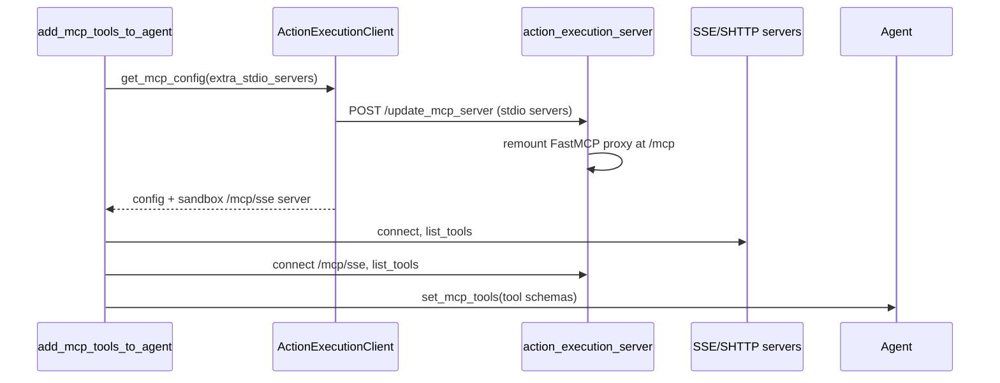

## Overview

OpenHands can give its agent tools from any Model Context Protocol (MCP) server. At startup it connects to the configured servers, lists their tools, and adds each tool's schema to the agent's tool list. When the model calls one of those tools, the agent emits an `MCPAction`; the runtime opens a client to the server that owns the tool, calls it, and returns an `MCPObservation`. OpenHands also runs its own MCP server, exposing pull-request tools, and every conversation is connected to it by default.

Sources: [openhands/mcp/utils.py:267-317](repo://openhands/mcp/utils.py#L267-L317), [openhands/runtime/base.py:361-370](repo://openhands/runtime/base.py#L361-L370), [openhands/server/routes/mcp.py:27-29](repo://openhands/server/routes/mcp.py#L27-L29)

The action and observation are listed in [[Actions and Observations]]; how CodeAct maps a tool call to `MCPAction` is in [[Agents and Tools]].

Sources: [openhands/agenthub/codeact_agent/function_calling.py:301-305](repo://openhands/agenthub/codeact_agent/function_calling.py#L301-L305)

## Server configuration

`MCPConfig` holds three lists. `sse_servers` and `shttp_servers` are remote servers reached over Server-Sent Events or streamable HTTP, each a URL with an optional API key. `stdio_servers` are local commands (`name`, `command`, `args`, `env`) that, as the docstring says, are added to the MCP router running inside the runtime container.

Sources: [openhands/core/config/mcp_config.py:46-77](repo://openhands/core/config/mcp_config.py#L46-L77), [openhands/core/config/mcp_config.py:191-214](repo://openhands/core/config/mcp_config.py#L191-L214)

`from_toml_section` reads `[mcp]`, accepting plain URL strings for SSE and SHTTP entries, and `validate_servers` rejects duplicate or malformed SSE URLs. `merge` concatenates two configs; the server uses it to add the MCP servers a user saved in their settings to those from the config file.

Sources: [openhands/core/config/mcp_config.py:239-313](repo://openhands/core/config/mcp_config.py#L239-L313), [openhands/server/session/session.py:189-194](repo://openhands/server/session/session.py#L189-L194)

```toml
[mcp]
sse_servers = ["http://localhost:8080/sse"]
shttp_servers = [{ url = "https://example.com/mcp", api_key = "secret" }]
stdio_servers = [
  { name = "fetch", command = "uvx", args = ["mcp-server-fetch"] },
]
```

Sources: [openhands/core/config/mcp_config.py:257-305](repo://openhands/core/config/mcp_config.py#L257-L305)

## Default servers

`OpenHandsMCPConfig.create_default_mcp_server_config` returns the OpenHands server's own MCP endpoint as an SHTTP server at `http://<mcp_host>/mcp/mcp`, and, when `search_api_key` is a Tavily key (starting `tvly-`), a stdio server that runs `npx -y tavily-mcp@0.2.1` with that key. The class can be replaced by setting `OPENHANDS_MCP_CONFIG_CLS`, which is how other deployments supply their own defaults.

Sources: [openhands/core/config/mcp_config.py:315-363](repo://openhands/core/config/mcp_config.py#L315-L363)

The web server's session adds both to the conversation config before the agent starts; the headless runner and CLI add the stdio servers.

Sources: [openhands/server/session/session.py:196-206](repo://openhands/server/session/session.py#L196-L206), [openhands/core/main.py:145-155](repo://openhands/core/main.py#L145-L155)

## Adding tools to the agent

`add_mcp_tools_to_agent(agent, runtime, memory)` runs once the runtime is connected, when the agent config has `enable_mcp`. It collects stdio servers declared by repository microagents ([[Microagents]]), asks the runtime for its effective MCP config including those servers, fetches the tool list, and calls `agent.set_mcp_tools`. On Windows MCP is disabled and the agent gets no MCP tools.

Sources: [openhands/mcp/utils.py:267-317](repo://openhands/mcp/utils.py#L267-L317), [openhands/server/session/agent_session.py:167-168](repo://openhands/server/session/agent_session.py#L167-L168)



Sources: [openhands/mcp/utils.py:283-315](repo://openhands/mcp/utils.py#L283-L315), [openhands/runtime/impl/action_execution/action_execution_client.py:361-450](repo://openhands/runtime/impl/action_execution/action_execution_client.py#L361-L450)

`fetch_mcp_tools_from_config` creates a client per server with `create_mcp_clients` and converts every tool with `MCPClientTool.to_param` into the function-calling schema the LLM receives (name, description and the server's input schema). Stdio servers are connected directly only for the CLI runtime; for every other runtime they run inside the sandbox and are reached through it.

Sources: [openhands/mcp/utils.py:151-203](repo://openhands/mcp/utils.py#L151-L203), [openhands/mcp/utils.py:28-60](repo://openhands/mcp/utils.py#L28-L60), [openhands/mcp/tool.py:1-23](repo://openhands/mcp/tool.py#L1-L23)

## Stdio servers inside the sandbox

Running stdio servers in the sandbox keeps their commands, files and network access inside the same isolation as the agent's shell. `ActionExecutionClient.get_mcp_config` compares the requested stdio servers with the ones it last sent, and when there are new ones posts the combined list, sorted by name, to `/update_mcp_server`. Whenever any stdio servers are registered, it appends the sandbox's own `/mcp/sse` endpoint, authenticated with the session API key, as an SSE server.

Sources: [openhands/runtime/impl/action_execution/action_execution_client.py:361-450](repo://openhands/runtime/impl/action_execution/action_execution_client.py#L361-L450)

Inside the sandbox, the action execution server creates an `MCPProxyManager` at startup, with authentication enabled when a session API key is set. `/update_mcp_server` validates the list as `MCPStdioServerConfig` objects and calls `update_and_remount`, which replaces the FastMCP proxy's `mcpServers` config, builds a new proxy and mounts it at `/mcp`. Errors are returned as `router_error_log`, which the client logs as servers that failed to start ([[Action Execution Server]]).

Sources: [openhands/runtime/action_execution_server.py:718-731](repo://openhands/runtime/action_execution_server.py#L718-L731), [openhands/runtime/action_execution_server.py:833-880](repo://openhands/runtime/action_execution_server.py#L833-L880), [openhands/runtime/mcp/proxy/manager.py:21-69](repo://openhands/runtime/mcp/proxy/manager.py#L21-L69), [openhands/runtime/mcp/proxy/manager.py:119-146](repo://openhands/runtime/mcp/proxy/manager.py#L119-L146)

## Clients and connections

`MCPClient` wraps a `fastmcp.Client`. `connect_http` uses `StreamableHttpTransport` for SHTTP servers and `SSETransport` for SSE servers; with an API key it sends it three ways (`Authorization: Bearer`, an `s` header for the sandbox's MCP router, and `X-Session-API-Key` for remote runtimes), and it adds `X-OpenHands-ServerConversation-ID` when a conversation id is known. `connect_stdio` uses `StdioTransport` with the server's command, arguments and environment. Both list the server's tools and keep them in `tools` and `tool_map`.

Sources: [openhands/mcp/client.py:23-98](repo://openhands/mcp/client.py#L23-L98), [openhands/mcp/client.py:125-145](repo://openhands/mcp/client.py#L125-L145)

`create_mcp_clients` skips a stdio server whose command is not on the path, and a server that fails to connect is logged and left out rather than failing the conversation. Connection errors are also recorded in `mcp_error_collector`.

Sources: [openhands/mcp/utils.py:63-148](repo://openhands/mcp/utils.py#L63-L148)

## Calling a tool

When the runtime receives an `MCPAction`, `_handle_action` routes it to `call_tool_mcp` instead of the sandbox's `/execute_action` ([[Runtime Architecture]]). `ActionExecutionClient.call_tool_mcp` gets the current config, creates fresh clients for the SSE and SHTTP servers (which include the sandbox proxy), and passes them to `openhands.mcp.utils.call_tool_mcp`.

Sources: [openhands/runtime/base.py:361-370](repo://openhands/runtime/base.py#L361-L370), [openhands/runtime/impl/action_execution/action_execution_client.py:452-481](repo://openhands/runtime/impl/action_execution/action_execution_client.py#L452-L481)

`call_tool_mcp` finds the first client that lists a tool with the action's name and raises `ValueError` if none does. It calls the tool and returns an `MCPObservation` whose content is the JSON of the MCP result. An `McpError` from the server becomes an observation with `isError: true` and the message, so the model sees the failure. Each call opens and closes its own session (`async with self.client`).

Sources: [openhands/mcp/utils.py:206-264](repo://openhands/mcp/utils.py#L206-L264), [openhands/mcp/client.py:147-156](repo://openhands/mcp/client.py#L147-L156)

## The OpenHands MCP server

The web server defines a stateless FastMCP server, `mcp_server`, and mounts its HTTP app at `/mcp`, which is why the default SHTTP URL ends in `/mcp/mcp`.

Sources: [openhands/server/routes/mcp.py:27-29](repo://openhands/server/routes/mcp.py#L27-L29), [openhands/server/app.py:28-63](repo://openhands/server/app.py#L28-L63)

| Tool | Provider | Does |
| --- | --- | --- |
| `create_pr` | GitHub | Opens a pull request (draft by default) with optional labels |
| `create_mr` | GitLab | Opens a merge request |
| `create_bitbucket_pr` | Bitbucket | Opens a pull request |

Sources: [openhands/server/routes/mcp.py:83-150](repo://openhands/server/routes/mcp.py#L83-L150), [openhands/server/routes/mcp.py:151-152](repo://openhands/server/routes/mcp.py#L151-L152), [openhands/server/routes/mcp.py:225-226](repo://openhands/server/routes/mcp.py#L225-L226)

Each tool reads the caller's provider tokens and user id from the HTTP request, builds the provider's service ([[Git Provider Integrations]]) and calls it. In SaaS mode the PR body gets a link back to the conversation, and the PR number found in the result is saved to the conversation's metadata. Errors are raised as `ToolError`. The bundled `github` microagent tells the agent to always use `create_pr` to open pull requests.

Sources: [openhands/server/routes/mcp.py:34-80](repo://openhands/server/routes/mcp.py#L34-L80), [openhands/server/routes/mcp.py:100-148](repo://openhands/server/routes/mcp.py#L100-L148), [microagents/github.md:14-18](repo://microagents/github.md#L14-L18)
