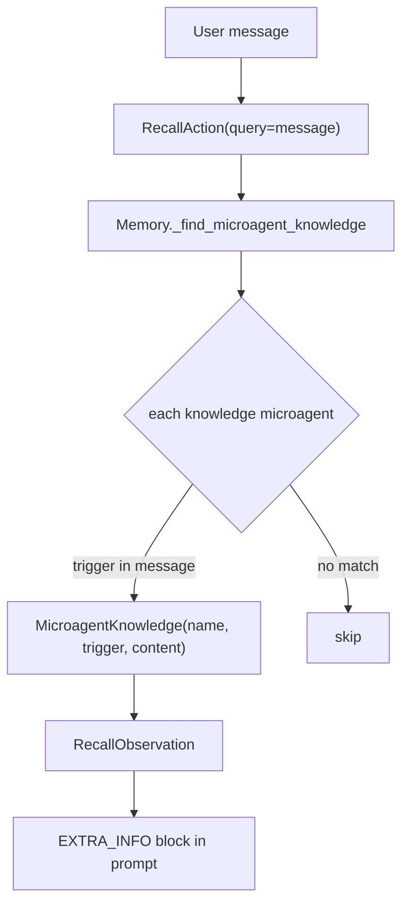

## Overview

A microagent is a markdown file of instructions that OpenHands adds to the agent's prompt. Despite the name it is not a separate agent: it is knowledge. A repository microagent is always included when its repository is open; a knowledge microagent is included only when a user or agent message contains one of its trigger words; a task microagent is a knowledge microagent triggered by `/name` that asks for named inputs. Microagents can also declare MCP servers that give the agent extra tools.

Sources: [openhands/microagent/types.py:11-37](repo://openhands/microagent/types.py#L11-L37), [microagents/README.md:1-3](repo://microagents/README.md#L1-L3)

This page covers where microagents come from and how they are parsed and matched. The `Memory` component that matches them and [[Conversation Memory]], which renders them into the prompt, are described there.

Sources: [openhands/memory/memory.py:225-252](repo://openhands/memory/memory.py#L225-L252)

## File format

A microagent is markdown with optional YAML frontmatter, parsed with the `frontmatter` library. The frontmatter fills `MicroagentMetadata`.

Sources: [openhands/microagent/microagent.py:93-98](repo://openhands/microagent/microagent.py#L93-L98)

| Field | Default | Meaning |
| --- | --- | --- |
| `name` | `default` | Name used when the file is not loaded relative to a folder |
| `type` | `repo` | `knowledge`, `repo` or `task`; validated, but the class is inferred (see below) |
| `version` | `1.0.0` | Kept as a string even if YAML parses a number |
| `agent` | `CodeActAgent` | The agent the microagent is written for |
| `triggers` | `[]` | Words that activate a knowledge microagent |
| `inputs` | `[]` | `name` and `description` of each value a task microagent needs |
| `mcp_tools` | none | An `MCPConfig` with stdio servers the microagent provides |

Sources: [openhands/microagent/types.py:19-37](repo://openhands/microagent/types.py#L19-L37), [openhands/microagent/microagent.py:93-105](repo://openhands/microagent/microagent.py#L93-L105)

The bundled `github` microagent is a typical knowledge microagent.

Sources: [microagents/github.md:1-9](repo://microagents/github.md#L1-L9)

```markdown
---
name: github
type: knowledge
version: 1.0.0
agent: CodeActAgent
triggers:
- github
- git
---

You have access to an environment variable, `GITHUB_TOKEN`, which allows you to interact with
the GitHub API.
```

Sources: [microagents/github.md:1-12](repo://microagents/github.md#L1-L12)

## Types and inference

`BaseMicroagent.load` decides the class from the metadata rather than from `type`: a file with `inputs` becomes a `TaskMicroagent`, a file with `triggers` a `KnowledgeMicroagent`, and anything else a `RepoMicroagent`. This is why a `repo.md` without frontmatter still loads as an always-on repository microagent.

Sources: [openhands/microagent/microagent.py:129-171](repo://openhands/microagent/microagent.py#L129-L171), [microagents/README.md:56-58](repo://microagents/README.md#L56-L58)

A task microagent automatically gains the trigger `/name`. Its content gets a sentence appended telling the agent to ask the user for any missing variables when the content has `${variable}` placeholders or the metadata lists inputs.

Sources: [openhands/microagent/microagent.py:141-149](repo://openhands/microagent/microagent.py#L141-L149), [openhands/microagent/microagent.py:226-274](repo://openhands/microagent/microagent.py#L226-L274)

```markdown
---
name: address_pr_comments
version: 1.0.0
author: openhands
agent: CodeActAgent
triggers:
- /address_pr_comments
inputs:
  - name: PR_URL
    description: "URL of the pull request"
  - name: BRANCH_NAME
    description: "Branch name corresponds to the pull request"
---
```

Sources: [microagents/address_pr_comments.md:1-13](repo://microagents/address_pr_comments.md#L1-L13)

## Naming and special files

When a file is loaded from a microagents folder, its name is its path relative to that folder without `.md`, so `microagents/git/rebase.md` is named `git/rebase`; the frontmatter `name` is used only when there is no folder.

Sources: [openhands/microagent/microagent.py:51-71](repo://openhands/microagent/microagent.py#L51-L71), [openhands/microagent/microagent.py:161-162](repo://openhands/microagent/microagent.py#L161-L162)

Instruction files used by other tools are read as repository microagents too. `.cursorrules` becomes `cursorrules`; `AGENTS.md` or `AGENT.md` (any case) becomes `agents`. The legacy `.openhands_instructions` file becomes `repo_legacy`. These files are taken whole, without frontmatter parsing.

Sources: [openhands/microagent/microagent.py:26-49](repo://openhands/microagent/microagent.py#L26-L49), [openhands/microagent/microagent.py:78-91](repo://openhands/microagent/microagent.py#L78-L91)

## Validation

Invalid metadata raises `MicroagentValidationError` naming the file, and for a bad `type` lists the valid values. A microagent with `mcp_tools` must declare at least one stdio server; SSE servers only log a warning, because only stdio servers are supported.

Sources: [openhands/microagent/microagent.py:104-127](repo://openhands/microagent/microagent.py#L104-L127)

## Loading a folder

`load_microagents_from_dir` takes a microagents folder (normally `.openhands/microagents`) and returns two dicts: repository microagents and knowledge microagents (task microagents go in the second). It first looks two levels up, in the repository root, for `.cursorrules` and the first `AGENTS.md` variant, then loads every `.md` under the folder except `README.md`. One bad file fails the whole load with an error naming it.

Sources: [openhands/microagent/microagent.py:277-341](repo://openhands/microagent/microagent.py#L277-L341)

## Where microagents come from

| Source | Location | Loaded by |
| --- | --- | --- |
| Global | `microagents/` in the OpenHands installation | `Memory._load_global_microagents` at creation |
| User | `~/.openhands/microagents/` | `Memory._load_user_microagents` at creation |
| Organisation | `microagents/` in the `ORG/.openhands` repository (`ORG/openhands-config` on GitLab) | `Runtime.get_microagents_from_org_or_user` |
| Repository | `.openhands/microagents/` and the root instruction files of the selected repository | `Runtime.get_microagents_from_selected_repo` |
| Legacy | `.openhands_instructions` in the workspace or repository root | `Runtime.get_microagents_from_selected_repo` |

Sources: [openhands/memory/memory.py:33-38](repo://openhands/memory/memory.py#L33-L38), [openhands/memory/memory.py:270-300](repo://openhands/memory/memory.py#L270-L300), [openhands/runtime/base.py:666-720](repo://openhands/runtime/base.py#L666-L720), [openhands/runtime/base.py:823-888](repo://openhands/runtime/base.py#L823-L888)

Repository microagents live inside the sandbox, so the runtime fetches them. `get_microagents_from_selected_repo` first tries the organisation repository: it gets an authenticated URL from the provider handler, shallow-clones it into the workspace, loads its `microagents/` folder and deletes the clone. A missing repository or failed clone is logged at debug level and skipped.

Sources: [openhands/runtime/base.py:727-821](repo://openhands/runtime/base.py#L727-L821)

It then reads `.openhands_instructions` and loads the repository's own folder through `_load_microagents_from_directory`, which copies the folder out of the sandbox as a zip, extracts it to a temporary directory and runs `load_microagents_from_dir` on it.

Sources: [openhands/runtime/base.py:857-888](repo://openhands/runtime/base.py#L857-L888), [openhands/runtime/base.py:586-636](repo://openhands/runtime/base.py#L586-L636)

`create_memory` passes the runtime's result to `Memory.load_user_workspace_microagents`, which files each one as repository or knowledge by class. Later sources overwrite earlier ones with the same name, so a repository can replace a global microagent by reusing its name.

Sources: [openhands/core/setup.py:188-194](repo://openhands/core/setup.py#L188-L194), [openhands/memory/memory.py:254-268](repo://openhands/memory/memory.py#L254-L268)

## Matching triggers

`KnowledgeMicroagent.match_trigger` lowercases the message and returns the first trigger that appears in it as a substring, so the trigger `git` also fires on `github` or `digit`. Distinctive triggers matter for that reason, which the README recommends.

Sources: [openhands/microagent/microagent.py:189-203](repo://openhands/microagent/microagent.py#L189-L203), [microagents/README.md:112-117](repo://microagents/README.md#L112-L117)



Sources: [openhands/controller/agent_controller.py:566-582](repo://openhands/controller/agent_controller.py#L566-L582), [openhands/memory/memory.py:236-252](repo://openhands/memory/memory.py#L236-L252)

Repository microagents need no match: on the first user message, `Memory` joins all their contents into the workspace context's `repo_instructions`. Knowledge matches from the first message are included in the same observation; later messages produce knowledge-only recalls, and microagents already shown earlier are not repeated ([[Conversation Memory]]).

Sources: [openhands/memory/memory.py:139-205](repo://openhands/memory/memory.py#L139-L205)

An agent can turn individual microagents off with `disabled_microagents`, and `enable_prompt_extensions = false` drops all recall content from the prompt ([[Configuration]]).

Sources: [openhands/core/config/agent_config.py:42-47](repo://openhands/core/config/agent_config.py#L42-L47), [openhands/memory/conversation_memory.py:657-664](repo://openhands/memory/conversation_memory.py#L657-L664)

## MCP tools from microagents

Repository microagents can carry `mcp_tools`. `Memory.get_microagent_mcp_tools` collects those configs from every loaded repository microagent, and `add_mcp_tools_to_agent` adds their stdio servers to the agent's tools ([[MCP Tools]]).

Sources: [openhands/memory/memory.py:302-318](repo://openhands/memory/memory.py#L302-L318), [openhands/mcp/utils.py:280-292](repo://openhands/mcp/utils.py#L280-L292)
