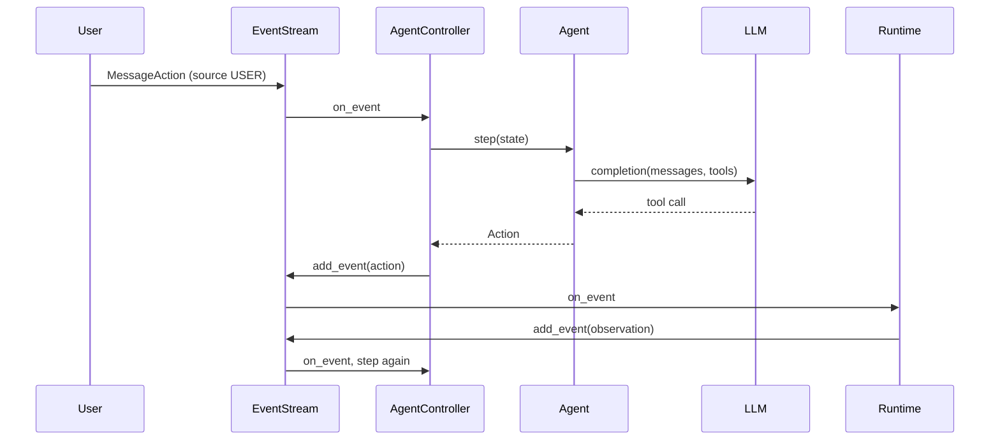

## Overview

OpenHands is a platform for AI software-development agents. An agent reads a task, asks a language model what to do next, and carries out the answer as concrete actions (run a shell command, edit a file, browse a page) inside a sandbox, then reads the result and decides again. The same core runs behind several front ends: a web server with a React app, a terminal CLI, a headless runner used by scripts and benchmarks, and a GitHub issue resolver.

Sources: [openhands/README.md:1-30](repo://openhands/README.md#L1-L30)

The Python package `openhands` holds the core. `enterprise/` adds the hosted multi-user server, `frontend/` holds the browser app, and `evaluation/` holds benchmark harnesses that drive the core through the same headless entry point. The `openhands` console script is the installed entry point.

Sources: [pyproject.toml:6-23](repo://pyproject.toml#L6-L23), [pyproject.toml:170-171](repo://pyproject.toml#L170-L171)

## Parts of the system

| Area | What it does | Page |
| --- | --- | --- |
| Agent controller | Drives the loop: reacts to events, asks the agent for the next action, enforces limits, handles delegation | [[Agent Controller]] |
| Events | `EventStream` carries every action and observation between components and persists them | [[Events and Event Stream]] |
| Event types | The `Action` and `Observation` classes agents emit and receive | [[Actions and Observations]] |
| Agents | `CodeActAgent` and the other agents that turn state into an action, and the tools they offer the model | [[Agents and Tools]] |
| LLM | Wraps LiteLLM: retries, function-calling conversion, cost metrics, routing | [[LLM Integration]] |
| Memory | Turns history into prompt messages and answers recall requests with workspace context | [[Conversation Memory]] |
| Condensers | Shrink long histories to fit the context window | [[Condensers]] |
| Microagents | Markdown knowledge injected on keywords or per repository | [[Microagents]] |
| MCP | Model Context Protocol servers exposed to agents as tools | [[MCP Tools]] |
| Security | Risk analysis and user confirmation of actions | [[Security Analyzers and Confirmation]] |
| Runtime | Executes actions in a sandbox and returns observations | [[Runtime Architecture]] |
| Sandbox server | The HTTP server inside the sandbox that runs bash, Jupyter, the browser and file edits | [[Action Execution Server]] |
| Runtime backends | Docker, remote, Kubernetes, local and CLI runtimes | [[Runtime Implementations]] |
| Runtime images | Building and tagging the sandbox image | [[Runtime Images]] |
| Web server | FastAPI and Socket.IO API used by the web app | [[Server Application]] |
| Conversation lifecycle | Starting, attaching to and stopping agent loops on the server | [[Conversations and Sessions]] |
| Storage | File stores and the conversation, settings and secrets stores | [[Storage]] |
| Git providers | GitHub, GitLab and Bitbucket access | [[Git Provider Integrations]] |
| Web app | React UI | [[Frontend Web App]] |
| CLI | Terminal interface | [[Command-Line Interface]] |
| Headless runs | One task from a script, and the setup helpers every entry point shares | [[Headless Mode]] |
| Issue resolver | Resolves issues and opens pull requests | [[Issue Resolver]] |
| Evaluation | Benchmark harnesses | [[Evaluation Harness]] |
| Enterprise | Hosted multi-user server | [[Enterprise Server]] |

Sources: [openhands/README.md:8-25](repo://openhands/README.md#L8-L25)

## The main loop

Every front end assembles the same pieces. The headless runner shows the order plainly: it creates the LLM registry and the agent, creates and connects a runtime (which owns the `EventStream`), clones the selected repository, creates the `Memory`, adds MCP tools, creates the controller, and then puts the user's first `MessageAction` on the stream.

Sources: [openhands/core/main.py:97-192](repo://openhands/core/main.py#L97-L192)

Sources: [openhands/controller/agent_controller.py:433-492](repo://openhands/controller/agent_controller.py#L433-L492), [openhands/controller/agent_controller.py:866-972](repo://openhands/controller/agent_controller.py#L866-L972), [openhands/runtime/base.py:320-401](repo://openhands/runtime/base.py#L320-L401)

1. The user's message enters the `EventStream`, which assigns it an id, saves it and hands it to every subscriber ([[Events and Event Stream]]).
2. The `AgentController` decides from the event type whether the agent should take a step, and calls `agent.step(state)` ([[Agent Controller]]).
3. The agent builds messages from the history ([[Conversation Memory]], [[Condensers]]) and calls the model ([[LLM Integration]]); it turns the model's tool call into an `Action` ([[Agents and Tools]]).
4. If confirmation mode is on, the controller may hold the action for the user ([[Security Analyzers and Confirmation]]); otherwise it publishes the action.
5. The runtime, also a subscriber, runs the action and publishes the resulting `Observation` with `cause` set to the action's id ([[Runtime Architecture]]).
6. The observation reaches the controller, which steps the agent again until it finishes, errors, or waits for the user.

Sources: [openhands/events/stream.py:163-203](repo://openhands/events/stream.py#L163-L203), [openhands/controller/agent_controller.py:392-431](repo://openhands/controller/agent_controller.py#L392-L431), [openhands/runtime/base.py:361-401](repo://openhands/runtime/base.py#L361-L401)

The headless runner waits by polling: `run_agent_until_done` sleeps in one-second steps until the controller's state is one of the end states (`FINISHED`, `REJECTED`, `ERROR`, `PAUSED`, `STOPPED`), and turns runtime or memory errors reported through `status_callback` into the `ERROR` state.

Sources: [openhands/core/loop.py:11-45](repo://openhands/core/loop.py#L11-L45), [openhands/core/main.py:207-218](repo://openhands/core/main.py#L207-L218)

## Design decisions

### Everything goes through the event stream

Components do not call each other directly. The controller, runtime, memory, server session and CLI each subscribe to the `EventStream` under a fixed subscriber id, and each callback runs on its own single-worker thread pool with its own asyncio loop, so a slow runtime never blocks the controller's callback. Because each event is written to the file store as it is added, a conversation can be replayed or resumed from its stored events.

Sources: [openhands/events/stream.py:23-30](repo://openhands/events/stream.py#L23-L30), [openhands/events/stream.py:130-148](repo://openhands/events/stream.py#L130-L148), [openhands/events/stream.py:254-275](repo://openhands/events/stream.py#L254-L275), [openhands/controller/agent_controller.py:164-169](repo://openhands/controller/agent_controller.py#L164-L169), [openhands/runtime/base.py:146-151](repo://openhands/runtime/base.py#L146-L151), [openhands/memory/memory.py:55-68](repo://openhands/memory/memory.py#L55-L68)

The stream also masks secrets: before an event is stored or delivered, every string field except a few top-level metadata fields has each known secret value replaced with `<secret_hidden>`.

Sources: [openhands/events/stream.py:221-244](repo://openhands/events/stream.py#L221-L244)

### The sandbox is reached over HTTP

Most runtimes do not execute actions in the OpenHands process. `ActionExecutionClient` serialises each action and posts it to `/execute_action` on a server running inside the sandbox, then rebuilds the observation from the JSON reply. The backend that hosts that server (a Docker container, a remote service, a Kubernetes pod, a local process) is chosen by name from a registry, so the agent loop is the same whichever backend runs.

Sources: [openhands/runtime/impl/action_execution/action_execution_client.py:272-338](repo://openhands/runtime/impl/action_execution/action_execution_client.py#L272-L338), [openhands/runtime/__init__.py:14-21](repo://openhands/runtime/__init__.py#L14-L21), [openhands/runtime/__init__.py:90-103](repo://openhands/runtime/__init__.py#L90-L103)

### Any model through LiteLLM

`LLM` builds its completion function as a partial of `litellm.completion` with the configured model, key, base URL and provider, and wraps it in a retry decorator. Supporting a new provider is a matter of configuration rather than code.

Sources: [openhands/llm/llm.py:194-215](repo://openhands/llm/llm.py#L194-L215)

### Errors become observations

When the model returns a malformed or missing action, the controller does not stop: it publishes an `ErrorObservation` so the agent sees the error on its next step. A context-window overflow becomes a `CondensationRequestAction` when history truncation is enabled. The runtime does the same with a `PermissionError` from an action.

Sources: [openhands/controller/agent_controller.py:869-916](repo://openhands/controller/agent_controller.py#L869-L916), [openhands/runtime/base.py:375-378](repo://openhands/runtime/base.py#L375-L378)
