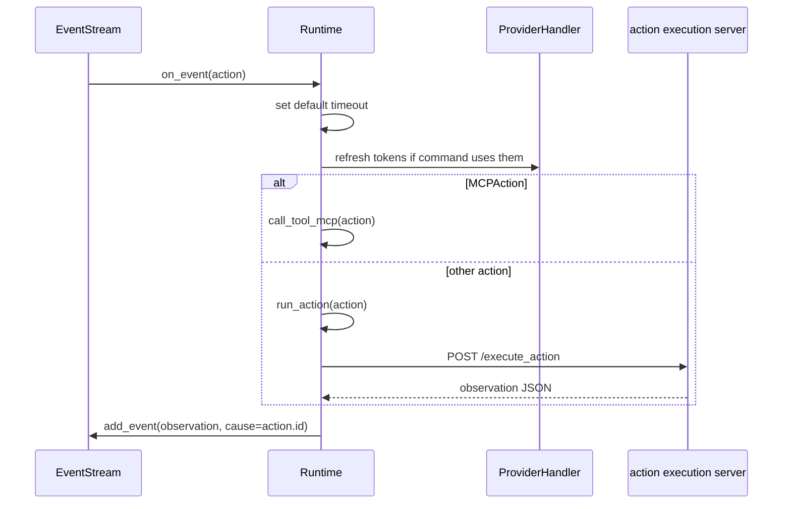

## Overview

The runtime is where actions happen. It subscribes to the conversation's [[Events and Event Stream]], runs each action it receives (a shell command, a Python cell, a file edit, a browser step, an MCP call) and publishes the resulting observation. The abstract `Runtime` class in `openhands/runtime/base.py` handles everything common to that job: event handling, environment variables, cloning the repository, setup scripts, git hooks, microagent loading, and the security analyzer. Concrete backends decide where the work runs.

Sources: [openhands/runtime/base.py:90-126](repo://openhands/runtime/base.py#L90-L126)

Most backends extend `ActionExecutionClient`, which sends each action over HTTP to an [[Action Execution Server]] inside the sandbox. The backends themselves (Docker, remote, Kubernetes, local, CLI) are compared in [[Runtime Implementations]].

Sources: [openhands/runtime/impl/action_execution/action_execution_client.py:61-66](repo://openhands/runtime/impl/action_execution/action_execution_client.py#L61-L66)

## Choosing and creating a runtime

`get_runtime_cls(name)` maps the `runtime` setting to a class: `docker` (also `eventstream`), `remote`, `local`, `kubernetes` and `cli`, plus any third-party runtime found as `third_party.runtime.impl.<name>.<name>_runtime` with a class named `<NAME>Runtime` or `<Name>Runtime`. Any other value is treated as a class path and resolved with `get_impl`; an unknown one raises `ValueError` listing the known names.

Sources: [openhands/runtime/__init__.py:14-103](repo://openhands/runtime/__init__.py#L14-L103)

`create_runtime` builds the conversation's `EventStream` on the configured file store, picks the class, and constructs it with the agent class's `sandbox_plugins`. The runtime is returned unconnected; the caller awaits `connect()`, which each backend implements to start or attach to its sandbox.

Sources: [openhands/core/setup.py:35-89](repo://openhands/core/setup.py#L35-L89), [openhands/runtime/base.py:985-987](repo://openhands/runtime/base.py#L985-L987)

## Construction

The constructor subscribes `on_event` to the stream as `EventStreamSubscriber.RUNTIME`, copies the plugins and adds the VS Code plugin unless running headless, and registers `close` to run at process exit.

Sources: [openhands/runtime/base.py:128-163](repo://openhands/runtime/base.py#L128-L163)

It then gathers the environment variables to set in the sandbox: every host variable named `SANDBOX_ENV_<NAME>` becomes `<NAME>`, `ENABLE_AUTO_LINT=true` is added when auto-lint is on, and the provider handler adds a variable for each git provider token (such as `GITHUB_TOKEN`). It also sets up the LLM-based file editor mixin and creates the security analyzer named in the config ([[Security Analyzers and Confirmation]]).

Sources: [openhands/runtime/base.py:79-87](repo://openhands/runtime/base.py#L79-L87), [openhands/runtime/base.py:165-204](repo://openhands/runtime/base.py#L165-L204)

Once the sandbox is up, backends call `setup_initial_env`, which applies those variables plus `runtime_startup_env_vars` and sets the git user name and email globally (the CLI runtime keeps the user's own git config). It is skipped when attaching to an existing sandbox, which already has them.

Sources: [openhands/runtime/base.py:210-219](repo://openhands/runtime/base.py#L210-L219), [openhands/runtime/base.py:988-1022](repo://openhands/runtime/base.py#L988-L1022)

`add_env_vars` upper-cases the names, sets them in the Jupyter kernel when that plugin is present, and in bash both exports them and appends them to `~/.bashrc` so new shells keep them; on Windows it uses PowerShell `$env:` assignments. A failing command raises `RuntimeError`.

Sources: [openhands/runtime/base.py:245-318](repo://openhands/runtime/base.py#L245-L318)

## Handling an action

### The event path

Sources: [openhands/runtime/base.py:320-399](repo://openhands/runtime/base.py#L320-L399), [openhands/runtime/impl/action_execution/action_execution_client.py:272-338](repo://openhands/runtime/impl/action_execution/action_execution_client.py#L272-L338)

`on_event` passes actions to `_handle_action` and ignores observations. An action without a timeout gets the sandbox's default (`sandbox.timeout`, 120 seconds) as a non-blocking timeout. If the command refers to a provider token, `_export_latest_git_provider_tokens` fetches fresh tokens and re-exports them, so a long conversation does not fail on an expired token. MCP actions go to `call_tool_mcp` ([[MCP Tools]]); everything else runs through `run_action` on a worker thread.

Sources: [openhands/runtime/base.py:320-372](repo://openhands/runtime/base.py#L320-L372)

The observation's `cause` is set to the action's id and the action's tool-call metadata is copied over, which is what lets the controller clear its pending action and memory pair the result with the tool call. `NullObservation`s are not published.

Sources: [openhands/runtime/base.py:390-399](repo://openhands/runtime/base.py#L390-L399)

### Failures

A `PermissionError` becomes an `ErrorObservation`, so the agent hears about it. A network error or `AgentRuntimeDisconnectedError` sets the status `ERROR_RUNTIME_DISCONNECTED`, and any other exception sets `ERROR`; in both cases no observation is published and the status callback reports the error to the session, which moves the agent to the error state.

Sources: [openhands/runtime/base.py:373-388](repo://openhands/runtime/base.py#L373-L388), [openhands/core/loop.py:22-29](repo://openhands/core/loop.py#L22-L29)

### Dispatch

`run_action` answers non-runnable actions itself: a think action gets `Your thought has been logged.`, and a task-tracking action reads or writes `TASKS.md` in the conversation's storage directory (writing a numbered list with status icons for `plan`). An action awaiting confirmation gets an empty `NullObservation`; an unknown action type or one the runtime has no method for gets an `ErrorObservation`; a rejected action gets a `UserRejectObservation`. Otherwise it calls the method named by the action type: `run`, `run_ipython`, `read`, `write`, `edit`, `browse` or `browse_interactive`.

Sources: [openhands/runtime/base.py:890-976](repo://openhands/runtime/base.py#L890-L976)

## The abstract interface

A backend must implement `connect`, the seven action methods, `call_tool_mcp`, `get_mcp_config`, and the file transfer methods `copy_to`, `list_files` and `copy_from`. Optional properties report the VS Code URL, the web hosts the agent can serve on, and extra agent instructions.

Sources: [openhands/runtime/base.py:985-1090](repo://openhands/runtime/base.py#L985-L1090), [openhands/runtime/base.py:1091-1113](repo://openhands/runtime/base.py#L1091-L1113), [openhands/runtime/base.py:1173-1175](repo://openhands/runtime/base.py#L1173-L1175)

Class methods `setup` and `teardown` run once per process around all runtimes of a class, and `delete(conversation_id)` removes a conversation's sandbox; the base versions do nothing.

Sources: [openhands/runtime/base.py:1190-1197](repo://openhands/runtime/base.py#L1190-L1197), [openhands/runtime/base.py:227-229](repo://openhands/runtime/base.py#L227-L229)

## ActionExecutionClient

`ActionExecutionClient` implements the interface over HTTP. Subclasses supply `action_execution_server_url`; every request goes through `_send_action_server_request`, which retries up to five times with exponential backoff on remote protocol errors and raises `RequestHTTPError` with the server's `detail` on an HTTP error status.

Sources: [openhands/runtime/impl/action_execution/action_execution_client.py:55-113](repo://openhands/runtime/impl/action_execution/action_execution_client.py#L55-L113), [openhands/runtime/utils/request.py:37-60](repo://openhands/runtime/utils/request.py#L37-L60)

`send_action_for_execution` runs every action method. LLM-based edits are handled locally by the edit mixin, which reads the file, asks a model to merge the draft and writes the result. Other actions are serialised with `event_to_dict` and posted to `/execute_action` with an HTTP timeout five seconds longer than the action's, so the sandbox's own timeout message arrives first; a client-side timeout raises `AgentRuntimeTimeoutError`. A semaphore allows one action at a time.

Sources: [openhands/runtime/impl/action_execution/action_execution_client.py:272-359](repo://openhands/runtime/impl/action_execution/action_execution_client.py#L272-L359), [openhands/runtime/utils/edit.py:126-137](repo://openhands/runtime/utils/edit.py#L126-L137), [openhands/runtime/utils/edit.py:240-246](repo://openhands/runtime/utils/edit.py#L240-L246)

| Client method | Server endpoint |
| --- | --- |
| `check_if_alive` | `GET /alive` |
| action methods | `POST /execute_action` |
| `list_files` | `POST /list_files` |
| `copy_from` | `GET /download_files` (zip stream) |
| `copy_to` | `POST /upload_file` (file, or zip when recursive) |
| `get_vscode_token` | `GET /vscode/connection_token` |
| `get_mcp_config` | `POST /update_mcp_server` |

Sources: [openhands/runtime/impl/action_execution/action_execution_client.py:115-190](repo://openhands/runtime/impl/action_execution/action_execution_client.py#L115-L190), [openhands/runtime/impl/action_execution/action_execution_client.py:191-270](repo://openhands/runtime/impl/action_execution/action_execution_client.py#L191-L270), [openhands/runtime/impl/action_execution/action_execution_client.py:411-416](repo://openhands/runtime/impl/action_execution/action_execution_client.py#L411-L416)

## Workspace setup

The setup code in [[Headless Mode]] and the server's agent session prepare the workspace through three runtime methods, in order.

Sources: [openhands/core/setup.py:119-154](repo://openhands/core/setup.py#L119-L154)

1. `clone_or_init_repo` clones the selected repository with an authenticated URL from the provider handler into a folder named after the repository, then checks out the requested branch or creates `openhands-workspace-<random>`. With no repository it runs `git init` only if `init_git_in_empty_workspace` is set.
2. `maybe_run_setup_script` runs `.openhands/setup.sh` if present, as a hidden blocking command with a ten-minute timeout, publishing it as an environment event.
3. `maybe_setup_git_hooks` installs `.openhands/pre-commit.sh` as the git pre-commit hook, first moving an existing hook not written by OpenHands to `pre-commit.local`.

Sources: [openhands/runtime/base.py:401-461](repo://openhands/runtime/base.py#L401-L461), [openhands/runtime/base.py:463-489](repo://openhands/runtime/base.py#L463-L489), [openhands/runtime/base.py:495-584](repo://openhands/runtime/base.py#L495-L584)

The runtime also loads the repository's microagents from the sandbox, including the organisation-level `.openhands` repository, as described in [[Microagents]].

Sources: [openhands/runtime/base.py:823-888](repo://openhands/runtime/base.py#L823-L888)

## Git information

`GitHandler` gives the server the workspace's changed files, per-file diffs and current branch for the UI. It runs its git commands through the runtime as hidden, static commands, so they neither reach the event stream nor disturb the agent's shell.

Sources: [openhands/runtime/base.py:142-145](repo://openhands/runtime/base.py#L142-L145), [openhands/runtime/base.py:1115-1171](repo://openhands/runtime/base.py#L1115-L1171)

## Runtime status

`set_runtime_status` records a `RuntimeStatus` and forwards it to the status callback with a level and message. Statuses cover startup (`BUILDING_RUNTIME`, `STARTING_RUNTIME`, `RUNTIME_STARTED`, `SETTING_UP_WORKSPACE`, `SETTING_UP_GIT_HOOKS`, `READY`) and errors (`ERROR`, `ERROR_RUNTIME_DISCONNECTED`, LLM authentication, availability, credit and content-policy errors, git provider authentication, `ERROR_MEMORY`). The values are message keys the frontend translates.

Sources: [openhands/runtime/base.py:235-241](repo://openhands/runtime/base.py#L235-L241), [openhands/runtime/runtime_status.py:4-24](repo://openhands/runtime/runtime_status.py#L4-L24)
