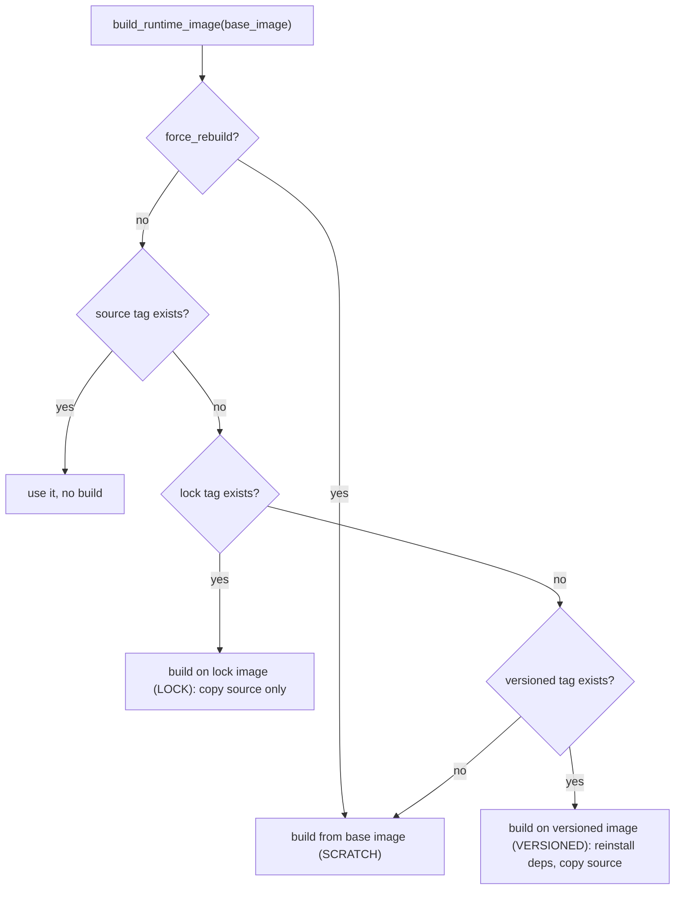

## Overview

A sandbox needs OpenHands' own code inside it: the [[Action Execution Server]], its Python dependencies, tmux, Jupyter, a browser and VS Code. OpenHands does not require a special image for that. It takes any base image (by default `nikolaik/python-nodejs:python3.12-nodejs22`), generates a Dockerfile that installs everything on top, and tags the result so later conversations and later versions can reuse as much of it as possible. Setting `sandbox.runtime_container_image` skips all of this and uses a prebuilt image.

Sources: [openhands/core/config/sandbox_config.py:55-58](repo://openhands/core/config/sandbox_config.py#L55-L58), [openhands/runtime/utils/runtime_build.py:108-138](repo://openhands/runtime/utils/runtime_build.py#L108-L138)

The Docker and remote runtimes call `build_runtime_image` when no runtime image is configured; the Kubernetes runtime expects an image to exist ([[Runtime Implementations]]).

Sources: [openhands/runtime/impl/docker/docker_runtime.py:233-249](repo://openhands/runtime/impl/docker/docker_runtime.py#L233-L249), [openhands/runtime/impl/remote/remote_runtime.py:224-268](repo://openhands/runtime/impl/remote/remote_runtime.py#L224-L268)

## Three tags per image

Every runtime image lives in one repository, `ghcr.io/all-hands-ai/runtime` unless `OH_RUNTIME_RUNTIME_IMAGE_REPO` says otherwise, and gets up to three tags that describe how much of its content is known.

Sources: [openhands/runtime/utils/runtime_build.py:27-28](repo://openhands/runtime/utils/runtime_build.py#L27-L28), [openhands/runtime/utils/runtime_build.py:179-187](repo://openhands/runtime/utils/runtime_build.py#L179-L187)

| Tag | Format | Identifies |
| --- | --- | --- |
| Versioned | `oh_v<version>_<base image, sanitised, last 96 chars>` | OpenHands version and base image |
| Lock | `oh_v<version>_<hash of base image, pyproject.toml, poetry.lock>` | Version, base image and exact dependencies |
| Source | `<lock tag>_<hash of the openhands source tree>` | Everything, including the current source code |

Sources: [openhands/runtime/utils/runtime_build.py:320-358](repo://openhands/runtime/utils/runtime_build.py#L320-L358)

Hashes are MD5 digests converted to base 36 and cut to 16 characters; the comments note that uniqueness, not cryptographic strength, is what matters. The lock hash includes the browser setting only when the browser is disabled, so existing tags stay valid. The source hash covers the `openhands` package directory, ignoring hidden directories and compiled Python files.

Sources: [openhands/runtime/utils/runtime_build.py:307-337](repo://openhands/runtime/utils/runtime_build.py#L307-L337), [openhands/runtime/utils/runtime_build.py:344-358](repo://openhands/runtime/utils/runtime_build.py#L344-L358)

## Choosing what to build

Sources: [openhands/runtime/utils/runtime_build.py:168-255](repo://openhands/runtime/utils/runtime_build.py#L168-L255)

`build_runtime_image_in_folder` works out all three names and returns the source-tagged name. If that exact image exists, nothing is built. If an image with the same lock tag exists, its dependencies are identical, so only the source code needs copying, which is the fastest build. If only the versioned image exists, most dependencies are already installed and the build reinstalls from the lock file and copies the source. Otherwise it builds from the base image. `force_rebuild` always builds from the base image.

Sources: [openhands/runtime/utils/runtime_build.py:21-24](repo://openhands/runtime/utils/runtime_build.py#L21-L24), [openhands/runtime/utils/runtime_build.py:190-237](repo://openhands/runtime/utils/runtime_build.py#L190-L237)

`_build_sandbox_image` applies every tag that does not exist yet to the new image. The versioned tag is applied only to scratch builds, so images are not stacked on top of each other again and again.

Sources: [openhands/runtime/utils/runtime_build.py:238-253](repo://openhands/runtime/utils/runtime_build.py#L238-L253), [openhands/runtime/utils/runtime_build.py:361-389](repo://openhands/runtime/utils/runtime_build.py#L361-L389)

A base image that is already in the runtime repository is used as is; for other images `get_runtime_image_repo_and_tag` derives a tag from the base image name, hashing long names to stay within Docker's 128-character limit.

Sources: [openhands/runtime/utils/runtime_build.py:65-105](repo://openhands/runtime/utils/runtime_build.py#L65-L105)

## The build folder

`prep_build_folder` copies the `openhands` package (without hidden folders, caches, `.pyc` and `.md` files), the `microagents` folder, and `pyproject.toml` and `poetry.lock` into `code/`, and writes the Dockerfile rendered from `runtime_templates/Dockerfile.j2` with the base image, the build mode, `extra_deps` and the browser flag.

Sources: [openhands/runtime/utils/runtime_build.py:258-304](repo://openhands/runtime/utils/runtime_build.py#L258-L304), [openhands/runtime/utils/runtime_build.py:31-62](repo://openhands/runtime/utils/runtime_build.py#L31-L62)

## The Dockerfile

The template starts from the base image and sets shared paths: Poetry environments in `/openhands/poetry`, micromamba in `/openhands/micromamba`, and OpenVSCode server in `/openhands/.openvscode-server`.

Sources: [openhands/runtime/utils/runtime_templates/Dockerfile.j2:1-13](repo://openhands/runtime/utils/runtime_templates/Dockerfile.j2#L1-L13)

A scratch build installs system packages (git, tmux, ripgrep, ffmpeg, build tools, and Node.js 22 and Python 3.12 on Ubuntu bases), `uv` for MCP servers, and Docker. It creates an `openhands` user (UID 1000 when free) with passwordless sudo and passwordless `su` between root and `openhands`, which the bash session relies on. It installs micromamba with a Python 3.12 environment holding Poetry, then installs the project's `main` and `runtime` dependency groups from the lock file.

Sources: [openhands/runtime/utils/runtime_templates/Dockerfile.j2:15-97](repo://openhands/runtime/utils/runtime_templates/Dockerfile.j2#L15-L97), [openhands/runtime/utils/runtime_templates/Dockerfile.j2:251-314](repo://openhands/runtime/utils/runtime_templates/Dockerfile.j2#L251-L314)

With the browser enabled it installs Playwright's Chromium into `/opt/playwright-browsers`, shared by both users. It records the interpreter path as `OH_INTERPRETER_PATH` in `/etc/environment` and activates the `openhands` micromamba environment in bash.

Sources: [openhands/runtime/utils/runtime_templates/Dockerfile.j2:198-249](repo://openhands/runtime/utils/runtime_templates/Dockerfile.j2#L198-L249)

Every build, whatever its mode, then makes sure the user and directories exist, sets up the VS Code server, and copies the lock files, `microagents` and `openhands` source into `/openhands/code`. A versioned build also reruns the dependency install and VS Code extension steps. Finally `extra_deps` is appended as a `RUN` step for the `openhands` user; the config docstring notes that `$OH_INTERPRETER_PATH` is available there for installing into OpenHands' own interpreter.

Sources: [openhands/runtime/utils/runtime_templates/Dockerfile.j2:316-360](repo://openhands/runtime/utils/runtime_templates/Dockerfile.j2#L316-L360), [openhands/core/config/sandbox_config.py:27-31](repo://openhands/core/config/sandbox_config.py#L27-L31)

Containers start with `/openhands/code/` as their working directory, which is why the server command can run `python -m openhands.runtime.action_execution_server` through the micromamba Poetry environment.

Sources: [openhands/runtime/impl/docker/docker_runtime.py:520-530](repo://openhands/runtime/impl/docker/docker_runtime.py#L520-L530), [openhands/runtime/utils/command.py:5-13](repo://openhands/runtime/utils/command.py#L5-L13)

## Builders

`RuntimeBuilder` has two methods: `build(path, tags, platform, extra_build_args)` returns the built image name, and `image_exists(name, pull_from_repo)` checks for an image.

Sources: [openhands/runtime/builder/base.py:4-42](repo://openhands/runtime/builder/base.py#L4-L42)

`DockerRuntimeBuilder` builds with `docker buildx build --load` (or Podman), passing `OPENHANDS_RUNTIME_VERSION` as a build argument, the platform when given, an optional local build cache in `/tmp/.buildx-cache`, and any `runtime_extra_build_args`. It requires Docker 18.09 or Podman 4.9 for BuildKit and buildx, and shows the last ten lines of build output as it goes. Its `image_exists` checks the local store and, if asked, tries to pull the image.

Sources: [openhands/runtime/builder/docker.py:20-40](repo://openhands/runtime/builder/docker.py#L20-L40), [openhands/runtime/builder/docker.py:51-160](repo://openhands/runtime/builder/docker.py#L51-L160), [openhands/runtime/builder/docker.py:251-292](repo://openhands/runtime/builder/docker.py#L251-L292)

`RemoteRuntimeBuilder` sends the build folder as a base64-encoded tarball to the runtime API's `/build` endpoint with the first tag as target, then polls `/build_status` until the build finishes. The remote runtime points the image repository at the registry prefix the API reports before building.

Sources: [openhands/runtime/builder/remote.py:19-90](repo://openhands/runtime/builder/remote.py#L19-L90), [openhands/runtime/impl/remote/remote_runtime.py:224-237](repo://openhands/runtime/impl/remote/remote_runtime.py#L224-L237)

## Building ahead of time

`python -m openhands.runtime.utils.runtime_build --base_image IMAGE` builds and tags the image locally. With `--build_folder DIR` it only prepares the Dockerfile and code in that folder and appends `DOCKER_IMAGE_TAG` and `DOCKER_IMAGE_SOURCE_TAG` to `config.sh` there, for the release scripts in `containers/` to build and push.

Sources: [openhands/runtime/utils/runtime_build.py:392-476](repo://openhands/runtime/utils/runtime_build.py#L392-L476)

Published runtime images are tagged `<version>-nikolaik`, which is what the Docker run instructions pass as `SANDBOX_RUNTIME_CONTAINER_IMAGE` ([[Quickstart]]).

Sources: [README.md:81-86](repo://README.md#L81-L86)
