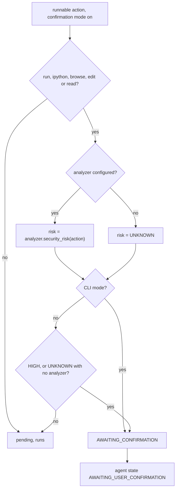

## Overview

Confirmation mode lets a person approve an agent's actions before they run. When it is on, the [[Agent Controller]] gives each command, Python cell, browser action, file edit and file read a risk level, and holds the action with the agent in `AWAITING_USER_CONFIRMATION` when the level calls for it. The risk comes from a security analyzer if one is configured; the built-in `llm` analyzer trusts the risk the model itself declared, and the `invariant` analyzer checks actions against a policy in a separate service.

Sources: [openhands/controller/agent_controller.py:918-958](repo://openhands/controller/agent_controller.py#L918-L958), [openhands/security/options.py:1-8](repo://openhands/security/options.py#L1-L8)

The fields involved, `security_risk` and `confirmation_state`, are described in [[Actions and Observations]].

Sources: [openhands/events/action/action.py:8-18](repo://openhands/events/action/action.py#L8-L18)

## Configuration

Two settings in `[security]` control the feature: `confirmation_mode` (off by default) and `security_analyzer`, the name of an analyzer in `SecurityAnalyzers` (none by default). On the web server, a user's saved settings override both for their conversations.

Sources: [openhands/core/config/security_config.py:4-15](repo://openhands/core/config/security_config.py#L4-L15), [openhands/server/session/session.py:143-152](repo://openhands/server/session/session.py#L143-L152)

```toml
[security]
confirmation_mode = true
security_analyzer = "llm"
```

Sources: [openhands/security/README.md:12-18](repo://openhands/security/README.md#L12-L18)

The runtime creates the analyzer: in its constructor it looks the name up in `SecurityAnalyzers` (falling back to the base class for an unknown name) and instantiates it. `create_controller` and the server's agent session pass `runtime.security_analyzer` to the controller. The frontend lists the available names from `GET /api/options/security-analyzers`.

Sources: [openhands/runtime/base.py:194-204](repo://openhands/runtime/base.py#L194-L204), [openhands/core/setup.py:236-242](repo://openhands/core/setup.py#L236-L242), [openhands/server/routes/public.py:47-59](repo://openhands/server/routes/public.py#L47-L59)

## How the model declares risk

Every CodeAct tool that changes or reads the system requires a `security_risk` argument of `LOW`, `MEDIUM` or `HIGH`, and the system prompt includes a risk policy defining those levels. In the sandbox, `LOW` is read-only work, `MEDIUM` is container-scoped edits and installs, and `HIGH` is data exfiltration or privilege breaks; in CLI mode, where the agent works on the user's own machine, `MEDIUM` is project-scoped changes and `HIGH` covers system settings, global installs and `sudo`. The prompt tells the model to always choose `HIGH` when sensitive data leaves the environment.

Sources: [openhands/agenthub/codeact_agent/tools/security_utils.py:6-10](repo://openhands/agenthub/codeact_agent/tools/security_utils.py#L6-L10), [openhands/agenthub/codeact_agent/prompts/security_risk_assessment.j2:1-23](repo://openhands/agenthub/codeact_agent/prompts/security_risk_assessment.j2#L1-L23), [openhands/agenthub/codeact_agent/prompts/system_prompt.j2:70](repo://openhands/agenthub/codeact_agent/prompts/system_prompt.j2#L70)

`set_security_risk` copies the argument onto the action; any other value is logged and the action keeps `UNKNOWN`.

Sources: [openhands/agenthub/codeact_agent/function_calling.py:59-70](repo://openhands/agenthub/codeact_agent/function_calling.py#L59-L70)

## The confirmation decision



Sources: [openhands/controller/agent_controller.py:918-966](repo://openhands/controller/agent_controller.py#L918-L966)

`_handle_security_analyzer` replaces the action's risk with the analyzer's answer, or with `UNKNOWN` if the analyzer raises. Without an analyzer it sets `UNKNOWN`, overriding whatever the model said; the comment calls this the fail-safe choice, and its effect is that every such action needs confirmation. With an analyzer, only `HIGH` actions are held.

Sources: [openhands/controller/agent_controller.py:204-242](repo://openhands/controller/agent_controller.py#L204-L242), [openhands/controller/agent_controller.py:931-958](repo://openhands/controller/agent_controller.py#L931-L958)

In CLI mode the controller marks every checked action as awaiting confirmation and leaves the risk-based choice to the CLI, a special case its comment flags for refactoring. Actions of other types, such as MCP calls, are never held.

Sources: [openhands/controller/agent_controller.py:942-951](repo://openhands/controller/agent_controller.py#L942-L951), [openhands/controller/agent_controller.py:920-926](repo://openhands/controller/agent_controller.py#L920-L926)

## Confirming or rejecting

### In the web app and headless runs

A held action is still published, so the user interface can show it, but the runtime answers it with an empty `NullObservation` without running it. The controller keeps it pending and does not clear it on that observation.

Sources: [openhands/runtime/base.py:951-956](repo://openhands/runtime/base.py#L951-L956), [openhands/controller/agent_controller.py:535-540](repo://openhands/controller/agent_controller.py#L535-L540)

The user answers with a `ChangeAgentStateAction` to `USER_CONFIRMED` or `USER_REJECTED`. `set_agent_state_to` clears the action's thought, sets its `confirmation_state` to `confirmed` or `rejected`, resets its id and publishes it again. A confirmed action now runs normally; a rejected one gets a `UserRejectObservation` saying the action was rejected and the agent is waiting for input. When that observation arrives the controller moves to `RUNNING` or `AWAITING_USER_INPUT` respectively.

Sources: [openhands/controller/agent_controller.py:660-671](repo://openhands/controller/agent_controller.py#L660-L671), [openhands/runtime/base.py:964-970](repo://openhands/runtime/base.py#L964-L970), [openhands/controller/agent_controller.py:540-547](repo://openhands/controller/agent_controller.py#L540-L547)

In the prompt, a rejection reaches the model as the observation text followed by `[Last action has been rejected by the user]` ([[Conversation Memory]]).

Sources: [openhands/memory/conversation_memory.py:517-520](repo://openhands/memory/conversation_memory.py#L517-L520)

### In the CLI

The CLI handles `AWAITING_USER_CONFIRMATION` itself. It asks the user, showing the pending action's risk, and accepts `yes`, `no`, `always` or `auto_highrisk`. `always` confirms every later action without asking; `auto_highrisk` confirms later actions automatically unless their risk is `HIGH`. A paused agent is not prompted until it resumes ([[Command-Line Interface]]).

Sources: [openhands/cli/main.py:245-299](repo://openhands/cli/main.py#L245-L299)

## Analyzers

### The interface and built-ins

`SecurityAnalyzer` is the interface: `security_risk(action)` returns an `ActionSecurityRisk`, `handle_api_request(request)` serves analyzer-specific HTTP endpoints, and `close()` releases resources.

Sources: [openhands/security/analyzer.py:8-29](repo://openhands/security/analyzer.py#L8-L29)

| Name | Class | Risk it returns |
| --- | --- | --- |
| `llm` | `LLMRiskAnalyzer` | The model's own `security_risk` if it is `LOW`, `MEDIUM` or `HIGH`; otherwise `UNKNOWN` |
| `invariant` | `InvariantAnalyzer` | The highest `risk=` level among policy violations; `LOW` when none match; `UNKNOWN` on a policy error |

Sources: [openhands/security/options.py:5-8](repo://openhands/security/options.py#L5-L8), [openhands/security/llm/analyzer.py:12-42](repo://openhands/security/llm/analyzer.py#L12-L42), [openhands/security/invariant/analyzer.py:92-125](repo://openhands/security/invariant/analyzer.py#L92-L125)

With `llm`, confirmation mode asks only about actions the model rated `HIGH`. The README calls it the default analyzer, and describes it as lightweight with no external dependencies.

Sources: [openhands/security/README.md:57-71](repo://openhands/security/README.md#L57-L71)

### Invariant

`InvariantAnalyzer` runs the Invariant server in a Docker container named `openhands-invariant-server` from `ghcr.io/invariantlabs-ai/server:openhands`, reusing a running or stopped container if one exists and otherwise starting one on a free port. It waits up to 180 checks for the container to run, then creates a client and a monitor from the given policy or the server's template. Docker must be available, or construction fails with a message saying so; `close` stops the container.

Sources: [openhands/security/invariant/analyzer.py:15-90](repo://openhands/security/invariant/analyzer.py#L15-L90)

For each action, `security_risk` converts it into Invariant trace elements (tool calls with ids), appends them to the trace it keeps, and asks the monitor to check the new elements against everything seen so far. Each violation message carries `[risk=…]`, and `get_risk` takes the highest.

Sources: [openhands/security/invariant/analyzer.py:110-125](repo://openhands/security/invariant/analyzer.py#L110-L125), [openhands/security/invariant/parser.py:19-60](repo://openhands/security/invariant/parser.py#L19-L60)

The default policy flags secrets in bash commands and Semgrep findings in Python cells and bash commands, all at medium risk.

Sources: [openhands/security/invariant/policies.py:1-18](repo://openhands/security/invariant/policies.py#L1-L18)

```python
DEFAULT_INVARIANT_POLICY = """from invariant.detectors import semgrep, secrets, CodeIssue

raise "Disallow secrets in bash commands [risk=medium]" if:
    (call: ToolCall)
    call is tool:cmd_run
    any(secrets(call.function.arguments.command))
```

Sources: [openhands/security/invariant/policies.py:1-6](repo://openhands/security/invariant/policies.py#L1-L6)

Because only `HIGH` is held when an analyzer is configured, a policy must raise `risk=high` for its matches to require confirmation.

Sources: [openhands/controller/agent_controller.py:936-958](repo://openhands/controller/agent_controller.py#L936-L958)

## Analyzer API

The server forwards every request under `/api/conversations/{conversation_id}/security/{path}` to the conversation's analyzer `handle_api_request`, and answers 404 when the conversation has no analyzer. This lets an analyzer offer its own settings screens without changing the core.

Sources: [openhands/server/routes/security.py:14-42](repo://openhands/server/routes/security.py#L14-L42), [openhands/server/session/conversation.py:53-55](repo://openhands/server/session/conversation.py#L53-L55)

## Adding an analyzer

A new analyzer subclasses `SecurityAnalyzer`, implements `security_risk` (and `handle_api_request` if it serves endpoints), and is added to `SecurityAnalyzers` in `openhands/security/options.py` so the setting and the frontend list can name it.

Sources: [openhands/security/README.md:43-49](repo://openhands/security/README.md#L43-L49), [openhands/security/options.py:5-8](repo://openhands/security/options.py#L5-L8)
