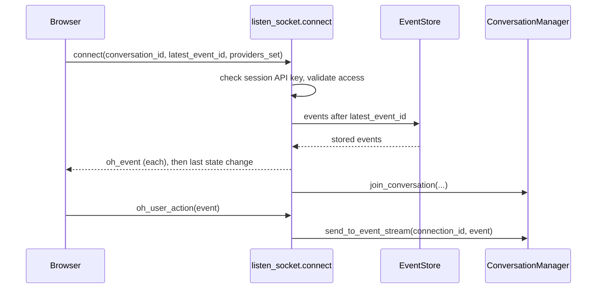

## Overview

The web server is a FastAPI application wrapped in a Socket.IO server. REST endpoints under `/api` create, list, start and stop conversations, read their events and files, and manage settings, secrets and git access. A Socket.IO connection per browser tab streams a conversation's events to the [[Frontend Web App]] and carries the user's actions back into the conversation's event stream. The OpenHands MCP server is mounted on the same app at `/mcp` ([[MCP Tools]]).

Sources: [openhands/server/app.py:37-86](repo://openhands/server/app.py#L37-L86), [openhands/server/listen.py:1-27](repo://openhands/server/listen.py#L1-L27)

The server itself keeps no agent state. Each request or socket message is handed to the `ConversationManager`, which owns running conversations; how it starts and stops them is in [[Conversations and Sessions]].

Sources: [openhands/server/shared.py:61-68](repo://openhands/server/shared.py#L61-L68), [openhands/server/listen_socket.py:124-158](repo://openhands/server/listen_socket.py#L124-L158)

## Assembly

`openhands.server.listen:app` is the ASGI entry point that `uvicorn` runs. It takes the FastAPI app from `app.py`, mounts the built frontend from `./frontend/build` at `/` unless `SERVE_FRONTEND=false`, adds three middlewares, and wraps everything in `socketio.ASGIApp`.

Sources: [openhands/server/listen.py:15-27](repo://openhands/server/listen.py#L15-L27), [Makefile:249-251](repo://Makefile#L249-L251)

| Middleware | Effect |
| --- | --- |
| `LocalhostCORSMiddleware` | Allows CORS from any `localhost` or `127.0.0.1` origin, on any port |
| `CacheControlMiddleware` | Long immutable caching for built assets, `no-cache` for everything else |
| `RateLimitMiddleware` | In-memory limit of 10 requests per second per client, delaying then rejecting excess requests |

Sources: [openhands/server/middleware.py:16-108](repo://openhands/server/middleware.py#L16-L108), [openhands/server/listen.py:20-25](repo://openhands/server/listen.py#L20-L25)

`app.py` registers the route modules, adds `/alive`, `/health` and `/server_info`, and turns any `AuthenticationError` from a git provider into HTTP 401. The git routes are only registered in `OSS` mode; the hosted server supplies its own. The app's lifespan enters the conversation manager's context, so the manager starts and stops with the server.

Sources: [openhands/server/app.py:52-86](repo://openhands/server/app.py#L52-L86), [openhands/server/routes/health.py:6-17](repo://openhands/server/routes/health.py#L6-L17)

## Shared objects and extension points

`openhands/server/shared.py` builds the process-wide objects at import: the `OpenHandsConfig` from `config.toml` and environment ([[Configuration]]), the `ServerConfig`, the file store, the Socket.IO server, the monitoring listener, the conversation manager, and the settings, secrets and conversation store classes. With `REDIS_HOST` set, Socket.IO uses a Redis client manager so several server processes can share connections.

Sources: [openhands/server/shared.py:21-77](repo://openhands/server/shared.py#L21-L77)

`ServerConfig` names the class for each pluggable part, and `OPENHANDS_CONFIG_CLS` can replace `ServerConfig` itself. This is how the [[Enterprise Server]] substitutes its own conversation manager, stores and authentication without changing these modules.

Sources: [openhands/server/config/server_config.py:8-60](repo://openhands/server/config/server_config.py#L8-L60)

| Setting | Default |
| --- | --- |
| `app_mode` | `OSS` |
| `conversation_manager_class` | `StandaloneConversationManager` (or `CONVERSATION_MANAGER_CLASS`) |
| `settings_store_class` | `FileSettingsStore` |
| `secret_store_class` | `FileSecretsStore` |
| `conversation_store_class` | `FileConversationStore` |
| `user_auth_class` | `DefaultUserAuth` |
| `monitoring_listener_class` | `MonitoringListener` |

Sources: [openhands/server/config/server_config.py:10-32](repo://openhands/server/config/server_config.py#L10-L32)

`get_config` returns the values the frontend needs (app mode, GitHub client id, PostHog key, and the billing and hide-LLM-settings feature flags), served at `GET /api/options/config`.

Sources: [openhands/server/config/server_config.py:38-49](repo://openhands/server/config/server_config.py#L38-L49), [openhands/server/routes/public.py:62](repo://openhands/server/routes/public.py#L62)

## Authentication

Every router is created with `get_dependencies()`, which adds a check of the `X-Session-API-Key` header only when `SESSION_API_KEY` is set. A plain local install has no key and no login: the README says it is meant for a single user on their own machine.

Sources: [openhands/server/dependencies.py:6-24](repo://openhands/server/dependencies.py#L6-L24), [README.md:114-116](repo://README.md#L114-L116)

User identity comes from `UserAuth`, created once per request from `server_config.user_auth_class` and cached on `request.state`. It provides the user id and email, access token, git provider tokens, and the user's settings and secrets stores. `DefaultUserAuth` has no user id and reads everything from the local file stores. Routes take these through dependencies such as `get_user_id`, `get_provider_tokens` and `get_user_settings`.

Sources: [openhands/server/user_auth/user_auth.py:18-94](repo://openhands/server/user_auth/user_auth.py#L18-L94), [openhands/server/user_auth/default_user_auth.py:16-92](repo://openhands/server/user_auth/default_user_auth.py#L16-L92)

## REST API

### Conversations

| Method and path | Does |
| --- | --- |
| `POST /api/conversations` | Creates a conversation and starts its agent loop |
| `GET /api/conversations` | Lists conversations with status, paged |
| `GET /api/conversations/{id}` | One conversation's metadata and status |
| `PATCH /api/conversations/{id}` | Renames a conversation |
| `DELETE /api/conversations/{id}` | Stops and deletes a conversation |
| `POST /api/conversations/{id}/start` | Starts the agent loop of an existing conversation |
| `POST /api/conversations/{id}/stop` | Stops the agent loop |
| `GET /api/conversations/{id}/remember-prompt` | Asks the LLM for a prompt to save what was learned around an event |

Sources: [openhands/server/routes/manage_conversations.py:189-190](repo://openhands/server/routes/manage_conversations.py#L189-L190), [openhands/server/routes/manage_conversations.py:291-292](repo://openhands/server/routes/manage_conversations.py#L291-L292), [openhands/server/routes/manage_conversations.py:330-331](repo://openhands/server/routes/manage_conversations.py#L330-L331), [openhands/server/routes/manage_conversations.py:352-353](repo://openhands/server/routes/manage_conversations.py#L352-L353), [openhands/server/routes/manage_conversations.py:371-372](repo://openhands/server/routes/manage_conversations.py#L371-L372), [openhands/server/routes/manage_conversations.py:473-474](repo://openhands/server/routes/manage_conversations.py#L473-L474), [openhands/server/routes/manage_conversations.py:534-535](repo://openhands/server/routes/manage_conversations.py#L534-L535), [openhands/server/routes/manage_conversations.py:639-640](repo://openhands/server/routes/manage_conversations.py#L639-L640)

`POST /api/conversations` accepts `InitSessionRequest`: repository, git provider, branch, initial message, image URLs, a replay trajectory, a suggested task or a microagent to create, conversation instructions and extra MCP config. A suggested task replaces the message with the task's prompt. Requests authenticated with a bearer API key must include an initial message. If a repository is given, the provider handler first checks the user can access it. The call returns the new conversation id; the client then connects the socket with that id.

Sources: [openhands/server/routes/manage_conversations.py:160-175](repo://openhands/server/routes/manage_conversations.py#L160-L175), [openhands/server/routes/manage_conversations.py:189-266](repo://openhands/server/routes/manage_conversations.py#L189-L266)

Missing LLM settings and LLM authentication failures return 400 with a `msg_id` the frontend translates, such as `CONFIGURATION$SETTINGS_NOT_FOUND`.

Sources: [openhands/server/routes/manage_conversations.py:267-289](repo://openhands/server/routes/manage_conversations.py#L267-L289)

### Inside a conversation

Routes under `/api/conversations/{id}` that need the running conversation use the `get_conversation` dependency, which attaches to it through the conversation manager (404 if it is not running) and detaches after the response.

Sources: [openhands/server/utils.py:96-115](repo://openhands/server/utils.py#L96-L115)

| Method and path | Does |
| --- | --- |
| `GET /events` | Searches stored events with `start_id`, `end_id`, `reverse`, a filter and `limit` (at most 100), returning `events` and `has_more` |
| `POST /events` | Adds an event to the running conversation |
| `GET /config`, `/vscode-url`, `/web-hosts` | Runtime id, VS Code URL and app ports of the sandbox |
| `GET /microagents` | Microagents loaded for the conversation |
| `GET /list-files`, `/select-file`, `/zip-directory`, `POST /upload-files` | Workspace files through the runtime |
| `GET /git/changes`, `/git/diff` | Changed files and diffs in the workspace |
| `GET /trajectory` | The conversation's events as a trajectory |
| `POST /submit-feedback` | Sends feedback on the conversation |
| `/security/{path}` | Forwarded to the security analyzer |

Sources: [openhands/server/routes/conversation.py:19-24](repo://openhands/server/routes/conversation.py#L19-L24), [openhands/server/routes/conversation.py:43-43](repo://openhands/server/routes/conversation.py#L43-L43), [openhands/server/routes/conversation.py:75-75](repo://openhands/server/routes/conversation.py#L75-L75), [openhands/server/routes/conversation.py:105-105](repo://openhands/server/routes/conversation.py#L105-L105), [openhands/server/routes/conversation.py:171-171](repo://openhands/server/routes/conversation.py#L171-L171), [openhands/server/routes/conversation.py:191-191](repo://openhands/server/routes/conversation.py#L191-L191), [openhands/server/routes/files.py:30-36](repo://openhands/server/routes/files.py#L30-L36), [openhands/server/routes/files.py:118-119](repo://openhands/server/routes/files.py#L118-L119), [openhands/server/routes/files.py:185-186](repo://openhands/server/routes/files.py#L185-L186), [openhands/server/routes/files.py:222-223](repo://openhands/server/routes/files.py#L222-L223), [openhands/server/routes/files.py:262-263](repo://openhands/server/routes/files.py#L262-L263), [openhands/server/routes/files.py:287-287](repo://openhands/server/routes/files.py#L287-L287), [openhands/server/routes/trajectory.py:12-17](repo://openhands/server/routes/trajectory.py#L12-L17), [openhands/server/routes/feedback.py:14-19](repo://openhands/server/routes/feedback.py#L14-L19), [openhands/server/routes/security.py:14-19](repo://openhands/server/routes/security.py#L14-L19)

`GET /events` reads the [[Events and Event Stream]] store directly, so it works for conversations that are not running. It asks for one more event than the limit to know whether more exist. The nested conversation manager uses this endpoint to read conversations in other containers.

Sources: [openhands/server/routes/conversation.py:105-168](repo://openhands/server/routes/conversation.py#L105-L168), [openhands/events/nested_event_store.py:23-49](repo://openhands/events/nested_event_store.py#L23-L49)

### Settings, secrets and options

| Method and path | Does |
| --- | --- |
| `GET`, `POST /api/settings` | Reads or saves the user's settings (LLM, agent, security, sandbox, MCP) |
| `POST /api/add-git-providers`, `/api/unset-provider-tokens` | Stores or removes git provider tokens |
| `GET`, `POST /api/secrets`, `PUT`, `DELETE /api/secrets/{id}` | Manages custom secrets exposed to the agent |
| `GET /api/options/models`, `/agents`, `/security-analyzers`, `/config` | Choices for the settings screens |

Sources: [openhands/server/routes/settings.py:25-137](repo://openhands/server/routes/settings.py#L25-L137), [openhands/server/routes/secrets.py:103-103](repo://openhands/server/routes/secrets.py#L103-L103), [openhands/server/routes/secrets.py:156-156](repo://openhands/server/routes/secrets.py#L156-L156), [openhands/server/routes/secrets.py:184-184](repo://openhands/server/routes/secrets.py#L184-L184), [openhands/server/routes/secrets.py:212-212](repo://openhands/server/routes/secrets.py#L212-L212), [openhands/server/routes/secrets.py:260-260](repo://openhands/server/routes/secrets.py#L260-L260), [openhands/server/routes/secrets.py:312-312](repo://openhands/server/routes/secrets.py#L312-L312), [openhands/server/routes/public.py:11-62](repo://openhands/server/routes/public.py#L11-L62)

Settings and secrets are kept by the stores described in [[Storage]]. The git routes under `/api/user` (installations, repositories, search, branches, suggested tasks, repository microagents) are covered in [[Git Provider Integrations]].

Sources: [openhands/server/routes/git.py:35-38](repo://openhands/server/routes/git.py#L35-L38), [openhands/server/routes/git.py:65-65](repo://openhands/server/routes/git.py#L65-L65), [openhands/server/routes/git.py:132-132](repo://openhands/server/routes/git.py#L132-L132), [openhands/server/routes/git.py:167-167](repo://openhands/server/routes/git.py#L167-L167), [openhands/server/routes/git.py:210-210](repo://openhands/server/routes/git.py#L210-L210), [openhands/server/routes/git.py:239-239](repo://openhands/server/routes/git.py#L239-L239), [openhands/server/routes/git.py:292-295](repo://openhands/server/routes/git.py#L292-L295), [openhands/server/routes/git.py:355-358](repo://openhands/server/routes/git.py#L355-L358)

## The Socket.IO connection

Sources: [openhands/server/listen_socket.py:35-136](repo://openhands/server/listen_socket.py#L35-L136), [openhands/server/listen_socket.py:143-158](repo://openhands/server/listen_socket.py#L143-L158)

`connect` reads `conversation_id`, `latest_event_id` and `providers_set` from the query string and refuses the connection without a conversation id or, when `SESSION_API_KEY` is set, without a matching `session_api_key`. A `ConversationValidator` (replaceable with `OPENHANDS_CONVERSATION_VALIDATOR_CLS`) checks access from cookies and the authorisation header and returns the user id; the default checks only that the conversation's metadata exists.

Sources: [openhands/server/listen_socket.py:35-76](repo://openhands/server/listen_socket.py#L35-L76), [openhands/server/listen_socket.py:161-168](repo://openhands/server/listen_socket.py#L161-L168), [openhands/storage/conversation/conversation_validator.py:13-50](repo://openhands/storage/conversation/conversation_validator.py#L13-L50)

It then replays every stored event after `latest_event_id` as an `oh_event`, skipping null events and recall actions and sending the latest agent state change last, so a reconnecting tab catches up and ends in the right state. Finally it builds the conversation's init settings and joins the conversation through the manager, which from then on forwards new events to this connection.

Sources: [openhands/server/listen_socket.py:78-136](repo://openhands/server/listen_socket.py#L78-L136)

`oh_user_action` (and the older `oh_action`) passes the client's event to `send_to_event_stream`; `disconnect` tells the manager the connection is gone. A refused connection is disconnected after the error is sent.

Sources: [openhands/server/listen_socket.py:137-158](repo://openhands/server/listen_socket.py#L137-L158)

The Socket.IO server accepts messages up to 4 MB, enough for a 3 MB file after base64 encoding.

Sources: [openhands/server/shared.py:46-52](repo://openhands/server/shared.py#L46-L52)
