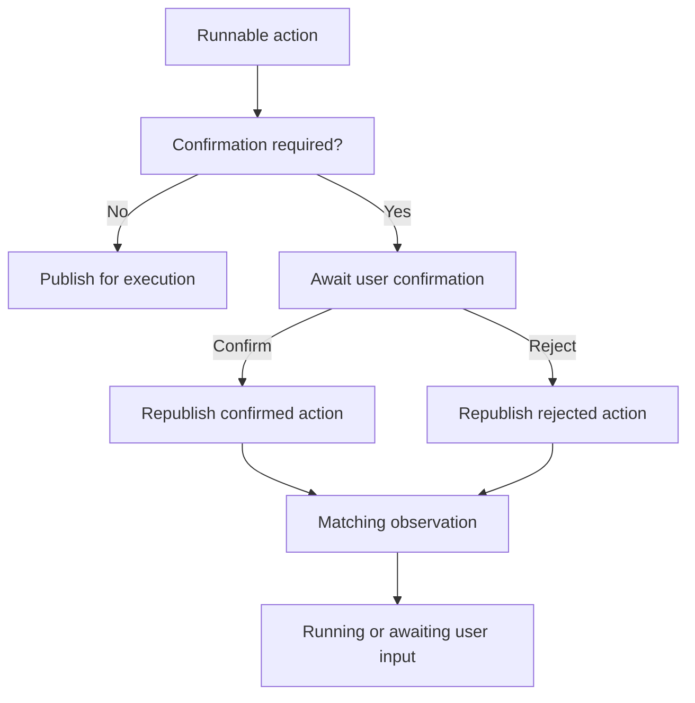

## Overview

The agent decides which action to take; `AgentController` decides when it may take a step and how that action affects conversation state. CodeAct builds model input from history and converts model tool calls into typed actions. The controller consumes actions and observations through the shared event stream described in [[Events and Storage]], enforcing pending-work, confirmation and progress rules around the agent's decisions.

Sources: [openhands/agenthub/codeact_agent/codeact_agent.py:182-224](repo://openhands/agenthub/codeact_agent/codeact_agent.py#L182-L224), [openhands/controller/agent_controller.py:467-485](repo://openhands/controller/agent_controller.py#L467-L485), [openhands/controller/agent_controller.py:821-860](repo://openhands/controller/agent_controller.py#L821-L860)

## Agent interface and capabilities

`Agent` requires a `step(State)` implementation and provides a registry for named classes, model lookup through the LLM registry, reset behavior and system-message construction. Registration rejects duplicate names, and class lookup rejects unknown names. System messages carry the rendered prompt, available tools and agent class. CodeAct lazily creates its `PromptManager`, constructs conversation memory and a condenser, then selects a model router from its registry.

Sources: [openhands/controller/agent.py:40-93](repo://openhands/controller/agent.py#L40-L93), [openhands/controller/agent.py:104-150](repo://openhands/controller/agent.py#L104-L150), [openhands/agenthub/codeact_agent/codeact_agent.py:78-106](repo://openhands/agenthub/codeact_agent/codeact_agent.py#L78-L106)

CodeAct's built-in tool list follows agent capability flags. These select commands, thinking, finishing, condensation requests, browsing, Jupyter, task tracking and editing. LLM-based editing takes precedence over the string-replacement editor when both flags would otherwise apply. Browsing is omitted on Windows. Its sandbox plugin order places AgentSkills before Jupyter because the latter needs the Python functions supplied by the former. External tools join through [[MCP Tools]].

Sources: [openhands/agenthub/codeact_agent/codeact_agent.py:70-76](repo://openhands/agenthub/codeact_agent/codeact_agent.py#L70-L76), [openhands/agenthub/codeact_agent/codeact_agent.py:125-152](repo://openhands/agenthub/codeact_agent/codeact_agent.py#L125-L152)

## One CodeAct decision

CodeAct first drains its pending-action deque, so multiple actions from one completion are returned one at a time. An exact `/exit` user message produces a finish action. Otherwise the condenser yields either a usable history view or a condensation action; the latter returns immediately so the controller can apply it before asking for another step. [[Memory and Microagents]] owns the detailed event-to-message conversion.

Sources: [openhands/agenthub/codeact_agent/codeact_agent.py:182-208](repo://openhands/agenthub/codeact_agent/codeact_agent.py#L182-L208)

With a history view, CodeAct builds messages, passes compatible tool definitions and conversation metadata to `llm.completion`, converts the response into actions and queues them. Function-call conversion supports one model choice, parses each tool's JSON arguments and validates required arguments such as a shell command or Python code. A shell timeout is converted to a float, and invalid JSON or missing required arguments raise a function-call validation error. [[Language Model Requests]] covers transport and retry behavior beneath completion.

Sources: [openhands/agenthub/codeact_agent/codeact_agent.py:207-224](repo://openhands/agenthub/codeact_agent/codeact_agent.py#L207-L224), [openhands/agenthub/codeact_agent/codeact_agent.py:295-299](repo://openhands/agenthub/codeact_agent/codeact_agent.py#L295-L299), [openhands/agenthub/codeact_agent/function_calling.py:73-133](repo://openhands/agenthub/codeact_agent/function_calling.py#L73-L133)

## Controller gates and observation matching

The root controller subscribes to the event stream and uses `StateTracker` to manage state. For each visible event, it adds history, handles the action or observation, and evaluates `should_step`. User messages normally trigger progress; state-change observations and most null observations do not. `_step` then refuses to proceed unless the agent is running and no pending action exists. It synchronizes spend, checks for a stuck loop and runs the control flags before invoking the agent or replay manager.

Sources: [openhands/controller/agent_controller.py:162-182](repo://openhands/controller/agent_controller.py#L162-L182), [openhands/controller/agent_controller.py:392-430](repo://openhands/controller/agent_controller.py#L392-L430), [openhands/controller/agent_controller.py:467-485](repo://openhands/controller/agent_controller.py#L467-L485), [openhands/controller/agent_controller.py:821-870](repo://openhands/controller/agent_controller.py#L821-L870)

A user message first creates a pending recall action: workspace context for the first user message, knowledge recall thereafter. When memory or runtime supplies an observation whose `cause` matches the pending action ID, the controller clears the pending action unless user confirmation is still awaited. This ID match is the bridge between execution feedback and permission to take another step. [[Sandbox Execution]] describes how runtimes attach the cause to execution results.

Sources: [openhands/controller/agent_controller.py:536-546](repo://openhands/controller/agent_controller.py#L536-L546), [openhands/controller/agent_controller.py:566-583](repo://openhands/controller/agent_controller.py#L566-L583), [openhands/runtime/base.py:391-399](repo://openhands/runtime/base.py#L391-L399)

## Confirmation and state transitions

Confirmation handling applies to selected runnable action classes: commands, IPython, interactive browsing, file edits and reads. When enabled, the controller invokes the security analyzer and examines the action's risk. CLI mode marks the action awaiting confirmation for its own risk-handling UI. Outside CLI mode, high risk, or unknown risk without an analyzer, can require confirmation. The controller stores the pending action before publishing it and enters the awaiting-confirmation state when required.

Sources: [openhands/controller/agent_controller.py:919-973](repo://openhands/controller/agent_controller.py#L919-L973)

Sources: [openhands/controller/agent_controller.py:919-973](repo://openhands/controller/agent_controller.py#L919-L973), [openhands/controller/agent_controller.py:658-669](repo://openhands/controller/agent_controller.py#L658-L669), [openhands/controller/agent_controller.py:536-546](repo://openhands/controller/agent_controller.py#L536-L546)

`set_agent_state_to` updates state, handles stop/error reset and confirmation side effects, emits `AgentStateChangedObservation` and saves state. Confirming or rejecting resets the pending action's ID before republishing it with its confirmation status. A matching observation then returns confirmed work to running or rejected work to awaiting input. Finish and reject actions copy outputs and select the corresponding final state; an agent message requesting a response selects awaiting-input state.

Sources: [openhands/controller/agent_controller.py:512-517](repo://openhands/controller/agent_controller.py#L512-L517), [openhands/controller/agent_controller.py:536-546](repo://openhands/controller/agent_controller.py#L536-L546), [openhands/controller/agent_controller.py:585-588](repo://openhands/controller/agent_controller.py#L585-L588), [openhands/controller/agent_controller.py:642-683](repo://openhands/controller/agent_controller.py#L642-L683)

## Limits, delegation and failures

New state receives an iteration control flag and an optional budget flag. Delegate controllers share the parent's iteration flag, budget flag, model registry and metrics, while using a later history start ID and increased delegate level. They do not independently subscribe to the event stream: the parent forwards events. History reconstruction keeps the delegate action and result in the parent's view while removing the enclosed delegate events.

Sources: [openhands/controller/state/state_tracker.py:71-91](repo://openhands/controller/state/state_tracker.py#L71-L91), [openhands/controller/agent_controller.py:454-462](repo://openhands/controller/agent_controller.py#L454-L462), [openhands/controller/agent_controller.py:709-752](repo://openhands/controller/agent_controller.py#L709-L752), [openhands/controller/state/state_tracker.py:145-192](repo://openhands/controller/state/state_tracker.py#L145-L192)

Malformed or nonexistent model actions produce an `ErrorObservation` so the agent can try again. Context-window errors request condensation when history truncation is enabled; otherwise they become a context-window failure. Other exceptions pass through the controller's exception mapping, which records the reason, emits status and sets error state; rate-limit handling distinguishes active retries from exhausted retries. Runner-level decisions about when to exit remain in [[CLI and Headless Tasks]].

Sources: [openhands/controller/agent_controller.py:874-917](repo://openhands/controller/agent_controller.py#L874-L917), [openhands/controller/agent_controller.py:302-356](repo://openhands/controller/agent_controller.py#L302-L356)
