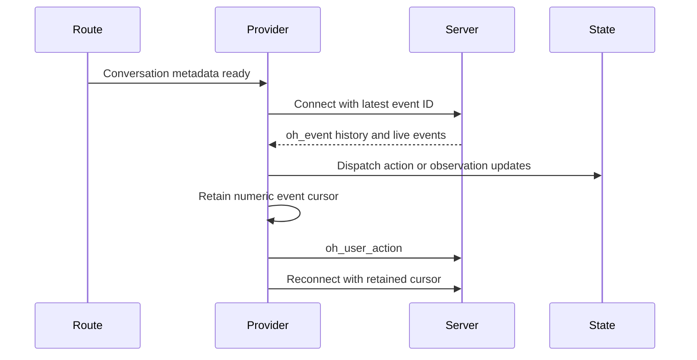

## Overview

The browser creates conversations through HTTP and interacts with a running conversation through Socket.IO. `WsClientProvider` maintains connection state, raw events, parsed actions and observations, and a send function. Event services project those messages into Redux state for agent status and workspace views. [[Conversation Lifecycle]] documents server initialization and replay, while [[Events and Storage]] defines the history that the browser consumes.

Sources: [frontend/src/api/open-hands.ts:257-304](repo://frontend/src/api/open-hands.ts#L257-L304), [frontend/src/context/ws-client-provider.tsx:72-88](repo://frontend/src/context/ws-client-provider.tsx#L72-L88), [frontend/src/services/actions.ts:17-77](repo://frontend/src/services/actions.ts#L17-L77), [frontend/src/services/observations.ts:9-46](repo://frontend/src/services/observations.ts#L9-L46)

## Create and enter a conversation

`useCreateConversation` accepts task text, repository name/provider/branch, a suggested task, conversation instructions and a microagent request. It delegates to `OpenHands.createConversation`, which posts those fields to `/api/conversations`. On success, the mutation records initial-query analytics and invalidates the conversation-list query. Creation supplies the identifier needed for later requests; the API class also exposes get, start and stop operations for that identifier.

Sources: [frontend/src/hooks/mutation/use-create-conversation.ts:8-55](repo://frontend/src/hooks/mutation/use-create-conversation.ts#L8-L55), [frontend/src/api/open-hands.ts:257-314](repo://frontend/src/api/open-hands.ts#L257-L314)

The conversation route loads current conversation information and configuration. When authenticated loading finds no conversation, it shows an error and navigates home. When initial metadata reports stopped, it starts the conversation with the user's providers and refetches. It clears terminal, Jupyter and conversation state and sets agent state to loading when the conversation ID changes. Its content is wrapped in the socket provider, subscription provider and event handler before rendering chat and workspace controls.

Sources: [frontend/src/routes/conversation.tsx:32-95](repo://frontend/src/routes/conversation.tsx#L32-L95)

`useActiveConversation` polls every three seconds while a conversation is starting and every thirty seconds otherwise, and keeps the API class's current-conversation reference synchronized. The multiple-subscription creation hook has its own readiness polling: it waits for running status before subscribing and stops watching a conversation that becomes stopped. These paths make readiness visible without treating a create response as completed runtime initialization.

Sources: [frontend/src/hooks/query/use-active-conversation.ts:6-25](repo://frontend/src/hooks/query/use-active-conversation.ts#L6-L25), [frontend/src/hooks/use-create-conversation-and-subscribe-multiple.ts:44-108](repo://frontend/src/hooks/use-create-conversation-and-subscribe-multiple.ts#L44-L108)

## Connect and resume event history

The socket effect waits until the conversation is running or has runtime status. It sends `conversation_id`, the latest numeric event ID or `-1`, the provider set and the session API key as connection query values. A returned absolute conversation URL supplies the host and path prefix for `/socket.io`; otherwise the connection uses `VITE_BACKEND_BASE_URL` or the browser host. It explicitly selects the WebSocket transport.

Sources: [frontend/src/context/ws-client-provider.tsx:295-339](repo://frontend/src/context/ws-client-provider.tsx#L295-L339)

Sources: [frontend/src/context/ws-client-provider.tsx:151-165](repo://frontend/src/context/ws-client-provider.tsx#L151-L165), [frontend/src/context/ws-client-provider.tsx:252-269](repo://frontend/src/context/ws-client-provider.tsx#L252-L269), [frontend/src/context/ws-client-provider.tsx:295-345](repo://frontend/src/context/ws-client-provider.tsx#L295-L345), [openhands/server/listen_socket.py:93-114](repo://openhands/server/listen_socket.py#L93-L114)

Every message is passed to `handleAssistantMessage`. Recognized action and observation events also enter the parsed-event list, while raw events are retained separately. Numeric IDs update the resume cursor. On disconnect, the provider writes that cursor into the next connection query. Switching conversation IDs clears both event lists and the cursor, preventing another conversation's history from being treated as already consumed.

Sources: [frontend/src/context/ws-client-provider.tsx:164-192](repo://frontend/src/context/ws-client-provider.tsx#L164-L192), [frontend/src/context/ws-client-provider.tsx:252-293](repo://frontend/src/context/ws-client-provider.tsx#L252-L293)

## Send messages and handle attachments

Chat input validates file sizes before processing attachments. Images become base64 URLs; ordinary files upload through the conversation's upload mutation. Skipped-file reasons appear as error toasts, and uploaded filenames are added to the textual prompt. `createChatMessage` returns a message action carrying content, image URLs, file URLs and timestamp. The provider emits it as `oh_user_action`, and chat immediately stores an optimistic user message until the server's user event arrives.

Sources: [frontend/src/components/features/chat/chat-interface.tsx:90-140](repo://frontend/src/components/features/chat/chat-interface.tsx#L90-L140), [frontend/src/services/chat-service.ts:3-14](repo://frontend/src/services/chat-service.ts#L3-L14), [frontend/src/context/ws-client-provider.tsx:151-157](repo://frontend/src/context/ws-client-provider.tsx#L151-L157), [frontend/src/context/ws-client-provider.tsx:204-206](repo://frontend/src/context/ws-client-provider.tsx#L204-L206)

## Project events into workspace views

| Event facet | Client effect |
| --- | --- |
| Command action | Adds terminal input |
| IPython action | Adds Jupyter input |
| Action model metrics | Updates cost, budget and token-usage state |
| Action security risk | Adds security-analyzer input |
| Command observation | Adds terminal output, truncating content beyond 5,000 characters for this view |
| IPython observation | Adds notebook output and image URLs |
| Browser observation | Updates screenshot and URL |
| Agent state observation | Updates the current agent state |

Sources: [frontend/src/services/actions.ts:17-43](repo://frontend/src/services/actions.ts#L17-L43), [frontend/src/services/observations.ts:9-46](repo://frontend/src/services/observations.ts#L9-L46)

The conversation layout places chat beside a resizable workspace panel on larger screens and stacks them at narrower widths. Workspace content selects changes, browser, Jupyter, served-app, VS Code or terminal views from conversation state. The tab components remain mounted with visibility controlled by the active selection, while the loading flag substitutes the conversation-loading view. Chat separately filters parsed events through `shouldRenderEvent` for its transcript.

Sources: [frontend/src/components/features/conversation/conversation-main.tsx:29-75](repo://frontend/src/components/features/conversation/conversation-main.tsx#L29-L75), [frontend/src/components/features/conversation/conversation-tabs/conversation-tab-content.tsx:18-34](repo://frontend/src/components/features/conversation/conversation-tabs/conversation-tab-content.tsx#L18-L34), [frontend/src/components/features/conversation/conversation-tabs/conversation-tab-content.tsx:65-128](repo://frontend/src/components/features/conversation/conversation-tabs/conversation-tab-content.tsx#L65-L128), [frontend/src/components/features/chat/chat-interface.tsx:73-76](repo://frontend/src/components/features/chat/chat-interface.tsx#L73-L76)

## Cache invalidation and errors

File edits, writes and commands invalidate the conversation's changed-files query. Edits and writes also invalidate the affected file diff after normalizing `/workspace/` and the cloned repository directory from its path. Title status messages invalidate the current conversation query. These invalidations connect live execution to HTTP-fetched workspace and metadata views, so observing an event and observing a refreshed diff are separate steps in the UI.

Sources: [frontend/src/context/ws-client-provider.tsx:212-248](repo://frontend/src/context/ws-client-provider.tsx#L212-L248), [frontend/src/services/actions.ts:45-65](repo://frontend/src/services/actions.ts#L45-L65)

Connection errors mark the socket disconnected, set a visible error and refetch conversation metadata. Runtime status errors and error-state observations also set chat errors; ordinary subsequent events can clear them. The event-handler hook treats a 401 server event as an expired session, displays other server errors, and sends a paused-state action for maximum-limit error messages. The underlying controller limits and confirmation transitions remain in [[Agent Decisions and Control]].

Sources: [frontend/src/context/ws-client-provider.tsx:167-202](repo://frontend/src/context/ws-client-provider.tsx#L167-L202), [frontend/src/context/ws-client-provider.tsx:271-284](repo://frontend/src/context/ws-client-provider.tsx#L271-L284), [frontend/src/hooks/use-handle-ws-events.ts:18-45](repo://frontend/src/hooks/use-handle-ws-events.ts#L18-L45)
