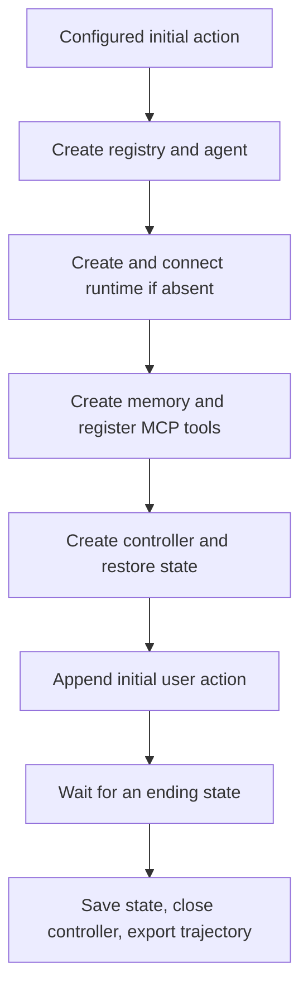

## Overview

OpenHands has an interactive terminal client and a headless task runner. The installed `openhands` entry point dispatches `serve` to the GUI launcher and defaults other invocations to `cli`. The headless entry point is `python -m openhands.core.main`, whose `run_controller` coroutine also supports benchmark and automation callers. Use the launch examples in [[Quickstart]] and the loading rules in [[Configuration]] before following the session behavior here.

Sources: [openhands/cli/entry.py:23-45](repo://openhands/cli/entry.py#L23-L45), [openhands/core/main.py:51-61](repo://openhands/core/main.py#L51-L61), [openhands/core/main.py:286-319](repo://openhands/core/main.py#L286-L319)

## Interactive startup

`main_with_loop` falls back to the user's `~/.openhands/config.toml` if the requested configuration file does not exist. It loads stored settings and enters initial model setup when there are none. Stored model settings fill in an incomplete model/API-key pair only when no named LLM was selected on the command line. Stored settings also control confirmation mode, search credentials and the choice between a summarizing or no-op condenser.

Sources: [openhands/cli/main.py:578-661](repo://openhands/cli/main.py#L578-L661)

Unless CLI defaults are overridden, startup selects runtime `cli`, uses the current directory when no workspace base was set, enables confirmation with the LLM security analyzer and marks the agent as operating in CLI mode. It finalizes configuration again after those changes. Startup requires a workspace base and checks the application's folder-security agreement before running the session. This explains why the interactive CLI's effective runtime can differ from the base application default of Docker.

Sources: [openhands/cli/main.py:663-712](repo://openhands/cli/main.py#L663-L712), [openhands/core/config/openhands_config.py:67-73](repo://openhands/core/config/openhands_config.py#L67-L73)

`run_session` builds the LLM registry, agent, runtime and controller, subscribes shell output to the terminal UI, and initializes memory and MCP tools. It displays each incoming event and updates usage metrics. When the agent finishes a task or awaits input, the session asks for the next task; its outer wait only ends on stopped or error states. Finishing an individual request therefore keeps the interactive conversation available.

Sources: [openhands/cli/main.py:140-181](repo://openhands/cli/main.py#L140-L181), [openhands/cli/main.py:214-243](repo://openhands/cli/main.py#L214-L243), [openhands/cli/main.py:324-353](repo://openhands/cli/main.py#L324-L353), [openhands/cli/main.py:425-443](repo://openhands/cli/main.py#L425-L443)

## Terminal commands and task input

| Input | Session behavior |
| --- | --- |
| Ordinary text | Adds a user `MessageAction` to the event stream |
| `/help` | Displays command help |
| `/status` | Displays usage and session status |
| `/settings` | Opens model and search settings controls |
| `/init` | Requests repository microagent creation for CLI/local runtimes |
| `/new` | Confirms stopping the current session and requests a fresh one |
| `/resume` | Handles resuming a paused agent |
| `/mcp` | Opens MCP management |
| `/exit` | Confirms termination and emits a stopped-state action |

Sources: [openhands/cli/commands.py:122-197](repo://openhands/cli/commands.py#L122-L197), [openhands/cli/commands.py:204-266](repo://openhands/cli/commands.py#L204-L266), [openhands/cli/commands.py:269-307](repo://openhands/cli/commands.py#L269-L307)

The shared task reader prefers a file, then `--task`, then non-interactive standard input. Interactive CLI handling adds an extra behavior for `--file`: it wraps the file contents in a message asking the agent to read them and ask the user what to do. The headless module consumes the task file directly. Use the latter path when the file itself is intended to be the complete unattended task.

Sources: [openhands/io/io.py:26-37](repo://openhands/io/io.py#L26-L37), [openhands/cli/main.py:714-731](repo://openhands/cli/main.py#L714-L731), [openhands/core/main.py:291-305](repo://openhands/core/main.py#L291-L305)

## Headless initialization and execution

`run_controller` accepts an `OpenHandsConfig` and an initial `Action`, with optional session ID, runtime, memory, conversation instructions and user-response callback. It generates an ID when needed, creates model services and an agent, then creates and connects the runtime unless the caller supplied one. If a repository is selected, setup initializes it before constructing memory. A supplied runtime already determines the event stream used by the rest of the task.

Sources: [openhands/core/main.py:51-61](repo://openhands/core/main.py#L51-L61), [openhands/core/main.py:97-143](repo://openhands/core/main.py#L97-L143)

Sources: [openhands/core/main.py:97-167](repo://openhands/core/main.py#L97-L167), [openhands/core/main.py:177-242](repo://openhands/core/main.py#L177-L242)

After MCP discovery, the runner creates the controller and checks that the initial value is an action. A restored state containing an error causes it to append a recovery message asking the agent to ask the user about the error; otherwise it appends the supplied action. [[Agent Decisions and Control]] explains how those user events transition into agent steps, while [[Memory and Microagents]] explains the context gathered before a model decision.

Sources: [openhands/core/main.py:145-191](repo://openhands/core/main.py#L145-L191)

## User responses and ending states

On `AWAITING_USER_INPUT`, the headless subscriber either emits `/exit` when `exit_on_message` is true, reads input when no callback was supplied, or calls `fake_user_response_fn` with controller state. The module entry point normally supplies `auto_continue_response`, which tells the agent to proceed or finish without asking for human responses. `--no-auto-continue` leaves that callback unset. A caller embedding `run_controller` can instead supply a benchmark-specific response policy.

Sources: [openhands/core/main.py:193-205](repo://openhands/core/main.py#L193-L205), [openhands/core/main.py:247-260](repo://openhands/core/main.py#L247-L260), [openhands/core/main.py:311-319](repo://openhands/core/main.py#L311-L319)

The headless wait ends on finished, rejected, error, paused or stopped. `run_agent_until_done` installs status callbacks on runtime, controller and memory; an error callback records `last_error` and schedules the controller into error state. It rejects already-populated runtime or controller callbacks because it would overwrite them. The polling loop waits one second between state checks. These are runner-level rules, separate from the per-action timeout in [[Sandbox Execution]].

Sources: [openhands/core/main.py:207-218](repo://openhands/core/main.py#L207-L218), [openhands/core/loop.py:11-45](repo://openhands/core/loop.py#L11-L45)

## Persistence, replay and cleanup

For non-memory storage, the headless runner saves final controller state before closing the controller without forcing a stopped state. It then returns that state and optionally writes a trajectory JSON file, including screenshots only when configured. Interactive cleanup also saves state, waits briefly for pending tasks, cancels remaining tasks, resets the agent, closes the runtime and closes the controller. [[Events and Storage]] documents the underlying persisted records.

Sources: [openhands/core/main.py:220-244](repo://openhands/core/main.py#L220-L244), [openhands/cli/main.py:91-122](repo://openhands/cli/main.py#L91-L122)

Replay mode requires a trajectory file and forbids a separately supplied task in the headless entry point. `load_replay_log` checks that the path exists and is a file, parses its JSON through `ReplayManager`, requires the first event to be a user message action, and returns that initial action separately from subsequent replay events. Invalid JSON produces a descriptive `ValueError`; a directory or missing file also fails before execution.

Sources: [openhands/core/main.py:157-163](repo://openhands/core/main.py#L157-L163), [openhands/core/main.py:263-283](repo://openhands/core/main.py#L263-L283), [openhands/core/main.py:294-305](repo://openhands/core/main.py#L294-L305)
