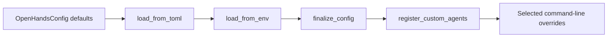

## Overview

OpenHands separates application configuration from persisted session settings. `OpenHandsConfig` holds the runtime, file store, model groups, agent groups, sandbox and security configuration. `Settings` holds choices such as the user's model, API key, confirmation mode and MCP configuration. The launch paths in [[Quickstart]] use these layers differently: the headless module prepares an application config, while the browser works with persisted settings for conversations.

Sources: [openhands/core/config/openhands_config.py:65-118](repo://openhands/core/config/openhands_config.py#L65-L118), [openhands/storage/data_models/settings.py:21-51](repo://openhands/storage/data_models/settings.py#L21-L51), [openhands/core/main.py:286-305](repo://openhands/core/main.py#L286-L305)

## Loading and precedence

`load_openhands_config` creates defaults, loads the chosen TOML file, applies environment values, finalizes paths and runtime adjustments, and registers custom agents. Consequently environment values override values loaded from TOML in this base loader. The default file is `config.toml` relative to the working directory; a missing file returns without applying any TOML settings. A malformed TOML file logs a warning and also returns, so a running process does not prove the file parsed successfully.

Sources: [openhands/core/config/utils.py:819-836](repo://openhands/core/config/utils.py#L819-L836), [openhands/core/config/utils.py:138-158](repo://openhands/core/config/utils.py#L138-L158)

Sources: [openhands/core/config/utils.py:819-850](repo://openhands/core/config/utils.py#L819-L850), [openhands/core/config/utils.py:879-904](repo://openhands/core/config/utils.py#L879-L904)

`setup_config_from_args` then applies explicit CLI selections. It can replace the default LLM with a named group, change the default agent, override iteration and budget limits, and assign a selected repository. A requested LLM group is looked up in the loaded groups, then the selected config file, and finally the user's `~/.openhands/config.toml` when applicable. If the requested group cannot be found, setup raises a `ValueError` rather than silently selecting another group.

Sources: [openhands/core/config/utils.py:849-904](repo://openhands/core/config/utils.py#L849-L904)

## TOML sections and named groups

`[core]` keys are assigned to known application attributes; an unknown key produces a warning. `[agent]` and `[llm]` are converted into mappings and stored by name. The root config lazily creates the default `agent` and `llm` entries when a getter needs them. An agent can refer to a model group using its `llm_config` field, and the application resolves that reference through `get_llm_config_from_agent_config`.

Sources: [openhands/core/config/utils.py:160-212](repo://openhands/core/config/utils.py#L160-L212), [openhands/core/config/openhands_config.py:131-169](repo://openhands/core/config/openhands_config.py#L131-L169)

| Configuration facet | Where it enters | Behavior |
| --- | --- | --- |
| Application | `[core]` | Sets runtime, storage and task limits |
| Models | `[llm]` and nested named groups | Produces `LLMConfig` entries |
| Agents | `[agent]` and nested named groups | Produces `AgentConfig` entries |
| Security | `[security]` | Selects confirmation mode and analyzer |
| Sandbox | `[sandbox]` | Validates workspace execution settings |
| Condensation | `[condenser]` | Assigns the default agent's history condenser |

Sources: [openhands/core/config/openhands_config.py:65-99](repo://openhands/core/config/openhands_config.py#L65-L99), [openhands/core/config/utils.py:192-220](repo://openhands/core/config/utils.py#L192-L220), [openhands/core/config/security_config.py:4-35](repo://openhands/core/config/security_config.py#L4-L35), [openhands/core/config/sandbox_config.py:99-117](repo://openhands/core/config/sandbox_config.py#L99-L117), [openhands/core/config/utils.py:301-335](repo://openhands/core/config/utils.py#L301-L335)

When no condenser section is present in a successfully loaded TOML file and `enable_default_condenser` is true, the loader creates an LLM summarizing condenser using the default LLM config. This branch occurs inside TOML loading, after the early returns for missing or malformed files. [[Memory and Microagents]] explains what the condenser does with history; [[Language Model Requests]] explains the model service behind it.

Sources: [openhands/core/config/utils.py:148-158](repo://openhands/core/config/utils.py#L148-L158), [openhands/core/config/utils.py:301-338](repo://openhands/core/config/utils.py#L301-L338)

## Environment values and finalization

Environment names are uppercased field names, with prefixes for nested configuration. The loader also explicitly applies `LLM_` and `AGENT_` values to the default groups. Empty values are skipped. Booleans accept `true` or `1` as true; list and dictionary values are parsed with `literal_eval`, including conversion of dictionaries into nested Pydantic models for typed lists. Failed casts log an error rather than applying the invalid value.

Sources: [openhands/core/config/utils.py:65-135](repo://openhands/core/config/utils.py#L65-L135)

`finalize_config` interprets comma-separated `sandbox.volumes` entries as host path, container path and optional mode. A mount explicitly targeting `/workspace` establishes the workspace mapping; mounts elsewhere clear the legacy workspace fields. Invalid entry shapes raise `ValueError`. The function warns when deprecated workspace settings are used, makes completion-log paths absolute, creates the cache directory and persists a JWT secret if none was configured.

Sources: [openhands/core/config/utils.py:377-457](repo://openhands/core/config/utils.py#L377-L457)

Runtime selection can also alter capabilities. When the runtime name is `cli`, finalization disables Jupyter and browsing for configured agents because that runtime does not support those facilities. Treat that adjustment as part of configuration resolution when comparing the visible tool set with a TOML file; [[Sandbox Execution]] covers the runtime implementations that consume these values.

Sources: [openhands/core/config/utils.py:459-469](repo://openhands/core/config/utils.py#L459-L469)

## Persisted settings and secrets

`Settings.from_config` returns no default settings when the model API key is absent. Otherwise it creates settings from the application's agent, limits, model, security and MCP values. Stored settings can merge MCP configuration from that default: configured servers are placed before stored servers in each transport list. This method is a specific MCP merge, so it should not be interpreted as replacing every persisted user preference from TOML.

Sources: [openhands/storage/data_models/settings.py:128-186](repo://openhands/storage/data_models/settings.py#L128-L186)

The default `FileSettingsStore` reads and writes `settings.json` through the selected file store. Its write deliberately uses serialization context with `expose_secrets` enabled. `Settings` normally masks its model and search API keys, but that context emits their values. Provider and custom secrets have a separate `FileSecretsStore` at `secrets.json`, which also writes with secret exposure enabled. These are persistence formats; event-history replacement is a different boundary covered in [[Events and Storage]].

Sources: [openhands/storage/settings/file_settings_store.py:14-43](repo://openhands/storage/settings/file_settings_store.py#L14-L43), [openhands/storage/data_models/settings.py:57-75](repo://openhands/storage/data_models/settings.py#L57-L75), [openhands/storage/secrets/file_secrets_store.py:14-49](repo://openhands/storage/secrets/file_secrets_store.py#L14-L49)

## Validation and failure signals

The root application model forbids extra fields, as do sandbox and security models. User settings validate assignment, and `condenser_max_size` rejects values below 20. Configuration failure behavior therefore depends on the boundary: malformed TOML is warned about, some section conversions are caught and logged, explicit missing CLI model groups raise, and invalid volume syntax raises during finalization. Check the loader branch that handles the value before assuming all configuration errors abort startup.

Sources: [openhands/core/config/openhands_config.py:127-129](repo://openhands/core/config/openhands_config.py#L127-L129), [openhands/core/config/sandbox_config.py:97-115](repo://openhands/core/config/sandbox_config.py#L97-L115), [openhands/core/config/security_config.py:12-33](repo://openhands/core/config/security_config.py#L12-L33), [openhands/storage/data_models/settings.py:53-55](repo://openhands/storage/data_models/settings.py#L53-L55), [openhands/storage/data_models/settings.py:113-120](repo://openhands/storage/data_models/settings.py#L113-L120), [openhands/core/config/utils.py:148-158](repo://openhands/core/config/utils.py#L148-L158), [openhands/core/config/utils.py:879-882](repo://openhands/core/config/utils.py#L879-L882), [openhands/core/config/utils.py:417-424](repo://openhands/core/config/utils.py#L417-L424)
