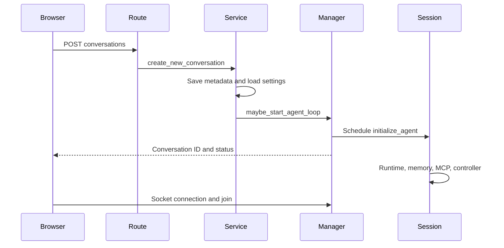

## Overview

A web conversation combines stored metadata, an agent loop, a workspace runtime and one or more client connections. These have different lifetimes: losing a socket connection does not immediately discard the agent loop, and receiving a creation response does not mean runtime initialization has finished. [[CLI and Headless Tasks]] covers the terminal lifecycle; this page follows the server path used by the browser.

Sources: [openhands/server/services/conversation_service.py:34-67](repo://openhands/server/services/conversation_service.py#L34-L67), [openhands/server/conversation_manager/standalone_conversation_manager.py:340-355](repo://openhands/server/conversation_manager/standalone_conversation_manager.py#L340-L355), [openhands/server/conversation_manager/standalone_conversation_manager.py:397-408](repo://openhands/server/conversation_manager/standalone_conversation_manager.py#L397-L408)

## Creation request

`POST /conversations` accepts `InitSessionRequest`: repository and provider, branch, initial message, image URLs, optional replay JSON, suggested task, microagent request, conversation instructions and MCP configuration. Extra fields are forbidden. Caller-supplied conversation IDs are only exposed when `ALLOW_SET_CONVERSATION_ID=1`; otherwise the route generates a UUID. The route chooses a trigger from GUI, suggested task, microagent management or bearer API-key use, and the bearer path requires an initial user message.

Sources: [openhands/server/routes/manage_conversations.py:160-175](repo://openhands/server/routes/manage_conversations.py#L160-L175), [openhands/server/routes/manage_conversations.py:189-240](repo://openhands/server/routes/manage_conversations.py#L189-L240), [openhands/server/routes/manage_conversations.py:242-248](repo://openhands/server/routes/manage_conversations.py#L242-L248)

When a repository is present, the route verifies its provider before calling `create_new_conversation`. That service first creates or loads metadata through the configured conversation store, then calls `start_conversation`. New metadata records the trigger, owner, repository, branch, provider and a default title. The response exposes the conversation ID and current conversation status so the client can connect separately.

Sources: [openhands/server/routes/manage_conversations.py:242-269](repo://openhands/server/routes/manage_conversations.py#L242-L269), [openhands/server/services/conversation_service.py:42-75](repo://openhands/server/services/conversation_service.py#L42-L75), [openhands/server/services/conversation_service.py:179-202](repo://openhands/server/services/conversation_service.py#L179-L202)

## Settings and session initialization

`start_conversation` loads persisted settings, adds repository information, credentials and conversation instructions, and constructs `ConversationInitData`. An initial message or images become a `MessageAction`. Missing settings raise `MissingSettingsError`; a missing or whitespace API key raises `LLMAuthenticationError` for models outside the `bedrock/` namespace. The route translates those failures into distinct HTTP 400 responses. This is a preliminary key check, with a comment explaining that a more accurate check would require inference.

Sources: [openhands/server/services/conversation_service.py:98-159](repo://openhands/server/services/conversation_service.py#L98-L159), [openhands/server/routes/manage_conversations.py:270-288](repo://openhands/server/routes/manage_conversations.py#L270-L288)

The standalone manager's `maybe_start_agent_loop` reuses an existing local session or creates a `WebSession`. A new session is stored immediately, and `initialize_agent` runs in an asyncio task. `WebSession` owns an `AgentSession`, subscribes to its event stream and publishes events to Socket.IO. [[Configuration]] describes persisted settings; [[Events and Storage]] follows the event history that survives these live objects.

Sources: [openhands/server/conversation_manager/standalone_conversation_manager.py:280-294](repo://openhands/server/conversation_manager/standalone_conversation_manager.py#L280-L294), [openhands/server/conversation_manager/standalone_conversation_manager.py:340-366](repo://openhands/server/conversation_manager/standalone_conversation_manager.py#L340-L366), [openhands/server/session/session.py:84-117](repo://openhands/server/session/session.py#L84-L117)

Sources: [openhands/server/routes/manage_conversations.py:248-269](repo://openhands/server/routes/manage_conversations.py#L248-L269), [openhands/server/services/conversation_service.py:98-159](repo://openhands/server/services/conversation_service.py#L98-L159), [openhands/server/services/conversation_service.py:179-202](repo://openhands/server/services/conversation_service.py#L179-L202), [openhands/server/conversation_manager/standalone_conversation_manager.py:340-355](repo://openhands/server/conversation_manager/standalone_conversation_manager.py#L340-L355), [openhands/server/listen_socket.py:120-129](repo://openhands/server/listen_socket.py#L120-L129), [openhands/server/session/agent_session.py:134-189](repo://openhands/server/session/agent_session.py#L134-L189)

`AgentSession.start` connects the runtime before creating memory, registers provider and custom secrets for event filtering, and installs MCP tools before controller creation so the system message includes them. It then emits the initial user message followed by a running-state action, or enters awaiting-input state when no message exists. [[Sandbox Execution]], [[Memory and Microagents]] and [[MCP Tools]] explain the initialization work at each boundary.

Sources: [openhands/server/session/agent_session.py:134-202](repo://openhands/server/session/agent_session.py#L134-L202)

## Socket connection and history replay

The Socket.IO connect handler requires `conversation_id`, parses `latest_event_id`, checks the optional session API key and validates the user's conversation access. It replays history starting after the supplied event ID, filtering null actions, null observations and recall actions. State-change observations are held back so the last such state is sent after other replayed events. Only then does it rebuild initialization settings and join the conversation room.

Sources: [openhands/server/listen_socket.py:35-73](repo://openhands/server/listen_socket.py#L35-L73), [openhands/server/listen_socket.py:78-140](repo://openhands/server/listen_socket.py#L78-L140)

`join_conversation` records the connection-to-conversation mapping, enters the room and ensures an agent loop exists. Incoming `oh_user_action` messages use that mapping to dispatch into the session; `oh_action` remains as a compatibility handler. This reconnect path is why a client should retain its latest event ID. [[Browser Conversation UI]] documents how the browser supplies that cursor and builds its local view.

Sources: [openhands/server/conversation_manager/standalone_conversation_manager.py:151-165](repo://openhands/server/conversation_manager/standalone_conversation_manager.py#L151-L165), [openhands/server/conversation_manager/standalone_conversation_manager.py:369-380](repo://openhands/server/conversation_manager/standalone_conversation_manager.py#L369-L380), [openhands/server/listen_socket.py:143-158](repo://openhands/server/listen_socket.py#L143-L158)

## Reuse, concurrency and cleanup

Server-side attachment uses reference counts. An active `ServerConversation` is reused and its count incremented; a detached one can be moved back into the active set. Detaching the last reference moves it to a detached map. A runtime-unavailable error during attachment disconnects the new object and returns no conversation. These attachments are distinct from the manager's separately tracked agent loops and socket mappings.

Sources: [openhands/server/conversation_manager/standalone_conversation_manager.py:91-149](repo://openhands/server/conversation_manager/standalone_conversation_manager.py#L91-L149), [openhands/server/conversation_manager/standalone_conversation_manager.py:167-177](repo://openhands/server/conversation_manager/standalone_conversation_manager.py#L167-L177)

Before starting a new loop, the manager checks `max_concurrent_conversations`. At the limit, it sorts existing conversation metadata and closes older conversations while emitting `AGENT_ERROR$TOO_MANY_CONVERSATIONS`. Separately, periodic cleanup disconnects detached server conversations and closes idle, non-running loops only when they have no remaining socket connections. A false `sandbox.close_delay` disables that idle-loop cleanup branch.

Sources: [openhands/server/conversation_manager/standalone_conversation_manager.py:179-228](repo://openhands/server/conversation_manager/standalone_conversation_manager.py#L179-L228), [openhands/server/conversation_manager/standalone_conversation_manager.py:306-338](repo://openhands/server/conversation_manager/standalone_conversation_manager.py#L306-L338)

Explicit session closure disconnects mapped sockets, removes the loop and closes the session. `AgentSession.close` closes its stream, saves and closes the controller, and submits runtime closure to an executor. Deleting a conversation additionally invokes the selected runtime's delete operation and removes metadata. The clustered deployment replaces this manager, so consult [[Enterprise Deployment]] before applying these in-process ownership rules across multiple servers.

Sources: [openhands/server/conversation_manager/standalone_conversation_manager.py:429-454](repo://openhands/server/conversation_manager/standalone_conversation_manager.py#L429-L454), [openhands/server/session/agent_session.py:224-245](repo://openhands/server/session/agent_session.py#L224-L245), [openhands/server/routes/manage_conversations.py:352-368](repo://openhands/server/routes/manage_conversations.py#L352-L368), [enterprise/server/config.py:64-67](repo://enterprise/server/config.py#L64-L67)
