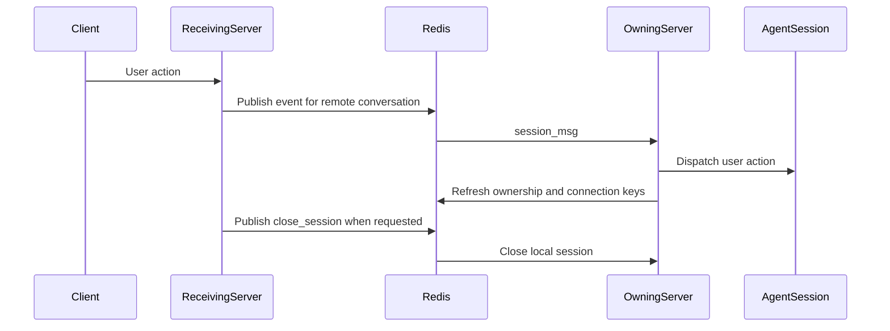

## Overview

The enterprise package extends the base server through configuration-selected implementations for authentication, settings, secrets, metadata, monitoring and conversation management. Its clustered manager keeps the base session machinery while coordinating ownership and messages through Redis. [[Conversation Lifecycle]] explains the session itself; this page follows the deployment boundaries that change when different servers can receive a request or own the agent loop.

Sources: [enterprise/server/config.py:51-71](repo://enterprise/server/config.py#L51-L71), [enterprise/server/clustered_conversation_manager.py:60-76](repo://enterprise/server/clustered_conversation_manager.py#L60-L76), [openhands/server/shared.py:54-77](repo://openhands/server/shared.py#L54-L77)

## Package and licensing boundary

The enterprise README identifies this directory as the server used by OpenHands Cloud and describes it as an extension of the MIT-licensed project. The directory contains its own `LICENSE`, headed PolyForm Free Trial License 1.0.0; its README describes trial and commercial licensing separately from the root project. The enterprise Python package depends on the parent `openhands-ai` checkout in development mode and adds database, identity, billing, monitoring and integration dependencies. Consult the checked-in license for its actual terms.

Sources: [enterprise/README.md:1-19](repo://enterprise/README.md#L1-L19), [enterprise/LICENSE:1-23](repo://enterprise/LICENSE#L1-L23), [enterprise/pyproject.toml:7-45](repo://enterprise/pyproject.toml#L7-L45)

## Select server implementations

`load_server_config` reads `OPENHANDS_CONFIG_CLS`, resolves a `ServerConfig` subclass, instantiates it and invokes `verify_config`. Base server initialization then dynamically resolves monitoring, conversation management and store classes from that object. Enterprise `SaaSServerConfig` sets SaaS mode and supplies enterprise implementation paths. Its validation requires a config path and PostHog client key, with an additional GitHub client-ID check when the corresponding application is configured.

Sources: [openhands/server/config/server_config.py:52-60](repo://openhands/server/config/server_config.py#L52-L60), [openhands/server/shared.py:54-77](repo://openhands/server/shared.py#L54-L77), [enterprise/server/config.py:51-71](repo://enterprise/server/config.py#L51-L71), [enterprise/server/config.py:129-137](repo://enterprise/server/config.py#L129-L137)

| Interface | Enterprise default |
| --- | --- |
| Settings store | `storage.saas_settings_store.SaasSettingsStore` |
| Secrets store | `storage.saas_secrets_store.SaasSecretsStore` |
| Conversation metadata | `storage.saas_conversation_store.SaasConversationStore` |
| Conversation manager | `server.clustered_conversation_manager.ClusteredConversationManager` |
| Monitoring | `server.saas_monitoring_listener.SaaSMonitoringListener` |
| User authentication | `server.auth.saas_user_auth.SaasUserAuth` |

Sources: [enterprise/server/config.py:59-71](repo://enterprise/server/config.py#L59-L71)

The manager path can be overridden through `CONVERSATION_MANAGER_CLASS`. These import paths refer to packages installed by the enterprise project, which includes `server`, `storage`, `sync`, `integrations` and `experiments`. Merely changing the base application's runtime name does not install these server services. [[Configuration]] covers the separate application configuration object that still supplies runtime and file-store settings.

Sources: [enterprise/server/config.py:64-67](repo://enterprise/server/config.py#L64-L67), [enterprise/pyproject.toml:15-25](repo://enterprise/pyproject.toml#L15-L25), [openhands/server/shared.py:23-35](repo://openhands/server/shared.py#L23-L35)

## Authenticate users and persist metadata

`SaasUserAuth.get_instance` tries bearer authentication first, then the signed cookie, and raises a no-credentials error when neither succeeds. Bearer handling validates an application API key, loads the user's offline token and builds a user-auth object. Cookie handling reads `keycloak_auth`, verifies its outer signed token and extracts the embedded identity and token fields. The authenticated request is rate-limited once per request state.

Sources: [enterprise/server/auth/saas_user_auth.py:205-224](repo://enterprise/server/auth/saas_user_auth.py#L205-L224), [enterprise/server/auth/saas_user_auth.py:227-299](repo://enterprise/server/auth/saas_user_auth.py#L227-L299)

The auth object obtains per-user settings and secrets stores using the database session factory. It refreshes an expired or absent access token and obtains identity-provider tokens through its token manager, retaining host overrides from saved provider secrets. Authentication middleware can refresh the response cookie, reject unverified email where required, return 401 for missing or invalid credentials and remove invalid cookies. These operations sit before the repository behavior in [[Git Provider Integration]].

Sources: [enterprise/server/auth/saas_user_auth.py:111-172](repo://enterprise/server/auth/saas_user_auth.py#L111-L172), [enterprise/server/auth/saas_user_auth.py:196-203](repo://enterprise/server/auth/saas_user_auth.py#L196-L203), [enterprise/server/middleware.py:32-97](repo://enterprise/server/middleware.py#L32-L97)

`SaasConversationStore` filters metadata by user and conversation ID, merges and commits updates through SQLAlchemy, and returns paginated results ordered by creation time. The database configuration supports ordinary PostgreSQL connection values or a GCP Cloud SQL connector. Conversation metadata is separate from the event file store: the clustered manager opens an `EventStore` through its configured file store when the loop is owned remotely. [[Events and Storage]] describes those event records.

Sources: [enterprise/storage/saas_conversation_store.py:35-88](repo://enterprise/storage/saas_conversation_store.py#L35-L88), [enterprise/storage/saas_conversation_store.py:106-138](repo://enterprise/storage/saas_conversation_store.py#L106-L138), [enterprise/storage/database.py:11-51](repo://enterprise/storage/database.py#L11-L51), [enterprise/server/clustered_conversation_manager.py:224-237](repo://enterprise/server/clustered_conversation_manager.py#L224-L237)

## Claim and route a clustered conversation

Base shared-server setup creates `AsyncRedisManager` when `REDIS_HOST` is set, with optional `REDIS_PASSWORD`; the clustered manager retrieves Redis through that Socket.IO manager. It starts heartbeat and subscription tasks on entry and subscribes to `session_msg`. Active conversation keys use `ohcnv:<user>:<conversation>`, and connection keys use `ohcnct:<user>:<conversation>:<connection>`.

Sources: [openhands/server/shared.py:37-52](repo://openhands/server/shared.py#L37-L52), [enterprise/server/clustered_conversation_manager.py:90-123](repo://enterprise/server/clustered_conversation_manager.py#L90-L123), [enterprise/server/clustered_conversation_manager.py:213-222](repo://enterprise/server/clustered_conversation_manager.py#L213-L222)

`maybe_start_agent_loop` claims the conversation key using Redis `SET` with `NX` and expiry. Only the server that creates the key starts the loop; other servers access the existing conversation through local or stored events. The expiry is fifteen seconds and the heartbeat interval is five seconds. Heartbeats refresh both locally owned conversation keys and connection keys. The constructor adjusts the concurrency limit because it marks ownership before counting running conversations.

Sources: [enterprise/server/clustered_conversation_manager.py:40-49](repo://enterprise/server/clustered_conversation_manager.py#L40-L49), [enterprise/server/clustered_conversation_manager.py:83-88](repo://enterprise/server/clustered_conversation_manager.py#L83-L88), [enterprise/server/clustered_conversation_manager.py:389-419](repo://enterprise/server/clustered_conversation_manager.py#L389-L419), [enterprise/server/clustered_conversation_manager.py:435-483](repo://enterprise/server/clustered_conversation_manager.py#L435-L483)

Sources: [enterprise/server/clustered_conversation_manager.py:150-160](repo://enterprise/server/clustered_conversation_manager.py#L150-L160), [enterprise/server/clustered_conversation_manager.py:366-387](repo://enterprise/server/clustered_conversation_manager.py#L366-L387), [enterprise/server/clustered_conversation_manager.py:435-483](repo://enterprise/server/clustered_conversation_manager.py#L435-L483)

If the receiving server owns the loop, it dispatches directly; otherwise it publishes an event for the owning server. The subscription handler dispatches only when the corresponding session exists locally. Close requests broadcast and also attempt local closure. Redis coordination therefore identifies liveness and routes messages, while the agent's event stream remains the execution history. Browser connection and history replay behavior remains documented in [[Browser Conversation UI]].

Sources: [enterprise/server/clustered_conversation_manager.py:150-160](repo://enterprise/server/clustered_conversation_manager.py#L150-L160), [enterprise/server/clustered_conversation_manager.py:366-387](repo://enterprise/server/clustered_conversation_manager.py#L366-L387), [enterprise/server/clustered_conversation_manager.py:224-237](repo://enterprise/server/clustered_conversation_manager.py#L224-L237)

## Recovery and operational signals

Cleanup compares local connections to remotely owned conversations against live Redis conversation keys. When an owner has disappeared, it looks up the user in stored metadata and schedules remote-stopped handling. Graceful closure deletes ownership and connection keys, broadcasts `session_closing` and closes the session; the code notes that graceful notification cannot be guaranteed when nodes vanish. Expiring ownership and persisted history are thus different parts of recovery, not a promise of uninterrupted execution.

Sources: [enterprise/server/clustered_conversation_manager.py:161-178](repo://enterprise/server/clustered_conversation_manager.py#L161-L178), [enterprise/server/clustered_conversation_manager.py:485-541](repo://enterprise/server/clustered_conversation_manager.py#L485-L541), [enterprise/server/clustered_conversation_manager.py:640-669](repo://enterprise/server/clustered_conversation_manager.py#L640-L669)

The SaaS monitoring listener increments agent-error and conversation-creation counters and observes startup duration labeled by success. The creation counter explicitly does not establish that creation succeeded. Cluster cleanup also logs attached, detached, running and local-connection counts. Use these separate signals to distinguish request volume, initialization success and live conversation ownership when investigating deployment behavior.

Sources: [enterprise/server/saas_monitoring_listener.py:25-68](repo://enterprise/server/saas_monitoring_listener.py#L25-L68), [enterprise/server/clustered_conversation_manager.py:581-595](repo://enterprise/server/clustered_conversation_manager.py#L581-L595)
