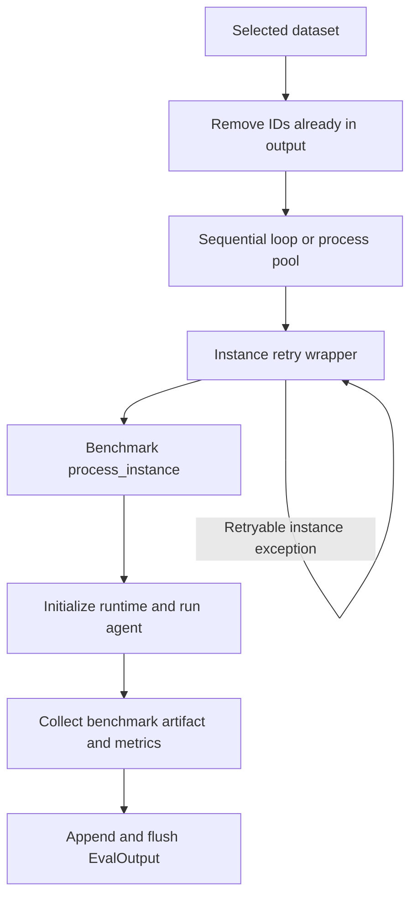

## Overview

The evaluation harness runs benchmark-specific instance processors and appends structured results to JSONL output. Shared helpers provide metadata, dataset filtering, retry policy, worker orchestration and metrics. Each benchmark owns its instructions, workspace initialization and scoring artifacts. [[CLI and Headless Tasks]] describes the underlying agent runner; evaluation wraps it with dataset and result handling rather than replacing its action loop.

Sources: [evaluation/utils/shared.py:44-78](repo://evaluation/utils/shared.py#L44-L78), [evaluation/utils/shared.py:219-289](repo://evaluation/utils/shared.py#L219-L289), [evaluation/utils/shared.py:486-549](repo://evaluation/utils/shared.py#L486-L549), [evaluation/benchmarks/swe_bench/run_infer.py:640-709](repo://evaluation/benchmarks/swe_bench/run_infer.py#L640-L709)

## Configure an experiment

The evaluation README starts from the development environment and directs users to benchmark-specific inference scripts. Do not assume that every ordinary application setting applies to evaluation: adapters build their own configuration. The SWE-bench entry point loads an explicit named LLM group, enables completion logging and sets `modify_params` false for reproducibility. It optionally loads an agent group and selects a condenser through `EVAL_CONDENSER`, defaulting to no-op condensation when absent.

Sources: [evaluation/README.md:7-23](repo://evaluation/README.md#L7-L23), [evaluation/README.md:73-75](repo://evaluation/README.md#L73-L75), [evaluation/benchmarks/swe_bench/run_infer.py:799-826](repo://evaluation/benchmarks/swe_bench/run_infer.py#L799-L826)

| Selection | Interface |
| --- | --- |
| Model group | `--llm-config` / `-l` |
| Agent implementation | `--agent-cls` / `-c` |
| Iteration limit | `--max-iterations` / `-i` |
| Output root | `--eval-output-dir` |
| Sample size | `--eval-n-limit` |
| Worker count | `--eval-num-workers` |
| SWE-bench dataset and split | `--dataset`, `--split` |
| SWE-bench mode | `--mode`, with `swe`, `swt` or `swt-ci` |

Sources: [openhands/core/config/arg_utils.py:49-55](repo://openhands/core/config/arg_utils.py#L49-L55), [openhands/core/config/arg_utils.py:67-99](repo://openhands/core/config/arg_utils.py#L67-L99), [openhands/core/config/arg_utils.py:110-123](repo://openhands/core/config/arg_utils.py#L110-L123), [evaluation/benchmarks/swe_bench/run_infer.py:747-767](repo://evaluation/benchmarks/swe_bench/run_infer.py#L747-L767)

`make_metadata` derives an output path from dataset, agent, model, iteration limit and optional note, creates output/log directories and writes `metadata.json`. The record includes start time, Git commit, model and agent configuration, dataset details and condenser configuration. This makes experiment identity explicit; changing only a shell environment without inspecting the resulting metadata can obscure which setup produced an output. [[Language Model Requests]] explains the completion logs and cost measurements retained during inference.

Sources: [evaluation/utils/shared.py:164-216](repo://evaluation/utils/shared.py#L164-L216), [evaluation/utils/shared.py:44-56](repo://evaluation/utils/shared.py#L44-L56)

## Dataset selection and resume

`prepare_dataset` requires a unique `instance_id` column. It reads existing output lines and records their IDs as finished, optionally selects explicit IDs, or skips an initial range and samples a limit with fixed seed 42. Sampling occurs without replacement. After selection it removes finished IDs and converts NumPy arrays and pandas timestamps into serializable forms. Resume therefore keys on saved result IDs rather than on output-file position or worker order.

Sources: [evaluation/utils/shared.py:219-289](repo://evaluation/utils/shared.py#L219-L289)

The SWE-bench script loads its requested dataset and split, determines its dataset type and applies adapter filtering before calling the shared preparation helper. Its regular inference path writes to `output.jsonl` and passes the selected worker count, instance processor and retry limit into `run_evaluation`. Benchmark-specific selection remains important even when the shared helper can accept a broader set of filtering arguments.

Sources: [evaluation/benchmarks/swe_bench/run_infer.py:769-797](repo://evaluation/benchmarks/swe_bench/run_infer.py#L769-L797), [evaluation/benchmarks/swe_bench/run_infer.py:846-877](repo://evaluation/benchmarks/swe_bench/run_infer.py#L846-L877)

## Worker orchestration and failures

Sources: [evaluation/utils/shared.py:219-289](repo://evaluation/utils/shared.py#L219-L289), [evaluation/utils/shared.py:387-478](repo://evaluation/utils/shared.py#L387-L478), [evaluation/utils/shared.py:512-538](repo://evaluation/utils/shared.py#L512-L538), [evaluation/utils/shared.py:292-305](repo://evaluation/utils/shared.py#L292-L305), [evaluation/benchmarks/swe_bench/run_infer.py:637-709](repo://evaluation/benchmarks/swe_bench/run_infer.py#L637-L709)

With more than one worker, the harness uses `multiprocessing.Pool` and unordered result collection; output order follows completion, not dataset order. A single worker calls the same wrapper directly. The multiprocess branch forwards the per-instance timeout, while the sequential branch shown here omits that argument. `update_progress` updates the progress display, writes one `EvalOutput` JSON object and flushes after each result.

Sources: [evaluation/utils/shared.py:497-538](repo://evaluation/utils/shared.py#L497-L538), [evaluation/utils/shared.py:292-305](repo://evaluation/utils/shared.py#L292-L305)

The instance wrapper attempts the processor up to `max_retries + 1` times. It returns an error result for its timeout exception; other exhausted exceptions normally stop evaluation with `RuntimeError`. `EVAL_SKIP_MAXIMUM_RETRIES_EXCEEDED=true` changes exhaustion into a logged skipped result. When supported by the processor's signature, the wrapper passes a runtime-failure count, incrementing it for recognized runtime-failure strings. This is distinct from the model-request retries described in [[Language Model Requests]].

Sources: [evaluation/utils/shared.py:387-478](repo://evaluation/utils/shared.py#L387-L478), [evaluation/utils/shared.py:652-667](repo://evaluation/utils/shared.py#L652-L667)

## SWE-bench instance lifecycle

`process_instance` obtains adapter configuration, resets instance logging when requested, and increases remote resource factor after runtime failures, capped at 8. It records the failure count and factor in copied metadata, creates and connects a runtime, initializes the benchmark workspace and builds a `MessageAction`. It invokes `run_controller` with the benchmark's fake-user response policy and treats recognized fatal controller errors as `EvalException` so the harness can retry the instance.

Sources: [evaluation/benchmarks/swe_bench/run_infer.py:606-659](repo://evaluation/benchmarks/swe_bench/run_infer.py#L606-L659)

After inference, the adapter collects a Git patch and closes the runtime in a `finally` block. Its `test_result` contains that patch; the code explicitly leaves evaluation of the edits to `eval_infer.sh` because the agent may have altered its environment or tests. Inference completion and benchmark correctness are separate outputs. Saved history includes delegate-agent events, and the result also stores the instruction, original instance, metadata, metrics and last error.

Sources: [evaluation/benchmarks/swe_bench/run_infer.py:661-709](repo://evaluation/benchmarks/swe_bench/run_infer.py#L661-L709)

## Metrics and repeated attempts

`get_metrics` prefers combined `ConversationStats` metrics and falls back to `state.metrics`, including a fallback if combining fails. It adds condenser diagnostic metadata under `condenser`. This preserves costs and condensation details together without conflating them with the benchmark-specific `test_result`. [[Memory and Microagents]] explains how condensers collect that metadata.

Sources: [evaluation/utils/shared.py:670-689](repo://evaluation/utils/shared.py#L670-L689)

SWE-bench also offers iterative evaluation controlled by `ITERATIVE_EVAL_MODE` and its maximum-attempt setting. It uses an agent-finished critic to select failed instances for subsequent attempts, adjusts zero temperature to 0.1 after the first attempt and writes separate critic-attempt files. Aggregation walks attempts in reverse and prefers a later non-empty patch for each instance. This critic checks rollout completion; it does not replace the separate patch-scoring step.

Sources: [evaluation/benchmarks/swe_bench/run_infer.py:849-855](repo://evaluation/benchmarks/swe_bench/run_infer.py#L849-L855), [evaluation/benchmarks/swe_bench/run_infer.py:879-925](repo://evaluation/benchmarks/swe_bench/run_infer.py#L879-L925), [evaluation/benchmarks/swe_bench/run_infer.py:928-987](repo://evaluation/benchmarks/swe_bench/run_infer.py#L928-L987), [evaluation/benchmarks/swe_bench/run_infer.py:678-683](repo://evaluation/benchmarks/swe_bench/run_infer.py#L678-L683)
