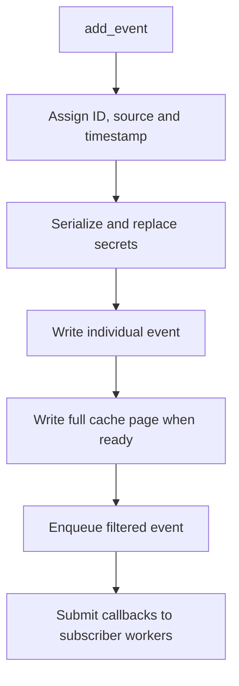

## Overview

The conversation event history connects the agent, runtime, memory and web session. `EventStream` extends `EventStore`: it adds event publication and subscribers to a stored sequence that can also be read independently. [[Conversation Lifecycle]] uses that stored sequence for socket replay; [[CLI and Headless Tasks]] uses it alongside saved controller state and exported trajectories. Understanding the distinction between stored events, queued callbacks and a controller snapshot helps locate a stalled conversation.

Sources: [openhands/events/stream.py:43-69](repo://openhands/events/stream.py#L43-L69), [openhands/events/event_store.py:43-58](repo://openhands/events/event_store.py#L43-L58), [openhands/server/listen_socket.py:78-114](repo://openhands/server/listen_socket.py#L78-L114), [openhands/core/main.py:220-242](repo://openhands/core/main.py#L220-L242)

## Event identity and serialization

An event has an ID, timestamp, source and optional cause. Sources distinguish agent, user and environment. The cause links an observation to the action that produced it; the runtime assigns that relationship when returning an observation. A newly created event starts with `INVALID_ID`, and `add_event` refuses an event that already has an assigned ID, explicitly guarding against a handler reintroducing the same object into a loop.

Sources: [openhands/events/event.py:9-12](repo://openhands/events/event.py#L9-L12), [openhands/events/event.py:35-77](repo://openhands/events/event.py#L35-L77), [openhands/runtime/base.py:391-399](repo://openhands/runtime/base.py#L391-L399), [openhands/events/stream.py:163-172](repo://openhands/events/stream.py#L163-L172)

Serialization preserves selected top-level metadata such as IDs, tool-call metadata and model metrics. Action-specific values go under `args`; observation content remains in `content`, with other values under `extras`. `event_from_dict` selects the action or observation deserializer and rebuilds typed metadata. A dictionary with neither discriminator raises `ValueError`. Trajectory serialization builds on this format but removes selected browser extras and, by default, screenshots.

Sources: [openhands/events/serialization/event.py:15-49](repo://openhands/events/serialization/event.py#L15-L49), [openhands/events/serialization/event.py:52-91](repo://openhands/events/serialization/event.py#L52-L91), [openhands/events/serialization/event.py:100-164](repo://openhands/events/serialization/event.py#L100-L164)

## Append, filter and publish

`add_event` stamps the timestamp and source, then assigns the next ID under a lock. It serializes the event, replaces registered secrets, reconstructs an event from the filtered dictionary and appends that dictionary to the current write-cache page. A full page causes future appends to use a new list. The individual event file is written before the optional full cache page, and the reconstructed event is queued after those storage calls.

Sources: [openhands/events/stream.py:163-203](repo://openhands/events/stream.py#L163-L203)

Sources: [openhands/events/stream.py:163-213](repo://openhands/events/stream.py#L163-L213), [openhands/events/stream.py:254-275](repo://openhands/events/stream.py#L254-L275)

Secret filtering recursively visits dictionaries and replaces registered secret values in string fields with a hidden marker. Certain top-level system fields are protected from replacement, including ID, source, cause, timestamp, action, observation and message. The implementation's recursion is specifically through dictionaries and string values; it does not show a general traversal of every nested container. Secret registration and persisted credential serialization are separate concerns described in [[Configuration]].

Sources: [openhands/events/stream.py:215-244](repo://openhands/events/stream.py#L215-L244), [openhands/storage/settings/file_settings_store.py:28-30](repo://openhands/storage/settings/file_settings_store.py#L28-L30)

## Subscriber ordering and shutdown

Each subscription is identified by subscriber and callback IDs and receives a `ThreadPoolExecutor` with one worker and its own event loop. Duplicate callback IDs within a subscriber raise `ValueError`. The queue processor takes events one at a time, visits subscriber keys in sorted order, and submits each callback to its executor. This preserves serial work within an executor, but submission order across different executors is not a promise that their callbacks finish together.

Sources: [openhands/events/stream.py:71-76](repo://openhands/events/stream.py#L71-L76), [openhands/events/stream.py:130-148](repo://openhands/events/stream.py#L130-L148), [openhands/events/stream.py:254-275](repo://openhands/events/stream.py#L254-L275)

Unsubscribing cleans up the callback's event loop and pool. Closing the stream signals its queue thread, joins it, cleans up subscribers and clears the remaining queue. Callback futures attach an error handler that logs and re-raises callback exceptions. A persisted event therefore does not by itself establish that every consumer processed it successfully; inspect subscriber errors as well as the event file when tracing failures.

Sources: [openhands/events/stream.py:78-128](repo://openhands/events/stream.py#L78-L128), [openhands/events/stream.py:150-161](repo://openhands/events/stream.py#L150-L161), [openhands/events/stream.py:277-289](repo://openhands/events/stream.py#L277-L289)

## History reads and storage backends

`EventStore` lazily determines the next ID by listing existing event files and taking the maximum filename ID plus one. Its default cache size is 25. `search_events` accepts inclusive explicit start/end IDs, optional reverse order, a filter and a result limit. It loads the cache page covering each index and falls back to the individual file when that page has no event. Missing individual files are skipped, and the limit counts included events rather than examined indices.

Sources: [openhands/events/event_store.py:43-83](repo://openhands/events/event_store.py#L43-L83), [openhands/events/event_store.py:85-142](repo://openhands/events/event_store.py#L85-L142), [openhands/events/event_store.py:158-175](repo://openhands/events/event_store.py#L158-L175)

| Backend selection | Result |
| --- | --- |
| `local` | `LocalFileStore`, requiring a configured root path |
| `s3` | `S3FileStore` |
| `google_cloud` | `GoogleCloudFileStore` |
| Other value | `InMemoryFileStore` |
| Webhook URL configured | Wraps the selected backend in regular or batched webhook storage |

Sources: [openhands/storage/__init__.py:14-57](repo://openhands/storage/__init__.py#L14-L57)

Conversation paths use `sessions/<sid>/` without a user ID and `users/<user_id>/conversations/<sid>/` with one. Individual events live under `events/<id>.json`; metadata, initialization data, model registry and controller state have separate filenames. The local backend expands a leading tilde in its root and creates parent directories for writes. It uses ordinary file writes, so the append sequence should not be mistaken for a transaction spanning all records.

Sources: [openhands/storage/locations.py:1-38](repo://openhands/storage/locations.py#L1-L38), [openhands/storage/local.py:11-32](repo://openhands/storage/local.py#L11-L32), [openhands/events/stream.py:186-203](repo://openhands/events/stream.py#L186-L203)

## Controller snapshots

`State.save_to_session` pickles and base64-encodes controller state into `agent_state.pkl`. It temporarily removes conversation statistics because those persist themselves. The pickle deliberately excludes history and cached views: event history will be restored from the event stream. Restoration first tries the user-specific location, falls back to the old session location for a user when needed, records a resumable prior state, and sets the current state to loading. [[Agent Decisions and Control]] covers rebuilding the controller around that state.

Sources: [openhands/controller/state/state.py:122-209](repo://openhands/controller/state/state.py#L122-L209), [openhands/storage/locations.py:29-38](repo://openhands/storage/locations.py#L29-L38)
