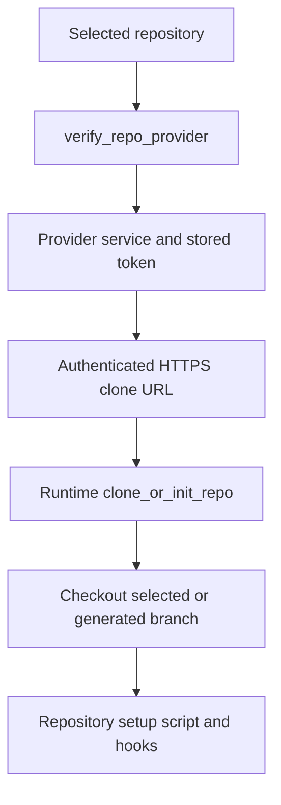

## Overview

`ProviderHandler` turns a set of provider credentials into repository discovery, branch access, authenticated clone URLs and runtime environment values. Provider services implement a shared `GitService` protocol; server MCP tools expose provider-specific pull-request operations. [[Conversation Lifecycle]] describes how selected repositories enter a session, and [[Issue Resolution]] covers the separate workflow that builds an agent task from an issue or pull-request follow-up.

Sources: [openhands/integrations/provider.py:105-160](repo://openhands/integrations/provider.py#L105-L160), [openhands/integrations/service_types.py:437-503](repo://openhands/integrations/service_types.py#L437-L503), [openhands/server/routes/mcp.py:83-100](repo://openhands/server/routes/mcp.py#L83-L100)

## Provider services and credentials

| Provider | Default host | Service selected by the handler | Proposal tool |
| --- | --- | --- | --- |
| GitHub | `github.com` | `GithubServiceImpl` | `create_pr` |
| GitLab | `gitlab.com` | `GitLabServiceImpl` | `create_mr` |
| Bitbucket | `bitbucket.org` | `BitBucketServiceImpl` | `create_bitbucket_pr` |

Sources: [openhands/integrations/provider.py:105-131](repo://openhands/integrations/provider.py#L105-L131), [openhands/server/routes/mcp.py:83-100](repo://openhands/server/routes/mcp.py#L83-L100), [openhands/server/routes/mcp.py:151-174](repo://openhands/server/routes/mcp.py#L151-L174), [openhands/server/routes/mcp.py:225-240](repo://openhands/server/routes/mcp.py#L225-L240)

`ProviderToken` is frozen and contains a secret token, optional provider user ID and optional host. `ProviderHandler` requires a `MappingProxyType` token mapping and raises `TypeError` for other containers. It instantiates a service using those credentials plus external-auth settings and the token's host override. The protocol covers users, repository search and pagination, branch access, suggested tasks, microagent access and pull-request information, keeping callers independent of provider HTTP response formats.

Sources: [openhands/integrations/provider.py:41-67](repo://openhands/integrations/provider.py#L41-L67), [openhands/integrations/provider.py:113-160](repo://openhands/integrations/provider.py#L113-L160), [openhands/integrations/service_types.py:437-533](repo://openhands/integrations/service_types.py#L437-L533)

## Resolve a repository and clone its workspace

`verify_repo_provider` tries an explicitly requested provider first, then iterates available credential providers until one returns repository details. It accumulates failures for logging and raises `AuthenticationError` if none can access the repository. The result carries the canonical repository name and provider. Thus a selected provider influences the first attempt but does not restrict every fallback attempt in this implementation.

Sources: [openhands/integrations/provider.py:447-470](repo://openhands/integrations/provider.py#L447-L470), [openhands/integrations/service_types.py:140-151](repo://openhands/integrations/service_types.py#L140-L151)

`get_authenticated_git_url` verifies access and selects the provider's default domain unless the token has a host override. It constructs the provider-specific HTTPS credential form from the stored token: GitLab uses the OAuth2 username, Bitbucket uses `x-token-auth` for access tokens or preserves a username/password token containing a colon, and GitHub places the token in the credential portion. Without a token it constructs an ordinary HTTPS URL. Verification errors become a repository-authentication exception before clone execution.

Sources: [openhands/integrations/provider.py:613-661](repo://openhands/integrations/provider.py#L613-L661)

Sources: [openhands/integrations/provider.py:613-661](repo://openhands/integrations/provider.py#L613-L661), [openhands/runtime/base.py:422-461](repo://openhands/runtime/base.py#L422-L461), [openhands/core/setup.py:98-154](repo://openhands/core/setup.py#L98-L154)

`clone_or_init_repo` clones into the final component of the repository name, then checks out the requested branch or creates a random `openhands-workspace-` branch. With no selected repository, it initializes Git only when `init_git_in_empty_workspace` is enabled; otherwise it leaves workspace-mounted content in place. Repository setup can execute `.openhands/setup.sh` as a hidden environment action with a 600-second hard timeout. [[Sandbox Execution]] explains the execution transport used for these commands.

Sources: [openhands/runtime/base.py:401-488](repo://openhands/runtime/base.py#L401-L488)

## Runtime token export and refresh

`get_env_vars` returns provider secrets as typed values by default or exposed strings when requested. Its environment-key function derives lowercase names such as `github_token` from the provider value. When latest-token retrieval is requested and a refresh URL plus session ID are present, it calls the server's `/api/refresh-tokens` endpoint with session authentication and provider/session query parameters. A refresh failure is logged and returns no token.

Sources: [openhands/integrations/provider.py:139-142](repo://openhands/integrations/provider.py#L139-L142), [openhands/integrations/provider.py:172-193](repo://openhands/integrations/provider.py#L172-L193), [openhands/integrations/provider.py:385-445](repo://openhands/integrations/provider.py#L385-L445)

Before execution, the runtime examines command actions for provider-token key references using a case-insensitive textual check. It fetches latest values for the referenced providers, registers the corresponding secrets on the event stream and exports the values into the runtime. Commands without detected references skip that refresh step. The event replacement mechanics are documented in [[Events and Storage]]; registering tokens here is what makes those values available to that filter.

Sources: [openhands/integrations/provider.py:426-445](repo://openhands/integrations/provider.py#L426-L445), [openhands/runtime/base.py:324-359](repo://openhands/runtime/base.py#L324-L359), [openhands/integrations/provider.py:338-365](repo://openhands/integrations/provider.py#L338-L365)

## Suggested work and repository knowledge

`SuggestedTask` identifies the provider, task type, repository, issue number and title. Prompt generation selects templates for merge conflicts, failing checks, unresolved comments or open issues and supplies provider-specific request terminology, token variable and CI system. Unsupported task types raise `ValueError`. These prompts enter ordinary conversation creation rather than introducing a different action-execution loop.

Sources: [openhands/integrations/service_types.py:41-107](repo://openhands/integrations/service_types.py#L41-L107), [openhands/server/routes/manage_conversations.py:213-217](repo://openhands/server/routes/manage_conversations.py#L213-L217)

Workspace memory also loads microagents from the selected repository after runtime setup, then records repository name and directory. Those documents provide context for subsequent agent decisions; they are distinct from provider authentication. [[Memory and Microagents]] describes their loading precedence, keyword matching and always-active repository instructions, including the optional MCP configurations they contribute.

Sources: [openhands/core/setup.py:184-197](repo://openhands/core/setup.py#L184-L197)

## Pull and merge request tools

The GitHub proposal tool accepts repository, source and target branches, title, body, draft state and labels; draft defaults to true. GitLab accepts project ID or encoded path and uses the title to express draft status. Bitbucket accepts a workspace/repository slug, branches, title and description. Each tool derives credentials from the incoming HTTP request, creates the provider service and invokes its proposal method. These tools are exposed through the system described in [[MCP Tools]].

Sources: [openhands/server/routes/mcp.py:83-139](repo://openhands/server/routes/mcp.py#L83-L139), [openhands/server/routes/mcp.py:151-213](repo://openhands/server/routes/mcp.py#L151-L213), [openhands/server/routes/mcp.py:225-279](repo://openhands/server/routes/mcp.py#L225-L279)

In SaaS mode, the tool attempts to append a conversation follow-up link to the proposal body. Link-generation failure logs a warning and does not prevent proposal creation. When a conversation ID is present, the tool saves proposal metadata; extraction currently recognizes GitHub `pull/` and GitLab `merge_requests/` number patterns. Provider creation or metadata-save errors inside the tool's guarded block become `ToolError`, so an error response should be checked against provider state before assuming no proposal exists.

Sources: [openhands/server/routes/mcp.py:34-80](repo://openhands/server/routes/mcp.py#L34-L80), [openhands/server/routes/mcp.py:125-148](repo://openhands/server/routes/mcp.py#L125-L148), [openhands/server/routes/mcp.py:198-222](repo://openhands/server/routes/mcp.py#L198-L222), [openhands/server/routes/mcp.py:265-289](repo://openhands/server/routes/mcp.py#L265-L289)
