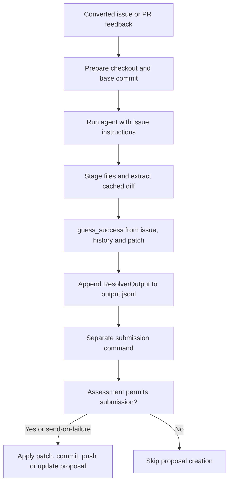

## Overview

The resolver turns one repository issue or pull-request follow-up into an agent task, captures a patch and assessment, then leaves submission to a separate command. `resolve_issue` constructs `IssueResolver` and runs its asynchronous workflow; `send_pull_request` consumes the saved output to commit and push changes. The shared execution loop is documented in [[CLI and Headless Tasks]], and [[Git Provider Integration]] covers repository services and credentials outside this orchestration.

Sources: [openhands/resolver/resolve_issue.py:128-135](repo://openhands/resolver/resolve_issue.py#L128-L135), [openhands/resolver/issue_resolver.py:439-517](repo://openhands/resolver/issue_resolver.py#L439-L517), [openhands/resolver/send_pull_request.py:522-584](repo://openhands/resolver/send_pull_request.py#L522-L584)

## Inputs and issue handlers

The resolver CLI requires `--selected-repo` and `--issue-number`; it accepts issue type `issue` or `pr`, an optional comment ID, output directory, iteration limit, runtime and image settings, prompt file, repository instruction file and provider base domain. Repository names must contain an owner/repository separator. The constructor obtains the token from an explicit argument or provider environment variable and requires a username from the argument or `GIT_USERNAME`. It identifies the token's platform before creating the issue handler.

Sources: [openhands/resolver/resolve_issue.py:17-77](repo://openhands/resolver/resolve_issue.py#L17-L77), [openhands/resolver/resolve_issue.py:97-125](repo://openhands/resolver/resolve_issue.py#L97-L125), [openhands/resolver/issue_resolver.py:74-97](repo://openhands/resolver/issue_resolver.py#L74-L97)

```bash
python -m openhands.resolver.resolve_issue --selected-repo all-hands-ai/openhands --issue-number 100
```

Sources: [openhands/resolver/README.md:134-148](repo://openhands/resolver/README.md#L134-L148)

`IssueHandlerFactory` selects GitHub, GitLab or Bitbucket strategies, wrapped in `ServiceContextIssue` or `ServiceContextPR` according to issue type. An unsupported platform or issue type raises `ValueError`. Default prompt templates differ between a new issue and PR follow-up, and the resolver loads a matching conversation-instructions template beside the user prompt. A custom prompt path therefore also needs the companion filename produced by replacing its `.jinja` suffix.

Sources: [openhands/resolver/issue_handler_factory.py:36-110](repo://openhands/resolver/issue_handler_factory.py#L36-L110), [openhands/resolver/issue_resolver.py:104-123](repo://openhands/resolver/issue_resolver.py#L104-L123)

## Prepare a reproducible workspace

Resolver configuration selects `CodeActAgent`, sets a task budget of 4, applies the requested iteration count and runtime, and creates agent configuration with the GitHub microagent disabled. It forbids supplying both a base image and runtime image. Its sandbox adjustments disable automatic linting and host networking and set a 300-second timeout. These are resolver-specific overrides layered on [[Configuration]], so they should be checked separately from GUI defaults.

Sources: [openhands/resolver/issue_resolver.py:178-217](repo://openhands/resolver/issue_resolver.py#L178-L217), [openhands/resolver/issue_resolver.py:238-265](repo://openhands/resolver/issue_resolver.py#L238-L265)

The workflow fetches the converted issue and rejects missing issues or an explicitly requested comment with no match. It creates output directories and clones a repository into `output_dir/repo` only if that checkout does not already exist. It records the base commit, optionally loads legacy repository instructions and skips an issue number already present in `output.jsonl`. For a PR follow-up it fetches and checks out the head branch and updates the recorded base commit.

Sources: [openhands/resolver/issue_resolver.py:519-560](repo://openhands/resolver/issue_resolver.py#L519-L560), [openhands/resolver/issue_resolver.py:562-615](repo://openhands/resolver/issue_resolver.py#L562-L615), [openhands/resolver/issue_resolver.py:623-652](repo://openhands/resolver/issue_resolver.py#L623-L652)

`process_issue` replaces its per-issue workspace with a copy of that checkout, creates and connects a runtime, subscribes event logging and initializes repository setup and Git hooks. The issue context produces user instructions, conversation instructions and image URLs. Those become the initial `MessageAction` and supplemental instructions passed to `run_controller`, with `codeact_user_response` supplying simulated user interaction. [[Sandbox Execution]] owns the action transport used during the task.

Sources: [openhands/resolver/issue_resolver.py:267-307](repo://openhands/resolver/issue_resolver.py#L267-L307), [openhands/resolver/issue_resolver.py:397-446](repo://openhands/resolver/issue_resolver.py#L397-L446)

## Patch extraction and success assessment



Sources: [openhands/resolver/issue_resolver.py:439-476](repo://openhands/resolver/issue_resolver.py#L439-L476), [openhands/resolver/issue_resolver.py:350-386](repo://openhands/resolver/issue_resolver.py#L350-L386), [openhands/resolver/issue_resolver.py:654-664](repo://openhands/resolver/issue_resolver.py#L654-L664), [openhands/resolver/send_pull_request.py:522-584](repo://openhands/resolver/send_pull_request.py#L522-L584)

After execution, `complete_runtime` stages all files and obtains a cached diff against the base commit. Diff retrieval retries up to five times with increasing hard timeouts. Agent startup or execution errors caught as `ValueError` or `RuntimeError` leave a failed state, but patch extraction is still attempted. A valid final state contributes history, metrics and its last error; the issue handler assesses success from the issue, history and patch.

Sources: [openhands/resolver/issue_resolver.py:350-386](repo://openhands/resolver/issue_resolver.py#L350-L386), [openhands/resolver/issue_resolver.py:439-476](repo://openhands/resolver/issue_resolver.py#L439-L476), [openhands/resolver/issue_resolver.py:501-517](repo://openhands/resolver/issue_resolver.py#L501-L517)

The success field is a model assessment, not a general assertion that a test suite passed. The issue context renders a success-check prompt and calls its LLM. PR assessment handles review threads, thread comments or review comments, returns individual indicators and requires all processed indicators to be true. No feedback produces a failed assessment. `ResolverOutput` stores the issue, instruction, base commit, patch, history, metrics, success details, explanation and error for later inspection.

Sources: [openhands/resolver/interfaces/issue_definitions.py:45-108](repo://openhands/resolver/interfaces/issue_definitions.py#L45-L108), [openhands/resolver/interfaces/issue_definitions.py:370-415](repo://openhands/resolver/interfaces/issue_definitions.py#L370-L415), [openhands/resolver/resolver_output.py:8-20](repo://openhands/resolver/resolver_output.py#L8-L20)

## Submit or update a proposal

Submission defaults to draft mode and supports `branch`, `draft` or `ready`. It skips failed resolver output unless `--send-on-failure` is set. Accepted output initializes a patch checkout, applies the stored patch and commits it; an empty staged change set raises an error. New issues use the proposal-creation path, while PR follow-ups update the existing proposal. A pushed branch is therefore a later side effect than generating a local resolver artifact.

Sources: [openhands/resolver/send_pull_request.py:205-230](repo://openhands/resolver/send_pull_request.py#L205-L230), [openhands/resolver/send_pull_request.py:522-584](repo://openhands/resolver/send_pull_request.py#L522-L584), [openhands/resolver/send_pull_request.py:615-638](repo://openhands/resolver/send_pull_request.py#L615-L638)

For a new issue, submission chooses a unique `openhands-fix-issue-` branch, validates an explicit target branch or uses the repository default, creates the branch and pushes to the original or fork owner. Branch-only mode returns a comparison URL; other modes create a proposal with the requested draft state and optionally request reviewers. Failures to create the local branch or push changes raise runtime errors before the proposal call.

Sources: [openhands/resolver/send_pull_request.py:299-390](repo://openhands/resolver/send_pull_request.py#L299-L390)

## Workflow integration

The example GitHub workflow listens to issue and PR labels, issue comments, review comments and submitted reviews. It calls the reusable resolver workflow and passes model, iteration, runner and target-branch settings plus token and model secrets. The resolver README describes label and mention entry points. Keep the example's checked-in workflow and the recorded resolver output together when investigating automation, since trigger selection and the agent's patch assessment happen at different layers.

Sources: [openhands/resolver/examples/openhands-resolver.yml:1-34](repo://openhands/resolver/examples/openhands-resolver.yml#L1-L34), [openhands/resolver/README.md:45-63](repo://openhands/resolver/README.md#L45-L63), [openhands/resolver/resolver_output.py:8-20](repo://openhands/resolver/resolver_output.py#L8-L20)
