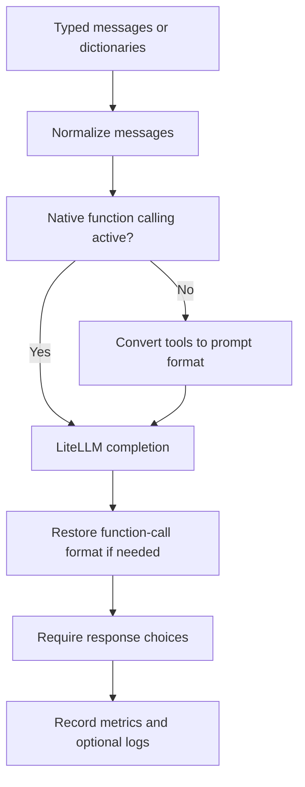

## Overview

OpenHands routes model access through `LLMRegistry` and `LLM`. The registry identifies model services used by the agent and other conversation features; `LLM` adapts messages, invokes LiteLLM, retries selected failures and records usage. [[Configuration]] owns where model values come from, and [[Agent Decisions and Control]] owns how a completion becomes actions. This page follows the request boundary between those systems.

Sources: [openhands/llm/llm_registry.py:23-69](repo://openhands/llm/llm_registry.py#L23-L69), [openhands/llm/llm.py:194-218](repo://openhands/llm/llm.py#L194-L218), [openhands/llm/llm.py:328-370](repo://openhands/llm/llm.py#L328-L370)

## Service identity and routing

`LLMRegistry` deep-copies application configuration and constructs the active agent service under ID `agent`. `get_llm` returns an existing service when its configuration matches, rejects reusing an ID with different configuration, and requires a config when creating a new service. The agent-config-specific lookup has a different behavior: it returns an existing service even if its requested configuration differs, with a TODO about reusing an LLM for delegation. Account for this distinction when tracing delegated model selection.

Sources: [openhands/llm/llm_registry.py:23-55](repo://openhands/llm/llm_registry.py#L23-L55), [openhands/llm/llm_registry.py:71-106](repo://openhands/llm/llm_registry.py#L71-L106)

`get_router` returns the agent service directly for `noop_router`; otherwise it constructs `RouterLLM` from agent configuration and the registry. Non-agent features can request an extraneous completion under another service ID. That path creates its LLM without the retry listener used for the agent, invokes completion and returns stripped text from the first response choice. Registry subscribers are notified when services are created and receive the active agent service immediately after subscription.

Sources: [openhands/llm/llm_registry.py:58-69](repo://openhands/llm/llm_registry.py#L58-L69), [openhands/llm/llm_registry.py:111-146](repo://openhands/llm/llm_registry.py#L111-L146)

## Model initialization and capabilities

`LLM` deep-copies its model configuration and owns a metrics object. Before constructing the completion callable, it initializes model information and optionally loads a custom tokenizer. The model metadata can supply input and output token limits when the user did not set them. Native tool calling comes from the centralized model feature table unless explicitly overridden by `native_tool_calling`; vision also depends on the disable flag and detected support.

Sources: [openhands/llm/llm.py:76-110](repo://openhands/llm/llm.py#L76-L110), [openhands/llm/llm.py:494-533](repo://openhands/llm/llm.py#L494-L533)

The implementation includes provider adjustments. An `openhands/` model name is rewritten to `litellm_proxy/` with the configured OpenHands proxy endpoint. `LLMConfig.model_post_init` supplies an Azure API version when absent, exports configured AWS credentials and region for Bedrock, and exports OpenRouter attribution settings. These are code behaviors in this checkout; they are distinct from choosing credentials or model groups through [[Configuration]].

Sources: [openhands/llm/llm.py:125-132](repo://openhands/llm/llm.py#L125-L132), [openhands/core/config/llm_config.py:162-194](repo://openhands/core/config/llm_config.py#L162-L194)

## Completion preparation and response conversion

The completion wrapper accepts OpenHands `Message` objects or already-serialized message dictionaries. It normalizes input into a list and formats typed messages for the provider. An empty list raises `ValueError`. It sets LiteLLM's global `modify_params` flag from configuration and removes `extra_body` for models outside the LiteLLM proxy namespace. The underlying request is synchronous and non-streaming; latency is measured around that call.

Sources: [openhands/llm/llm.py:240-256](repo://openhands/llm/llm.py#L240-L256), [openhands/llm/llm.py:294-333](repo://openhands/llm/llm.py#L294-L333)

Sources: [openhands/llm/llm.py:240-298](repo://openhands/llm/llm.py#L240-L298), [openhands/llm/llm.py:328-370](repo://openhands/llm/llm.py#L328-L370), [openhands/llm/llm.py:372-405](repo://openhands/llm/llm.py#L372-L405)

When native function calling is inactive and tools are present, the wrapper converts function-call messages and tool definitions into prompting form. It can add stop words when supported, removes the tool definitions from the provider arguments and adjusts tool choice. After receiving the provider response, it converts that response back into function-call messages for the agent. An empty response choice list raises `LLMNoResponseError`, including on the conversion path. This lets the action parser consume one common response shape.

Sources: [openhands/llm/llm.py:258-292](repo://openhands/llm/llm.py#L258-L292), [openhands/llm/llm.py:335-364](repo://openhands/llm/llm.py#L335-L364), [openhands/agenthub/codeact_agent/codeact_agent.py:218-224](repo://openhands/agenthub/codeact_agent/codeact_agent.py#L218-L224)

## Retries and terminal errors

The retry set includes API connection errors, rate limits, service unavailability, timeouts, internal server errors and no-response errors. `RetryMixin` uses exponential waiting with configured minimum, maximum and multiplier; its stopping rule combines a maximum attempt count with application shutdown. Despite the configuration name `num_retries`, the code passes that value to Tenacity's `stop_after_attempt`, so it is the attempt bound used by this decorator.

Sources: [openhands/llm/llm.py:43-51](repo://openhands/llm/llm.py#L43-L51), [openhands/llm/llm.py:211-218](repo://openhands/llm/llm.py#L211-L218), [openhands/llm/retry_mixin.py:28-69](repo://openhands/llm/retry_mixin.py#L28-L69)

Before sleeping, the decorator logs the attempt and calls the retry listener if one exists. For a no-response failure with an absent or zero temperature, it changes the next attempt's temperature to 1.0. Retry logging attaches attempt metadata to the exception. Exhausted or non-retryable failures propagate to the controller, whose status mapping and error-state behavior are documented in [[Agent Decisions and Control]]. Authentication errors are not included in this retry tuple.

Sources: [openhands/llm/retry_mixin.py:35-69](repo://openhands/llm/retry_mixin.py#L35-L69), [openhands/llm/retry_mixin.py:71-100](repo://openhands/llm/retry_mixin.py#L71-L100), [openhands/llm/llm.py:43-51](repo://openhands/llm/llm.py#L43-L51), [openhands/controller/agent_controller.py:302-356](repo://openhands/controller/agent_controller.py#L302-L356)

## Usage, cost and completion logs

Post-processing records prompt and completion tokens, cache reads, provider-specific cache writes and a context-window value from model metadata. The measured response latency is stored with the response ID. Cost computation can use configured per-token prices, a provider cost response header, LiteLLM's cost calculation and a model-name fallback. If the calculation fails, cost support is disabled rather than turning the completion itself into a model failure.

Sources: [openhands/llm/llm.py:330-333](repo://openhands/llm/llm.py#L330-L333), [openhands/llm/llm.py:583-666](repo://openhands/llm/llm.py#L583-L666), [openhands/llm/llm.py:733-791](repo://openhands/llm/llm.py#L733-L791)

When `log_completions` is enabled, the wrapper writes a timestamped JSON record containing messages, response, arguments, keyword arguments, timestamp and cost. For emulated function calling it also retains separate function-call messages and response forms. These completion records describe the provider request; they differ from event trajectories in [[Events and Storage]], which describe actions and observations. Prompt construction, truncation and caching placement before this request remain in [[Memory and Microagents]].

Sources: [openhands/llm/llm.py:372-403](repo://openhands/llm/llm.py#L372-L403), [openhands/events/serialization/event.py:155-164](repo://openhands/events/serialization/event.py#L155-L164), [openhands/agenthub/codeact_agent/codeact_agent.py:282-291](repo://openhands/agenthub/codeact_agent/codeact_agent.py#L282-L291)
