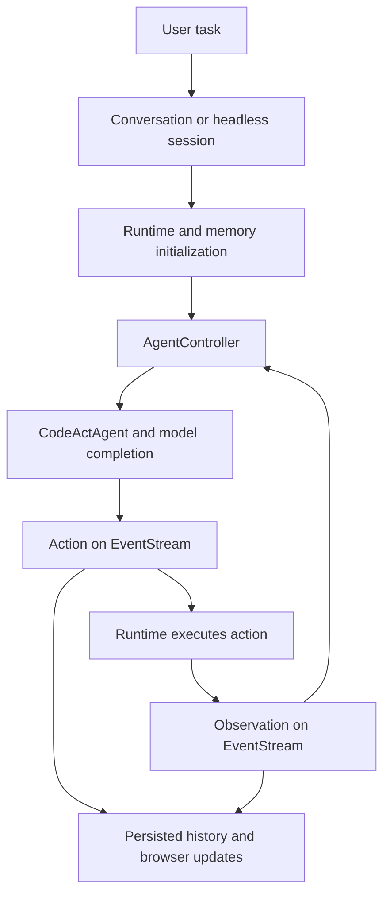

## Overview

OpenHands is a platform for software development agents. A user supplies a task; an agent exchanges messages with a language model, produces actions such as shell commands or file edits, and receives observations from a workspace runtime. This checkout includes a browser application, terminal entry points, repository issue automation, and benchmark runners. Start with [[Quickstart]] to run a task, then use this map to follow the system that handles it.

Sources: [README.md:35-40](repo://README.md#L35-L40), [openhands/core/main.py:97-155](repo://openhands/core/main.py#L97-L155), [openhands/cli/entry.py:23-45](repo://openhands/cli/entry.py#L23-L45)

## System map

| Area | What it does | Documentation |
| --- | --- | --- |
| Startup | Launches the GUI or terminal task | [[Quickstart]], [[CLI and Headless Tasks]] |
| Configuration | Resolves application, agent, model and sandbox settings | [[Configuration]] |
| Conversations | Creates sessions and manages live connections and agent loops | [[Conversation Lifecycle]] |
| Event history | Persists actions and observations and delivers them to subscribers | [[Events and Storage]] |
| Agent control | Chooses tools, takes steps, waits for observations and enforces confirmation | [[Agent Decisions and Control]] |
| Models | Obtains the agent's model service and invokes completions | [[Language Model Requests]] |
| Context | Supplies workspace knowledge, microagents and condensed history | [[Memory and Microagents]] |
| Execution | Runs actions in a selected workspace environment | [[Sandbox Execution]] |
| External tools | Discovers MCP tools and adds them to the agent | [[MCP Tools]] |

Sources: [openhands/cli/entry.py:23-45](repo://openhands/cli/entry.py#L23-L45), [openhands/core/config/openhands_config.py:65-118](repo://openhands/core/config/openhands_config.py#L65-L118), [openhands/server/conversation_manager/standalone_conversation_manager.py:91-165](repo://openhands/server/conversation_manager/standalone_conversation_manager.py#L91-L165), [openhands/events/stream.py:163-203](repo://openhands/events/stream.py#L163-L203), [openhands/controller/agent_controller.py:919-973](repo://openhands/controller/agent_controller.py#L919-L973), [openhands/agenthub/codeact_agent/codeact_agent.py:182-224](repo://openhands/agenthub/codeact_agent/codeact_agent.py#L182-L224), [openhands/memory/memory.py:90-136](repo://openhands/memory/memory.py#L90-L136), [openhands/runtime/base.py:361-399](repo://openhands/runtime/base.py#L361-L399), [openhands/mcp/utils.py:151-189](repo://openhands/mcp/utils.py#L151-L189)

| Area | What it does | Documentation |
| --- | --- | --- |
| Browser client | Connects a conversation and projects events into UI state | [[Browser Conversation UI]] |
| Repository access | Verifies a repository's provider and passes credentials into sessions | [[Git Provider Integration]] |
| Issue automation | Builds a task from an issue or pull-request follow-up | [[Issue Resolution]] |
| Evaluation | Runs dataset instances through a shared worker harness | [[Benchmark Evaluation]] |
| Enterprise services | Replaces stores, authentication and conversation management | [[Enterprise Deployment]] |
| Source development | Builds services and runs contributor checks | [[Development and Testing]] |

Sources: [frontend/src/routes/conversation.tsx:32-95](repo://frontend/src/routes/conversation.tsx#L32-L95), [openhands/server/routes/manage_conversations.py:242-263](repo://openhands/server/routes/manage_conversations.py#L242-L263), [openhands/resolver/issue_resolver.py:74-123](repo://openhands/resolver/issue_resolver.py#L74-L123), [evaluation/utils/shared.py:486-538](repo://evaluation/utils/shared.py#L486-L538), [enterprise/server/config.py:51-71](repo://enterprise/server/config.py#L51-L71), [Development.md:51-104](repo://Development.md#L51-L104)

## A task through the system

Sources: [openhands/core/main.py:105-167](repo://openhands/core/main.py#L105-L167), [openhands/agenthub/codeact_agent/codeact_agent.py:182-224](repo://openhands/agenthub/codeact_agent/codeact_agent.py#L182-L224), [openhands/controller/agent_controller.py:919-973](repo://openhands/controller/agent_controller.py#L919-L973), [openhands/runtime/base.py:361-399](repo://openhands/runtime/base.py#L361-L399), [openhands/events/stream.py:163-203](repo://openhands/events/stream.py#L163-L203), [frontend/src/context/ws-client-provider.tsx:164-205](repo://frontend/src/context/ws-client-provider.tsx#L164-L205)

1. The browser creates a conversation and receives its identifier; [[Conversation Lifecycle]] explains the request and its session ownership.
2. Runtime setup precedes memory and controller creation; [[Sandbox Execution]] explains workspace readiness, while [[Memory and Microagents]] explains the contextual observations.
3. The controller calls the agent only while running and without a pending action; [[Agent Decisions and Control]] explains these gates.
4. The agent condenses history, constructs messages and calls its model; [[Language Model Requests]] follows the completion boundary.
5. Actions and observations are stored and queued for subscribers; [[Events and Storage]] explains their identifiers and delivery.
6. The browser consumes those events and updates the conversation; [[Browser Conversation UI]] follows the client projection.

Sources: [openhands/server/routes/manage_conversations.py:242-269](repo://openhands/server/routes/manage_conversations.py#L242-L269), [openhands/server/session/agent_session.py:134-202](repo://openhands/server/session/agent_session.py#L134-L202), [openhands/controller/agent_controller.py:821-839](repo://openhands/controller/agent_controller.py#L821-L839), [openhands/agenthub/codeact_agent/codeact_agent.py:191-224](repo://openhands/agenthub/codeact_agent/codeact_agent.py#L191-L224), [openhands/events/stream.py:163-203](repo://openhands/events/stream.py#L163-L203), [frontend/src/context/ws-client-provider.tsx:164-205](repo://frontend/src/context/ws-client-provider.tsx#L164-L205)

## Decisions that cross system boundaries

The event stream is both a durable record and a delivery mechanism. `add_event` writes serialized, secret-filtered data before queueing the event, and each subscriber callback has a single-worker executor. The code explicitly rejects an event that already has an ID to prevent handlers from feeding the same event back into a loop. These details make the history and callback boundary central to debugging a task that stopped progressing.

Sources: [openhands/events/stream.py:130-148](repo://openhands/events/stream.py#L130-L148), [openhands/events/stream.py:163-203](repo://openhands/events/stream.py#L163-L203), [openhands/events/stream.py:254-275](repo://openhands/events/stream.py#L254-L275)

Context and tool availability are prepared before the controller begins. `AgentSession.start` creates the runtime, registers secrets, creates memory, then adds MCP tools before controller creation. Its comment gives the reason for that last ordering: the tools must appear in `SystemMessageAction`. The same initialization boundary is visible in the headless path, so tool discovery problems belong before the first model decision rather than inside an arbitrary later step.

Sources: [openhands/server/session/agent_session.py:134-189](repo://openhands/server/session/agent_session.py#L134-L189), [openhands/core/main.py:133-167](repo://openhands/core/main.py#L133-L167)

History reads use cache pages because reading individual events becomes slow for long conversations. Full pages are written after the individual event files; the accompanying comment says readers can bypass a cache page that is not yet present. `EventStore.search_events` implements that fallback by attempting an individual event read when the cached page does not provide an event.

Sources: [openhands/events/stream.py:199-213](repo://openhands/events/stream.py#L199-L213), [openhands/events/event_store.py:118-136](repo://openhands/events/event_store.py#L118-L136)

Deployment services are selected through interfaces. The base server dynamically resolves its monitoring listener, conversation manager and stores; the enterprise configuration supplies different implementations. The standalone manager explicitly describes itself as the single-server implementation. Follow [[Enterprise Deployment]] when reasoning about multi-server ownership, since the base manager's in-process session dictionaries do not describe that coordination.

Sources: [openhands/server/shared.py:54-77](repo://openhands/server/shared.py#L54-L77), [openhands/server/conversation_manager/standalone_conversation_manager.py:52-76](repo://openhands/server/conversation_manager/standalone_conversation_manager.py#L52-L76), [enterprise/server/config.py:51-71](repo://enterprise/server/config.py#L51-L71)
