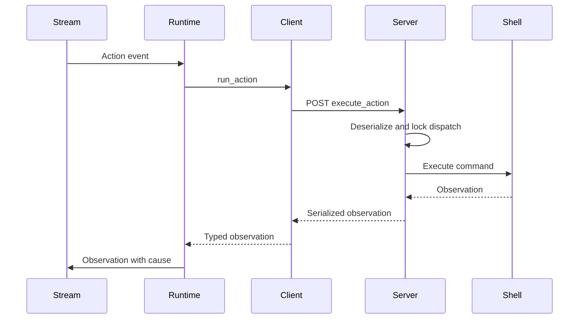

## Overview

A runtime executes actions and publishes observations into the conversation event stream. The base `Runtime` subscribes to actions, holds workspace and provider configuration, and exposes operations such as command execution, file access, browsing and MCP calls. Docker and other action-server runtimes delegate execution over HTTP; CLI execution uses local processes. [[Agent Decisions and Control]] owns the decision and confirmation rules before execution, and [[Events and Storage]] owns the resulting history.

Sources: [openhands/runtime/base.py:128-178](repo://openhands/runtime/base.py#L128-L178), [openhands/runtime/base.py:361-399](repo://openhands/runtime/base.py#L361-L399), [openhands/runtime/impl/action_execution/action_execution_client.py:315-338](repo://openhands/runtime/impl/action_execution/action_execution_client.py#L315-L338), [openhands/runtime/impl/cli/cli_runtime.py:90-105](repo://openhands/runtime/impl/cli/cli_runtime.py#L90-L105)

## Runtime selection

| Name | Implementation and execution boundary |
| --- | --- |
| `docker`, `eventstream` | `DockerRuntime`, using a runtime container and action execution client |
| `local` | `LocalRuntime`, an action-server implementation on the local machine |
| `cli` | `CLIRuntime`, local subprocess commands and Python file operations without browsing |
| `remote` | `RemoteRuntime`, a remote runtime service requiring an API key and runtime API URL |
| `kubernetes` | `KubernetesRuntime`, creating and managing pods in a Kubernetes cluster |

Sources: [openhands/runtime/__init__.py:14-21](repo://openhands/runtime/__init__.py#L14-L21), [openhands/runtime/impl/docker/docker_runtime.py:75-88](repo://openhands/runtime/impl/docker/docker_runtime.py#L75-L88), [openhands/runtime/impl/local/local_runtime.py:667-695](repo://openhands/runtime/impl/local/local_runtime.py#L667-L695), [openhands/runtime/impl/cli/cli_runtime.py:90-105](repo://openhands/runtime/impl/cli/cli_runtime.py#L90-L105), [openhands/runtime/impl/remote/remote_runtime.py:80-104](repo://openhands/runtime/impl/remote/remote_runtime.py#L80-L104), [openhands/runtime/impl/kubernetes/kubernetes_runtime.py:61-76](repo://openhands/runtime/impl/kubernetes/kubernetes_runtime.py#L61-L76)

The runtime registry discovers optional packages under `third_party.runtime.impl`, attempts conventional module and class names, and merges successfully imported runtimes with core names. Missing optional libraries are ignored; other import failures are logged. For a name outside the combined registry, `get_runtime_cls` attempts to resolve a `Runtime` subclass by import path and raises a supported-runtime error if that fails. The package's `third_party_runtimes` extra supplies the optional provider dependencies.

Sources: [openhands/runtime/__init__.py:23-103](repo://openhands/runtime/__init__.py#L23-L103), [pyproject.toml:98-106](repo://pyproject.toml#L98-L106)

## Docker connection and workspace setup

`DockerRuntime.connect` first attempts to attach to its container. If the container is missing and attachment was required, it raises a disconnected-runtime error. Otherwise it obtains or builds the runtime image and starts a container. A configured runtime image skips the build; without one, a base image is required and the builder receives platform, extra dependencies, rebuild and browser options. The connection waits for the action server, initializes environment for a new runtime and then reports readiness.

Sources: [openhands/runtime/impl/docker/docker_runtime.py:170-214](repo://openhands/runtime/impl/docker/docker_runtime.py#L170-L214), [openhands/runtime/impl/docker/docker_runtime.py:233-248](repo://openhands/runtime/impl/docker/docker_runtime.py#L233-L248)

Container initialization allocates locked ports for execution, VS Code and preview applications. With host networking disabled, it maps these ports using the configured runtime binding address. It combines initial environment values with startup values and passes ports into the runtime environment. This wiring is separate from the GUI application's public port described in [[Quickstart]]; an application server that starts successfully can still be waiting on its workspace runtime.

Sources: [openhands/runtime/impl/docker/docker_runtime.py:391-475](repo://openhands/runtime/impl/docker/docker_runtime.py#L391-L475)

Mount processing converts comma-separated volume entries into container bindings and modes, defaulting mode to read/write. Absolute host paths become bind sources; non-absolute names are treated as named volumes. Overlay-mode entries are handled separately. Without explicit volumes, legacy workspace mount fields may provide a binding. [[Configuration]] explains the earlier finalization and validation step, including how a `/workspace` target sets the workspace location.

Sources: [openhands/runtime/impl/docker/docker_runtime.py:261-322](repo://openhands/runtime/impl/docker/docker_runtime.py#L261-L322), [openhands/core/config/utils.py:377-424](repo://openhands/core/config/utils.py#L377-L424)

## Action transport and sandbox dispatch

The base event handler supplies a default nonblocking timeout when needed, refreshes provider credentials for relevant actions and dispatches MCP separately from built-in actions. Successful observations receive the originating action ID and tool-call metadata before publication. Null observations are omitted. [[Git Provider Integration]] explains token refresh, while [[MCP Tools]] explains the external-tool branch.

Sources: [openhands/runtime/base.py:361-399](repo://openhands/runtime/base.py#L361-L399)

Sources: [openhands/runtime/base.py:361-399](repo://openhands/runtime/base.py#L361-L399), [openhands/runtime/impl/action_execution/action_execution_client.py:315-338](repo://openhands/runtime/impl/action_execution/action_execution_client.py#L315-L338), [openhands/runtime/action_execution_server.py:379-397](repo://openhands/runtime/action_execution_server.py#L379-L397), [openhands/runtime/action_execution_server.py:814-831](repo://openhands/runtime/action_execution_server.py#L814-L831)

`ActionExecutionClient` serializes action requests under an action semaphore. It skips actions awaiting confirmation, produces a user-rejection observation for rejected actions and detects unsupported action types. The HTTP timeout allows five extra seconds beyond the action timeout so execution can return its own timeout result. A client HTTP timeout becomes `AgentRuntimeTimeoutError`. The server deserializes the request, verifies it is an action, executes it and serializes the observation.

Sources: [openhands/runtime/impl/action_execution/action_execution_client.py:272-338](repo://openhands/runtime/impl/action_execution/action_execution_client.py#L272-L338), [openhands/runtime/action_execution_server.py:814-831](repo://openhands/runtime/action_execution_server.py#L814-L831)

Inside the action server, `run_action` holds an asyncio lock and selects a method from the action type. Command execution uses the persistent Bash session unless the action is static, in which case it creates a session for that action's working directory. Command exceptions become error observations. Jupyter execution uses its plugin and synchronizes its current directory with Bash when required. Browser setup is lazy and reports unavailability if initialization cannot supply a browser.

Sources: [openhands/runtime/action_execution_server.py:379-424](repo://openhands/runtime/action_execution_server.py#L379-L424), [openhands/runtime/action_execution_server.py:229-264](repo://openhands/runtime/action_execution_server.py#L229-L264)

## Plugins, failures and shutdown

The runtime copies requested plugin requirements and adds VS Code for non-headless sessions. CodeAct supplies AgentSkills followed by Jupyter so the Python skills exist before Jupyter initializes. Plugin availability and agent tool flags are related but separate: a tool must be offered to the model and supported by the selected runtime. [[Memory and Microagents]] uses runtime-provided context to describe available hosts and workspace instructions to the agent.

Sources: [openhands/runtime/base.py:152-182](repo://openhands/runtime/base.py#L152-L182), [openhands/agenthub/codeact_agent/codeact_agent.py:70-76](repo://openhands/agenthub/codeact_agent/codeact_agent.py#L70-L76), [openhands/memory/memory.py:173-202](repo://openhands/memory/memory.py#L173-L202)

Permission failures in the base action handler become observations so the agent can continue. Network and disconnected-runtime exceptions instead report an error-disconnected status and return without publishing a normal observation; other exceptions report a generic runtime error. Docker shutdown closes client resources and logs, then preserves the container when keep-alive or attachment mode applies. Otherwise it stops the selected container or configured prefix and releases port locks. Conversation idle cleanup is covered in [[Conversation Lifecycle]].

Sources: [openhands/runtime/base.py:372-399](repo://openhands/runtime/base.py#L372-L399), [openhands/runtime/impl/docker/docker_runtime.py:593-612](repo://openhands/runtime/impl/docker/docker_runtime.py#L593-L612)
