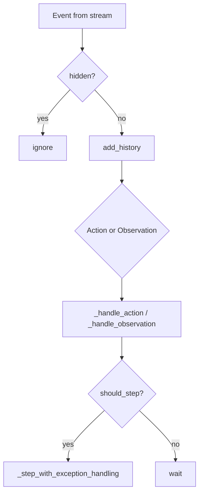

## Overview

`AgentController` is the loop that turns an agent into a running process. It subscribes to the [[Events and the Event Stream]], decides after each event whether the agent should take a step, calls `agent.step(state)`, applies the iteration and budget limits and the stuck detector first, and publishes the resulting action back to the stream. It owns the agent's `AgentState` and the `State` object that is saved between sessions. What the agent does inside `step` is in [[CodeAct Agent and Agent Catalogue]].

Sources: [openhands/controller/agent_controller.py:100-202](repo://openhands/controller/agent_controller.py#L100-L202), [openhands/controller/agent_controller.py:821-876](repo://openhands/controller/agent_controller.py#L821-L876)

The constructor subscribes `on_event` as `EventStreamSubscriber.AGENT_CONTROLLER` unless the controller is a delegate, builds a `StateTracker`, loads the initial state (restored, inherited from a parent, or new), creates a `StuckDetector` and a `ReplayManager`, and calls `_add_system_message`. That method adds the agent's `SystemMessageAction` to the stream unless one already exists, or a user message appears first in an old stream.

Sources: [openhands/controller/agent_controller.py:154-202](repo://openhands/controller/agent_controller.py#L154-L202), [openhands/controller/agent_controller.py:244-268](repo://openhands/controller/agent_controller.py#L244-L268)

## Reacting to events

Sources: [openhands/controller/agent_controller.py:467-492](repo://openhands/controller/agent_controller.py#L467-L492)

`_on_event` skips events with `hidden` set, appends the event to `state.history` through the tracker, runs the action or observation handler and then asks `should_step`.

Sources: [openhands/controller/agent_controller.py:467-492](repo://openhands/controller/agent_controller.py#L467-L492)

`should_step` is true after a user `MessageAction`, an agent `MessageAction` when the state is not `AWAITING_USER_INPUT`, an `AgentDelegateAction`, and either condensation action. After an observation it is true unless the observation is an `AgentStateChangedObservation` or a `NullObservation`; a `NullObservation` with a positive `cause` (the answer to a `RecallAction`) does step. It is always false while a delegate is active.

Sources: [openhands/controller/agent_controller.py:392-431](repo://openhands/controller/agent_controller.py#L392-L431)

The action handlers update state rather than act.

Sources: [openhands/controller/agent_controller.py:494-517](repo://openhands/controller/agent_controller.py#L494-L517)

| Event | Effect |
| --- | --- |
| `ChangeAgentStateAction` | `set_agent_state_to` the requested state |
| User `MessageAction` | Adds a `RecallAction` (`WORKSPACE_CONTEXT` for the first user message, `KNOWLEDGE` after), sets it as the pending action and moves to `RUNNING` |
| Agent `MessageAction` with `wait_for_response` | State becomes `AWAITING_USER_INPUT` |
| `AgentFinishAction` | Stores `outputs`, state `FINISHED` |
| `AgentRejectAction` | Stores `outputs`, state `REJECTED` |
| `AgentDelegateAction` | `start_delegate`, then posts the task as a user message |

Sources: [openhands/controller/agent_controller.py:494-517](repo://openhands/controller/agent_controller.py#L494-L517), [openhands/controller/agent_controller.py:549-588](repo://openhands/controller/agent_controller.py#L549-L588)

The recall request is how [[Conversation Memory and Microagents]] receives its trigger: the controller sets it as the pending action, and the agent does not step until an observation whose `cause` equals the pending action's id arrives and clears it.

Sources: [openhands/controller/agent_controller.py:519-547](repo://openhands/controller/agent_controller.py#L519-L547)

## One step

`_step` returns at once unless the state is `RUNNING` and there is no pending action. The rest of the step runs in this order.

Sources: [openhands/controller/agent_controller.py:821-861](repo://openhands/controller/agent_controller.py#L821-L861)

1. `sync_budget_flag_with_metrics` copies the accumulated LLM cost into the budget flag.
2. `_is_stuck` is checked; if true it reacts with `AgentStuckInLoopError`.
3. `run_control_flags` advances the iteration flag and checks the budget flag; an exception is passed to `_react_to_exception`.
4. In replay mode the next recorded action is used; otherwise `agent.step(self.state)` is called and its action is stamped with source `AGENT`.
5. If the action is runnable, confirmation is decided (next section) and the action becomes the pending action.
6. Unless it is a `NullAction`, the action is added to the stream with its source.

Sources: [openhands/controller/agent_controller.py:821-876](repo://openhands/controller/agent_controller.py#L821-L876), [openhands/controller/agent_controller.py:919-976](repo://openhands/controller/agent_controller.py#L919-L976)

Failures inside `agent.step` split in two. A malformed, empty or invalid response (`LLMMalformedActionError`, `LLMNoActionError`, `LLMResponseError`, `FunctionCallValidationError`, `FunctionCallNotExistsError`) is published as an `ErrorObservation` so the model sees its mistake and tries again. A context-window error, recognised by exception type or by matching provider messages in the text, publishes a `CondensationRequestAction` when `enable_history_truncation` is set (see [[Condensers]]) and otherwise raises `LLMContextWindowExceedError`.

Sources: [openhands/controller/agent_controller.py:869-917](repo://openhands/controller/agent_controller.py#L869-L917)

## Limits and the stuck detector

`State` holds an `IterationControlFlag` (default limit and increase of 100) and an optional `BudgetControlFlag`. The iteration flag raises `RuntimeError('Agent reached maximum iteration...')` once `current_value` reaches `max_value`, otherwise it increments. The budget flag does not count; its value is the accumulated cost synced from the conversation stats, and it raises when the cost reaches the maximum.

Sources: [openhands/controller/state/control_flags.py:42-95](repo://openhands/controller/state/control_flags.py#L42-L95), [openhands/controller/state/state.py:81-90](repo://openhands/controller/state/state.py#L81-L90), [openhands/controller/state/state_tracker.py:254-267](repo://openhands/controller/state/state_tracker.py#L254-L267)

When the user resumes an agent from `ERROR` to `RUNNING`, `maybe_increase_control_flags_limits` extends the limits. The iteration limit grows only in interactive mode (not headless) and only if it was hit; the budget limit is set to the current spend plus the original increase amount.

Sources: [openhands/controller/agent_controller.py:651-657](repo://openhands/controller/agent_controller.py#L651-L657), [openhands/controller/state/control_flags.py:51-81](repo://openhands/controller/state/control_flags.py#L51-L81), [openhands/controller/state/state_tracker.py:231-236](repo://openhands/controller/state/state_tracker.py#L231-L236)

`StuckDetector.is_stuck` looks at all history in headless mode, or only events after the last user message otherwise, ignoring user messages and null events. With fewer than 3 events left it answers no. It then tests five scenarios: the same action with the same observation repeating, the same action with errors, a monologue, an action-observation pattern over the last six steps (needs 6 events) and a context-window error loop (needs 10).

Sources: [openhands/controller/stuck.py:28-110](repo://openhands/controller/stuck.py#L28-L110)

## Agent states and confirmation

`set_agent_state_to` ignores a repeat of the current state. Moving to `STOPPED` or `ERROR` calls `_reset`, which adds an `ErrorObservation` carrying the pending action's tool-call metadata if none exists (so the history stays valid for the LLM), clears the pending action and calls `agent.reset()`. Every change is announced with an `AgentStateChangedObservation` from the environment and the state is saved to the file store.

Sources: [openhands/controller/agent_controller.py:590-683](repo://openhands/controller/agent_controller.py#L590-L683)

In `confirmation_mode`, a runnable `CmdRunAction`, `IPythonRunCellAction`, `BrowseInteractiveAction`, `FileEditAction` or `FileReadAction` goes through `_handle_security_analyzer`. With an analyzer from [[MCP Tools and Security Analyzers]] the action's `security_risk` is replaced by the analyzer's answer, set to `UNKNOWN` if it fails; with no analyzer it is `UNKNOWN`, the fail-safe that asks for every action. In the CLI (`cli_mode`) the action is marked `AWAITING_CONFIRMATION` and the CLI decides itself; otherwise only `HIGH` risk, or `UNKNOWN` with no analyzer, is marked.

Sources: [openhands/controller/agent_controller.py:204-242](repo://openhands/controller/agent_controller.py#L204-L242), [openhands/controller/agent_controller.py:919-960](repo://openhands/controller/agent_controller.py#L919-L960)

An action awaiting confirmation moves the agent to `AWAITING_USER_CONFIRMATION` before it is published. When the user answers, `USER_CONFIRMED` or `USER_REJECTED` rewrites the pending action's `confirmation_state`, clears its id and republishes it. After the observation arrives, a confirmed agent returns to `RUNNING` and a rejected one to `AWAITING_USER_INPUT`.

Sources: [openhands/controller/agent_controller.py:658-669](repo://openhands/controller/agent_controller.py#L658-L669), [openhands/controller/agent_controller.py:962-968](repo://openhands/controller/agent_controller.py#L962-L968), [openhands/controller/agent_controller.py:536-547](repo://openhands/controller/agent_controller.py#L536-L547)

## Errors

`_step_with_exception_handling` catches everything from `_step`. LLM and network exception types are reported as they are; any other exception is replaced by a generic `RuntimeError` message. `_react_to_exception` stores `last_error`, maps the exception to a `RuntimeStatus` (authentication, service unavailable, internal server error, out of credits, content policy) for the status callback, and sets `ERROR`. A `RateLimitError` instead sets `RATE_LIMITED` while retries remain, and `ERROR` with a fixed message once `retry_attempt` reaches `max_retries`.

Sources: [openhands/controller/agent_controller.py:302-390](repo://openhands/controller/agent_controller.py#L302-L390)

## Delegation

An `AgentDelegateAction` makes the controller build a second `AgentController` with `is_delegate=True`, which does not subscribe to the stream itself. The delegate's `State` starts at the latest event id, increments `delegate_level`, and shares the parent's iteration flag, budget flag and metrics. While `self.delegate` is set the parent forwards every event to it and never steps. When the delegate reaches `FINISHED`, `ERROR` or `REJECTED`, `end_delegate` copies the iteration count back, closes it, and publishes an `AgentDelegateObservation` linked to the delegating tool call so the parent resumes.

Sources: [openhands/controller/agent_controller.py:693-752](repo://openhands/controller/agent_controller.py#L693-L752), [openhands/controller/agent_controller.py:433-465](repo://openhands/controller/agent_controller.py#L433-L465), [openhands/controller/agent_controller.py:754-819](repo://openhands/controller/agent_controller.py#L754-L819)

## Persistence

`State.save_to_session` pickles the state, base64-encodes it and writes it to the conversation's agent-state file (see [[Storage, Settings and Secrets]]); conversation stats are excluded because they save themselves. `StateTracker._init_history` rebuilds `state.history` from the event stream on start, excluding filtered and hidden events and everything between a delegate action and its observation.

Sources: [openhands/controller/state/state.py:122-145](repo://openhands/controller/state/state.py#L122-L145), [openhands/controller/state/state_tracker.py:104-125](repo://openhands/controller/state/state_tracker.py#L104-L125)
