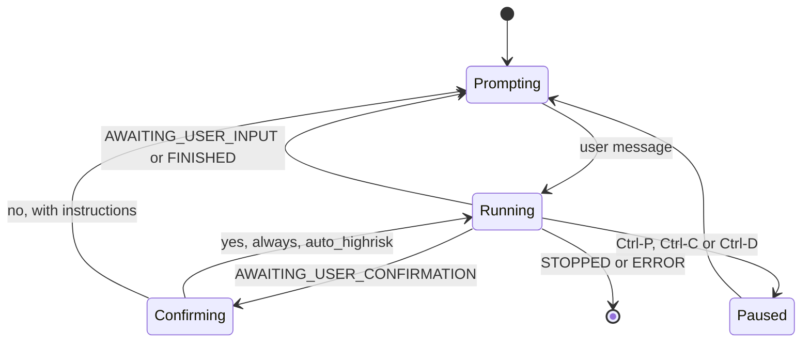

## Overview

The `openhands` command has two subcommands: `serve`, which launches the web GUI in Docker, and `cli`, an interactive terminal session that drives the same controller, runtime and event stream as the server but in one process. Typing `openhands` alone means `openhands cli`. This page covers the terminal session; `serve` is covered in [[Quickstart]].

Sources: [openhands/cli/entry.py:12-48](repo://openhands/cli/entry.py#L12-L48), [openhands/cli/fast_help.py:19-34](repo://openhands/cli/fast_help.py#L19-L34)

## Startup

`entry.main` keeps start-up cheap. `fast_help.handle_fast_commands` answers `--help`, `-h`, `--version` and `-v` (when they are the only argument) with a hand-built, lightweight parser, because loading the full code base took several seconds; the module docstring cites a report of `openhands --help` taking around 20 seconds. Only after that does `main` import the real parser from [[Configuration]], inject `cli` if no subcommand was given, and dispatch to `run_cli_command`.

Sources: [openhands/cli/fast_help.py:1-17](repo://openhands/cli/fast_help.py#L1-L17), [openhands/cli/fast_help.py:82-111](repo://openhands/cli/fast_help.py#L82-L111), [openhands/cli/entry.py:12-48](repo://openhands/cli/entry.py#L12-L48)

`run_cli_command` creates an event loop, runs `main_with_loop` and turns `KeyboardInterrupt` into an "interrupted" message and `ConnectionRefusedError` into exit status 1, cancelling pending tasks at the end.

Sources: [openhands/cli/main.py:758-781](repo://openhands/cli/main.py#L758-L781)

`main_with_loop` then works in five steps.

Sources: [openhands/cli/main.py:565-575](repo://openhands/cli/main.py#L565-L575)

1. Falls back to `~/.openhands/config.toml` when the given config file does not exist, and builds the config with `setup_config_from_args`.
2. Loads settings from a `FileSettingsStore` with no user id. With none saved, it runs `run_setup_flow` first.
3. Applies the settings as the lowest-precedence layer: the settings' LLM model and key are used only when `-l` was not given and the config has no model or key; `confirmation_mode`, the search key and the condenser choice come from settings.
4. Unless `override_cli_mode` is truthy, switches to CLI defaults: runtime `cli`, workspace base the current directory, confirmation mode on, the `llm` security analyzer, and `cli_mode` for the agent. It then calls `finalize_config` again so that Jupyter and browsing are disabled for the CLI runtime.
5. Offers the shell-alias setup once, checks that the folder is trusted (`check_folder_security_agreement`; it exits if the user declines), reads the task from `--file` or the arguments, calls the runtime class's `setup`, runs sessions and calls `teardown`.

Sources: [openhands/cli/main.py:565-612](repo://openhands/cli/main.py#L565-L612), [openhands/cli/main.py:613-700](repo://openhands/cli/main.py#L613-L700), [openhands/cli/main.py:701-781](repo://openhands/cli/main.py#L701-L781)

A file given with `--file` is wrapped in a prompt that asks the agent to read it and then ask the user what to do with it. If a session returns `new_session_requested` (the `/new` command), another `run_session` starts.

Sources: [openhands/cli/main.py:712-755](repo://openhands/cli/main.py#L712-L755)

## The session loop

`run_session` builds the same objects as headless mode ([[OpenHands Overview]]): an LLM registry and conversation stats, an agent, a runtime (with `headless_mode=True`) and a controller. It subscribes `stream_to_console` to the runtime's shell stream so command output appears live, and an `on_event` callback to the event stream as `MAIN`. After connecting the runtime it clones the selected repository if any, creates `Memory`, adds MCP tools while collecting errors for the `/mcp` screen, shows the banner, and then either posts the initial message as a `MessageAction` or prompts for one. `run_agent_until_done` waits for `STOPPED` or `ERROR`, then the session is cleaned up and a termination message is printed.

Sources: [openhands/cli/main.py:125-186](repo://openhands/cli/main.py#L125-L186), [openhands/cli/main.py:299-380](repo://openhands/cli/main.py#L299-L380), [openhands/cli/main.py:420-445](repo://openhands/cli/main.py#L420-L445)

Sources: [openhands/cli/main.py:215-298](repo://openhands/cli/main.py#L215-L298), [openhands/cli/tui.py:872-918](repo://openhands/cli/tui.py#L872-L918)

`on_event_async` reacts to each event: it renders it with `display_event`, updates usage metrics, and on an `AgentStateChangedObservation` decides what to do. When the agent is `AWAITING_USER_INPUT` or `FINISHED` (and not paused) it reloads microagents if `/init` created a repo file, then calls `prompt_for_next_task`. On `PAUSED` it prompts. On `RUNNING` it shows a running message and starts the pause listener.

Sources: [openhands/cli/main.py:187-298](repo://openhands/cli/main.py#L187-L298)

## Confirmation prompts

In the CLI the controller marks every runnable action `AWAITING_CONFIRMATION` and leaves the decision to the terminal ([[Agent Controller Loop]]). On `AWAITING_USER_CONFIRMATION` the session first honours two flags: with "always" on it confirms immediately, and with "auto high-risk" on it confirms any action whose `security_risk` is not `HIGH`. Otherwise `read_confirmation_input` shows a menu. For `HIGH` risk the choices are yes, no (and enter instructions) and always, with a warning. For other risks there is a fourth choice that auto-confirms LOW and MEDIUM actions and asks only for HIGH. The answer becomes a `ChangeAgentStateAction` of `USER_CONFIRMED`, or `USER_REJECTED` followed by a prompt for new instructions.

Sources: [openhands/cli/main.py:231-280](repo://openhands/cli/main.py#L231-L280), [openhands/cli/tui.py:839-870](repo://openhands/cli/tui.py#L839-L870)

While the agent runs, `process_agent_pause` listens for raw key presses and treats Ctrl-P, Ctrl-C or Ctrl-D as a request to pause, adding a `ChangeAgentStateAction(PAUSED)` event.

Sources: [openhands/cli/tui.py:872-918](repo://openhands/cli/tui.py#L872-L918)

## Slash commands

Each line entered at the prompt goes through `handle_commands`; anything that is not a known command becomes a user `MessageAction`.

Sources: [openhands/cli/commands.py:122-173](repo://openhands/cli/commands.py#L122-L173)

| Command | Effect |
| --- | --- |
| `/exit` | Ends the session after confirmation |
| `/help` | Lists the commands |
| `/init` | Where the runtime is `local` or `cli`, asks the agent to write `.openhands/microagents/repo.md` and flags microagents to be reloaded |
| `/status` | Shows usage metrics and session id |
| `/new` | Ends this session and starts a new one |
| `/settings` | Opens the settings editor |
| `/resume` | Continues a paused agent by sending `continue`; refused unless the agent is paused |
| `/mcp` | Lists MCP servers, lets you add or remove them in the config file, and views MCP errors |

Sources: [openhands/cli/commands.py:122-173](repo://openhands/cli/commands.py#L122-L173), [openhands/cli/commands.py:204-234](repo://openhands/cli/commands.py#L204-L234), [openhands/cli/commands.py:296-322](repo://openhands/cli/commands.py#L296-L322), [openhands/cli/commands.py:431-456](repo://openhands/cli/commands.py#L431-L456)

## Display

`tui.display_event` is a dispatcher over event types: commands (thought first, then the command if not yet confirmed), MCP actions and observations, task-tracking actions, agent messages with light markdown rendering, command output, file edits and reads, agent state changes and errors. Streaming shell output is shown through `initialize_streaming_output` and `update_streaming_output`, fed by the runtime's shell stream.

Sources: [openhands/cli/tui.py:260-306](repo://openhands/cli/tui.py#L260-L306), [openhands/cli/tui.py:589-618](repo://openhands/cli/tui.py#L589-L618)
