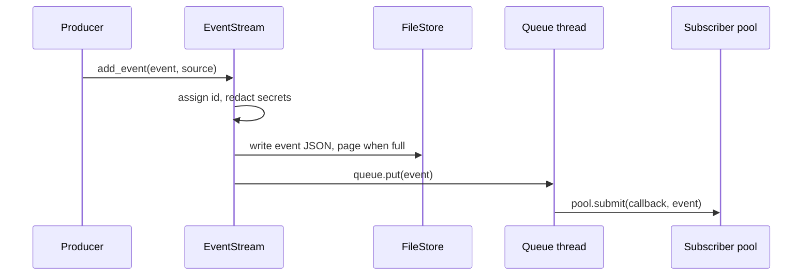

## Overview

Everything that happens in a conversation is an `Event`: either an `Action` (a request to do something) or an `Observation` (information from the environment). Components never call each other with these; they add events to an `EventStream` and subscribe to it. The stream numbers each event, redacts secrets, persists it to a file store and fans it out to subscribers on a background thread. The consumers are described in [[Agent Controller Loop]], [[Runtime and Action Execution Server]] and [[Server, Conversations and Sessions]].

Sources: [openhands/events/stream.py:43-69](repo://openhands/events/stream.py#L43-L69), [openhands/events/stream.py:163-203](repo://openhands/events/stream.py#L163-L203)

## The event model

`Event` is a dataclass whose metadata is held in underscore attributes exposed through properties: `id`, `timestamp`, `source`, `cause`, `timeout`, `llm_metrics`, `tool_call_metadata` and `response_id`. An id of `-1` (`Event.INVALID_ID`) means the event has not been added to a stream yet. `source` is an `EventSource`: `AGENT`, `USER` or `ENVIRONMENT`. `cause` holds the id of the event that triggered this one, which is how an observation is tied to its action.

Sources: [openhands/events/event.py:9-12](repo://openhands/events/event.py#L9-L12), [openhands/events/event.py:35-131](repo://openhands/events/event.py#L35-L131)

`Action` adds a class flag `runnable` (false by default) and `Observation` adds a `content` string. `CmdRunAction` shows the usual shape: the command plus flags such as `blocking`, `is_input` and `hidden`, a `confirmation_state` and a `security_risk`. Both of those two fields feed the confirmation flow in [[Agent Controller Loop]] and the analyzers in [[MCP Tools and Security Analyzers]].

Sources: [openhands/events/action/action.py:8-23](repo://openhands/events/action/action.py#L8-L23), [openhands/events/observation/observation.py:5-14](repo://openhands/events/observation/observation.py#L5-L14), [openhands/events/action/commands.py:10-40](repo://openhands/events/action/commands.py#L10-L40)

`ActionSecurityRisk` is an int enum (`UNKNOWN` -1, `LOW` 0, `MEDIUM` 1, `HIGH` 2) and `ActionConfirmationStatus` is `CONFIRMED`, `REJECTED` or `AWAITING_CONFIRMATION`.

Sources: [openhands/events/action/action.py:8-19](repo://openhands/events/action/action.py#L8-L19)

The set of actions the platform knows is the `actions` tuple in the serializer: shell and IPython commands, URL and interactive browsing, file read, write and edit, the agent-control actions (think, finish, reject, delegate, change state, task tracking), `RecallAction` for retrieving workspace context or microagent knowledge, the two condensation actions, `MCPAction`, and the message actions. Each class declares an `action` string, and `ACTION_TYPE_TO_CLASS` maps that string back to the class.

Sources: [openhands/events/serialization/action.py:30-53](repo://openhands/events/serialization/action.py#L30-L53)

## Serialization

`event_to_dict` writes the keys in `TOP_KEYS` (id, timestamp, source, message, cause, action or observation, tool call metadata, LLM metrics) at the top level and puts every other dataclass field under `args` for actions, or `content` and `extras` for observations. `event_from_dict` reverses this: an `action` key goes to `action_from_dict`, an `observation` key to `observation_from_dict`, anything else raises, and the underscore metadata is restored with `setattr`.

Sources: [openhands/events/serialization/event.py:52-91](repo://openhands/events/serialization/event.py#L52-L91), [openhands/events/serialization/event.py:100-140](repo://openhands/events/serialization/event.py#L100-L140)

`action_from_dict` is also the entry point for decoding what an LLM produced, so it raises `LLMMalformedActionError` for a non-dict, a missing or unknown `action` key, or arguments the class rejects. It carries compatibility shims for older streams: `is_confirmed` becomes `confirmation_state`, `images_urls` becomes `image_urls`, an integer `security_risk` becomes the enum (an invalid value is dropped), and `handle_action_deprecated_args` drops `keep_prompt` and `task_completed` and rewrites an old `translated_ipython_code` file-editor call back into plain arguments.

Sources: [openhands/events/serialization/action.py:56-153](repo://openhands/events/serialization/action.py#L56-L153)

Trajectory export removes bulky browser fields (`dom_object`, `axtree_object`, and so on) and, optionally, screenshots, using `DELETE_FROM_TRAJECTORY_EXTRAS`.

Sources: [openhands/events/serialization/event.py:36-49](repo://openhands/events/serialization/event.py#L36-L49)

## Adding an event

`EventStream.add_event` adds one event as follows.

Sources: [openhands/events/stream.py:163-203](repo://openhands/events/stream.py#L163-L203)

1. Rejects an event that already has an id, with a message that it was probably re-added from inside a handler and is looping.
2. Stamps `timestamp` and `source`.
3. Under `_lock`, takes the next id from `cur_id`, serializes the event, runs `_replace_secrets`, rebuilds the event from the redacted dictionary and appends the dictionary to the current write page. A full page (`cache_size`, 25 by default) is swapped for a fresh one so other threads keep appending.
4. Outside the lock, writes the event JSON to `file_store` under its id (warning when it exceeds about 1 MB), and writes the page file once the page is full.
5. Puts the redacted event on the in-memory `queue.Queue`.

Sources: [openhands/events/stream.py:163-213](repo://openhands/events/stream.py#L163-L213), [openhands/events/event_store.py:43-52](repo://openhands/events/event_store.py#L43-L52)

Sources: [openhands/events/stream.py:163-203](repo://openhands/events/stream.py#L163-L203), [openhands/events/stream.py:254-275](repo://openhands/events/stream.py#L254-L275)

Secret redaction replaces each value in `secrets` found in a string field with `<secret_hidden>`. It skips the top-level fields `timestamp`, `id`, `source`, `cause`, `action`, `observation` and `message`, but recurses into nested dictionaries. Secrets are set with `set_secrets` or merged with `update_secrets`.

Sources: [openhands/events/stream.py:215-244](repo://openhands/events/stream.py#L215-L244)

## Subscribers and delivery

`subscribe(subscriber_id, callback, callback_id)` creates a one-worker `ThreadPoolExecutor` whose initializer gives that callback its own asyncio loop. A repeated `callback_id` under the same subscriber raises `ValueError`. `EventStreamSubscriber` names the fixed subscriber kinds: `AGENT_CONTROLLER`, `RESOLVER`, `SERVER`, `RUNTIME`, `MEMORY`, `MAIN` and `TEST`.

Sources: [openhands/events/stream.py:23-30](repo://openhands/events/stream.py#L23-L30), [openhands/events/stream.py:130-148](repo://openhands/events/stream.py#L130-L148)

A daemon thread started in the constructor runs `_process_queue`. It polls the queue every 0.1 s and, for each event, visits subscriber kinds in sorted order and submits the callback to each callback's pool. Because each callback has one worker, a callback sees events in id order; separate callbacks run concurrently and independently, and one slow callback does not block another. A callback exception is logged and re-raised from its future's done handler.

Sources: [openhands/events/stream.py:246-291](repo://openhands/events/stream.py#L246-L291)

`close` sets the stop flag, joins the queue thread, cleans up every subscriber (cancelling tasks on its loop and shutting down its pool) and drains the queue.

Sources: [openhands/events/stream.py:78-128](repo://openhands/events/stream.py#L78-L128)

## Reading history

`EventStore` is the read side that `EventStream` extends. `cur_id` is computed lazily by listing the events directory and taking the highest numeric filename plus one, or 0 when there are none. `search_events` iterates ids from `start_id` to `end_id` (inclusive on input), optionally in reverse, applying an `EventFilter` and a `limit`, and stops early when `should_continue()` turns false on shutdown.

Sources: [openhands/events/event_store.py:53-136](repo://openhands/events/event_store.py#L53-L136)

To avoid one file read per event, `search_events` first asks `_load_cache_page_for_index` for the page file `event_cache/<start>-<end>.json` that covers the index. If the page file is missing, `_CachePage.get_event` returns nothing and the loop falls back to `get_event`, which reads the single event file. Pages are only written once full, so recent events are always read individually.

Sources: [openhands/events/event_store.py:19-40](repo://openhands/events/event_store.py#L19-L40), [openhands/events/event_store.py:118-142](repo://openhands/events/event_store.py#L118-L142), [openhands/events/event_store.py:158-175](repo://openhands/events/event_store.py#L158-L175)

`EventFilter.include` combines its criteria with AND: included types, excluded types, source, then the remaining query, date and hidden checks. File paths come from [[Storage, Settings and Secrets]].

Sources: [openhands/events/event_filter.py:9-60](repo://openhands/events/event_filter.py#L9-L60)
