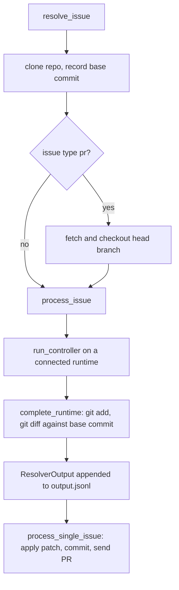

## Overview

OpenHands talks to GitHub, GitLab and Bitbucket in three places: the server uses provider services to list repositories and branches for the UI, the runtime clones repositories and hands tokens to the agent's shell, and the agent can open pull requests through MCP tools. Separately, the resolver in `openhands/resolver` runs an agent on an issue or on pull-request review comments and then sends the result back as a pull request. A single class, `ProviderHandler`, sits in front of the per-provider services.

Sources: [openhands/integrations/provider.py:105-160](repo://openhands/integrations/provider.py#L105-L160), [openhands/resolver/issue_resolver.py:52-60](repo://openhands/resolver/issue_resolver.py#L52-L60)

## Provider tokens and ProviderHandler

### Token model and provider lookup

Credentials travel as `ProviderToken` objects (frozen pydantic models holding a `SecretStr` token, an optional `user_id` and an optional custom `host`), grouped in a read-only `MappingProxyType` keyed by `ProviderType`. `ProviderHandler.__init__` rejects anything that is not a `MappingProxyType`, and maps each provider type to a service class (`GithubServiceImpl`, `GitLabServiceImpl`, `BitBucketServiceImpl`). `_get_service` builds a service from the stored token each time it is needed.

Sources: [openhands/integrations/provider.py:41-67](repo://openhands/integrations/provider.py#L41-L67), [openhands/integrations/provider.py:105-160](repo://openhands/integrations/provider.py#L105-L160)

Most methods try one provider if the caller names it, or loop over every provider that has a token and tolerate individual failures: `get_user` returns the first provider's user, `get_repositories` and `get_suggested_tasks` concatenate results while logging errors per provider, and `get_branches` returns an empty page when none of them answers. `verify_repo_provider` tries the named provider first, then the others, and raises `AuthenticationError` if none can read the repository.

Sources: [openhands/integrations/provider.py:162-170](repo://openhands/integrations/provider.py#L162-L170), [openhands/integrations/provider.py:213-258](repo://openhands/integrations/provider.py#L213-L258), [openhands/integrations/provider.py:447-512](repo://openhands/integrations/provider.py#L447-L512)

### Tokens in the sandbox

`get_env_vars` returns the tokens either as typed secrets or, with `expose_secrets`, as strings keyed `github_token`, `gitlab_token` or `bitbucket_token`. With `get_latest` it fetches a fresh token from the web host's `/api/refresh-tokens` endpoint, using the session API key. `set_event_stream_secrets` registers the exposed values as the stream's secrets so they are redacted from every stored event ([[Events and the Event Stream]]). `check_cmd_action_for_provider_token_ref` looks for those variable names inside a `CmdRunAction`, which is how the runtime knows to refresh tokens before a command that uses one ([[Runtime and Action Execution Server]]).

Sources: [openhands/integrations/provider.py:172-193](repo://openhands/integrations/provider.py#L172-L193), [openhands/integrations/provider.py:338-446](repo://openhands/integrations/provider.py#L338-L446), [openhands/runtime/base.py:324-359](repo://openhands/runtime/base.py#L324-L359)

`get_authenticated_git_url` first resolves which provider owns the repository, then builds the clone URL with the token embedded: `https://<token>@host/...` for GitHub, `https://oauth2:<token>@...` for GitLab, and for Bitbucket either `username:app_password` or `x-token-auth:<token>`; with no token it returns the plain HTTPS URL. A custom host in the token replaces the default domain.

Sources: [openhands/integrations/provider.py:613-661](repo://openhands/integrations/provider.py#L613-L661)

## Service classes

Each provider service implements the `GitService` protocol in `service_types.py`: `get_user`, `search_repositories`, `get_all_repositories`, `get_paginated_repos`, `get_suggested_tasks`, `get_repository_details_from_repo_name`, branch listing and search, microagent listing and content, `get_pr_details` and `is_pr_open`. `BaseGitService` supplies the shared microagent-parsing helpers, and the errors callers handle are `AuthenticationError`, `RateLimitError`, `ResourceNotFoundError` and `UnknownException`.

Sources: [openhands/integrations/service_types.py:163-200](repo://openhands/integrations/service_types.py#L163-L200), [openhands/integrations/service_types.py:437-541](repo://openhands/integrations/service_types.py#L437-L541)

`GitHubService` is assembled from feature mixins: branches, features (suggested tasks and microagent lookups), pull requests, repositories and resolver helpers, plus `BaseGitService`. Its default `BASE_URL` and `GRAPHQL_URL` point at `api.github.com`, and a custom `base_domain` switches them to `https://<domain>/api/v3` and `/api/graphql` for GitHub Enterprise. `GithubServiceImpl` is resolved with `get_impl` from the `OPENHANDS_GITHUB_SERVICE_CLS` environment variable, so an application can substitute its own class; GitLab and Bitbucket follow the same layout in their own packages.

Sources: [openhands/integrations/github/github_service.py:21-78](repo://openhands/integrations/github/github_service.py#L21-L78)

The GitHub base mixin sends requests with a `Bearer` token header, retries once after fetching a fresh token when the response says the token expired, and exposes `execute_graphql_query`, which raises `UnknownException` when the reply carries `errors`.

Sources: [openhands/integrations/github/service/base.py:24-107](repo://openhands/integrations/github/service/base.py#L24-L107)

## Opening pull requests from the agent

The server hosts a FastMCP server named `mcp` whose tools are `create_pr` (GitHub), `create_mr` (GitLab) and `create_bitbucket_pr`. `create_pr` reads the conversation id from the `X-OpenHands-ServerConversation-ID` header that `MCPClient.connect_http` sends ([[MCP Tools and Security Analyzers]]), builds a `GithubServiceImpl` from the request's provider tokens, and calls `create_pr` with source and target branches, title, body, draft (default true) and optional labels. Errors are raised as `ToolError`.

Sources: [openhands/server/routes/mcp.py:26-28](repo://openhands/server/routes/mcp.py#L26-L28), [openhands/server/routes/mcp.py:83-148](repo://openhands/server/routes/mcp.py#L83-L148), [openhands/mcp/client.py:57-80](repo://openhands/mcp/client.py#L57-L80)

In SaaS mode the PR body is extended with a link back to the conversation, and after creation `save_pr_metadata` extracts the number from the returned URL (`pull/<n>` or `merge_requests/<n>`) and appends it to the conversation's stored metadata.

Sources: [openhands/server/routes/mcp.py:34-80](repo://openhands/server/routes/mcp.py#L34-L80)

## The issue resolver

The resolver is a batch pipeline in two stages. `IssueResolver` produces a `ResolverOutput`: the `Issue` (owner, repo, number, title, body, thread and review comments, head and base branches), the instruction given to the agent, the base commit, the resulting `git_patch`, the event history, metrics, a success flag and an explanation. `send_pull_request.py` then turns that output into a branch and PR.

Sources: [openhands/resolver/interfaces/issue.py:12-24](repo://openhands/resolver/interfaces/issue.py#L12-L24), [openhands/resolver/resolver_output.py:8-19](repo://openhands/resolver/resolver_output.py#L8-L19)

`IssueHandlerFactory.create` picks a handler by issue type and platform: for type `issue` a `ServiceContextIssue` wrapping `GithubIssueHandler`, `GitlabIssueHandler` or `BitbucketIssueHandler`, and for type `pr` a `ServiceContextPR`. Any other platform raises `ValueError`. Handlers implement `IssueHandlerInterface` (download issues, comments, URLs, branch checks, creating pull requests and so on).

Sources: [openhands/resolver/issue_handler_factory.py:15-110](repo://openhands/resolver/issue_handler_factory.py#L15-L110), [openhands/resolver/interfaces/issue.py:27-125](repo://openhands/resolver/interfaces/issue.py#L27-L125)

Sources: [openhands/resolver/issue_resolver.py:535-600](repo://openhands/resolver/issue_resolver.py#L535-L600), [openhands/resolver/issue_resolver.py:397-465](repo://openhands/resolver/issue_resolver.py#L397-L465), [openhands/resolver/send_pull_request.py:502-585](repo://openhands/resolver/send_pull_request.py#L502-L585)

`resolve_issue` clones the repository into `<output_dir>/repo`, records `HEAD` as the base commit, reads `.openhands_instructions` as repository instructions if none were given, and skips an issue already present in `output.jsonl`. For a PR it first checks out the head branch. `process_issue` copies the repo to the workspace, creates and connects a runtime, runs `initialize_runtime` (git config, the repository setup script and git hooks), asks the handler for the instruction text, and calls `run_controller` with the instruction as a `MessageAction`, using `codeact_user_response` for automated answers ([[OpenHands Overview]] describes `run_controller`).

Sources: [openhands/resolver/issue_resolver.py:535-620](repo://openhands/resolver/issue_resolver.py#L535-L620), [openhands/resolver/issue_resolver.py:397-465](repo://openhands/resolver/issue_resolver.py#L397-L465), [openhands/resolver/issue_resolver.py:267-307](repo://openhands/resolver/issue_resolver.py#L267-L307)

When the agent stops, `complete_runtime` stages everything with `git add -A` and takes `git diff --no-color --cached <base_commit>` as the patch, retrying if the diff fails. `issue_handler.guess_success` then judges success from the history, issue and patch. If the agent raised, the output records success false and the error text.

Sources: [openhands/resolver/issue_resolver.py:309-387](repo://openhands/resolver/issue_resolver.py#L309-L387), [openhands/resolver/issue_resolver.py:466-517](repo://openhands/resolver/issue_resolver.py#L466-L517)

`process_single_issue` skips an unsuccessful result unless `send_on_failure` is set. Otherwise it re-creates the repository at the base commit (or the PR's head branch), applies the patch, makes a commit, and either updates the existing pull request (for type `pr`) or calls `send_pull_request`. That function takes a `pr_type` of `branch` (push only, no PR), `draft` or `ready`, and optional fork owner, target branch, reviewer and title.

Sources: [openhands/resolver/send_pull_request.py:233-260](repo://openhands/resolver/send_pull_request.py#L233-L260), [openhands/resolver/send_pull_request.py:502-585](repo://openhands/resolver/send_pull_request.py#L502-L585)
